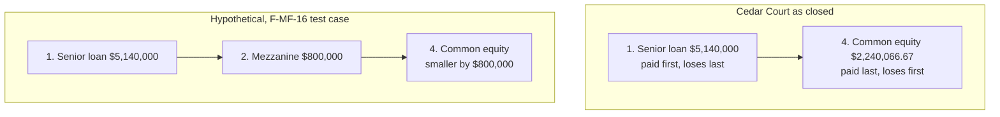
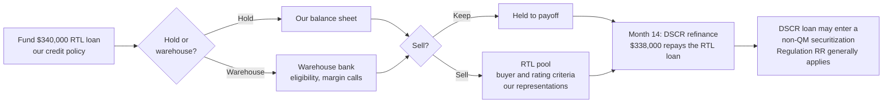
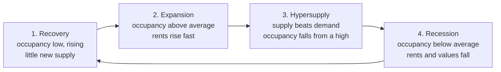
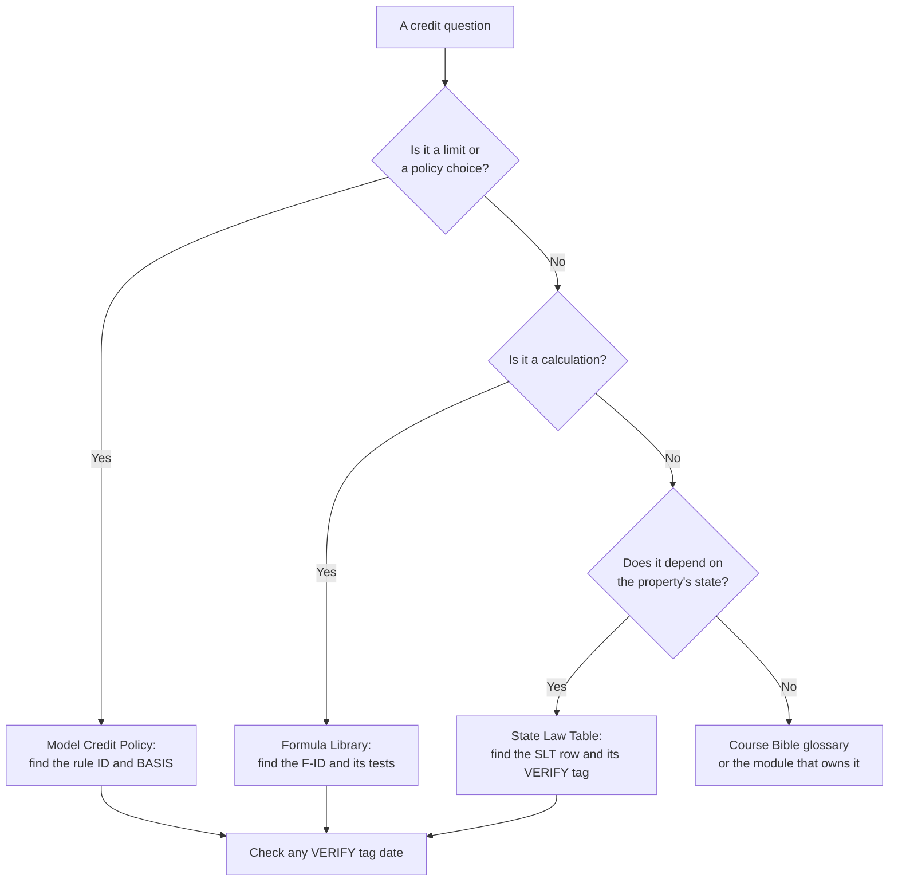

**Model policy for training - not for live lending decisions.** Fictional deal data only. Market figures are real, sourced and dated.

| Item | Detail |
| --- | --- |
| Assets in this tab | C0-lesson-v0, C0-quiz-v0 (sets A and B), C0-ojt-v0, C0-jobaid-v0 |
| Hours | 2.0 CPE credits projected (QAS Self Study word-count formula, about 105 minutes; blueprint section 7; final count after Phase 3), plus a 30-minute OJT task |
| Prerequisite | None |
| Objectives | O1-O6 (docs/curriculum/c00-blueprint.md, section 2): distinguish loan types; explain the capital stack and regulators; trace a funding route; calculate and reconcile market figures; analyze cycle risk to a bridge exit; locate rule, formula, state and source IDs |
| Bloom's levels | 2 to 4: two Understand, three Apply, one Analyze (LD-02) |
| Formulas | Applied in worked examples, taught in C3 and C8: F-CORE-04; F-CORE-13; F-CORE-14; F-RES-04; F-MF-14; F-MF-16; F-MF-20; F-MF-25; F-MF-27. Shares, growth rates and point changes are plain arithmetic, with no library ID |
| Rules | CORE-BOR-01; CORE-BP-01; RES-GEN-04; RES-FF-03; MF-MEZ-01 to -03; COM-BR-05; COM-BR-07; COM-BR-09; CORE-VAL-01; CORE-BOR-06; CORE-CONC-01 to -07; CORE-EXC-01; CORE-SVC-07; CORE-AUTH-01 (lookup only). Term rules: RES-FF-11; RES-GU-09; RES-DSCR-10; MF-BR-11; COM-BR-01. All preview only |
| Glossary | Item 12 (bridge loan); Main Sections 2 and 3 |
| Running deals | All three, introduced (LD-08) |
| Status | v0. Self-review against Bible Section 7 is at the end of this tab |
| Change log | v0, 20 Nov 2026: first draft. Market data checked 20 Nov 2026 v0.2, 22 Nov 2026: review fixes, policy decisions D-CORE-17 onward, self-check v1.0-draft, 22 Nov 2026: rewritten to blueprint (Phase 2 pilot) |

## Timing plan

| Segment (LD-04) | Minutes |
| --- | --- |
| 1 Hook | 3 |
| 2 Objectives | 2 |
| 3 Teach chunks T1-T6, with worked examples (10,248 counted words ÷ 180) | 57 |
| 5 Practice (7 items, 3 of them scored exercises) | 15 |
| 6 Quiz (current v0 sets; Phase 3 rebuilds them) | 10 |
| 8 Job aid walk-through and wrap-up | 5 |
| Total | 92 |
| 7 OJT task (extra, per LD-03) | 30 |
| Credit basis | QAS credit uses the word-count formula, not this plan: 2.0 credits projected (blueprint section 7) |

## 1. Hook (3 minutes)

A Columbus investor buys a tired house, fixes it and plans to rent it out. A limited liability company (LLC) buys a 50-unit apartment block in Charlotte to renovate. Another buys a 70%-leased strip center in Indianapolis and plans to fill it.

None of these properties earns what it could yet, so none fits a bank's standard loan. All of them can get a business-purpose loan (BPL), repaid when the plan succeeds.

That is the market you are joining. You will follow these three deals through the whole course, from first call to payoff.

## 2. Objectives

By the end of C0, you will be able to:

1. **Distinguish** a business-purpose loan from bank, agency and consumer mortgage loans by borrower, collateral, term, repayment source and governing law (Understand; T1).
2. **Explain** where banks, debt funds, mortgage REITs and specialist BPL lenders sit in the capital stack, and which regulator or law reaches each (Understand; T2).
3. **Trace** a running-deal loan through a funding route, naming the party whose eligibility criteria and risk-retention rule apply at each step (Apply; T3).
4. **Calculate** shares, growth rates and percentage-point changes from a named primary data series, and reconcile each to its published headline (Apply; T4).
5. **Analyze** how a market-cycle phase and four indicators change the refinance and collateral risk of a bridge loan (Analyze; T5).
6. **Locate**, for a given credit question, the governing rule ID, formula ID, State Law Table row and [VERIFY] source in the course tabs (Apply; T6).

Four of the six objectives are at Apply or above. C0 teaches no job task in full. It previews fifteen tasks from the needs analysis, and T6 names the module that teaches each.

## 3. Teach

### T1. What a business-purpose loan is: five products and their exits (O1)

**The point.** A business-purpose loan (BPL) lends to an entity against property held for income or profit. A sale, a refinance or the property's rent repays it, not the owner's salary.

#### Four kinds of real estate loan

You already know the home mortgage. A family borrows, buys a house, lives in it and repays from wages.

Lenders, regulators and investors treat that loan very differently from the loans in this course. The table compares four kinds of real estate credit on five features.

| Feature | Consumer home mortgage | Agency multifamily loan | Bank commercial real estate loan | Business-purpose loan (our market) |
| --- | --- | --- | --- | --- |
| Borrower | A natural person, often a couple | A single-purpose entity owned by an experienced sponsor | An entity or an individual investor | An entity: LLC, limited partnership (LP) or corporation |
| Collateral | The borrower's own home | A stabilized apartment property, usually 5+ units | Stabilized offices, shops, warehouses and apartments | Properties in transition: a house to renovate, an apartment block to upgrade, a center to lease up |
| Term | Long, and commonly fully amortizing | Medium to long, usually ending in a balloon payment | Short to medium, often ending in a balloon payment | 12-36 months for our bridge loans; 30 years for our debt service coverage ratio (DSCR) rental loan (RES-DSCR-10) |
| Repayment source | The borrower's income | The property's stabilized net cash flow | Property cash flow, plus the borrower's other income | An exit: a sale, a refinance into a long-term loan, or rent |
| Governing law | Consumer protection law: disclosures, ability to repay, loan originator licensing | Commercial law; the agency's own guide | Commercial law; bank safety-and-soundness rules | Commercial law; most consumer rules do not apply if the purpose test is met |

Two words in the table carry most of the meaning. "Transition" means the property is not yet earning what it could. "Exit" means the event that pays our loan off.

A bank or agency lender wants a property that already works. A BPL lender lends because the property does not work yet.

#### What makes a loan "business-purpose"

The main federal consumer credit law is the Truth in Lending Act (TILA). Its rule, Regulation Z, exempts two kinds of credit.

The first is credit "primarily for a business, commercial or agricultural purpose." The second is credit "to other than a natural person" [VERIFY: 12 CFR 1026.3(a)(1)-(2); law.cornell.edu/cfr/text/12/1026.3; checked 22 Nov 2026].

That exemption is why our loans look so different. A consumer mortgage needs set disclosures, ability-to-repay analysis and limits on certain fees and terms [VERIFY: 12 CFR 1026.19(e)(1)(i), 1026.32(d), 1026.43(a), (c)(1); law.cornell.edu/cfr/text/12/1026.19, /1026.32, /1026.43; checked 22 Nov 2026]. A loan that falls outside Regulation Z generally does not.

The trade-off is that a lender who gets the purpose wrong can lose the exemption. Then every missing consumer disclosure becomes a defect.

Loan originator licensing follows the same line. The federal SAFE Act requires people who originate a "residential mortgage loan" to be state-licensed or federally registered [VERIFY: 12 U.S.C. 5103(a)(1); law.cornell.edu/uscode/text/12/5103; checked 22 Nov 2026]. That term means a loan "primarily for personal, family, or household use" secured by a dwelling, or by residential land meant for one [VERIFY: 12 U.S.C. 5102(9); law.cornell.edu/uscode/text/12/5102; checked 22 Nov 2026].

A loan to an LLC to renovate a rental house is generally outside that definition. State licensing laws can still apply, and each state draws the line differently. You will meet that in the State Law Table and in C10.

C0 only names these two exemptions. C1 teaches the purpose test in full, including the occupancy questions that decide hard cases.

#### How our model policy applies the rule

Our model policy turns the legal line into three simple rules:

1. **Entity borrowers only.** The borrower is an LLC, LP or corporation formed in a US state and in good standing. Individuals and trusts are ineligible (CORE-BOR-01). Lending only to entities keeps us inside the non-natural-person exemption as well as the business-purpose one.
2. **A signed purpose certification.** The borrower and every guarantor certify business purpose and non-occupancy before closing (CORE-BP-01). The certification is evidence, not proof. C1 shows how an occupancy red flag can override it.
3. **A size range for residential loans.** Residential loans run from $75,000 to $2,000,000. Larger loans go to committee (RES-GEN-04).

**Why the entity rule is stricter than the law.** Regulation Z exempts business-purpose credit even to a natural person [VERIFY: 12 CFR 1026.3(a)(1); law.cornell.edu/cfr/text/12/1026.3; checked 22 Nov 2026]. Many lenders do lend to individuals.

Our policy is MARKET-based: it follows residential transition loan (RTL) lenders that require an entity (OfferMarket, Apr 2025, as cited in CORE-BOR-01). DSCR programs that lend to individuals are the looser end of the market (Griffin, Aug 2026). A simpler rule means fewer purpose disputes.

#### The five products

Our policy groups loans into three families: Residential (1-4 units), Multifamily (5 or more units) and Commercial (retail, office, industrial and specialty property). Inside those families, five products make up most of the market.

| Product | Family | What it funds | Term in our model policy | How it is repaid (the exit) | Main risk |
| --- | --- | --- | --- | --- | --- |
| Residential transition loan (RTL): fix-and-flip or bridge | Residential 1-4 | Purchase plus renovation of a house to sell or rent | 12 months, plus 2 × 3-month extensions (RES-FF-11) | Sale at the after-repair value (ARV), or refinance into a DSCR loan | Renovation runs late or over budget; ARV is too high |
| Ground-up construction | Residential 1-4 | Land plus building a new house | 18 months, plus 2 × 3-month extensions (RES-GU-09) | Sale of the finished house, or a refinance | Builder fails to finish; costs rise |
| Debt service coverage ratio (DSCR) rental loan | Residential 1-4 | A rented house held long term | 30-year fixed, fully amortizing; 5/6 and 7/6 adjustable-rate mortgages (ARMs) allowed (RES-DSCR-10) | The property's rent, month by month | Rent falls below the payment; the tenant leaves |
| Multifamily (MF) bridge | Multifamily 5+ | Purchase plus upgrades of an apartment property | 24 months, plus 2 × 6-month extensions (MF-BR-11) | Refinance into a term loan once rents rise | Rents or occupancy miss the plan; rates rise before the refinance |
| Commercial (COM) bridge | Commercial | Purchase plus leasing of a part-empty commercial property | Up to 24 months, plus up to 2 × 6-month extensions (COM-BR-01) | Refinance after lease-up, or a sale | Tenants do not sign; a large tenant leaves |

Notice that four of the five are bridge loans. Only the DSCR loan is repaid by the property's own monthly income. That is why the course keeps asking one question: what is the exit, and how sure is it?

#### What a bridge loan bridges

A bridge loan carries a property across a gap. On one side is the property as it is today: vacant, tired or part-leased. On the other side is the property as it will be: renovated, leased and worth more.

The bridge lender is paid when the property reaches the far side.

That design has a consequence. Today's value protects the bridge lender only partly. The rest of the protection comes from the future value and the future loan.

If the future arrives late or smaller, the exit can fail. A credit officer therefore underwrites two things at once: the property today and the path to the exit.

Bridge loans also behave differently from long-term loans in three ways.

- **Interest only.** Most bridge loans pay interest only, so the balance does not fall. The whole loan is due at maturity.
- **Future funding.** Part of the loan is often held back and released as work is done. The balance grows during the loan.
- **Short term.** A 12- to 36-month term means the exit arrives soon. Market conditions at maturity matter more than at closing.

**Worked example 1: classify the three running deals.**

Each running deal is one product. Read each row as a credit officer would: who borrows, what the money does, and what repays it.

| Item | Maple Run (RD-RES-01) | Cedar Court (RD-MF-01) | Birchwood Plaza (RD-COM-01) |
| --- | --- | --- | --- |
| State | Ohio | North Carolina | Indiana |
| Borrower | Harborline Holdings LLC | Cedar Court Partners LLC | Birchwood Plaza LLC |
| Family | Residential 1-4 | Multifamily 5+ | Commercial |
| Product | RTL fix-and-flip | Value-add MF bridge | COM bridge (unanchored retail) |
| Collateral | Single-family house, vacant, 1,640 square feet (sf) | 50 units, 88% leased | 40,000 sf strip center, 70% leased |
| Total commitment | $340,000 | $5,140,000 | $3,520,000 |
| Repayment source | The exit, not today's income | The exit, not today's income | The exit, not today's income |
| Planned exit | Renovate in 5 months, lease, then refinance into a DSCR loan. Back-up: sell at the $520,000 ARV | Renovate over 18 months, then refinance into a term loan | Lease up the empty 12,000 sf, then refinance into a term loan |
| What happens in the deal file | Month 14: DSCR refinance approved at $338,000 | Month 27: term loan of $5,472,000 repays the bridge | Month 24: term loan of $3,900,000 repays the bridge |

Now test two of the policy rules on Maple Run.

1. **CORE-BOR-01, entity test.** Inputs: borrower Harborline Holdings LLC, an Ohio LLC formed 2021, in good standing (RD-RES-01). Substitution: an LLC formed in a US state and in good standing meets the rule. Result: eligible borrower.
2. **RES-GEN-04, size test.** Inputs: commitment $340,000; range $75,000 to $2,000,000. Substitution: $75,000 ≤ $340,000 ≤ $2,000,000. Result: inside the range, so no committee referral for size.

Then measure Maple Run's leverage the way an RTL lender does, on cost.

- **Formula F-RES-04: loan-to-cost (LTC) = total loan ÷ (purchase price + rehab budget).**
- **Inputs:** total loan $340,000; price $300,000; rehab $100,000 (RD-RES-01).
- **Substitution:** $340,000 ÷ ($300,000 + $100,000) = $340,000 ÷ $400,000 = 0.850000.
- **Result:** LTC 85.0%, exactly at the Tier 2 cap of 85% (RES-FF-03). The loan passes at the limit.

The two bridge exits are refinances, so their repayment depends on a future lender. The Maple Run exit is a refinance too, but with a sale as a back-up. That back-up is why a flip lender sizes on cost and ARV, not only on rent.

**Why it matters to a credit officer.** The product decides which rules apply, which test binds and what can go wrong. Classify every request first. Then ask what repays it and how sure that exit is.

### T2. The capital stack, the lenders and their regulators (O2)

**The point.** Every property is funded by layers of capital that are paid in a set order. Who sits in which layer, and which regulator watches them, explains why lenders' terms differ.

#### The capital stack

A property's "capital stack" is every source of money that bought it, ranked by who is paid first. Think of it as a column. Repayment flows from the top down, and losses flow from the bottom up.

| Layer (paid in this order) | What it is | Security | Return | Who loses first if value falls |
| --- | --- | --- | --- | --- |
| 1. Senior debt | A first-lien mortgage loan, like ours | A recorded lien on the property | Lowest: fixed or floating interest | Last |
| 2. Mezzanine debt | A loan to the owner of the borrowing entity | A pledge of the ownership interests, not the property | Higher interest | Third |
| 3. Preferred equity | An ownership class with a priority return | Rights in the entity's operating agreement | A preferred return, often with a share of profit | Second |
| 4. Common equity | The sponsor's and investors' own cash | None: it owns what is left | All profit after the layers above | First |

Each layer is paid only after every layer above it is paid in full. That ordering is what makes the bottom layer "first loss." If a property sells for less than the total debt, common equity is wiped out first.

Preferred equity goes next, then mezzanine. The senior lender loses only when the sale price falls below its own loan.

Two features make the senior position safe but not risk-free.

- **The cushion.** The layers beneath you absorb losses before you do. Their size, as a share of value, is your cushion.
- **The behavior of the layers below.** More debt beneath you is not a cushion. Mezzanine and hard-pay preferred equity need cash every month, so they raise the chance the borrower defaults.

Our model policy reflects both features. We do not originate mezzanine or preferred equity. Our senior loans allow them only with our written consent and an intercreditor or recognition agreement (MF-MEZ-01).

With subordinate debt in place, total debt is capped at 85% of cost and 80% of as-stabilized value. Combined DSCR must be at least 1.10x (MF-MEZ-02; formulas F-MF-16 and F-MF-27). Preferred equity with a fixed payment or a forced-sale right counts as debt (MF-MEZ-03).

The diagram shows Cedar Court's two-layer stack, and the same deal with a mezzanine layer added. Arrows run in payment order.

**Worked example 2: Cedar Court's capital stack (RD-MF-01).**

Cedar Court has two layers: our senior loan and the owners' equity. Build the stack from sources and uses.

| Uses of funds | Amount | Sources of funds | Amount |
| --- | --: | --- | --: |
| Purchase price | $6,200,000.00 | Senior loan, initial funding (MF-BR-02) | $4,340,000.00 |
| Closing costs | $200,000.00 | Senior loan, capital expenditure (capex) future funding (MF-BR-10) | $800,000.00 |
| Origination fee, 1.00% | $51,400.00 | Equity: owners' cash to close | $2,240,066.67 |
| Rate cap | $60,000.00 |  |  |
| Repair escrow | $50,000.00 |  |  |
| Tax and insurance escrow cushion | $18,666.67 |  |  |
| Capex plan | $800,000.00 |  |  |
| **Total uses** | **$7,380,066.67** | **Total sources** | **$7,380,066.67** |

1. **Senior share of the stack.** Inputs: commitment $5,140,000; total sources $7,380,066.67. Substitution: $5,140,000 ÷ $7,380,066.67 = 0.696471. Result: senior debt is 69.6% of the stack.
2. **Equity share.** Inputs: cash to close $2,240,066.67. Substitution: $2,240,066.67 ÷ $7,380,066.67 = 0.303529. Result: equity is 30.4% of the stack, and it takes the first loss.
3. **How far value can fall before our loan is hurt.** Formula: cushion = 1 − (loan ÷ value). Inputs: fully funded loan $5,140,000; as-stabilized value $8,600,000 (appraisal by a Member of the Appraisal Institute, or MAI). Substitution: 1 − ($5,140,000 ÷ $8,600,000) = 1 − 0.597674 = 0.402326. Result: the stabilized value could fall 40.2% before the senior loan is impaired, before sale costs.

Now add a layer. The Formula Library tests F-MF-16 with a hypothetical $800,000 mezzanine loan on Cedar Court. It is not part of the running deal.

- **Formula F-MF-16:** combined LTC = (senior + subordinate) ÷ total cost; combined loan-to-value (LTV) = (senior + subordinate) ÷ as-stabilized value.
- **Inputs:** senior $5,140,000; mezzanine $800,000; total cost $7,200,000 (price + capex + closing costs); as-stabilized value $8,600,000.
- **Substitution:** $5,940,000 ÷ $7,200,000 = 0.825000; $5,940,000 ÷ $8,600,000 = 0.690698.
- **Result:** combined LTC 82.5% (cap 85%) and combined LTV 69.1% (cap 80%) pass the MF-MEZ-02 leverage tests. Coverage fails. Senior annual debt service (ADS) $452,586.00 (30 years at 8.00%) plus mezzanine ADS $98,746.80 (30 years at 12.00%) is $551,332.80. Combined DSCR (F-MF-27) = $560,000 ÷ $551,332.80 = 1.02x, below 1.10x, so this mezzanine is not allowed as sized. The mezzanine lender's cushion is 1 − 0.690698 = 30.9%, smaller than ours. Our cushion is unchanged, but the borrower now owes more each month.

#### Where each lender sits

Four kinds of lender compete for business-purpose loans. They differ in where their money comes from, which regulator reaches them and which layer they usually fill.

| Lender type | Where its money comes from | Usual layer | Who regulates it | Typical BPL role |
| --- | --- | --- | --- | --- |
| Bank | Insured deposits and bank capital | Senior debt; warehouse lines to other lenders | Bank regulators, through examinations and capital rules. For a national bank, the Office of the Comptroller of the Currency (OCC) [VERIFY: 12 U.S.C. 1813(q)(1); law.cornell.edu/uscode/text/12/1813; checked 22 Nov 2026] | Stabilized loans; funding other lenders |
| Debt fund | Investors' committed capital, often with leverage | Senior bridge loans; mezzanine and preferred equity | No bank examiner. Its investors' agreements and its own funders set the limits | Larger bridge loans, often MF and COM |
| Mortgage real estate investment trust (REIT) | Public or private shareholders, plus repo and securitization | Senior bridge loans; securitization retained pieces | No bank examiner. Its shareholders, repo lenders and bond investors set the limits | MF and COM bridge loans, often funded in commercial real estate collateralized loan obligations (CRE CLOs) |
| Specialist BPL lender (the model in this course) | Its own equity plus warehouse lines, loan sales and securitization (T3) | Senior debt | State lending and licensing laws where they apply (State Law Table); its funders' contracts | RTL, DSCR and small-balance bridge loans |

The bank regulator column holds the key difference. A bank lends insured deposits, so the government examines how it lends.

A debt fund or specialist lender has no bank examiner. Its discipline comes from its investors, its warehouse lender and the buyers of its loans.

Those parties write their own rules into contracts. T3 shows how those rules reach our credit box.

#### Why banks and non-banks write different loans

Federal law requires each bank regulator to adopt uniform rules setting standards for real estate lending. Congress added that law on 19 December 1991, in the FDIC Improvement Act [VERIFY: 12 U.S.C. 1828(o)(1); Pub. L. 102-242, § 304(a), 19 Dec 1991; law.cornell.edu/uscode/text/12/1828; checked 22 Nov 2026]. For national banks the rule says each bank "shall adopt and maintain written policies" for real estate loans [VERIFY: 12 CFR 34.62(a); ecfr.gov, Part 34 Subpart D; checked 22 Nov 2026].

The interagency guidelines attached to that rule set supervisory loan-to-value (LTV) limits. One of them is 85% for "improved property," which includes completed commercial property [VERIFY: 12 CFR Part 34, Subpart D, Appendix A, "Supervisory Loan-to-Value Limits"; ecfr.gov; checked 22 Nov 2026]. Three definitions in the appendix shape how a bank applies it:

- **Extension of credit** means "the total amount of any loan, line of credit, or other legally binding lending commitment." So a committed future advance counts.
- **Loan-to-value** is computed "at the time of loan origination."
- **Value**, for a purchase, is "the lesser of the actual acquisition cost or the estimate of value."

Our model policy uses the same idea of value. F-CORE-14 measures LTV on the lower of price and appraisal for a purchase.

C2 teaches the full supervisory table, the exception allowances and board reporting. C0 uses only the 85% figure, as one comparison.

A second reason banks ration commercial real estate (CRE) credit is concentration. In 2006 the bank regulators issued guidance on CRE concentrations. It names screening criteria that can bring a bank under closer review [VERIFY: OCC Bulletin 2006-46, 6 Dec 2006; occ.gov/news-issuances/bulletins/2006/bulletin-2006-46.html; checked 22 Nov 2026].

The guidance says it "does not establish specific limits on CRE lending." Still, a bank near the criteria often slows CRE lending, and non-bank lenders fill the gap. C14 teaches the criteria.

**Worked example 3: Birchwood Plaza leverage two ways (RD-COM-01).**

A bank and our model policy look at the same loan. They measure it against different limits.

1. **The bank's view.**
   - Formula F-CORE-14: LTV = loan ÷ value, with value the lower of price and appraisal on a purchase.
   - Inputs: total commitment $3,520,000; price $4,400,000; as-is appraisal $4,500,000. Value = $4,400,000.
   - Substitution: $3,520,000 ÷ $4,400,000 = 0.800000.
   - Result: LTV 80.0%. That is under the 85% supervisory limit for improved property, by $3,740,000 − $3,520,000 = $220,000 of loan.
2. **Our model policy's view.**
   - Formula F-CORE-14 again, on the initial advance, because our as-is test sizes the day-one loan.
   - Inputs: initial funding $2,860,000; value $4,400,000; COM-BR-09 cap for unanchored retail 65% as-is.
   - Substitution: $2,860,000 ÷ $4,400,000 = 0.650000.
   - Result: as-is LTV 65.0%, exactly at our cap. The other $660,000 is future funding for capex and leasing costs, which counts in the 70% LTC test (COM-BR-05; 70% cap, COM-BR-09). Total LTC is $3,520,000 ÷ $5,180,000 = 0.679537, or 68.0%: it passes.

So our house limit binds well before the bank guideline, which is normal. A supervisory limit is a ceiling for a whole banking system. A house limit is a lender's own credit choice for its product.

Recourse is the other piece of the comparison. Our COM bridge policy requires a full guarantee when LTV is over 60%, burning off at stabilization (COM-BR-07). Birchwood's 80.0% total leverage puts it in that group.

A guarantee is credit support from outside the stack. It does not change the property's cushion, but it gives us a second source of repayment.

#### How loans reach a lender: origination channels

Loans reach a BPL lender through three channels.

| Channel | How it works | What it means for credit |
| --- | --- | --- |
| Direct (retail) | Our own originators find and screen borrowers | We control the first contact and the file from day one |
| Broker | A mortgage broker brings the borrower and is paid a fee | The broker is paid on closing, not on performance. Check every document the broker supplies |
| Correspondent | Another lender closes the loan to our guidelines, then sells it to us | We rely on another firm's work. We re-underwrite or audit the file |

Broker-fed files need extra diligence because the person collecting the documents is paid only if the loan closes. C7 teaches the broker red flags. C1 covers the fair-lending limits on how originators market loans.

#### Why these rules exist: two crises in one page

Two crises explain much of the law you will meet in this course.

**The savings and loan crisis and FIRREA (1980s to 1989).** In the 1980s many savings institutions grew fast in real estate lending, often on weak appraisals. Many failed, and their insured deposits had to be paid out.

Congress answered with the Financial Institutions Reform, Recovery, and Enforcement Act of 1989 (FIRREA). Title XI set federal appraisal rules. It aims to require that appraisals in federally related transactions are "performed in writing, in accordance with uniform standards," by competent, supervised appraisers [VERIFY: 12 U.S.C. 3331; Pub. L. 101-73, title XI, § 1101, 9 Aug 1989; law.cornell.edu/uscode/text/12/3331; checked 22 Nov 2026].

C5 teaches appraisal regulation. The 1991 lending-standards statute above came two years later.

**The 2008 crisis and the Dodd-Frank Act (2010).** Many lenders made loans they planned to sell. A lender that keeps none of the risk has less reason to underwrite well.

Congress answered with the Dodd-Frank Wall Street Reform and Consumer Protection Act of 2010. Section 941 told regulators to make securitizers keep "not less than 5 percent of the credit risk" of assets they securitize [VERIFY: 15 U.S.C. 78o-11(c)(1)(B)(i); Dodd-Frank Act § 941(b), Pub. L. 111-203; law.cornell.edu/uscode/text/15/78o-11; checked 22 Nov 2026]. T3 shows that rule on Maple Run.

The lesson of both crises is the same. Fast growth plus weak checks plus risk passed to someone else produces losses. Our policy's appraisal, exception and concentration rules all push back against that pattern.

**Why it matters to a credit officer.** Your loan's place in the stack tells you who absorbs the first loss and how big your cushion is. The lender's type tells you whose rules, not just whose money, stand behind the loan.

### T3. Funding routes and risk retention (O3)

**The point.** A non-bank lender funds its loans with other people's money, and each funder sets eligibility rules. Those rules shape our credit box as much as our own policy does.

#### Why a lender needs funding routes

A specialist lender's own equity is small next to its loan book. Suppose a lender has $50 million of equity and lends $340,000 per house. Its equity alone would fund fewer than 150 loans.

To keep lending, it must recycle its capital. It funds a loan, then moves the loan or its risk to someone else, and lends again.

Three routes do that. Most lenders use all three at different stages of a loan's life.

| Route | How it works | Who sets the rules | What the lender keeps | When it is used |
| --- | --- | --- | --- | --- |
| Warehouse line | A bank lends against our loans, which we pledge as collateral | The warehouse bank, in the credit agreement | The loan and all its credit risk; we owe the bank whatever happens | From closing until sale or securitization |
| Whole-loan sale | We sell the loan outright to an insurer, fund, bank or other lender | The buyer, in its purchase guidelines and sale agreement | Sometimes the servicing; repurchase risk if a representation proves false | When a buyer pays a good price for a pool of loans |
| Securitization | Loans are pooled in a trust that issues bonds in classes; investors buy the bonds | Rating agencies, bond investors and federal risk-retention rules | A retained interest, at least 5% where the risk-retention rule applies | When the lender has enough similar loans for a pool |

#### Why a lender sells loans at all

Selling a good loan gives up its interest income. Lenders do it for four reasons.

1. **Capital recycling.** Cash from a sale funds the next loan. A lender's volume is limited by its funding, not by its demand.
2. **Gain on sale.** A buyer may pay more than the loan's balance for a well-priced pool. The lender books the gain at sale rather than earning it over the loan's life.
3. **Servicing income.** A seller often keeps servicing. It collects payments for the buyer and earns a fee, so it keeps the borrower relationship.
4. **Risk transfer.** Credit losses after the sale fall mainly on the buyer, unless a representation was false or the lender kept a retained interest.

The fourth reason is the one regulators worry about. A lender that expects to sell every loan may relax its checks.

Investors protect themselves with due diligence, representations and retained interests. Each of those tools pushes the lender's discipline back toward the file you write.

For you, the practical effect is that a buyer reviews your loan as a stranger would. It sees the file, not the conversation. Every condition, exception and calculation must be written down where a buyer can find it.

#### The warehouse line

A warehouse line is a revolving credit line secured by the loans themselves. When we close a loan, the warehouse bank advances a percentage of its balance, called the advance rate. We fund the rest from our own equity, which is called the "haircut."

The warehouse bank protects itself in three ways.

1. **Eligibility.** It finances only loans that meet its criteria: product, state, size, leverage, borrower credit. An ineligible loan is funded entirely with our equity.
2. **Time limits.** It finances each loan only for a set period. A loan that sits too long must be sold, repaid or funded by us.
3. **Margin calls.** If a pledged loan defaults or its value is marked down, the bank can demand more cash. We must pay down the line or pledge more collateral.

That third feature links market risk to our liquidity. In a falling market, several loans can be marked down at once. Margin calls then arrive just when selling loans is hardest.

The model credit policy does not set warehouse terms; each funder negotiates its own. When you see a loan that would fall outside a funder's criteria, flag it. It will need equity, or a different route.

#### The whole-loan sale

In a whole-loan sale we sell the loan, or a pool of loans, to an investor. The buyer prices the pool from a "data tape," a spreadsheet with one row per loan. Each row lists the loan's balance, rate, leverage, borrower credit score, property type and state.

The buyer then runs due diligence. It samples files to check that each loan matches its tape row and was underwritten to the stated guidelines. Errors cut the price or remove the loan from the sale.

In the sale agreement we give representations and warranties: statements of fact about each loan. Two examples: "the loan was made to an entity"; "the appraisal was ordered by the lender." If a representation proves false and the buyer is harmed, the buyer can usually make us repurchase the loan.

Repurchase claims can arrive years after the sale. C14 and the capital-markets content teach the details (task K7). C0 only names them.

For a credit officer, the lesson is plain. Every file must be defensible to an outside buyer, not just to us.

#### How securitization works

In a securitization, a sponsor sells a pool of loans to a trust, which issues bonds in classes called tranches. Cash from the loans pays the senior tranche first and the junior tranches last. The structure is a capital stack built from loans instead of from one property.

| Pool type | Who rates it | What the rating does | Typical BPL use |
| --- | --- | --- | --- |
| Rated | One or more rating agencies, such as KBRA | Sets how much loss each tranche can absorb, using the agency's criteria. Investors rely on the rating | RTL pools; DSCR pools; MF and COM bridge loans in CRE CLOs |
| Unrated | No agency | Investors do their own credit work, often with smaller or private deals | Smaller RTL pools; private placements |

A rated pool brings a third set of rules. The agency reviews pool concentrations, borrower credit, leverage and loan documents.

Its view of each loan affects how much subordination the deal needs. That cost passes back to the lender as a lower price for weak loans.

Our model policy's concentration rules come partly from this world. Securitizations cap borrower concentration, but the numbers vary by issuer (CORE-CONC-01, citing KBRA, 30 Jul 2026). Our policy therefore sets its own caps:

- sponsor exposure tiers from $1,000,000 to $15,000,000 (CORE-CONC-01);
- no sponsor above 5% of total commitments (CORE-CONC-02);
- ground-up at most 25% and no-rehab bridge at most 25% of Residential commitments (CORE-CONC-03, -04);
- 5-9 unit properties at most 10% of Residential commitments (CORE-CONC-05);
- one state at most 25% and one metropolitan area at most 15% of total commitments (CORE-CONC-06);
- monthly bucket reporting, and no new loans in a breached bucket without committee approval (CORE-CONC-07).

Each of those caps is JUDGMENT in our policy. They exist because funders and rating agencies watch the same risks.

#### Commercial real estate CLOs

Multifamily and commercial bridge loans are often funded in a commercial real estate collateralized loan obligation (CRE CLO). A CRE CLO is a securitization of floating-rate bridge loans.

Many are managed: for a set period, the manager can replace loans that pay off with new ones. That makes the CLO a revolving funding source for a bridge lender.

The CLO's rules reach the loan itself: Cedar Court's rate cap is a good example. Its 4.25% strike matches the KBRA CLO weighted average cited in the running deal's market inputs (RD-MF-01). A bridge lender that plans to fund in a CLO sets its rate-cap rule to fit that market (MF-BR-09).

#### Selling part of a loan: participations

A lender can also sell part of a loan instead of the whole. In a participation, the lead lender keeps the loan and the borrower relationship. Participants buy shares of the loan and its payments.

The lead lender services the loan for everyone. Banks often buy participations to lend in a market without originating there. C14 returns to participations as a funding and concentration tool.

#### How funders' rules reach our credit box

Many of our policy rules mirror what a funder checks. The table shows five pairs. Each policy rationale is in the Model Credit Policy.

| What a funder or rating agency checks | Our rule | Why the two line up |
| --- | --- | --- |
| The borrower is an entity, for business purpose | CORE-BOR-01; CORE-BP-01 | A buyer will not take a loan that might be consumer credit (T1) |
| The appraisal was ordered by the lender | CORE-VAL-01 | Borrower-supplied appraisals are a known fraud route. One rating agency tightened appraisal validation in May 2026 (CORE-VAL-01 rationale) |
| Guarantor credit scores | CORE-BOR-06: qualifying guarantor at least 680 | Rated RTL pools show strong credit. One 2026 pool had a weighted average FICO of 742 (KBRA, 30 Jul 2026, cited in the policy's market table) |
| Leverage at origination | RES-FF-03; MF-BR-02 to -04; COM-BR-09 | Pool leverage is one of the first lines on a data tape |
| Concentration by sponsor, product and state | CORE-CONC-01 to -07 | Securitizations cap borrower concentration (above) |

**A repurchase illustration.** Suppose we sold Maple Run in a pool and represented that "every guarantor signed a business-purpose certification." Suppose the buyer later finds one guarantor's certification missing. That breaches the representation.

The buyer can ask us to buy the loan back at the price the sale agreement sets. One missing page can turn a sold $340,000 loan back into ours. In the running deal, both guarantors sign their certifications (RD-RES-01, Role 1), so no claim arises.

#### Risk retention: skin in the game

The 2008 crisis showed what happens when lenders sell all of a loan's risk (T2). Dodd-Frank answered with risk retention. The regulators' rule, Regulation RR, says "the sponsor of a securitization transaction must retain an eligible vertical interest or eligible horizontal residual interest" [VERIFY: 17 CFR 246.4(a); law.cornell.edu/cfr/text/17/246.4; checked 22 Nov 2026].

The rule gives two basic forms, which a sponsor may combine.

| Form | What the sponsor keeps | How losses reach it | Rule |
| --- | --- | --- | --- |
| Eligible vertical interest | "Not less than 5 percent" of each class of the deal | 5% of every loss, at every level | 17 CFR 246.4(a)(1) |
| Eligible horizontal residual interest | The first-loss piece, worth "at least 5 percent of the fair value of all ABS interests," measured under generally accepted accounting principles (GAAP) | Every loss first, until the piece is gone | 17 CFR 246.4(a)(2) |

[VERIFY: 17 CFR 246.4(a)(1)-(2); law.cornell.edu/cfr/text/17/246.4; checked 22 Nov 2026]

Commercial mortgage-backed securities (CMBS) have a third option. Up to two third-party purchasers may hold the horizontal piece instead of the sponsor. The deal must then appoint an operating advisor who acts for investors "as a collective whole" [VERIFY: 17 CFR 246.7(b)(1), (b)(6); law.cornell.edu/cfr/text/17/246.7; checked 22 Nov 2026].

C14 teaches the options and their conditions. C0 only names the 5% floor.

Why does a vertical interest change behavior? The sponsor now loses money on every bad loan in the pool.

A sponsor that makes a weak loan to sell it pays for 5% of the damage. That is the "skin in the game" Dodd-Frank wanted.

**Worked example 4: Maple Run's funding chain (RD-RES-01).**

Follow Maple Run from closing to its long-term lender. Each step names the party whose rules apply.

1. **Fund.** We fund the $340,000 RTL loan to Harborline Holdings LLC. Our credit policy applies: entity, purpose, leverage at the 85% LTC cap (RES-FF-03).
2. **Warehouse or hold.** We fund it on our balance sheet or pledge it to a warehouse line. The warehouse bank's eligibility rules apply. A loan at the top of our leverage range may need more equity from us.
3. **Sell or pool.** We hold it, or sell it into an RTL pool. The pool buyer's guidelines and, if rated, the rating agency's criteria apply. Our representations go with the loan.
4. **Refinance.** In month 14 the borrower refinances into a DSCR loan of $338,000 (RD-RES-01, Role 3). That repays the RTL loan. The DSCR loan is sized under our DSCR rules (RES-DSCR-01 to -12).
5. **Long-term pool.** The DSCR loan may go into a non-qualified mortgage (non-QM) securitization. A new sponsor and new investors apply their rules, and Regulation RR generally applies to the sponsor.

The diagram shows Maple Run's loan moving through hold or warehouse, an optional sale, the month-14 refinance and a possible securitization.

Now put a number on risk retention. This step is illustrative only. Suppose a pool that holds Maple Run's RTL loan is securitized, and the sponsor keeps a vertical interest.

- **Formula:** sponsor's retained share of one loan = loan balance × vertical percentage (17 CFR 246.4(a)(1); no Formula Library ID).
- **Inputs:** balance $340,000 (RD-RES-01); minimum vertical interest 5%.
- **Substitution:** $340,000 × 0.05 = $17,000.
- **Result:** the sponsor bears $17,000 of Maple Run's credit risk. Investors bear $323,000. If the loan lost 10% of its balance, the sponsor's share of that loss would be $34,000 × 0.05 = $1,700.

**Why it matters to a credit officer.** Most non-bank loans are sold or pledged. A loan that fails a funder's rules stays on your balance sheet, ties up equity or comes back through a repurchase claim.

### T4. Reading market data (O4)

**The point.** A market number is only useful if you know who published it, what it measures and when. Then you can recompute it from its inputs and check the headline.

#### Where market numbers come from

Market data in this course is context, never policy. Every market figure carries the label "market range," a source and a date (Course Bible 5.4, rule 6). Wherever possible, use the publisher that collected the data, not a news story about it.

| Series | Publisher | What it measures | How often | Where to read it |
| --- | --- | --- | --- | --- |
| Rental vacancy rate (Housing Vacancies and Homeownership survey) | US Census Bureau | Share of rental housing units that are vacant and for rent | Quarterly | census.gov/housing/hvs; FRED series RRVRUSQ156N |
| Commercial real estate prices, United States | International Monetary Fund (IMF), via FRED | Percent change in CRE prices from a year earlier | Quarterly | FRED series COMREPUSQ159N |
| Financial Accounts of the United States (Z.1) | Federal Reserve Board | Who holds US mortgage debt, by lender type and property type | Quarterly | federalreserve.gov/releases/z1 |
| Quarterly Banking Profile | Federal Deposit Insurance Corporation (FDIC) | Bank earnings, loan growth and loan problems, industry-wide | Quarterly | fdic.gov/quarterly-banking-profile |
| Secured Overnight Financing Rate (SOFR) | Federal Reserve Bank of New York | "A broad measure of the cost of borrowing cash overnight collateralized by Treasury securities" | Each business day | newyorkfed.org/markets/reference-rates/sofr |
| RTL securitization volume | KBRA (a rating agency) | Issuance of rated and unrated RTL bonds | Research releases | kbra.com |
| CRE loan maturities | Mortgage Bankers Association (MBA) | Balances scheduled to mature, by lender group | Annual survey | newslink.mba.org |

FRED is the Federal Reserve Bank of St. Louis database. It republishes series from many publishers with their dates and notes. It is a convenient mirror, not the original publisher.

#### What each primary series is good for

- **Census rental vacancy.** A national measure of residential rental slack. It helps judge DSCR and rental exits. It is too broad for one property, so C4 adds submarket data.
- **IMF CRE prices on FRED.** A national price trend for commercial property. It shows the direction of the asset market, not the value of one building.
- **Federal Reserve Z.1.** The flow-of-funds accounts. They show how much mortgage debt each sector holds: banks, insurers, government-sponsored enterprises, securitization trusts and others. Use them to see where credit is shifting. The 2026:Q2 release came out on 11 Sep 2026, and the next is due 10 Dec 2026.
- **FDIC Quarterly Banking Profile.** Bank-industry results, including loan growth and problem loans. It shows whether banks are pulling back from real estate. The Q2 2026 edition was published 25 Aug 2026.
- **SOFR.** The base rate for most floating bridge loans, including Cedar Court and Birchwood Plaza. The New York Fed publishes it each business day at about 8:00 a.m. Eastern time.

#### Four habits for reading a series

1. **Check the units.** A series can be a level (7.6%), a change from a year ago (+6.58%) or an index (2015 = 100). The IMF CRE series on FRED is already a "percent change from year ago." Its value is a growth rate, not a price.
2. **Check seasonal adjustment.** Some series rise and fall with the seasons. The FRED rental vacancy series is not seasonally adjusted. Compare a quarter with the same quarter a year earlier, not with the quarter before.
3. **Check the vintage.** Publishers revise past values when better data arrive. The value you read today may differ from last year's release. Record the release date with every number, as FRED does with "Last Updated."
4. **Check the scope.** A securitization total covers only loans that were securitized. A survey covers only its respondents. Ask what the number leaves out.

#### Percent versus percentage point

This is the most common error in market reading. When a rate changes, there are two ways to describe the change.

- **Percentage-point change:** new rate − old rate. A move from 7.1% to 7.6% is 0.5 percentage point.
- **Percent (relative) change:** (new − old) ÷ old. The same move is 0.5 ÷ 7.1 = a 7.0% rise.

Both are correct, but they answer different questions. The first says how far the rate moved. The second says how big the move was compared with where it started.

A headline that says "vacancy rose 7%" and one that says "vacancy rose half a point" can describe the same data.

Lenders also use basis points (bp). One basis point is 0.01 percentage point, so 100 bp = 1 percentage point. Loan spreads and rate changes are quoted in basis points.

| Measure | Formula | Answers |
| --- | --- | --- |
| Share | Part ÷ whole | What fraction of the total is this part? |
| Growth rate | (New − old) ÷ old, or new ÷ old − 1 | How fast did a level change? |
| Percentage-point change | New rate − old rate | How far did a rate move? |
| Basis-point change | (New rate − old rate) × 100, with rates in percent | The same, in lender units |
| Multiple | New ÷ old | How many times larger? |

None of these has a Formula Library ID. They are plain arithmetic that every later formula uses.

#### Reconciling to the headline

A publisher usually computes its headline from unrounded data, then rounds the inputs for the press release. So your recomputed figure may differ slightly from the headline. The rule for this course:

- **A gap within rounding** (a few tenths of a point) means you have the right inputs. Note it and move on.
- **A large gap** means you have the wrong inputs, the wrong period or the wrong measure. Stop and find the cause.

**Market snapshot (first checked 20 Nov 2026; re-checked 22 Nov 2026).** Market range: context only, never policy.

| Segment | Data point | Source (opened 22 Nov 2026 unless noted) |
| --- | --- | --- |
| RTL securitization | $6.2 billion issued in 2024 and $5.5 billion in 2025. About $4.8 billion is projected for 2026, "down 12% year-over-year" | KBRA research release, 30 Jul 2026 (primary) |
| RTL securitization | About $3.5 billion of 2026 issuance expected to be rated, "approximately 73%" of volume | KBRA, 30 Jul 2026 (primary) |
| RTL caution | KBRA describes securitization as one funding channel. Warehouse lines and loan sales fund the rest (T3) | KBRA, 30 Jul 2026 (primary); course inference |
| Rental vacancy | 7.6% in Q3 2026; 7.1% in Q3 2025. Not seasonally adjusted | Census Bureau, released 28 Oct 2026; FRED RRVRUSQ156N, updated 28 Oct 2026 (primary) |
| CRE prices | +6.58% from a year earlier in Q1 2026; +1.09% in Q4 2025 | IMF via FRED COMREPUSQ159N, updated 1 Oct 2026 (primary series) |
| SOFR | 3.91% on 19 Nov 2026 | New York Fed, reference rate data (primary) |
| CRE maturities | $875 billion of $5.0 trillion matures in 2026 ("17 percent"), down from $957 billion in 2025; $652 billion in 2027 | MBA survey, released 9 Feb 2026, via MBA NewsLink (primary publisher) |
| CRE lenders | Alternative lenders (debt funds and mortgage REITs) made 38% of CBRE's non-agency loan closings in Q2 2026, up from 34% a year earlier. Banks made 30% | CBRE Lending Momentum data, via MBA NewsLink, 5 Aug 2026 (publisher's data, reported by MBA) |
| CRE debt funds | About 15% of CRE loans in 2025, up from 10% in 2024 and 5% in 2019 | Multi-Housing News, 2026 (secondary; checked 20 Nov 2026; primary data owner not found) |
| Non-QM (includes DSCR) | Originations projected at $175 billion in 2026, up from $108 billion in 2025 | Bank of America via HousingWire, 2026 (secondary; checked 20 Nov 2026; primary report not found) |
| DSCR and investor loans | 35.1% of non-QM production in August 2026 | Optimal Blue data, via National Mortgage Professional, 2026 (secondary; primary report not found, 22 Nov 2026) |

The two lender-share rows measure different things. CBRE counts its own non-agency loan closings in one quarter. The 15% figure claims to cover all CRE loans in a year.

Scope explains most of the gap (habit 4).

**Worked example 5: recompute the headlines.**

Recompute each figure from its own inputs. Then compare it with what the source says.

| # | Measure | Formula | Working | Result | Check against the source |
| --- | --- | --- | --- | --- | --- |
| 1 | Rated share of 2026 RTL issuance | Rated ÷ total | $3.5 billion ÷ $4.8 billion = 0.729167 | 72.9% | KBRA reports about 73%: a rounding gap |
| 2 | Change in rental vacancy, Q3 2025 to Q3 2026 | New − old (points); (new − old) ÷ old (percent) | 7.6% − 7.1% = 0.5 point; 0.5 ÷ 7.1 = 0.070423 | 0.5 percentage point; a 7.0% relative rise | Census says the rate "was higher" than 7.1%. Same quarter both years, so the seasonal pattern does not distort the comparison |
| 3 | Change in RTL issuance, 2025 to 2026 | (New − old) ÷ old | ($4.8 billion − $5.5 billion) ÷ $5.5 billion = −0.127273 | −12.7% | KBRA reports a 12% fall, likely from unrounded figures |
| 4 | Non-QM growth, 2025 to 2026 | New ÷ old − 1 | $175 billion ÷ $108 billion − 1 = 0.620370 | 62.0% | No headline to compare. Secondary source: treat with caution |
| 5 | Debt-fund share of CRE loans, 2025 vs 2019 | 2025 share ÷ 2019 share | 15% ÷ 5% = 3 | 3 times | No headline to compare. Secondary source |
| 6 | Share of CRE balances maturing in 2026 | Maturing ÷ outstanding | $875 billion ÷ $5,000 billion = 0.175000 | 17.5% | MBA says 17%: a rounding gap. "$5.0 trillion" is rounded. A total of $5.05 trillion still rounds to $5.0 trillion and gives 17.3% |
| 7 | Change in CRE maturities, 2025 to 2026 | (New − old) ÷ old | ($875 billion − $957 billion) ÷ $957 billion = −0.085684 | −8.6% | MBA reports a 9% decrease: a rounding gap |
| 8 | Change in CRE maturities, 2026 to 2027 | (New − old) ÷ old | ($652 billion − $875 billion) ÷ $875 billion = −0.254857 | −25.5% | No headline to compare. The wall shrinks fast after 2026 |
| 9 | Alternative lenders' share of CBRE non-agency closings, Q2 2025 to Q2 2026 | New − old (points); (new − old) ÷ old (percent) | 38% − 34% = 4 points; 4 ÷ 34 = 0.117647 | 4 percentage points; an 11.8% relative rise | MBA NewsLink reports 38%, "up from 34%." Report the 4-point change |

Now look at line 2 in full, in the four-line form you will use for every calculation.

- **Formula:** percentage-point change = new rate − old rate; relative change = (new − old) ÷ old (no Formula Library ID).
- **Inputs:** rental vacancy 7.6% in Q3 2026 and 7.1% in Q3 2025 (Census, via FRED RRVRUSQ156N, updated 28 Oct 2026).
- **Substitution:** 7.6 − 7.1 = 0.5; 0.5 ÷ 7.1 = 0.070423.
- **Result:** vacancy rose 0.5 percentage point, a 7.0% relative rise. Report the point change in a credit memo, because it is the move in the rate itself.

One more conversion shows how basis points work. The running deals assume one-month Term SOFR of 3.65% at closing (RD-MF-01). Overnight SOFR printed 3.91% on 19 Nov 2026.

The difference is 3.91 − 3.65 = 0.26 percentage point, or 26 bp. Overnight SOFR and one-month Term SOFR are different rates, so treat this as a rough check.

The running deals keep 3.65% as an illustrative closing input. Never change a running-deal input to match today's market (Course Bible 5.4, rule 5).

#### What the snapshot says, read together

Three readings stand out for a BPL credit officer.

- **Funding is shifting.** Rated deals are about 73% of RTL securitization. Alternative lenders rose 4 points to 38% of CBRE's non-agency closings. Both mean funder and rating criteria shape more of the market (T3).
- **Residential rental supply is loosening.** Rental vacancy rose 0.5 point in a year. For an RTL loan with a rental exit, that can mean longer lease-up and softer rents.
- **The maturity load is falling but large.** Maturities fall 8.6% in 2026 and another 25.5% in 2027. Yet $875 billion still needs repayment or refinance in 2026. T5 explains why that matters for bridge loans.

**Why it matters to a credit officer.** Committee members will challenge every market figure in a credit memo. A figure you have sourced, dated and recomputed survives that challenge. A figure copied from a headline does not.

### T5. The market cycle and credit risk (O5)

**The point.** A bridge loan is repaid by a future loan on a future property. Where the market sits in its cycle at maturity can matter more than the property's condition at closing.

#### Two markets, not one

Real estate economists split the property market into two linked markets. DiPasquale and Wheaton (1992) set out the standard framework [DiPasquale and Wheaton, *Journal of the American Real Estate and Urban Economics Association* 20(2), 1992, pp. 181-198; the journal is now *Real Estate Economics*].

- **The space market** is where tenants rent space from owners. Demand comes from households and firms, and supply is the stock of buildings. Together they set rent and vacancy.
- **The asset market** is where investors buy and sell buildings, setting prices by capitalizing rent. The capitalization (cap) rate is "the ratio of rent to price." It moves with interest rates and investors' appetite for property.

The paper links the two markets in a four-quadrant diagram.

| Quadrant | Market | What it decides | In the paper's words |
| --- | --- | --- | --- |
| 1. Rent | Space | Rent, given the current stock and demand | "Rents are determined in the short run in the NE quadrant" |
| 2. Price | Asset | Price, by dividing rent by the cap rate | The ray from the origin is the cap rate, "the ratio of rent to price" |
| 3. Construction | Asset | How much new building is profitable at that price | "the construction of new assets is determined" here |
| 4. Stock | Space | How new construction, less demolition, changes the stock | The flow of construction "is converted into a long-run stock" |

The diagram works as a loop. Rent sets price, price sets construction, construction changes the stock, and the stock feeds back into rent. A shock in one quadrant moves the other three over time.

For a bridge lender, the loop shows three ways an exit can weaken:

1. **Demand falls** (space market). Rents and occupancy drop, so the property earns less at maturity.
2. **Cap rates rise** (asset market). The same rent supports a lower value. Rising interest rates usually push cap rates up.
3. **New supply arrives** (construction and stock). Competing buildings lower rents and slow lease-up, even if demand holds.

**The cap rate at work.** Birchwood Plaza's appraiser projects stabilized net operating income (NOI) of $480,000 and an as-stabilized value of $6,000,000 (RD-COM-01).

- **Formula:** implied cap rate = NOI ÷ value (F-CORE-13; C5 teaches capitalization).
- **Inputs:** NOI $480,000; value $6,000,000.
- **Substitution:** $480,000 ÷ $6,000,000 = 0.080000.
- **Result:** an implied cap rate of 8.00%. On the same NOI, a cap rate of 8.50% would give $480,000 ÷ 0.085 = $5,647,058.82, about 5.9% less. This is illustrative arithmetic, not a running-deal event.

That one division is the asset market's link to the exit. The term lender sizes on value as well as cash flow. A rise in cap rates cuts value even when rent holds.

#### The four phases of the physical cycle

Glenn Mueller described the physical market cycle in four phases. He set out the theory in 1995 and restated it in later papers. "Real estate cycles can be separated into four distinct phases based upon the rate of change in both demand and supply" [Mueller, *Predicting Long-Term Trends and Market Cycles in Commercial Real Estate*, Wharton Real Estate Center Working Paper 388, 24 Oct 2001; realestate.wharton.upenn.edu].

Up-cycles are phases where demand grows faster than supply. Down-cycles are phases where supply grows faster than demand.

| Phase | Demand versus supply | Occupancy | Rent growth | New construction | Bridge-loan exit risk |
| --- | --- | --- | --- | --- | --- |
| 1. Recovery | Demand grows; little new supply | Low but rising toward the long-term average | Near zero or negative at first, then below inflation | Little or none | Moderate: lease-up is slow but improving |
| 2. Expansion | Demand grows faster than supply | Above the long-term average | Faster than inflation; rent spikes possible | Starts once rents reach "cost feasible" levels | Lowest for exits now; leverage starts to drift up |
| 3. Hypersupply | Supply grows faster than demand, after the peak | Falling, but still high | Positive but slowing | Completions high; new starts slow late in the phase | Rising and easy to miss: occupancy still looks fine |
| 4. Recession | Supply far exceeds demand, or demand drops | Below the long-term average | Below inflation, perhaps negative | Slows, then stops | Highest: lower rents, lower values, few buyers |

Mueller's warning on the hypersupply phase matters most to a lender. "Often participants do not recognize this peak turning point since occupancy rates are high." A loan underwritten at the peak looks safe on current numbers, but its exit arrives in the phase that follows.

The diagram shows the four phases as a loop. Exit risk is lowest in expansion and highest in recession.

#### Four indicators to watch

You cannot see the phase directly. You infer it from indicators. Four do most of the work for a bridge book.

| Indicator | Primary series (T4) | What a bad reading means for a bridge exit |
| --- | --- | --- |
| Vacancy | Census rental vacancy; property-type vacancy for MF and COM | Slower lease-up and weaker rent at maturity |
| Price index | IMF CRE prices via FRED | Lower values, so less room on the take-out lender's LTV test |
| Interest rates | SOFR; Treasury yields; the take-out rate | A higher loan constant, so a smaller DSCR-sized take-out |
| Loan maturities | MBA maturity survey; Federal Reserve Z.1 | Many borrowers refinance at once, so lenders get choosier |

Vacancy and prices tell you about the space and asset markets. Rates and maturities tell you about the capital market that funds the exit.

#### How the cycle reaches each running deal

| Deal | Market that matters most | Indicator to watch first | Why |
| --- | --- | --- | --- |
| Maple Run (Ohio) | Columbus single-family rentals | Rental vacancy and DSCR loan rates | The exit is a DSCR refinance sized on rent and rate. Its DSCR was already thin: 1.02x at $338,000 (RD-RES-01, Role 3) |
| Cedar Court (North Carolina) | Charlotte apartments | Submarket vacancy and new completions | The exit needs rents to rise to a $560,000 net cash flow (NCF) |
| Birchwood Plaza (Indiana) | Indianapolis unanchored retail | Retail vacancy and tenant demand | The exit needs 12,000 sf leased. One tenant pays 21.4% of rent |

#### Refinance risk and the maturity wall

A "maturity wall" is a year in which a large volume of loans falls due. MBA expects $875 billion of commercial and multifamily mortgages to mature in 2026 (T4).

Of that, $163 billion is held by credit companies, warehouse and other lenders, which is 29% of what they hold. That is the MBA group closest to BPL lenders (MBA, 9 Feb 2026).

Bank examiners treat this as a known risk.

The OCC says refinance risk "can be amplified by large volumes of loans set to mature in underperforming markets." It expects that "during ongoing monitoring and near maturity, management should conduct analysis." The analysis tests whether the borrower can "reasonably qualify for another market rate loan" [VERIFY: OCC Bulletin 2024-29, *Commercial Lending: Refinance Risk*, 3 Oct 2024; occ.gov/news-issuances/bulletins/2024/bulletin-2024-29.html; checked 22 Nov 2026].

Our model policy applies the same idea. A loan within 90 days of maturity with no confirmed exit is rated at least 2, Pass/Watch (CORE-SVC-07).

The policy's five grades extend the regulators' shared scale. "The regulatory ratings of special mention, substandard, doubtful, and loss identify different degrees of credit weakness" [VERIFY: OCC Bulletin 2026-56, 10 Nov 2026; occ.gov/news-issuances/bulletins/2026/bulletin-2026-56.html; checked 22 Nov 2026].

C2 teaches risk rating and C12 the watch list. In C0 you only need to know where the rule lives.

#### Competition and leverage drift

Late in an expansion, more lenders chase the same deals. Some raise leverage or cut pricing to win them, which is called "leverage drift." It is dangerous because the loans written at the top of the cycle exit in the phase after it.

Our policy does not drift with the market. An exception is any approval outside a policy rule, and it is approved before closing, never after (CORE-EXC-01). A competitor's offer is not a reason to approve an exception.

Fast growth brings one more risk: fraud follows volume, and fast-growing products such as DSCR loans attract it (C7).

**Worked example 6: Cedar Court's exit under stress (RD-MF-01).**

Cedar Court is repaid by a term loan at month 27. Two market forces can shrink that take-out: a higher rate and a lower net cash flow (NCF). Work both.

1. **The underwritten exit.**
   - Formula F-MF-20: exit take-out = the lower of stabilized NCF ÷ minimum DSCR ÷ loan constant and 80% of as-stabilized value. The constant is the 30-year amortizing constant (F-CORE-04).
   - Inputs: stabilized NCF $560,000; minimum DSCR 1.25x; exit rate 6.55% agency 10-year + 0.50% = 7.05%, constant 0.0802397 (MF-BR-08).
   - Substitution: $560,000 ÷ 1.25 ÷ 0.0802397 = $5,583,273.69. LTV leg: 0.80 × $8,600,000 = $6,880,000, so the DSCR leg binds. Cushion: $5,583,273.69 − $5,140,000 = $443,273.69.
   - Result: the take-out exceeds the bridge payoff by $443,273.69. The exit test passes.
2. **The rate effect.**
   - Formula F-MF-14, DSCR test: $560,000 ÷ 1.25 ÷ constant, at the 7.25% band rate actually used at month 27 (F-MF-25).
   - Inputs: same NCF and DSCR; constant 0.0818612 at 7.25%.
   - Substitution: $560,000 ÷ 1.25 ÷ 0.0818612 = $5,472,681.24. Change: $5,583,273.69 − $5,472,681.24 = $110,592.44 at full precision ($110,592.45 if you subtract the rounded figures).
   - Result: a 0.20-point higher rate cuts the DSCR-sized take-out by about $110,592. The term loan is still $5,472,000 and repays the bridge.
3. **The cash-flow stress (what-if 5).**
   - Formula F-MF-14, DSCR test, as above.
   - Inputs: stabilized NCF only $500,000; DSCR 1.25x; constant 0.0818612.
   - Substitution: $500,000 ÷ 1.25 ÷ 0.0818612 = $4,886,322.54. Shortfall: $5,140,000 − $4,886,322.54 = $253,677.46.
   - Result: the take-out falls $253,677.46 short of the payoff. The $443,273.69 cushion is gone after a drop in NCF of 1 − ($500,000 ÷ $560,000) = 10.7%.

The constants are shown rounded to seven places. The results use full precision, so recomputing with the rounded constants gives slightly different cents.

**Place the stress in a cycle phase.** Cedar Court's NCF misses its plan by 10.7% even though the renovation is done, because rents did not rise as planned. That fits the hypersupply phase: new apartment completions compete for tenants while occupancy still looks high. If rates rose at the same time, the asset market adds pressure through cap rates and loan constants.

**Name the indicator that warns first.** Vacancy warns first. Rising vacancy in the submarket appears before rents fall and long before values are re-marked.

Census rental vacancy rose 0.5 point in the year to Q3 2026 (T4). For Cedar Court you would track the Charlotte apartment submarket's vacancy and new completions each quarter. C4 teaches submarket evidence.

**What the borrower can do.** The running deal lists three options. The borrower pays down about $254,000; or uses the second 6-month extension to finish lease-up; or refinances elsewhere. The extension still needs a 7.5% debt yield (MF-BR-11): $500,000 ÷ $5,140,000 = 9.73%, so it passes.

C8 owns the exit break-even, and C12 owns the extension decision. C14 takes the stress to committee.

**Why it matters to a credit officer.** You approve a bridge loan in one phase of the cycle and it is repaid in another. Underwrite the exit under the next phase, not the current one.

### T6. Your job and this course: roles, tasks, IDs and tags (O6)

**The point.** Every answer in this course traces to a rule ID, a formula ID, a State Law Table row or a dated legal source. Learning to find them is the first job skill.

#### Five roles, 41 tasks

The course needs analysis (22 Nov 2026) lists five roles in a BPL lender and 41 job tasks across them. In solo mode you play each role on every running deal.

| Role | Tasks | What the role does | Where the core teaches it |
| --- | --: | --- | --- |
| Originator (O1-O6) | 6 | Finds borrowers, screens purpose, pre-sizes, issues the term sheet, pitches to committee | C1, C8, C11, C14; prospecting stays on the job |
| Underwriter and credit analyst (U1-U11) | 11 | Spreads cash flow, reviews value and sponsors, sizes the loan, writes the memo, stress-tests the exit | C3 to C10, C14; U6, U10 and U11 are only partly covered |
| Closer and funder (F1-F6) | 6 | Clears conditions, settles funds, controls the wire, perfects the lien, delivers the file | C9, C11; file delivery (F6) is only named |
| Servicer and asset manager (S1-S11) | 11 | Bills interest, runs draws, watches covenants, rates risk, extends, works defaults | C3, C12, C13; S7 and S11 are not yet covered |
| Credit officer (K1-K7) | 7 | Approves within authority, sets policy, tracks exceptions and concentrations, manages funder terms | C2, C14; K4 to K7 are only partly covered |

C0 teaches no task in full. It previews fifteen: O1, O2, O4, O6, U2, U8, U10, U11, F6, S4, S5, S11, K1, K2 and K7. The module named in each row teaches them in full.

#### The four kinds of ID

| ID | Format | Example | Where it lives |
| --- | --- | --- | --- |
| Policy rule | FAMILY-TOPIC-NN | RES-FF-03, the third Residential fix-and-flip rule | Model Credit Policy tab |
| Formula | F-FAMILY-NN | F-RES-04, loan-to-cost | Formula Library tab |
| State Law Table row | SLT-XX-NN: -01 for 1-4 unit business purpose, -02 for commercial and 5+ multifamily, -03 for changes and sources | SLT-OH-01, Ohio 1-4 unit business purpose | State Law Table tab |
| Running deal | RD-FAMILY-NN | RD-RES-01, Maple Run | Running Deals tab |

FAMILY is CORE, RES, MF or COM. TOPIC is a two- to four-letter code, such as BP for business purpose or AUTH for approval authority (Course Bible 5.7).

Rule and formula numbers are never reused. If the Course Bible and the Formula Library ever differ, the library governs (Course Bible 5.8).

#### Two kinds of tag

**BASIS tags** say why a rule is set where it is. Each rule in the Model Credit Policy carries one.

| BASIS | Meaning | What it tells you |
| --- | --- | --- |
| MARKET | Consistent across several sources | The limit sits near common lender practice |
| JUDGMENT | Thin or mixed sources; the limit is a recommendation | The limit is a training choice, open to debate |
| LEGAL | Depends on law; carries a [VERIFY] tag | Check the source before relying on it |

**[VERIFY] tags** mark a legal or regulatory statement and its source. The form is `[VERIFY: authority and section; source; date checked]` (Course Bible 5.6). Read a tag in three parts: what the law is, where it was read and when.

A tag older than six months must be re-checked before re-release. State-law statements also cite the State Law Table row.

Legal content in this course is written as "generally," "may" or "can," never as a final legal conclusion. Every limit in the course is model policy for training. It is never used on a live loan.

The course mechanics, such as pass marks, test-out and the module order, are in the program instructions and Course Bible sections 2 and 3.

#### How to read a policy row

Each rule in the Model Credit Policy has four columns: rule ID, the rule, its BASIS and its rationale. Take CORE-SVC-07, the risk-rating rule.

Its rule column sets five grades, from 1 Pass to 5 Doubtful/Loss. It also says a loan within 90 days of maturity with no confirmed exit is at least a 2. Its BASIS is LEGAL + MARKET.

Its rationale cites OCC Bulletins 2026-56 and 2024-29 with a [VERIFY] tag. It marks the 90 days as JUDGMENT, decided 20 Nov 2026. So one row tells you what the rule says, which part is law and which part is our choice.

#### How to find an answer

The diagram shows the lookup order. Policy questions go to the Model Credit Policy, calculations to the Formula Library, state questions to the State Law Table.

**Worked example 7: four lookups on Maple Run (RD-RES-01).**

The question is "Can a senior underwriter approve Maple Run at $340,000 and 85% LTC?" Do not answer it yet. Find where each part of the answer lives.

| # | Part of the question | Where you look | What you find |
| --- | --- | --- | --- |
| 1 | What is the LTC cap? | Model Credit Policy, Residential fix-and-flip leverage table | RES-FF-03: max LTC 85% for Tier 2 (MARKET) |
| 2 | How is LTC computed? | Formula Library | F-RES-04: total loan ÷ (price + rehab). $340,000 ÷ $400,000 = 85.0% |
| 3 | Does Ohio law add anything? | State Law Table, Ohio 1-4 unit business purpose | SLT-OH-01: no residential mortgage license for a house held to rent or resell. A business loan to a business association, or any loan over $100,000, is exempt from Ohio's 8% base rate cap [VERIFY: ORC 1322.01(II)(1) (license); ORC 1343.01(A), (B)(1), (B)(6)(a) (rate); codes.findlaw.com/oh (codes.ohio.gov refused the connection); State Law Table SLT-OH-01; checked 22 Nov 2026] |
| 4 | Who may approve? | Model Credit Policy, approval authority matrix | CORE-AUTH-01: a senior underwriter may approve up to $500,000, Residential only, with no exceptions |

The running deal's answer key confirms the result. Maple Run is $340,000, Residential, with no exceptions, so a senior underwriter may approve it (RD-RES-01, Role 2). C2 teaches you to route approvals yourself.

**Why it matters to a credit officer.** A committee member's first question is "Where does that come from?" An answer with an ID and a dated source ends the debate. An answer from memory starts one.

### Sources

Every source below was opened on 22 Nov 2026 unless the row says otherwise. Market figures are context, never policy.

| # | Source | Used in | URL | Checked |
| --- | --- | --- | --- | --- |
| 1 | 12 CFR 1026.3(a)(1)-(2), Regulation Z exempt transactions; 12 CFR 1026.19(e), 1026.32(d), 1026.43, consumer mortgage rules (law.cornell.edu/cfr/text/12/1026.19, /1026.32, /1026.43) | T1 | [law.cornell.edu/cfr/text/12/1026.3](https://www.law.cornell.edu/cfr/text/12/1026.3) | 22 Nov 2026 |
| 2 | 12 U.S.C. 5102(9) and 5103(a)(1), SAFE Act definition of residential mortgage loan and duty to be licensed or registered (also law.cornell.edu/uscode/text/12/5103) | T1 | [law.cornell.edu/uscode/text/12/5102](https://www.law.cornell.edu/uscode/text/12/5102) | 22 Nov 2026 |
| 3 | 12 U.S.C. 1828(o)(1), uniform real estate lending standards (Pub. L. 102-242, § 304(a), 19 Dec 1991); 12 U.S.C. 1813(q)(1), OCC as national-bank regulator (law.cornell.edu/uscode/text/12/1813) | T2 | [law.cornell.edu/uscode/text/12/1828](https://www.law.cornell.edu/uscode/text/12/1828) | 22 Nov 2026 |
| 4 | 12 CFR 34.62 and Part 34, Subpart D, Appendix A, Interagency Guidelines for Real Estate Lending Policies | T2; Practice 2 | [ecfr.gov, Part 34 Subpart D (versioner API, 1 Nov 2026)](https://www.ecfr.gov/api/versioner/v1/full/2026-11-01/title-12.xml?part=34&subpart=D) | 22 Nov 2026 |
| 5 | OCC Bulletin 2006-46, interagency CRE concentration guidance, 6 Dec 2006; no rescission notice, and OCC Bulletin 2026-49 (30 Sep 2026) does not rescind it | T2 | [occ.gov bulletin 2006-46](https://www.occ.gov/news-issuances/bulletins/2006/bulletin-2006-46.html) | 22 Nov 2026 |
| 6 | 12 U.S.C. 3331, FIRREA Title XI purpose (Pub. L. 101-73, 9 Aug 1989) | T2 | [law.cornell.edu/uscode/text/12/3331](https://www.law.cornell.edu/uscode/text/12/3331) | 22 Nov 2026 |
| 7 | 15 U.S.C. 78o-11, credit risk retention (Dodd-Frank Act § 941) | T2 | [law.cornell.edu/uscode/text/15/78o-11](https://www.law.cornell.edu/uscode/text/15/78o-11) | 22 Nov 2026 |
| 8 | 17 CFR 246.4, Regulation RR standard risk retention | T3; Practice 3 | [law.cornell.edu/cfr/text/17/246.4](https://www.law.cornell.edu/cfr/text/17/246.4) | 22 Nov 2026 |
| 9 | 17 CFR 246.7(b)(1), (b)(6), CMBS third-party purchaser option | T3; Practice 3 | [law.cornell.edu/cfr/text/17/246.7](https://www.law.cornell.edu/cfr/text/17/246.7) | 22 Nov 2026 |
| 10 | OCC Bulletin 2024-29, *Commercial Lending: Refinance Risk*, 3 Oct 2024 | T5 | [occ.gov bulletin 2024-29](https://www.occ.gov/news-issuances/bulletins/2024/bulletin-2024-29.html) | 22 Nov 2026 |
| 11 | OCC Bulletin 2026-56, guarantor support and commercial risk ratings, 10 Nov 2026 | T5 | [occ.gov bulletin 2026-56](https://www.occ.gov/news-issuances/bulletins/2026/bulletin-2026-56.html) | 22 Nov 2026 |
| 12 | Ohio Revised Code 1322.01(II) and 1343.01(A), (B)(1), (B)(6)(a) (FindLaw mirror, current as of 1 Jan 2026; codes.ohio.gov refused the connection) | T6 | [codes.findlaw.com, ORC 1322.01 and 1343.01](https://codes.findlaw.com/oh/title-xiii-commercial-transactions/oh-rev-code-sect-1343-01/) | 22 Nov 2026 |
| 13 | DiPasquale and Wheaton, "The Markets for Real Estate Assets and Space: A Conceptual Framework," 1992 (bibliographic record and full-text copy) | T5 | [ideas.repec.org record](https://ideas.repec.org/a/bla/reesec/v20y1992i2p181-198.html); [readkong.com copy](https://www.readkong.com/page/the-ma-rk-e-ts-for-real-es-ta-te-asse-ts-and-space-a-7837175) | 22 Nov 2026 |
| 14 | Mueller, *Predicting Long-Term Trends and Market Cycles in Commercial Real Estate*, Wharton Working Paper 388, 24 Oct 2001 | T5 | [realestate.wharton.upenn.edu, WP 388](https://realestate.wharton.upenn.edu/wp-content/uploads/2017/03/388.pdf) | 22 Nov 2026 |
| 15 | Mueller, "Real Estate Rental Growth Rates at Different Points in the Physical Market Cycle," *Journal of Real Estate Research* 18(1), 1999 (cites Mueller 1995) | T5 | [ideas.repec.org record](https://ideas.repec.org/a/taf/rjerxx/v18y1999i1p131-150.html) | 22 Nov 2026 |
| 16 | Census Bureau, Quarterly Residential Vacancies and Homeownership, Q3 2026, released 28 Oct 2026 | T4; T5 | [census.gov/housing/hvs/current](https://www.census.gov/housing/hvs/current/index.html) | 22 Nov 2026 |
| 17 | FRED RRVRUSQ156N, rental vacancy rate (Census), updated 28 Oct 2026 | T4 | [fred.stlouisfed.org/data/RRVRUSQ156N.txt](https://fred.stlouisfed.org/data/RRVRUSQ156N.txt) | 22 Nov 2026 |
| 18 | FRED COMREPUSQ159N, CRE prices for the United States (IMF), updated 1 Oct 2026 | T4; Practice 4 | [fred.stlouisfed.org/data/COMREPUSQ159N.txt](https://fred.stlouisfed.org/data/COMREPUSQ159N.txt) | 22 Nov 2026 |
| 19 | Federal Reserve Board, Z.1 Financial Accounts, 2026:Q2 release of 11 Sep 2026; next release 10 Dec 2026 | T4 | [federalreserve.gov/releases/z1](https://www.federalreserve.gov/releases/z1/) | 22 Nov 2026 |
| 20 | FDIC Quarterly Banking Profile, Q2 2026, published 25 Aug 2026 | T4 | [fdic.gov/quarterly-banking-profile](https://www.fdic.gov/quarterly-banking-profile) | 22 Nov 2026 |
| 21 | Federal Reserve Bank of New York, SOFR description and rate data (3.91% on 19 Nov 2026) | T4 | [newyorkfed.org SOFR](https://www.newyorkfed.org/markets/reference-rates/sofr); [markets.newyorkfed.org API](https://markets.newyorkfed.org/api/rates/secured/sofr/last/5.json) | 22 Nov 2026 |
| 22 | KBRA, *Laying the Foundation: The Evolution of RTL Lending* (research release), 30 Jul 2026 | T3; T4 | [kbra.com release](https://www.kbra.com/publications/CfwBDnbf/kbra-releases-research-laying-the-foundation-the-evolution-of-rtl-lending) | 22 Nov 2026 |
| 23 | MBA, 2025 CRE Survey of Loan Maturity Volumes, released 9 Feb 2026 (MBA NewsLink) | T4; T5 | [newslink.mba.org](https://newslink.mba.org/?p=270033) | 22 Nov 2026 |
| 24 | CBRE Lending Momentum data, Q2 2026, reported by MBA NewsLink, 5 Aug 2026 | T4 | [newslink.mba.org](https://newslink.mba.org/mba-newslinks/2026/august/cbre-commercial-real-estate-lending-fundamentals-remain-strong/) | 22 Nov 2026 |
| 25 | Secondary, kept with labels: Multi-Housing News (debt-fund share); HousingWire (Bank of America non-QM forecast); National Mortgage Professional (Optimal Blue DSCR share) | T4 | Cited in the market snapshot | 20 Nov 2026; NMP figure re-found 22 Nov 2026 |

## 5. Practice (15 minutes)

1. **(T1, Exercise 1: sort.)** Assign each fictional request to a family and a product.
   - (a) Ridgeback Homes LLC wants $280,000 to buy and renovate a duplex for resale.
   - (b) Pinecrest Rentals LLC wants a 30-year loan on a leased fourplex.
   - (c) Tall Oaks Builders LLC wants $410,000 to build a new house on a lot it owns.
   - (d) Harbor Point Apartments LLC wants a 24-month loan to buy and upgrade a 12-unit building.
   - (e) Lakeshore Flex LLC wants a bridge loan on a half-leased 40,000 sf warehouse.

   **Model answer:** (a) Residential 1-4, RTL fix-and-flip; exit by sale. (b) Residential 1-4, DSCR rental; repaid by rent (RES-DSCR-10). Four units is still Residential. (c) Residential 1-4, ground-up construction (RES-GU-09). (d) Multifamily 5+, MF bridge; exit by refinance (MF-BR-11). (e) Commercial, COM bridge on industrial; exit by refinance after lease-up (COM-BR-01).

   All five borrowers are LLCs, so each passes the entity test (CORE-BOR-01). Each still needs signed purpose certifications (CORE-BP-01).
2. **(T2.)** A fictional strip center sells for $2,000,000 and appraises at $2,100,000. A bank offers a $1,500,000 first mortgage. A debt fund offers a $1,300,000 first mortgage plus a $300,000 mezzanine loan from its own affiliate.

   Place each offer in the capital stack, compute its leverage and say who examines each lender.

   **Model answer:** Value is the lower of price and appraisal: $2,000,000 (F-CORE-14; 12 CFR Part 34, Subpart D, App. A, "value").

   Bank: $1,500,000 ÷ $2,000,000 = 0.750000, or 75.0% LTV, all senior debt. That is under the 85% improved-property guideline. Equity is $500,000 and loses first.

   Debt fund: senior $1,300,000 ÷ $2,000,000 = 65.0%; combined ($1,300,000 + $300,000) ÷ $2,000,000 = 80.0%. Equity is $400,000. The mezzanine sits between senior debt and equity, secured by the ownership interests.

   The bank is examined by bank regulators. The debt fund has no bank examiner; its investors and funders set its limits. The borrower's equity is thinner with the debt fund, and it owes two lenders each month.
3. **(T3, Exercise 2: build-up.)** Trace Cedar Court (RD-MF-01) from bridge loan to term loan. At each step, name the party whose criteria apply.

   **Model answer:**
   1. We commit $5,140,000: $4,340,000 at closing plus $800,000 of capex future funding. Our MF-BR rules apply.
   2. We fund it on our balance sheet or a warehouse line. The warehouse bank's eligibility rules and margin terms apply.
   3. We may sell it or pool it in a CRE CLO. The buyer's guidelines, a rating agency's criteria and Regulation RR's 5% retention floor apply (17 CFR 246.4(a)).
   4. At month 24 the borrower asks to extend. Our extension tests apply (MF-BR-11).
   5. At month 27 our term loan of $5,472,000 repays the $5,140,000 bridge. Our MF-TRM rules apply. The term loan may itself be sold or securitized; in a CMBS deal, the third-party purchaser option may apply (17 CFR 246.7).
4. **(T4.)** The IMF's US CRE price series reads +1.09% for Q4 2025 and +6.58% for Q1 2026 (FRED COMREPUSQ159N, updated 1 Oct 2026). (a) Compute the change between the two readings. (b) One headline says "US CRE prices up 6.58%." Another says "CRE price growth up 5.49." Which is a percent and which is points? (c) A third headline says "RTL securitization fell 12% in 2026." What does it tell you about total RTL lending?

   **Model answer:** (a) 6.58 − 1.09 = 5.49 percentage points. Both readings are already percent changes from a year earlier, so the gap between them is in points.

   (b) "Up 6.58%" is a percent: prices are 6.58% higher than a year earlier. "Up 5.49" is percentage points: the growth rate rose by 5.49 points. A relative change of a growth rate, 5.49 ÷ 1.09, has no useful meaning here.

   (c) Not much on its own. Securitization is one funding channel among several (KBRA, 30 Jul 2026; T3). Loans can also be held, pledged to warehouse lines or sold whole.
5. **(T5, Exercise 3: scenario.)** Birchwood Plaza (RD-COM-01) must lease 12,000 sf and refinance at month 24. Suppose its Indianapolis retail submarket enters a hypersupply phase. Pick the two indicators you would watch, and say what the running deal's what-if shows.

   **Model answer:** Watch submarket retail vacancy, with new completions, first. In hypersupply, new space competes for the same tenants while occupancy still looks high, so lease-up slows before rents fall. Watch interest rates second: the take-out rate sets the loan constant and the DSCR-sized term loan.

   The running deal's what-if shows what a failed lease-up costs. The replacement tenant falls through and NCF is $380,000 instead of $434,000, a drop of 1 − ($380,000 ÷ $434,000) = 12.4%. The DSCR test then gives $3,446,475.69, which is $73,524.31 short of the $3,520,000 payoff (RD-COM-01, Role 3, what-if 5).

   Near maturity with no confirmed exit, the loan goes on watch (CORE-SVC-07).
6. **(T6, lookup drill.)** A broker says a competitor offers 90% LTC on Maple Run. Do not decide the request. List where you would look, and what each source governs.

   **Model answer:** (1) Model Credit Policy, Residential leverage table: RES-FF-03 sets the Tier 2 LTC cap at 85%. (2) Formula Library: F-RES-04 computes LTC.

   (3) Model Credit Policy, exceptions: CORE-EXC-01 says any approval outside a rule is an exception, approved before closing. (4) Model Credit Policy, approval authority matrix: CORE-AUTH-01 says who may approve an exception and how large. C2 teaches you to route it.

   A competitor's terms do not change any of these rules.
7. **(T6, lookup drill.)** Find five rules or rows for Birchwood Plaza (RD-COM-01). They cover its as-is leverage cap, LTV formula, state row, recourse rule and approver.

   **Model answer:** (1) COM-BR-09, bridge limits by property type: unanchored retail, 65% as-is LTV. (2) F-CORE-14: LTV = loan ÷ lower of price and appraisal. (3) SLT-IN-02, Indiana commercial and 5+ multifamily.

   (4) COM-BR-07: full guarantee above 60% LTV, burning off at stabilization. (5) CORE-AUTH-01: a loan over $2,000,000 goes to committee; CORE-CONC-01 sends it there too, because the sponsor's Tier 1 cap is $3,000,000.

## 6. Quiz: C0-quiz-v0

Pass mark 80%. Items marked (C) are critical. Each set has 7 items and covers all four objectives.

*Author note, 22 Nov 2026 (v1.0-draft):* Set A item 7 (pass mark) and Set B item 7 (test-out, critical) were deleted. They tested the course-mechanics table, which moved to the program instructions. Each set now has 7 items. Phase 3 rebuilds both sets as multiple choice.

### Set A

1. (O1) Can an individual borrow under our program? **Answer:** no; entities only (CORE-BOR-01). (C)
2. (O1) What does a bridge loan bridge? **Answer:** the gap to a sale, refinance or stabilization.
3. (O2) Name one funding route other than holding the loan. **Answer:** any of: warehouse line, whole-loan sale, securitization.
4. (O2) About $3.5 billion of 2026 RTL securitization is expected to be rated. Why does a rated pool matter to a credit officer? **Answer:** rated pools apply rating-agency criteria and data checks. A loan we may sell must meet them, or it may be hard to sell (T3, buyer standards).
5. (O3) Why does a large maturity year raise risk on a bridge book? **Answer:** many borrowers need refinancing at once; exits may fail.
6. (O3) A competitor raises leverage. Do our limits move? **Answer:** no (CORE-EXC-01).
7. (O4) Can policy limits in this course be used on a live loan? **Answer:** no; model policy for training only. (C)

### Set B

1. (O1) Can a family trust borrow under our program? **Answer:** no; only LLCs, LPs and corporations borrow (CORE-BOR-01). A trust may own part of a borrower, but never be the borrower (CORE-KYC-08). (C)
2. (O1) What repays a DSCR rental loan? **Answer:** the property's rent.
3. (O2) DSCR and investor loans were 35.1% of non-QM production in August 2026 (Optimal Blue). What risk grows with that volume? **Answer:** fraud. Fast-growing products attract it, so DSCR files need close document checks (T3; C7).
4. (O2) Debt funds made about 15% of CRE loans in 2025, up from 5% in 2019. A broker says a fund will lend past our limits. What do you do? **Answer:** keep our limits. Competition does not move them; anything outside needs an approved exception or a decline (CORE-EXC-01).
5. (O3) Name two market forces that change risk. **Answer:** any two of: refinance risk, competition, buyer standards, fraud.
6. (O3) Why check a headline percentage against its inputs? **Answer:** to catch wrong inputs; small gaps are usually rounding.
7. (O4) What does a [VERIFY] tag mean? **Answer:** a legal point awaiting compliance confirmation, with source and date.

## 7. OJT task: C0-ojt-v0 (solo mode)

**Output.** A half-page market note for your first family track.

**Source.** Public news and rating agency releases from the last six months. No live loan data.

**Time.** 30 minutes.

**Steps.**

1. Find two current data points for the family's segment. Record source and date for each.
2. Recalculate one percentage from its own inputs.
3. Write one sentence on how each data point could change credit risk.
4. Name the running deal for that family and its exit.

**Rubric.**

| Criterion | Pass |
| --- | --- |
| Data | Two points, each sourced and dated within six months |
| Check | One percentage recalculated, with any gap explained |
| Risk | A clear link from each point to credit risk |
| Deal | Correct deal and exit |

**Sign-off.** Self-review against this rubric, dated (solo mode, Bible Section 7).

## 8. Job aid: C0-jobaid-v0 (one page)

1. **We lend:** to entities, for business purpose only (CORE-BOR-01; CORE-BP-01).
2. **Families:** Residential 1-4 (Maple Run); Multifamily 5+ (Cedar Court); Commercial (Birchwood Plaza).
3. **Most loans are bridges:** the exit repays them.
4. **Funding:** warehouse lines, whole-loan sales, securitization.
5. **Market risks:** refinance, competition, buyer standards, fraud.
6. **Course:** take C0 to C2 first. Pass each quiz with 80% and every critical item right. Find rule IDs in the Model Credit Policy tab and formula IDs in the Formula Library tab. A [VERIFY] tag marks a legal point that compliance has not yet confirmed.

## Alignment matrix (LD-07)

| Objective | Teach | Worked example | Practice | Quiz A | Quiz B | OJT | Job aid |
| --- | --- | --- | --- | --- | --- | --- | --- |
| O1 What we lend on | T1 | WE1 | 1 | 1-2 | 1-2 | Step 4 | Items 1-3 |
| O2 Who lends | T2 | WE2 | 2-3 | 3-4 | 3-4 | Steps 1-2 | Item 4 |
| O3 Market and risk | T3 | WE3 | 4 | 5-6 | 5-6 | Step 3 | Item 5 |
| O4 Course structure | T4 | — | 5 | 7-8 | 7-8 | — | Item 6 |

## Self-review against Bible Section 7 (20 Nov 2026)

| Check | Result |
| --- | --- |
| LD-04 order; fits 1 hour | Not met: the timing plan totals 92 minutes, plus 30 OJT |
| Every threshold cites a rule | Met |
| Numbers worked step by step | Met: 72.9%, −12.7%, 62.0%, 3 times |
| Deal numbers match the running deals file | Met |
| Quiz sets; critical items | Met: 7 items each; 2 critical in Set A, 1 in Set B |
| Sources dated | Met: all market data from 2026, checked 20 Nov 2026 |
| No open tags | Met: every legal point carries a [VERIFY] tag checked 22 Nov 2026 |

**Self-check.**

1. A borrower wants a bridge loan to buy, renovate and resell a duplex. Which family is it, and what repays it? **Answer:** Residential 1-4; the sale repays it. Only an entity may borrow (CORE-BOR-01).
2. Name the three ways a private lender funds loans besides holding them. **Answer:** warehouse lines, whole-loan sales and securitization (T3).
3. Non-QM originations are projected at $175 billion in 2026, up from $108 billion. What is the growth? **Answer:** $175 billion ÷ $108 billion − 1 = 62.0% (worked example 5).
4. Maple Run is 60 days from maturity with no confirmed exit. What is the minimum rating? **Answer:** 2, Pass/Watch, because it is within 90 days with no confirmed exit (CORE-SVC-07).
5. Can a limit from this course be used on a live loan? **Answer:** no. It is model policy for training only.

**What to look up yourself.** Find KBRA's latest 2026 RTL securitization figures and Optimal Blue's latest non-QM report. Recompute the rated share and compare it with the 72.9% in worked example 5. A big gap means the market has moved since 20 Nov 2026.

**How to check it.** Divide $3.5 billion by $4.8 billion. You should get 72.9%, close to KBRA's "about 73%".
