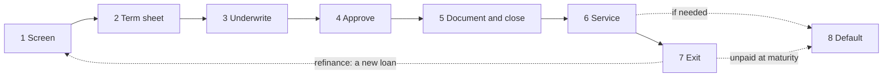

**Model policy for training - not for live lending decisions.** Fictional data only. Legal statements are [VERIFY] until compliance counsel confirms them.

| Item | Detail |
| --- | --- |
| Assets in this tab | C2-lesson-v0, C2-quiz-v0 (sets A and B), C2-ojt-v0, C2-jobaid-v0 |
| Hours | 2 (120 minutes) plus a 45-minute OJT task |
| Prerequisite | C1 |
| Bloom's levels | 2 to 4 (LD-02) |
| Formulas | Preview only: F-CORE-14 (LTV), F-RES-02 (LTARV), F-RES-04 (LTC). Taught fully in C3, C8 and R2 |
| Rules | CORE-AUTH-01 to -04; CORE-EXC-01 to -03; CORE-CONC-01; CORE-DOC-01, -02; CORE-KYC-01; CORE-PRC-05; CORE-CLS-06; CORE-INS-01, -04; CORE-SVC-07; CORE-BOR-01 to -04; RES-GEN-04, -11; RES-FF-01, -03, -04 |
| Glossary | Items 13 to 17 (credit box, five Cs, risk rating, term sheet, recourse) |
| Running deals | Worked examples: RD-RES-01 Maple Run. Practice: all three deals (LD-08) |
| Status | v0. Self-review against Bible Section 7 is at the end of this tab |
| Change log | v0, 20 Nov 2026: first draft v0.2, 22 Nov 2026: review fixes, policy decisions D-CORE-17 onward, self-check |

## Timing plan

| Segment (LD-04) | Minutes |
| --- | --- |
| 1 Hook | 5 |
| 2 Objectives | 5 |
| 3 Teach chunks T1-T4, with worked examples | 55 |
| 5 Practice | 25 |
| 6 Quiz | 20 |
| 8 Job aid walk-through and wrap-up | 10 |
| Total | 120 |
| 7 OJT task (extra, per LD-03) | 45 |

## 1. Hook (5 minutes)

Every loan we make is repaid one of two ways. The borrower pays it from cash flow, a sale or a refinance. Or we take the collateral and sell it ourselves.

Credit work is the job of making the first way likely and the second way survivable. This module gives you the frame for that job, and the map of where each later module fits.

## 2. Objectives

By the end of C2, you will be able to:

1. **Explain** the five Cs of credit and apply them to a business-purpose loan (glossary 14).
2. **Check** a loan against the credit box and route it to the right approver (glossary 13; CORE-AUTH-01; CORE-EXC-01).
3. **Sequence** the loan life cycle and name the module, rule and document for each stage (glossary 16, 17).
4. **Assign** a risk rating and say what moves it (glossary 15; CORE-SVC-07).

## 3. Teach

### T1. The five Cs of credit (Objective 1, 15 minutes)

The five Cs are a standard frame for any credit decision. Federal rules use them too. USDA guaranteed-loan rules require lenders to review and comment on each C in writing [VERIFY: 7 CFR 5001.202 and 5001.202(b); eCFR API; checked 22 Nov 2026].

| C | Question | In a business-purpose loan, look at | Module |
| --- | --- | --- | --- |
| Character | Will they repay? | Track record, credit history, background, honesty of the file | C6, C7 |
| Capacity | Can they repay? | Property cash flow, or a realistic sale or refinance exit | C3, C4 |
| Capital | What do they lose if it fails? | Cash in the deal; liquidity after closing; the guarantor's assets behind a guaranty | C6, C8 |
| Collateral | What do we recover if it fails? | Property value now and after the plan; our lien position | C5, C9 |
| Conditions | What could change around the deal? | Market, rates, rules, the loan's own terms | C5, C10 |

**Business-purpose twist.** In consumer lending, capacity means the borrower's income. In our loans, the property usually repays the debt. So capacity is mostly the asset's cash flow or exit. A guarantor's own assets are a second source of repayment. We count those under Capital, not Capacity.

**Worked example 1: Maple Run (RD-RES-01) through the five Cs.**

| C | Fact (Running Deals, Role 1) | Read |
| --- | --- | --- |
| Character | Dana Reyes: 6 counted deals, Tier 2. One paid and released 2019 tax lien | Acceptable; lien explained (C6) |
| Capacity | No income during rehab. Exit: lease at about $3,100 a month, then a DSCR refinance; back-up sale at $520,000 ARV | Depends on the exit, tested in R2 and R4 |
| Capital | Cash to close $300,000 + $9,000 + $5,100 − $240,000 = $74,100 | Real money at risk |
| Collateral | As-is $310,000; ARV $520,000; first lien | Pass, see T2 |
| Conditions | Columbus rental market; 12-month term; Ohio law | Check SLT-OH rows (C10) |

### T2. The credit box and who approves (Objective 2, 15 minutes)

The credit box is every policy limit and eligibility rule a loan must fit (glossary 13). Inside the box, the right approver can say yes. Outside it, the loan needs an exception or a decline.

**Step 1: Check the box.** An RTL (residential transition loan) is a short fix-and-flip or bridge loan. For Maple Run (Tier 2), the RTL limits are an 85% purchase advance, 85% LTC and 70% LTARV (RES-FF-01, -03, -04).

| Test | Working | Result | Limit | Pass? |
| --- | --- | --- | --- | --- |
| Purchase advance | $240,000 ÷ $300,000 | 80.00% | 85% | Yes |
| LTC (F-RES-04) | $340,000 ÷ ($300,000 + $100,000) | 85.00% | 85% | Yes, at the cap |
| LTARV (F-RES-02) | $340,000 ÷ $520,000 | 65.38% | 70% | Yes |
| Loan size | $340,000 | — | $75,000 to $2,000,000 (RES-GEN-04) | Yes |

You will learn each formula properly in C3, C8 and R2. Here, see only that every test is a ratio against a limit.

**Step 2: Route it (CORE-AUTH-01).**

| Approver | Max single loan (commitment) | Max sponsor exposure (F-CORE-29) | Exceptions allowed | Must go higher when |
| --- | --- | --- | --- | --- |
| Senior underwriter | $500,000, Residential only | $1,000,000 | None | Any exception; any Multifamily or Commercial loan |
| Credit officer | $2,000,000 | $5,000,000 | One: leverage +2.5 points; DSCR −0.05x; FICO −20; liquidity −10% of requirement | Ground-up with one completed build (RES-GU-01); first loan in a new state |
| Credit committee | Above $2,000,000 | Above $5,000,000 | Up to two: leverage +5.0 points; DSCR −0.10x; FICO −40; liquidity −25% of requirement | Beyond these limits the loan is declined; no one has authority |

Committee approval is also needed at any size for related-party or employee loans, ground-up with one completed build (RES-GU-01), and any concentration breach. Ground-up with no completed build is declined (D-CORE-26). A sponsor above their tier's exposure cap is a breach (CORE-CONC-01). Check loan size, sponsor exposure, exceptions and triggers. The highest approver any of them needs makes the decision.

Maple Run is a $340,000 Residential loan with no exceptions. Harborline has no other loans with us, so sponsor exposure is $340,000. That is under $1,000,000 and under Dana Reyes's Tier 2 cap of $7,500,000 (CORE-CONC-01). A senior underwriter may approve it. The approver cannot be the underwriter of record.

**Step 3: Exceptions.** An exception is any approval outside a policy rule. It is approved before closing, never after (CORE-EXC-01). Business-purpose rules allow no exceptions at all (CORE-EXC-03).

### T3. The loan life cycle (Objective 3, 15 minutes)

| Stage | What happens | Key output | Rules | Module |
| --- | --- | --- | --- | --- |
| 1 Screen | Purpose, borrower, property and state checked | Go or no-go | CORE-BP-01 to -04; CORE-BOR-01; CORE-KYC-01 (OFAC) | C1, C7, C10 |
| 2 Term sheet | Proposed amount, rate, points, term and conditions | Non-binding term sheet (glossary 16) | CORE-PRC-01 to -03 | C8 |
| 3 Underwrite | Cash flow, value, sponsor, KYC, sizing | Credit memo | CORE-VAL-01; CORE-KYC-01 to -07 | C3 to C8, C14 |
| 4 Approve | Recommendation and separate approval | Approval with conditions | CORE-AUTH-01 to -04; CORE-EXC | C14 |
| 5 Document and close | Loan documents, title, insurance, funding | Recorded lien; funded loan | CORE-DOC; CORE-CLS, including CORE-CLS-06 (title for the full commitment); CORE-INS-01, -04 | C9, C11 |
| 6 Service | Payments, draws, reporting, ratings | Monthly review | CORE-SVC-01 to -07 | C12 |
| 7 Exit | Payoff, extension, or refinance | Release of lien | CORE-SVC-01, -02 | C12 |
| 8 Default (if needed) | Workout, foreclosure, REO | Recovery | CORE-DEF-01 to -06 | C13 |

The flow shows the eight stages in order. Dotted lines mark the default path and a refinance that starts a new loan at stage 1.

**Recourse sets what stage 8 can reach (glossary 17).** With full recourse, we can pursue the guarantors personally for any shortfall. Every Residential loan is full recourse (CORE-DOC-01). Cedar Court is non-recourse, except for "bad-boy" carve-outs (CORE-DOC-02; glossary 18). These make the guarantor fully liable for fraud, misapplied funds, an unpermitted transfer or a voluntary bankruptcy. Birchwood Plaza instead has a full guarantee that burns off at stabilization (COM-BR-07). State law can limit this (C10).

**Worked example 2: Maple Run's timeline.** Closing 15 Jan 2027 (stage 5). Draws in months 2, 4, 6 and 8 (stage 6). A lease signed in month 11, with a copy to us within 10 business days (stage 6; RES-GEN-11). Maturity 15 Jan 2028, with an extension request (stage 7). A DSCR refinance request in month 14 (stage 7, then a new loan at stage 1).

### T4. Risk ratings (Objective 4, 10 minutes)

Every loan is rated at each monthly review (CORE-SVC-07).

| Rating | Name | Meaning |
| --- | --- | --- |
| 1 | Pass | Performing; no triggers |
| 2 | Pass/Watch | A trigger fired; still performing |
| 3 | Special mention | Potential weakness |
| 4 | Substandard | Well-defined weakness; loss possible |
| 5 | Doubtful/Loss | Loss likely or certain |

Ratings 2 to 5 go on the watch list with an action and an owner. Regulators share the special mention, substandard, doubtful and loss grades [VERIFY: OCC Bulletin 2026-56, 10 Nov 2026, occ.gov; checked 22 Nov 2026].

**Loans in default (CORE-SVC-08; D-CORE-23).** A loan in default is rated on exit cover. Exit cover is as-is value less cost to sell, divided by balance plus accrued interest and fees (F-CORE-42 terms). A non-monetary default still in its cure period, with payments current and cover of 1.00 or more, is a 3. If it is not cured in time, it is a 4. A payment default with cover of 1.00 or more is a 4. Cover under 1.00, with no guarantor able to pay the gap, is a 5. C12 works the numbers. Special mention means default is not imminent, so a missed payment is never a 3 [VERIFY: OCC Rating Credit Risk; Fed SR 23-5 attachment; checked 22 Nov 2026].

**Worked example 3: when does Maple Run reach watch?** Maturity is 15 Jan 2028. A loan within 90 days of maturity with no confirmed exit is at least a 2 (CORE-SVC-07).

- 90 days before maturity is 17 Oct 2027.
- On 15 Nov 2027 (month 10), maturity is 61 days away. Rehab is complete, but no lease or refinance is confirmed yet.
- So the rating is at least 2 from 17 Oct 2027 until the exit is confirmed.

The month-7 roof overrun of $8,000 does not move the rating. The $9,000 contingency covers it, so the loan stays in balance (C12). We approve the move from contingency to roof in writing (Running Deals, Role 3).

## 5. Practice (25 minutes)

1. Put Cedar Court (RD-MF-01) through the five Cs. Name one fact for each C you would need from the deal file.
2. Route each deal under CORE-AUTH-01: Maple Run $340,000; Cedar Court $5,140,000 commitment; Birchwood Plaza $3,520,000 commitment.
3. Maple Run's LTC came out at 85.00%. What happens if the rehab budget is cut to $90,000 but the loan stays at $340,000?
4. Put these in life-cycle order: lien release; term sheet; draw inspection; credit memo; OFAC search; funding wire.
5. A loan is 45 days from maturity. The borrower has a signed refinance commitment from another lender. What is the minimum rating?
6. Birchwood's guarantor, Dana Whitlow, offers a full guaranty. Which C does that strengthen most?

**Answer key.**

1. Character: Marcus Hale's track record. Capacity: in-place and stabilized NOI. Capital: $2,240,066.67 cash to close. Collateral: as-is and as-stabilized values. Conditions: the North Carolina submarket and the SOFR rate. Any sensible fact per C passes.
2. Maple Run: senior underwriter ($340,000 loan and exposure, Residential, no exceptions). Cedar Court: committee. The loan is above $2,000,000. Marcus Hale is Tier 1, so $5,140,000 of exposure breaks the $3,000,000 cap (CORE-CONC-01). Birchwood Plaza: committee. The loan is above $2,000,000, and Dana Whitlow's $3,520,000 exposure breaks her Tier 1 $3,000,000 cap (CORE-AUTH-01; CORE-CONC-01).
3. LTC = $340,000 ÷ ($300,000 + $90,000) = 87.18%, above the 85% cap (RES-FF-03). Option 1: cut the loan. 85% × $390,000 = $331,500, the lowest of the tests. Round down to $331,000 (CORE-PRC-05). Option 2: an exception of 2.18 points, within a credit officer's +2.5 points (CORE-EXC-01; CORE-AUTH-01).
4. OFAC search; term sheet; credit memo; funding wire; draw inspection; lien release. OFAC runs before the term sheet and again before funding (CORE-KYC-01). The funding checklist adds a same-day re-run (CORE-CLS-03).
5. Rating 1 is allowed. The 90-day trigger applies only with no confirmed exit. A signed commitment is a confirmed exit, but record it in the review (CORE-SVC-07).
6. Capital: the guarantor's own assets become a second source of repayment. It does not fix weak property cash flow (capacity).

**Common wrong answers.** Rating a loan 1 because payments are current. Sending a loan to a credit officer when it is over $2,000,000. Treating the term sheet as a commitment.

## 6. Quiz: C2-quiz-v0

Pass mark 80%. Items marked (C) are critical. Each set has 10 items and covers all four objectives.

### Set A

1. (O1) Name the five Cs. **Answer:** character, capacity, capital, collateral, conditions.
2. (O1) In a bridge loan, where does capacity mostly come from? **Answer:** the exit: a sale or refinance of the property.
3. (O1) Maple Run's capital at closing? **Answer:** $74,100 (Running Deals, Role 1).
4. (O2) Who may approve a $1,800,000 multifamily loan to a Tier 2 sponsor with no exceptions and no other loans with us? **Answer:** a credit officer (CORE-AUTH-01). (C)
5. (O2) When must an exception be approved? **Answer:** before closing (CORE-EXC-01).
6. (O2) Can the underwriter of record approve their own loan? **Answer:** no (CORE-AUTH-01). (C)
7. (O3) Is a term sheet binding? **Answer:** no (glossary 16).
8. (O3) Which stage produces the credit memo? **Answer:** underwriting (stage 3).
9. (O4) What does rating 4 mean? **Answer:** substandard: a well-defined weakness; loss possible.
10. (O4) 60 days to maturity, no confirmed exit, payments current. Minimum rating? **Answer:** 2 (CORE-SVC-07). (C)

### Set B

1. (O1) Which C asks "what do we recover if it fails"? **Answer:** collateral.
2. (O1) Why is guarantor income not the main capacity test for our loans? **Answer:** the property's cash flow or exit repays the loan.
3. (O1) Maple Run's ARV? **Answer:** $520,000.
4. (O2) A $450,000 Residential loan needs one LTV exception of 2 points. Who approves? **Answer:** a credit officer. Seniors approve no exceptions, and 2 points is within the credit officer's +2.5 (CORE-AUTH-01). (C)
5. (O2) Maple Run LTARV? **Answer:** $340,000 ÷ $520,000 = 65.38%.
6. (O2) Can a credit officer waive CORE-BP-02? **Answer:** no; no exception to business-purpose rules (CORE-EXC-03). (C)
7. (O3) What does full recourse let us do? **Answer:** pursue the guarantors personally for a shortfall (glossary 17; CORE-DOC-01).
8. (O3) Which module covers stage 8? **Answer:** C13.
9. (O4) Name the regulator grades. **Answer:** special mention, substandard, doubtful, loss.
10. (O4) What must happen to a loan rated 2 or worse? **Answer:** it goes on the watch list with an action and owner, reviewed monthly (CORE-SVC-07). (C)

## 7. OJT task: C2-ojt-v0 (solo mode)

**Output.** A one-page "deal on a page" for RD-RES-01 Maple Run, as at the term sheet.

**Source.** Running deals file. No live data.

**Time.** 45 minutes.

**Steps.**

1. Write one line for each of the five Cs, with a number where one exists.
2. Check the four credit-box tests in T2 and show the working.
3. Name the approver and why.
4. List the eight life-cycle stages with the date or month each happens for this deal.
5. State the expected rating at closing and the date it would move to watch if the exit is unconfirmed.

**Rubric.**

| Criterion | Pass |
| --- | --- |
| Five Cs | All five, each with a fact from the deal file |
| Box | Four tests, working shown, correct pass or fail |
| Route | Approver matches CORE-AUTH-01, with loan size and sponsor exposure both checked |
| Life cycle | All eight stages in order, each dated: stages 1-4 before closing; closing 15 Jan 2027; draws in months 2, 4, 6 and 8; lease in month 11; maturity 15 Jan 2028 with an extension request; DSCR refinance request in month 14; default not reached |
| Rating | 1 at closing; at least 2 from 17 Oct 2027 if no exit |

**Sign-off.** Self-review against this rubric, dated (solo mode, Bible Section 7).

## 8. Job aid: C2-jobaid-v0 (one page)

1. **Five Cs:** character, capacity, capital, collateral, conditions. One fact each.
2. **Credit box:** every ratio against its family limit. Any fail is an exception or a decline.
3. **Route (CORE-AUTH-01):** senior underwriter for Residential up to $500,000, sponsor exposure up to $1,000,000, no exceptions. Credit officer up to $2,000,000 and $5,000,000 exposure, with one exception. Committee above those, or at any size for related-party or employee loans, ground-up with one completed build or a concentration breach.
4. **No exceptions** to business-purpose rules (CORE-EXC-03). Exceptions before closing only.
5. **Life cycle:** screen, term sheet, underwrite, approve, close, service, exit, default.
6. **Ratings:** 1 Pass; 2 Pass/Watch; 3 Special mention; 4 Substandard; 5 Doubtful/Loss. Within 90 days of maturity with no exit: at least 2. In default: rate under CORE-SVC-08.

**Mini-example.** Maple Run: $340,000; 85.00% LTC at the cap; senior underwriter approves; rated 1 at closing.

## Alignment matrix (LD-07)

| Objective | Teach | Worked example | Practice | Quiz A | Quiz B | OJT | Job aid |
| --- | --- | --- | --- | --- | --- | --- | --- |
| O1 Five Cs | T1 | WE1 | 1, 6 | 1-3 | 1-3 | Step 1 | Item 1 |
| O2 Box and approver | T2 | WE1 table | 2-3 | 4-6 | 4-6 | Steps 2-3 | Items 2-4 |
| O3 Life cycle | T3 | WE2 | 4 | 7-8 | 7-8 | Step 4 | Item 5 |
| O4 Ratings | T4 | WE3 | 5 | 9-10 | 9-10 | Step 5 | Item 6 |

## Self-review against Bible Section 7 (20 Nov 2026)

| Check | Result |
| --- | --- |
| LD-04 order; fits 2 hours | Met: 120 minutes plus 45 OJT |
| Every threshold cites a rule | Met |
| Numbers worked step by step | Met: 80.00%, 85.00%, 65.38%, 87.18%; cash $74,100; 61 and 90 days |
| Deal numbers match the running deals file | Met (Role 1 answer key and timeline) |
| Quiz sets; critical items | Met: 10 items each; 3 critical in each set |
| No open tags | In part: [VERIFY] tags on the USDA five-Cs rule, the OCC grades and the default rating rechecked 22 Nov 2026; compliance counsel has not yet confirmed them |

**Self-check.**

1. Which C does a guaranty strengthen, and why? **Answer:** Capital. The guarantor's assets become a second source of repayment (T1).
2. Cedar Court's commitment is $5,140,000, and Marcus Hale is Tier 1. Who approves? **Answer:** committee. The loan is above $2,000,000, and exposure is above the Tier 1 $3,000,000 cap (CORE-AUTH-01; CORE-CONC-01).
3. When must OFAC screening run? **Answer:** before the term sheet and again before funding (CORE-KYC-01).
4. On 1 Nov 2027 Maple Run has no confirmed exit. Maturity is 15 Jan 2028. Minimum rating? **Answer:** 2, Pass/Watch. 29 + 31 + 15 = 75 days to maturity, inside 90 (CORE-SVC-07).

**What to look up yourself.** Open OCC Bulletin 2026-56 (10 Nov 2026). Read how it defines special mention and substandard, and compare its words with the T4 rating table.

**How to check it.** Recalculate Maple Run's LTC: $340,000 ÷ $400,000 should give 85.00%. Then count back 90 days from 15 Jan 2028: you should land on 17 Oct 2027.
