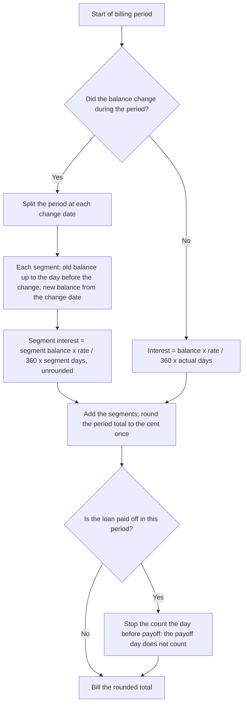
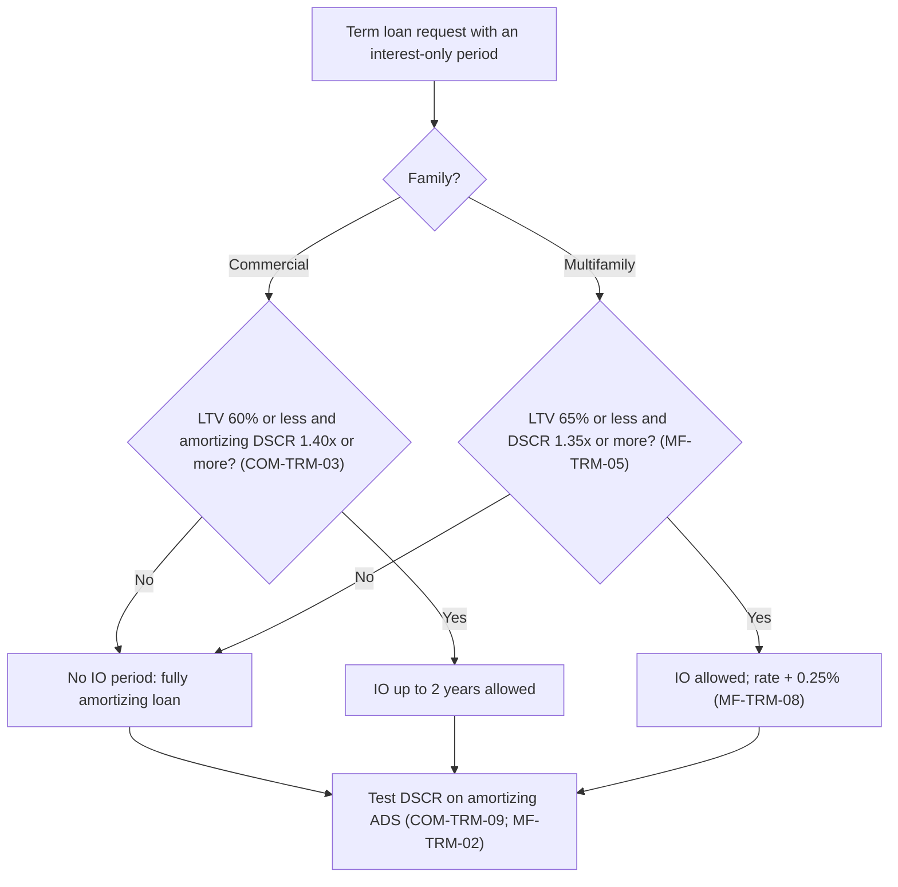
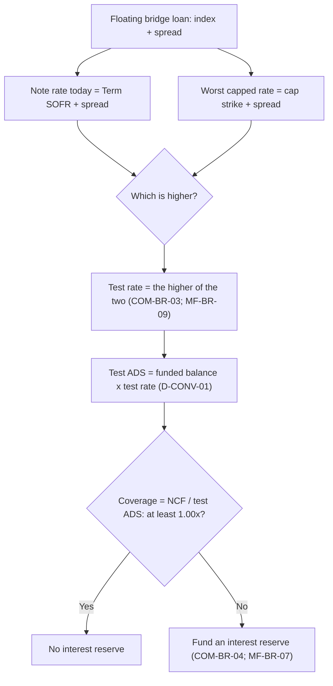

# C3: Real estate finance math: interest, amortization, debt service

**Model policy for training - not for live lending decisions.** Fictional data only.

| Item | Detail |
| --- | --- |
| Assets in this tab | C3-lesson-v1.0-draft, C3-quiz-v0 (sets A and B, unchanged until Phase 3), C3-ojt-v0, C3-jobaid-v1.0-draft |
| Objectives | O1 calculate period interest (Actual/360); O2 convert rates (time value of money); O3 calculate the amortizing payment, schedule and balloon; O4 calculate ADS and the loan constant on the test basis; O5 calculate floating and coverage test rates; O6 analyze lender yield and all-in cost |
| Hours | Blueprint projection 3.4 CPE credits (QAS Self Study word-count formula, section 7). That projection counted open-answer practice, which the amended counting rule (qas-spec.md) excludes; recount from the final lesson and assessment. The OJT task is extra |
| Knowledge level | Intermediate (qas-spec.md) |
| Prerequisite | C1 and C2. Spreadsheet use (cell references, absolute references, ROUND); percentages and exponents. No advance preparation |
| Bloom's levels | 3 Apply (O1-O5) and 4 Analyze (O6), within LD-02 as amended 22 Nov 2026 (levels 1-5, at least half at Apply or above) |
| Formulas | F-CORE-01 to F-CORE-06, F-CORE-33, F-CORE-40, F-CORE-45 to F-CORE-48 |
| Rules | D-CONV-01, D-CONV-02, D-CORE-27; CORE-CLS-04; CORE-PRC-01, -02, -03, -05; COM-BR-03, -06; COM-TRM-02, -03, -04, -09; MF-BR-09, -14; MF-TRM-02, -05, -08 |
| Conventions | D-CONV-01 (tests use the nominal rate), D-CONV-02 (funding day counts, payoff day does not) |
| Running deals | Worked examples: RD-RES-01 Maple Run, RD-COM-01 Birchwood Plaza and RD-MF-01 Cedar Court. Practice uses a second deal for each chunk (LD-05, LD-08) |
| Status | v1.0-draft. Teach, Practice and Job aid rewritten to the C3 blueprint. Review questions and exam forms follow in Phase 3. Self-review is at the end of this tab |
| Change log | v0, 19 Nov 2026: first draft; all numbers computed in code. v0.2, 22 Nov 2026: review fixes, policy decisions D-CORE-17 onward, self-check. v1.0-draft, 22 Nov 2026: rewritten to blueprint (Phase 2 pilot) |

## 1. Hook

Harborline Holdings closed its $340,000 Maple Run loan on 15 Jan 2027. Dana Reyes calls on 2 April. Her February interest bill was $1,913.33. Her March bill was $2,263.54. "Nothing changed but the month," she says. "Why is March $350 higher?"

Two things changed: March has three more days than February, and a $30,000 draw funded on 15 March. By the end of this module you can explain both, to the cent.

## 2. Objectives

By the end of C3, you will be able to:

1. **O1. Calculate** the interest for any billing period on an interest-only loan, Actual/360, with mid-period draws and paydowns, to the cent (F-CORE-01, F-CORE-05; D-CONV-02).
2. **O2. Convert** a quoted rate between nominal, effective annual and Actual/360 bases, using present value, future value and annuity formulas (F-CORE-45, F-CORE-46).
3. **O3. Calculate** the amortizing payment, the schedule rows and the balloon balance at maturity (F-CORE-02, F-CORE-47).
4. **O4. Calculate** annual debt service and the loan constant on the test basis for interest-only, amortizing and partial interest-only loans (F-CORE-03, F-CORE-04; D-CONV-01).
5. **O5. Calculate** a floating note rate and its coverage test rate from Term SOFR (the Secured Overnight Financing Rate), the spread and the cap strike (COM-BR-03; MF-BR-09).
6. **O6. Analyze** the lender's yield and the borrower's all-in cost from the note rate, points and term (F-CORE-06, F-CORE-40, F-CORE-48).

O1 to O5 are at Bloom level 3 (Apply). O6 is at level 4 (Analyze).

## 3. Teach

### T1. Interest-only interest, per diem and split periods (O1)

**The point.** Period interest is the balance times the daily rate times the days, and the note's day-count clause decides what "daily rate" means.

**What interest-only means.** Most bridge and rehab loans are interest-only. The borrower pays the interest that accrues each month and repays all principal at maturity.

The balance changes only when the lender funds a draw or the borrower pays principal down. So the monthly bill depends on three things: the balance, the rate and the number of days.

**Day-count conventions.** A note quotes an annual rate. To bill a month, someone must turn that annual rate into a daily or monthly rate.

The day-count convention is the rule for doing so. Three conventions are common in US lending.

| Convention | Daily rate | Days counted | Maple Run, $240,000 at 10.250%, 31-day March | Full 365-day year |
| --- | --- | --- | --- | --- |
| Actual/360 (our notes) | Rate ÷ 360 | Actual days | $2,118.33 | $24,941.67 |
| Actual/365 | Rate ÷ 365 | Actual days | $2,089.32 | $24,600.00 |
| 30/360 | Rate ÷ 12 a month | Every month is 30 days | $2,050.00 | $24,600.00 |

Actual/360 divides by 360 but counts every calendar day. A 365-day year therefore holds 365 days of a 1/360 rate. The borrower pays 365 ÷ 360 = 1.0139 times the quoted rate, or $341.67 more a year on $240,000.

Actual/365 and 30/360 both give exactly the quoted rate over a full year. They differ only in how they spread it across short and long months.

Why would a lender choose a basis that charges more than the quote? Mostly history and funding. Banks fund themselves in money markets, and US money markets have long quoted on Actual/360.

A lender that borrows on Actual/360 and lends on Actual/365 loses the gap on every dollar. So commercial lenders match their loans to their funding.

**The per diem (F-CORE-05).** One day's interest is the per diem: balance × rate ÷ 360. Keep it unrounded while you multiply by days. Round the period total to the cent once, half up.

Rounding the per diem first builds an error that grows with the days.

On Maple Run's full $340,000, the per diem is $96.805555… A 17-day period at the unrounded per diem is $1,645.69. At a per diem rounded to $96.81 it is $1,645.77, eight cents too high.

**Which days count (D-CONV-02).** The funding day counts. The payoff day does not.

The logic is simple: interest is owed for each night the borrower holds the money. Funds wired on 15 January are held on the night of the 15th. Funds repaid on 15 March are not held that night.

So a loan funded on 15 January earns interest for 15 to 31 January: 17 days. A loan repaid on 15 March earns March interest for 1 to 14 March: 14 days.

**Split periods at every balance change.** When a draw funds or a paydown posts mid-month, the balance changes that day. Split the month into segments, one per balance.

Each segment runs from one change date up to, but not including, the next. The new balance applies from the change date, because the funding day counts.



The flowchart shows the order of work for any interest-only billing period. Split first, multiply at full precision, then round once.

**Prepaid interest (CORE-CLS-04; F-CORE-33).** Our regular bills run from the first to the last day of each month, paid in arrears. A loan rarely funds on the first. So we collect interest from the funding day (counted) to month-end at closing.

That stub is called prepaid or odd-days interest. The first regular bill then covers the first full month.

**The real-world rule: the note governs, and courts read it.** No federal statute sets the day count on a business-purpose loan. The disclosure rules of the Truth in Lending Act (TILA) do not apply, because credit primarily for a business purpose is exempt (C1) [VERIFY: 12 CFR 1026.3(a)(1); checked 22 Nov 2026].

The contract decides. That puts weight on the exact words of the note.

Maple Run is in Ohio, and the Ohio Supreme Court has read such a clause.

In *JNT Properties, L.L.C. v. KeyBank National Association*, the note said the rate was "computed on a 365/360 basis". It went on: "by applying the ratio of the annual interest rate over a year of 360 days". That ratio was multiplied by the balance and "the actual number of days the principal balance is outstanding". [VERIFY: *JNT Properties, L.L.C. v. KeyBank Natl. Assn.*, 134 Ohio St.3d 209, 2012-Ohio-5369, para. 4; checked 22 Nov 2026]

The borrower argued the clause was ambiguous, and that the bank charged more than the 8.93% annual rate the note stated. Over a 365-day year, the 365/360 method yields 8.93% × 365 ÷ 360 = 9.054%.

The court disagreed, 7-0. Read in context, the clause "is not ambiguous". It defined "the method to be used to calculate interest payments", not a cap on yearly interest. [VERIFY: *JNT Properties*, 2012-Ohio-5369, paras. 10-12; checked 22 Nov 2026]

Courts have not always sided with lenders. In Oregon in the 1970s, a federal court applied Oregon's usury statute to the same method, through the National Bank Act. The bank charged the statutory maximum rate but computed it on a 360-day year.

The Ninth Circuit affirmed the trial court's finding. The method produced "more interest than would be produced by applying the maximum legal rate to a calendar year of 365 days". That broke the usury cap. [VERIFY: *American Timber & Trading Co. v. First Natl. Bank of Oregon*, 511 F.2d 980 (9th Cir. 1973), affirming 334 F. Supp. 888 (D. Or. 1971), applying ORS 82.010 through 12 U.S.C. 85-86; checked 22 Nov 2026]

The two cases do not conflict. *JNT* asks what the contract means. *American Timber* asks whether the result breaks a statutory cap.

A clear clause wins the first question. Only an exemption or a rate safely below the cap wins the second. C10 owns the usury test; C3 gives you the math to run it.

**Market practice.** The Alternative Reference Rates Committee (ARRC), whose papers the New York Fed publishes, wrote conventions for business loans that use SOFR in arrears. Its recommendation "is Actual/360 days for SOFR, which is the standard convention in U.S. money markets". [VERIFY: ARRC, *SOFR "In Arrears" Conventions for Syndicated Business Loans*, 22 Jul 2020, "Daycount"; checked 22 Nov 2026]

Cedar Court and Birchwood Plaza, our floating-rate bridges, bill on that basis. Maple Run's fixed rate uses it too, so one rule covers the book.

**Reading the clause: what to check.** Before you bill or test a loan, find the interest clause in the note and check five things.

| Element | What to look for | Maple Run's note (RD-RES-01) |
| --- | --- | --- |
| Rate | Fixed, or an index plus a spread | Fixed 10.250% (CORE-PRC-02, F-CORE-28) |
| Basis | Actual/360, Actual/365 or 30/360, stated in words | Actual/360 (F-CORE-01) |
| Balance | Funded balance, not the commitment | Funded balance only (RES-FF-08) |
| Day rule | Which of the funding and payoff days count | Funding day counts; payoff day does not (D-CONV-02) |
| Timing | Paid in arrears or in advance; first payment date | Monthly in arrears; stub prepaid at closing (CORE-CLS-04) |

When the note and the servicing system disagree, the note wins. Raise the gap before the first bill, not after a dispute.

**How our model policy applies it.** Every note bills Actual/360 (F-CORE-01). The funding day counts and the payoff day does not (D-CONV-02).

Interest is charged on the funded balance only, never the undrawn commitment (RES-FF-08; MF-BR-10). Prepaid interest runs to month-end and is collected at closing (CORE-CLS-04). Credit tests use a different basis, covered in T4 (D-CONV-01).

**Worked example 1: Maple Run, January to March 2027 (RD-RES-01)**

1. **Formula.** F-CORE-01: Interest = balance × rate ÷ 360 × actual days; per diem (F-CORE-05) = balance × rate ÷ 360.
2. **Inputs.** Initial advance $240,000 on 15 Jan 2027; note rate 10.250% (term sheet); $30,000 draw funded 15 Mar 2027 (draw table, month 2).
3. **Substitution.** Per diem $240,000 × 10.25% ÷ 360 = $68.3333… January, 15-31 (17 days): $68.3333 × 17 = $1,161.67. February (28 days): $68.3333 × 28 = $1,913.33. March splits at the draw. For 1-14 March, $240,000 × 10.25% ÷ 360 × 14 = $956.6667. For 15-31 March, $270,000 × 10.25% ÷ 360 × 17 = $1,306.875.
4. **Result.** March = $956.6667 + $1,306.875 = $2,263.5417, rounded once to $2,263.54. January's $1,161.67 is prepaid at closing (CORE-CLS-04, F-CORE-33). The February bill is $1,913.33 and the March bill $2,263.54.

That answers Dana Reyes's question in the hook. March costs $350.21 more than February, and the gap splits cleanly into two effects.

| Effect | Calculation | Amount |
| --- | --- | --- |
| Three more days on $240,000 | $68.3333 × 3 | $205.00 |
| The $30,000 draw for 17 days | $30,000 × 10.25% ÷ 360 × 17 | $145.21 |
| Total change, February to March | $205.00 + $145.2083 | $350.21 |

Splitting a change like this is how a servicer answers a borrower's call. It also catches errors: if the parts do not add to the change, a day count is wrong.

Notice the rounding. Round each segment first and you get $956.67 + $1,306.88 = $2,263.55, one cent high. The rule is to round the period, not the segment.

**Worked example 2: Maple Run payoff period (RD-RES-01, what-if date)**

The DSCR (debt service coverage ratio) refinance in Role 3 happens in month 14. Place the payoff on 15 Mar 2028 as a what-if date; Running Deals gives the month, not the day.

1. **Formula.** F-CORE-01, counting days up to but not including the payoff day (D-CONV-02).
2. **Inputs.** Balance $340,000 after the final draw; 10.250%; payoff 15 Mar 2028; interest paid through 29 Feb 2028 (2028 is a leap year).
3. **Substitution.** Days 1-14 March: 14 days. $340,000 × 10.25% ÷ 360 = $96.8056 a day; × 14 = $1,355.2778.
4. **Result.** Interest to payoff $1,355.28. The 15th is not charged. The payoff letter adds this to principal and any fees (F-CORE-32, taught in C12).

A paydown works the same way in reverse. The balance falls on the day the payment posts, and the lower balance applies from that day.

**Common slips.**

- Using balance × rate ÷ 12. That gives $2,050.00 for every month on $240,000. It is right only for a 30-day month under 30/360, which our notes do not use.
- Counting both the funding day and the payoff day. That bills one day too many.
- Billing interest on the commitment. Maple Run's commitment is $340,000, but only $240,000 was funded at closing.
- Using 365 in a leap year by habit. Actual/360 always divides by 360; only the day count changes. Maple Run's extension to 15 Apr 2028 includes 29 Feb 2028, a billable day.

**Why it matters to a credit officer.** Billing errors are small per loan but systematic across a book. A clause that does not match your servicing system invites a breach-of-contract claim, as in *JNT*. In a capped state, the same method can create a usury claim, as in *American Timber*.

**Review questions.** Added in Phase 3 (blueprint section 6).

### T2. Time value of money and rate conversions (O2)

**The point.** A loan is a trade of money now for money later, so every payment, balance and yield formula in this course is a present-value calculation.

**Why time changes value.** A lender hands over cash today and gets it back in pieces over months or years. A dollar received next year is worth less than a dollar today. The lender could have lent today's dollar elsewhere and earned interest on it.

The interest rate is the price of waiting. Time value of money (TVM) is the arithmetic of that price.

Four quantities describe any TVM problem. Present value (PV) is the value today. Future value (FV) is the value at a later date.

The payment (PMT) is a level amount paid each period. The rate per period (i) is the annual rate divided by the periods in a year. For monthly loans, i = annual rate ÷ 12 and n counts months.

**A single sum: future and present value.** Money left to earn interest grows by a factor of (1 + i) each period. After n periods it has grown by (1 + i)^n.

Run the other way, a sum due in n periods is worth that sum divided by (1 + i)^n today. That division is called discounting.

```latex
FV = PV (1+i)^{n} \qquad PV = \frac{FV}{(1+i)^{n}}
```

Take $100,000 at 7.000% a year, compounded monthly. The monthly rate is 0.07 ÷ 12 = 0.0058333. After 12 months the sum grows to $100,000 × 1.0058333^12 = $107,229.01.

The quoted rate is 7.000%, but the money earned 7.229% over the year. Interest earned in early months itself earned interest later. Hold that 7.229%; it returns below as an effective annual rate.

**A level stream: the ordinary annuity.** A loan does not repay in one sum. It repays in equal payments at the end of each month.

That stream is an ordinary annuity. Its present value is the sum of each payment discounted to today:

```latex
PV = \frac{PMT}{(1+i)} + \frac{PMT}{(1+i)^{2}} + \dots + \frac{PMT}{(1+i)^{n}} = PMT \times \frac{1-(1+i)^{-n}}{i}
```

The right-hand side comes from the sum of a geometric series. Each term is the one before it divided by (1 + i).

The fraction is called the annuity factor. It tells you what $1 a period for n periods is worth today.

Add a lump sum at the end, such as a balloon or the payoff of an interest-only loan, and you have the full F-CORE-45 formula. The lump sum is discounted like any single sum.

```latex
PV = PMT \times \frac{1-(1+i)^{-n}}{i} + FV_{n} (1+i)^{-n}
```

**The loan is the present value of its payments.** This is the idea that holds the module together. Discount a loan's payments at its own note rate and you get back the loan amount.

Discount them at a higher rate and they are worth less. That is why a buyer who wants a higher yield pays less than face for a loan (T6).

**Worked example 3: Birchwood Plaza payment derived from the annuity (RD-COM-01)**

1. **Formula.** F-CORE-45: PV = PMT × (1 − (1 + i)^−n) ÷ i. Solve for PMT: PMT = L ÷ annuity factor, which is F-CORE-02.
2. **Inputs.** Term loan $3,900,000; 7.000% (COM-TRM-04 floor, Running Deals month 24); 25-year amortization, n = 300 (COM-TRM-02).
3. **Substitution.** i = 0.07 ÷ 12 = 0.0058333. (1 + i)^−300 = 0.174660. Annuity factor = (1 − 0.174660) ÷ 0.0058333 = 141.486903. PMT = $3,900,000 ÷ 141.486903 = $27,564.3887.
4. **Result.** Payment $27,564.39 a month, the F-CORE-02 figure. Check: $27,564.39 × 141.486903 = $3,900,000.18; the 18 cents come from rounding the payment up.

So the payment formula is not a rule to memorize. It is the annuity solved for PMT. Multiply the top and bottom of L ÷ factor by i and you get F-CORE-02 exactly: L × i ÷ (1 − (1 + i)^−n).

Run the same payments forward instead. Each $27,564.39, reinvested at 7.000% to month 300, grows to $22,329,132.07 in total (F-CORE-45). That is $3,900,000.18, the payments' present value, times 1.0058333^300 (5.725418): today's value grown for 25 years.

The lender who reinvests every payment ends where it would have been with the loan left to compound. That equality is what "earning 7.000%" means.

**Why "ordinary" matters.** F-CORE-45 assumes each payment falls at the end of its month. That is how loans work: interest is paid in arrears, after it accrues.

If payments fell at the start of each month, the stream would be an annuity due. Each payment would be discounted one month less, so the factor rises by (1 + i). Birchwood's payment would then be $27,564.39 ÷ 1.0058333 = $27,404.53.

The $159.86 gap is one month's interest on the payment. Leases often pay rent in advance; loans almost never do. Mixing the two is a common spreadsheet error when an analyst builds a property model and a loan model side by side.

**What compounding assumes.** The FV above assumes every payment is reinvested at 7.000% until month 300. A real lender reinvests at whatever rates exist when each payment arrives.

So TVM results are exact statements about rates, not forecasts of wealth. The same assumption sits inside every internal rate of return (IRR) in T6.

**Worked example 4: Maple Run as a present value (RD-RES-01, simplified)**

1. **Formula.** F-CORE-45 with a lump sum: PV = PMT × annuity factor + FV\_n × (1 + i)^−n.
2. **Inputs.** Simplify Maple Run to full funding on day one: $340,000 at 10.250%, interest-only, 12 months. PMT = $340,000 × 10.25% ÷ 12 = $2,904.17; lump sum $340,000 at month 12.
3. **Substitution.** At i = 0.1025 ÷ 12: PV = $2,904.17 × 11.359479 + $340,000 × 0.902971 = $340,000.04. At a 12.000% discount rate, i = 0.01: PV = $334,419.39.
4. **Result.** At its own rate the loan is worth its face, plus 4 cents of payment rounding. To an investor who demands 12.000%, the same loan is worth $334,419.39, which is $5,580.65 less than at its own rate.

The 12% case previews T6. Maple Run's lender collects $5,100 in points at closing.

That cuts its cash out to $334,900, close to the $334,419.39 an investor at 12.000% would pay. So the points lift the lender's yield toward 12%.

**Nominal and effective rates.** A quoted annual rate is a nominal rate. It is the periodic rate times the periods in a year.

A nominal 7.000% paid monthly is 0.5833% a month. But a dollar earning 0.5833% a month for 12 months earns more than 7.000%, because of compounding. The rate actually earned over the year is the effective annual rate (EAR).

Actual/360 adds a second gap. The note rate applies to a 360-day year, but the calendar has 365 days. So the simple interest earned in a year is the note rate × 365 ÷ 360.

Both gaps can apply at once. F-CORE-46 combines them:

```latex
EAR = \left(1+\frac{r \times D/360}{m}\right)^{m} - 1
```

Here r is the note rate, D is the days the rate accrues over in a year, and m is the payments a year. Use D = 365 for an Actual/360 note, 366 in a leap year, and 360 for a 30/360 rate.

Use m = 12 for monthly payments. Use m = 1 when interest is not paid or added during the year.

**Worked example 5: Maple Run's 10.250% on four bases (RD-RES-01)**

1. **Formula.** F-CORE-46: EAR = (1 + r × (D ÷ 360) ÷ m)^m − 1.
2. **Inputs.** Note rate 10.250%; billed Actual/360 (D = 365); paid monthly (m = 12).
3. **Substitution.** Day-count uplift: 10.250% × 365 ÷ 360 = 10.392%. Compounded monthly: (1 + 0.103924 ÷ 12)^12 − 1 = 0.109019.
4. **Result.** Maple Run's 10.250% note rate earns 10.392% simple over a 365-day year, and 10.902% effective with monthly payments.

| Basis for Maple Run's 10.250% | Inputs to F-CORE-46 | Rate over one year |
| --- | --- | --- |
| Nominal (the quote; used in tests, D-CONV-01) | n/a | 10.250% |
| Actual/360, simple, 365-day year | D = 365, m = 1 | 10.392% |
| Actual/360, simple, 366-day year (2028) | D = 366, m = 1 | 10.421% |
| 30/360, compounded monthly | D = 360, m = 12 | 10.746% |
| Actual/360, compounded monthly | D = 365, m = 12 | 10.902% |

The table shows that one quote can describe five different costs. Each line is right for its own question. The skill is matching the line to the question.

**Comparing two quotes.** Suppose a bank quotes Birchwood's term loan at 7.000%, 30/360, paid monthly. Our note is 7.000%, Actual/360, paid monthly. They look identical.

On F-CORE-46 the bank's costs 7.229% effective (D = 360). Ours costs (1 + 0.07 × 365 ÷ 360 ÷ 12)^12 − 1 = 7.333% (D = 365). The same quoted rate differs by about 0.10 points a year, purely from the day count.

A borrower who knows this asks for the basis before comparing rates. A credit officer who knows it can explain why our quote is not "the same" as a bank's.

**When to use which rate.**

1. To bill interest, use the note rate on its day count (F-CORE-01).
2. To build a payment or schedule, use the nominal rate ÷ 12, with no 365/360 uplift (F-CORE-02).
3. To run DSCR, coverage, sizing or liquidity tests, use the nominal rate (D-CONV-01).
4. To compare two loans' true cost, convert both to an EAR (F-CORE-46) or an IRR (F-CORE-48, T6).

**The real-world rule: no disclosure basis for business credit.** Consumer lenders must disclose an annual percentage rate (APR) under the Truth in Lending Act. That rule does not reach credit "primarily for a business, commercial or agricultural purpose", or credit to "other than a natural person" [VERIFY: 12 CFR 1026.3(a)(1)-(2); checked 22 Nov 2026].

All three running deals lend to limited liability companies (LLCs) for business purposes (C1). So no statute tells us how to quote their rates.

Market convention is a nominal note rate plus a stated day count. The borrower, or its counsel, must do the conversions in this section.

State usury law can still care about the basis. *American Timber* (T1) turned on the gap between a 360-day and a 365-day year.

When a cap applies, counsel decides how the state measures the rate. C10 owns that test.

**How our model policy applies it.** Tests use the nominal rate, never an EAR (D-CONV-01). Payments use a 12-period year (F-CORE-02). Bills use Actual/360 (F-CORE-01).

F-CORE-45 and F-CORE-46 carry no policy limit; they are tools for comparison and for the payment, balance and yield formulas.

**Common slips.**

- Using the annual rate as i on monthly payments. Divide by 12 first.
- Applying the 365 ÷ 360 uplift inside F-CORE-02. The payment formula is a 12-period year.
- Putting an EAR into a DSCR test. Tests use the nominal rate (D-CONV-01).
- Treating payments as made at the start of each period. Loan payments are in arrears, an ordinary annuity.

**Why it matters to a credit officer.** Borrowers compare your quote with a bank's, a debt fund's and an agency lender's. Each may use a different day count and payment frequency.

Converting all of them to one basis is how you see whether you are cheap or dear. It is also how you explain to a borrower why 10.250% costs more than 10.250%.

**Review questions.** Added in Phase 3 (blueprint section 6).

### T3. Amortizing payment, schedule and balloon (O3)

**The point.** A level payment repays principal slowly at first. So a term shorter than the amortization leaves a balloon to refinance or sell off at maturity.

**Amortization versus term.** Two clocks run on every term loan. The **amortization** is the period over which the level payment would repay the loan in full. The **term** is when the loan actually falls due.

In US commercial real estate the term is usually much shorter than the amortization. Our commercial term loans run 5, 7 or 10 years on a 25-year amortization (COM-TRM-02). Multifamily term loans run 5, 7 or 10 years (MF-TRM-05) and are tested on 30-year amortization (MF-TRM-02).

The payment is set by the amortization, so it stays affordable. The term is set short, so the lender can re-underwrite the loan or get its money back.

Whatever is still owed when the term ends is the **balloon**. The borrower pays it from a refinance or a sale.

**The payment (F-CORE-02).** T2 derived it from the annuity: P = L × i ÷ (1 − (1 + i)^−n). Here i = annual rate ÷ 12 and n = amortization months, never the term.

The formula uses 12 equal months by market convention, not Actual/360. Round P to the cent; every later step uses the rounded payment, because that is what the borrower pays.

**The schedule.** Each payment first covers that month's interest. The rest repays principal.

1. Interest = opening balance × i, rounded to the cent.
2. Principal = payment − interest.
3. Closing balance = opening balance − principal.
4. The closing balance becomes next month's opening balance.

Interest is charged on a falling balance, so it shrinks each month. The payment is fixed, so the principal part grows by the same amount.

Early payments are mostly interest. Late payments are mostly principal. That shape is why the balance falls slowly in the first years.

**Worked example 6: Birchwood Plaza schedule, months 1-3 (RD-COM-01)**

1. **Formula.** F-CORE-02 schedule rows: interest = opening × i; principal = P − interest; closing = opening − principal.
2. **Inputs.** Term loan $3,900,000; 7.000%; n = 300; P = $27,564.39 (worked example 3).
3. **Substitution.** Month 1 interest: $3,900,000 × 0.07 ÷ 12 = $22,750.00. Principal: $27,564.39 − $22,750.00 = $4,814.39. Closing: $3,900,000.00 − $4,814.39 = $3,895,185.61.
4. **Result.** The table carries the same steps to month 3. Principal rises by about $28 a month as interest falls.

| Month | Opening balance | Interest | Principal | Closing balance |
| --- | --- | --- | --- | --- |
| 1 | $3,900,000.00 | $22,750.00 | $4,814.39 | $3,895,185.61 |
| 2 | $3,895,185.61 | $22,721.92 | $4,842.47 | $3,890,343.14 |
| 3 | $3,890,343.14 | $22,693.67 | $4,870.72 | $3,885,472.42 |
| 120 | $3,076,321.45 | $17,945.21 | $9,619.18 | $3,066,702.27 |

In month 1, principal is 17.5% of the payment. By month 120 it is 34.9%.

After ten years the borrower has paid $3,307,726.80. Only $833,297.73 of that repaid principal; the other $2,474,429.07 was interest.

**The shape over the full life.** The balance does not fall in a straight line. It falls slowly, then faster. The table runs Birchwood's schedule to the end with F-CORE-47.

| End of year | Balance (F-CORE-47) | Share of $3,900,000 still owed |
| --- | --- | --- |
| 1 | $3,840,337.26 | 98.5% |
| 5 | $3,555,323.85 | 91.2% |
| 10 | $3,066,702.23 | 78.6% |
| 15 | $2,374,019.89 | 60.9% |
| 20 | $1,392,055.90 | 35.7% |
| 25 | −$1.06 | 0.0% |

The principal part first exceeds the interest part in month 182, past year 15: $13,795.95 of principal against $13,768.44 of interest. Half the loan is still owed after about 17 years of a 25-year schedule. The −$1.06 at month 300 comes from rounding the payment up; the last payment is cut by that amount (F-CORE-47 edge case).

**The remaining balance (F-CORE-47).** You do not need to build 120 rows to find a balance.

Grow the loan to month k at the note rate. Then subtract what the payments have grown to by then. The difference is what is still owed.

```latex
B_k = L(1+i)^{k} - P \times \frac{(1+i)^{k}-1}{i}
```

The first term is the loan left to compound. The second is the future value of an annuity, the same TVM idea as T2.

A second route gives nearly the same answer. The balance is also the present value of the payments still to come. Both views say a loan is worth its remaining cash flows.

The routes can differ by cents. A row-by-row schedule rounds each month's interest. F-CORE-47 does not.

Birchwood's row-by-row balance after 120 payments is $3,066,702.27, four cents above the formula's $3,066,702.23. The present value of the last 180 payments is $3,066,702.61, because the payment was rounded up. Our standard is F-CORE-47, with P rounded to the cent first.

**Worked example 7: Birchwood Plaza balloon after 120 payments (RD-COM-01, what-if term)**

Running Deals sets no term for the Birchwood term loan. COM-TRM-02 allows 5, 7 or 10 years, and the owner has not yet picked one. The 120-month term below is a what-if.

1. **Formula.** F-CORE-47: B\_k = L × (1 + i)^k − P × ((1 + i)^k − 1) ÷ i.
2. **Inputs.** L = $3,900,000; i = 0.07 ÷ 12 = 0.0058333; P = $27,564.39; k = 120.
3. **Substitution.** (1 + i)^120 = 2.009661. Loan grown: $3,900,000 × 2.009661 = $7,837,679.37. Payments grown: $27,564.39 × (2.009661 − 1) ÷ 0.0058333 = $4,770,977.14.
4. **Result.** Balance after 120 payments = $7,837,679.37 − $4,770,977.14 = $3,066,702.23. That is the balloon at a 10-year maturity: 78.6% of the original loan.

| Birchwood term (what-if, COM-TRM-02) | Payments made | Balloon (F-CORE-47) | Share of the $3,900,000 loan still owed |
| --- | --- | --- | --- |
| 5 years | 60 | $3,555,323.85 | 91.2% |
| 7 years | 84 | $3,380,050.79 | 86.7% |
| 10 years | 120 | $3,066,702.23 | 78.6% |

Even a 10-year term leaves more than three-quarters of the loan unpaid. On a 5-year term the borrower has repaid less than 9%.

**The amortization trade-off.** A longer amortization lowers the payment but leaves a bigger balloon. The table holds Birchwood's $3,900,000 and 7.000% and changes only the amortization. COM-TRM-02 fixes ours at 25 years; the 20- and 30-year rows are what-ifs.

| Amortization | n | Payment (F-CORE-02) | Annual debt service (F-CORE-03) | Balloon after 120 (F-CORE-47) |
| --- | --- | --- | --- | --- |
| 20 years (what-if) | 240 | $30,236.66 | $362,839.92 | $2,604,172.90 |
| 25 years (COM-TRM-02) | 300 | $27,564.39 | $330,772.68 | $3,066,702.23 |
| 30 years (what-if) | 360 | $25,946.80 | $311,361.60 | $3,346,682.49 |

Moving from 25 to 30 years saves the borrower $19,411.08 a year in debt service. It costs $279,980.26 more balloon at year 10.

That is the choice the Office of the Comptroller of the Currency (OCC) describes. Properties with volatile income streams "usually merit shorter amortization periods", because slow early paydown can leave collateral coverage uncertain [VERIFY: OCC CRE Handbook v2.0, p. 40; checked 22 Nov 2026].

**Why the balloon is a credit risk.** At maturity the borrower must find a new lender, or a buyer, for the balloon. That depends on the property's income and on interest rates at the time, not today.

The table tests the 10-year balloon against our term-loan DSCR minimum. It holds net cash flow (NCF) at $434,000, a what-if; real NCF will move.

| Refinance rate at maturity (what-if) | Refinance $3,066,702.23 amortized balloon: DSCR | Refinance $3,900,000 if the loan had been interest-only: DSCR |
| --- | --- | --- |
| 7.00% | 1.67x | 1.31x |
| 8.00% | 1.53x | 1.20x |
| 9.00% | 1.41x | 1.11x |

Each DSCR is $434,000 ÷ the new loan's ADS on 25-year amortization (F-CORE-02, F-CORE-03). COM-TRM-09 needs 1.30x for unanchored retail.

The amortized balloon passes even at 9.00%. The interest-only balloon fails at 8.00%. Ten years of principal payments are the borrower's cushion against higher rates.

Value matters as much as rates. Birchwood's balloon is 51.1% of today's $6,000,000 stabilized value.

A refinance at our 65% loan-to-value (LTV) limit (COM-TRM-09) needs a value of at least $3,066,702.23 ÷ 65% = $4,718,003.43. So the property's value could fall 21.4% over ten years and the balloon would still fit the LTV test.

Without amortization, the interest-only $3,900,000 would need the full $6,000,000: no room for any decline. These are what-ifs on a what-if term, but the method is the one C8 uses to judge refinance risk.

**The real-world rule: what examiners expect.** No regulation caps amortization. The OCC says so directly: "there are no regulatory maximum amortization periods".

Prudent lenders "generally consider 30 years to be a reasonable maximum for income-producing CRE". Office, retail and industrial properties sit "generally 25 years"; stabilized multifamily is "up to 30 years". [VERIFY: OCC, *Comptroller's Handbook: Commercial Real Estate Lending*, v2.0, Mar 2022, p. 40; checked 22 Nov 2026]

The OCC also names the balloon risk. Borrowers who can pay monthly "could find it difficult to refinance their balloon payment amount at maturity because of declines in property value" [VERIFY: OCC CRE Handbook v2.0, p. 11; checked 22 Nov 2026].

Its footnote shows the arithmetic. A $1,000,000 loan at 6% on 25-year amortization owes about $899,000 after five years, the present value of the remaining payments [VERIFY: OCC CRE Handbook v2.0, p. 40, note 48; checked 22 Nov 2026]. Our F-CORE-47 gives $899,321.15 on the same inputs (P = $6,443.01).

The OCC lists underwriting weaknesses that may signal credit deterioration. Two are "failure to require principal curtailments when appropriate" and "loans that are renewed on an interest-only basis without appropriate mitigants" [VERIFY: OCC CRE Handbook v2.0, p. 57; checked 22 Nov 2026]. A curtailment is a principal paydown the lender requires, often at renewal.

**How our model policy applies it.** Commercial term loans amortize over 25 years (COM-TRM-02), the OCC's middle band for retail. Multifamily loans are tested on 30-year amortization (MF-TRM-02), the OCC's top band for stabilized apartments.

Terms are 5, 7 or 10 years in both families (COM-TRM-02, MF-TRM-05). Interest-only is allowed only with low leverage and high coverage (COM-TRM-03, MF-TRM-05; T4). Refinance risk at maturity is a credit-memo item for every term loan (C8 sizes it).

**Common slips.**

- Using the term for n. A 10-year loan on 25-year amortization has n = 300, not 120. With n = 120, Birchwood's payment rises from $27,564.39 to $45,282.31, about 64% more.
- Building the schedule with an unrounded payment. The schedule then drifts from what the borrower pays.
- Reading the balance after k payments as the payoff. Payoff adds accrued interest, any prepayment premium and fees (F-CORE-32; C12).
- Applying Actual/360 to schedule interest. Schedules use rate ÷ 12, the F-CORE-02 convention.

**Why it matters to a credit officer.** Term-loan trouble often surfaces at maturity, not in month 3. A loan that pays on time for ten years can still fail if the balloon cannot be refinanced. Knowing the balloon, and testing it at higher rates, is how you see that risk on day one.

**Review questions.** Added in Phase 3 (blueprint section 6).

### T4. Annual debt service, the loan constant and the test basis (O4)

**The point.** Coverage tests divide income by a year of debt service on one fixed basis. The loan constant turns any loan amount into that debt service.

**Annual debt service (F-CORE-03).** Annual debt service (ADS) is a year of scheduled payments. It is the denominator of every coverage ratio in this course. There are two cases.

- Amortizing: ADS = monthly payment × 12. Round the payment to the cent first, so ADS ties to the schedule.
- Interest-only, for tests: ADS = balance × annual rate. This is the nominal basis (D-CONV-01), not the Actual/360 bill.

**The loan constant (F-CORE-04).** The constant K is ADS ÷ loan. It is the yearly cost of each dollar borrowed, interest and principal together.

On an amortizing loan it equals 12i ÷ (1 − (1 + i)^−n), which depends only on the rate and the amortization. On an interest-only loan K equals the rate. Show K to at least six decimals; sizing divides by it, and two decimals move a loan by thousands.

```latex
K = \frac{ADS}{L} = \frac{12\,i}{1-(1+i)^{-n}}
```

**Worked example 8: Birchwood Plaza ADS and constant (RD-COM-01)**

1. **Formula.** F-CORE-03: ADS = P × 12. F-CORE-04: K = ADS ÷ L.
2. **Inputs.** P = $27,564.39 (worked example 3); L = $3,900,000.
3. **Substitution.** ADS = $27,564.39 × 12 = $330,772.68. K = $330,772.68 ÷ $3,900,000 = 0.0848135.
4. **Result.** ADS $330,772.68; constant 0.084814, or 8.481%. Preview of C4: NCF $434,000 ÷ $330,772.68 = 1.31x DSCR (F-CORE-11). COM-TRM-09 unanchored retail needs 1.30x: passes.

The constant is 8.481% though the rate is 7.000%. The extra 1.481 points are first-year principal. The constant is above the rate on every amortizing loan with a positive rate.

**The constant across structures.** Because K depends only on the rate and the amortization, a lender can size a loan before knowing its amount. The table holds Birchwood's 7.000% rate, $434,000 NCF and 1.30x minimum, and varies the structure.

| Structure at 7.000% | Constant K (F-CORE-04) | DSCR-test maximum, $434,000 ÷ 1.30 ÷ K | DSCR on a $3,900,000 loan |
| --- | --- | --- | --- |
| 20-year amortization (what-if) | 0.093036 | $3,588,359.30 | 1.20x |
| 25-year amortization (COM-TRM-09 basis) | 0.084814 | $3,936,238.02 | 1.31x |
| 30-year amortization (what-if) | 0.079836 | $4,181,633.19 | 1.39x |
| Interest-only | 0.070000 | $4,769,230.77 | 1.59x |

Every step down the table raises the supportable loan. That is why policy fixes the amortization in the test, not the borrower's preference.

C5 compares the constant with the cap rate to show positive and negative leverage. One example is Birchwood's 8.481% constant against a 7.23% cap rate ($434,000 ÷ $6,000,000).

**Why sizing divides by the constant.** A DSCR sizing test asks: what loan would this income cover at the minimum ratio?

Rearrange DSCR = NCF ÷ (L × K) and you get L = NCF ÷ (DSCR\_min × K). Put the rate in place of K and you ignore principal. The test then overstates the loan the income can carry.

For Birchwood, the DSCR test gives $434,000 ÷ 1.30 ÷ 0.0848135 = $3,936,238.02 (F-COM-08). With the 7.000% rate instead it gives $4,769,230.77, 21.2% more.

But Birchwood's loan is $3,900,000 because the 65% LTV test binds, not DSCR. So the error would not change Birchwood's loan at all. It would only make the DSCR test look looser than it is.

The error matters when DSCR binds. Cedar Court's term loan is DSCR-bound: $560,000 ÷ 1.25 ÷ 0.0818612 gives $5,472,681, and the loan is $5,472,000 (F-MF-14; CORE-PRC-05). Divide by the 7.250% rate instead and the test allows $6,179,310.34.

At $6,179,000 the true ADS would be $505,820.04 and the true DSCR 1.11x, well under the 1.25x minimum (MF-TRM-02). Other tests would also cut that loan (MF-TRM-03). The lesson stands: the "about 21% more debt" warning applies only when DSCR is the binding test.

**Test basis versus billed basis (D-CONV-01).** Credit tests use the nominal annual rate. Bills use Actual/360. Over a 365-day year the bill is 365 ÷ 360 = 1.0139 times the test figure.

The two bases answer different questions. The test compares one loan with a policy minimum and with other loans, so it needs one stable yardstick.

The bill is what the borrower actually pays, so it follows the note. Mixing them inside one test makes ratios inconsistent between loans.

**Worked example 9: Birchwood Plaza bridge, day one (RD-COM-01)**

1. **Formula.** F-CORE-03 interest-only test: ADS = balance × test rate. F-CORE-01 billed over a 365-day year: balance × rate ÷ 360 × 365.
2. **Inputs.** Funded balance $2,860,000. Test rate 8.25%, the higher of the 7.65% note rate and the 4.25% cap strike + 4.00% spread (COM-BR-03; T5). In-place NCF $254,000.
3. **Substitution.** Test ADS = $2,860,000 × 8.25% = $235,950.00. Billed over 365 days = $2,860,000 × 8.25% ÷ 360 × 365 = $239,227.08.
4. **Result.** Coverage uses $235,950.00: $254,000 ÷ $235,950 = 1.08x, so no interest reserve is needed (COM-BR-04). The billed figure would be $3,277.08 higher at the same rate.

| Item | Test basis (D-CONV-01) | Billed basis (F-CORE-01) |
| --- | --- | --- |
| Calculation | Balance × nominal rate | Balance × rate ÷ 360 × actual days |
| Birchwood day one, one 365-day year | $2,860,000 × 8.25% = $235,950.00 | $2,860,000 × 8.25% ÷ 360 × 365 = $239,227.08 |
| Used for | DSCR, coverage, sizing, liquidity and reserve tests | Monthly bills, payoffs and prepaid interest |

A liquidity review should remember the gap. The borrower's real cash cost is the billed figure, not the test figure.

**Partial interest-only loans.** Some term loans start with an interest-only (IO) period, then amortize. During the IO period ADS = L × r. After it, ADS = P × 12, where P is set on the remaining amortization.

The IO period gives the borrower more cash flow early. It also means no principal is repaid in those years, so the balloon is larger (T3).

Which debt service goes in the test? Our policy answers this plainly: the amortizing one.

- Multifamily DSCR is tested "at the note rate, 30-year amortization" (MF-TRM-02).
- Commercial DSCR is tested at the note rate on "25-year amortization" (COM-TRM-09).
- Commercial IO is allowed for up to 2 years only if LTV is 60% or less and "amortizing DSCR" is 1.40x or more (COM-TRM-03).
- Multifamily IO is allowed only at LTV 65% or less and DSCR 1.35x or more (MF-TRM-05), and adds 0.25% to the rate (MF-TRM-08).



The flowchart shows that an IO period changes what the borrower pays, never the debt service the test uses.

**Worked example 10: could Birchwood or Cedar Court take an IO period? (what-if)**

1. **Formula.** F-CORE-03 both ways: IO ADS = L × r; amortizing ADS = P × 12. Then test eligibility under COM-TRM-03 and MF-TRM-05.
2. **Inputs.** Birchwood: $3,900,000 at 7.000%, LTV 65.0%, amortizing DSCR 1.31x. Cedar Court: $5,472,000 at 7.250%, LTV 63.6%, DSCR 1.25x ($560,000 ÷ $447,944.28).
3. **Substitution.** Birchwood IO ADS = $3,900,000 × 7.000% = $273,000.00, which would show $434,000 ÷ $273,000 = 1.59x. Its 65.0% LTV is above 60%, and 1.31x is below 1.40x. Cedar Court's 63.6% LTV passes the 65% test, but 1.25x is below 1.35x.
4. **Result.** Neither loan qualifies for an IO period. Both stay fully amortizing, and both are tested on amortizing ADS: $330,772.68 and $447,944.28.

Notice the trap in Birchwood's 1.59x. It looks stronger than 1.31x, but it measures a payment the loan will not always have. A credit officer who tests on IO debt service approves loans that fail once amortization starts.

**What an IO period does to the balloon (what-if).** Suppose Birchwood had qualified for two years of interest-only, then amortized on a 25-year schedule. Years 1 and 2 would cost $273,000.00 each.

From month 25 the payment would be $27,564.39, the same as worked example 3. At a 10-year maturity only 96 amortizing payments would have been made.

| Structure (Birchwood, 7.000%, what-if 10-year term) | Paid over 10 years | Balloon at year 10 (F-CORE-47) |
| --- | --- | --- |
| Fully amortizing, 25 years (actual structure) | $3,307,726.80 | $3,066,702.23 |
| 2 years IO, then 25-year amortization | $3,192,181.44 | $3,282,800.88 |

The IO period saves the borrower $115,545.36 in payments over ten years. It leaves $216,098.65 more owing at maturity. That extra balloon is the risk the IO gates price and limit.

**The real-world rule: examiners test as if amortizing.** The OCC states the same principle. "Even if the terms of a loan permits interest-only payments, the property should nonetheless meet" the coverage requirement "as though the loan were amortizing". It adds that LTV and as-if amortizing coverage limits for IO loans are generally "more conservative". [VERIFY: OCC, *Comptroller's Handbook: Commercial Real Estate Lending*, v2.0, Mar 2022, p. 40; checked 22 Nov 2026]

It also links the ratio to the structure. "The determination of an appropriate DSCR should consider the loan amortization period and the expected volatility of the cash flow." [VERIFY: OCC CRE Handbook v2.0, p. 43; checked 22 Nov 2026]

Our IO gates follow that advice. Both require lower LTV and higher coverage than the base minimums, 1.30x and 1.25x.

**How our model policy applies it.** ADS rounds the payment first, then multiplies by 12 (F-CORE-03). Constants keep six decimals and sizing divides by the unrounded ADS ÷ L (F-CORE-04).

Every test uses the nominal rate (D-CONV-01). Term-loan DSCR uses amortizing ADS (MF-TRM-02, COM-TRM-09). Bridge coverage uses the higher of note rate and cap strike plus spread (COM-BR-03, MF-BR-09; T5).

**Common slips.**

- Using the note rate as the constant on an amortizing loan.
- Rounding K to two decimals before sizing.
- Testing an IO loan on its IO payment.
- Using billed Actual/360 interest in one test and nominal interest in another.

**Why it matters to a credit officer.** ADS is the denominator of nearly every ratio in C4, C5 and C8. A wrong basis moves every ratio in the same direction, so the error hides. Fix the basis once, and loans can be compared fairly across the book.

**Review questions.** Added in Phase 3 (blueprint section 6).

### T5. Floating rates, SOFR, caps and the test rate (O5)

**The point.** A floating note rate is an index plus a spread. The coverage test uses the worst rate the borrower can face while the cap runs.

**Index plus spread.** A floating-rate loan does not quote one rate. It quotes a formula: index + spread.

The index is a public market rate that resets each period. The spread, or margin, is fixed in the note and pays the lender for credit risk, costs and profit.

Both bridges in our running deals float: Cedar Court and Birchwood Plaza are each 1-month Term SOFR + 4.00%. Maple Run is fixed, because residential bridge loans are priced on our grid (CORE-PRC-02, F-CORE-28).

**SOFR.** The Secured Overnight Financing Rate measures the cost of borrowing cash overnight against US Treasury securities. The New York Fed publishes it each business day at about 8:00 a.m. Eastern. [VERIFY: Federal Reserve Bank of New York, Secured Overnight Financing Rate data page; checked 22 Nov 2026]

Because the loans behind it are secured by Treasuries, SOFR carries almost no bank credit risk. That is why an old loan on the London Interbank Offered Rate (LIBOR) gets a spread adjustment when it converts to SOFR (below).

**Overnight SOFR versus Term SOFR.** SOFR itself is an overnight rate, known only after each day ends. A loan can use it "in arrears": the lender pulls each day's rate during the period and adds them up. The ARRC says of these in-arrears rates that, "unlike forward-looking term LIBOR rates, they are not set in advance". [VERIFY: ARRC, *SOFR "In Arrears" Conventions for Syndicated Business Loans*, 22 Jul 2020, p. 1; checked 22 Nov 2026]

Term SOFR is a forward-looking rate, fixed at the start of each period, for 1-, 3-, 6- and 12-month tenors. The federal LIBOR rules name it "CME Term SOFR" [VERIFY: 12 CFR 253.4(b)(1)(ii); checked 22 Nov 2026].

| Feature | Daily SOFR in arrears | 1-month Term SOFR (our bridges) |
| --- | --- | --- |
| When the rate is known | After the period ends | At the start of the period |
| Bill known in advance | No; needs a lookback or payment delay | Yes |
| Where it comes from | New York Fed, each business day | CME Group, forward-looking |
| Day count in practice | Actual/360 (ARRC) | Actual/360 (our notes, F-CORE-01) |

Term SOFR lets the servicer send the bill before the period starts, which suits small borrowers. Our running deals use it.

**Spreads and floors.** The spread is set by policy. Cedar Court's is SOFR + 375 basis points (bp), plus 25 bp because its commitment is over 70% of cost, so 4.00% (MF-BR-14). Birchwood's is the retail floor of SOFR + 400 bp (COM-BR-06).

Note that COM-BR-06's "pricing floor" is a minimum spread. An index floor is different: a minimum value for SOFR itself, written into some notes. Our model policy sets no index floor, so the running deals carry none.

**Rate caps.** A floating rate passes interest-rate risk to the borrower. The OCC puts it plainly. "When a project has floating rate debt and fixed rents, increasing interest rates can have a negative effect on the borrower's repayment capacity." [VERIFY: OCC, *Comptroller's Handbook: Commercial Real Estate Lending*, v2.0, Mar 2022, p. 12; checked 22 Nov 2026]

A rate cap is the usual hedge. The borrower buys it from a bank or dealer for a one-time premium. When the index is above the strike, the cap pays the difference on the notional amount, Actual/360.

The cap is assigned to the lender, so the payments support the loan.

Our policy requires one. Multifamily bridges need a cap for the initial term and any extension. The counterparty must be rated A or A2 or better, with "strike set so F-MF-12 is at least 1.00x" (MF-BR-09).

Commercial bridges need "a SOFR cap for the initial term" (COM-BR-03). Both running-deal caps have a 4.25% strike for 24 months.

**The coverage test rate.** With a cap in place, the worst index the borrower pays net is the strike. So the worst all-in rate is strike + spread.

The test uses that rate, or the note rate if it is higher today. In-place coverage "uses the higher of note rate and cap strike + spread" (COM-BR-03; F-MF-12).



The flowchart sets out the test-rate decision. The test rate never falls below strike + spread while the cap runs.

**Worked example 11: Cedar Court at closing (RD-MF-01)**

1. **Formula.** Note rate = Term SOFR + spread (MF-BR-14). Test rate = max(note rate, strike + spread) (MF-BR-09; F-MF-12). Coverage = NCF ÷ (funded balance × test rate).
2. **Inputs.** 1-month Term SOFR 3.65%; spread 4.00%; cap strike 4.25%; funded balance $4,340,000; in-place NCF $395,000.
3. **Substitution.** Note rate 3.65% + 4.00% = 7.65%. Strike + spread 4.25% + 4.00% = 8.25%. Test rate max(7.65%, 8.25%) = 8.25%. Test ADS $4,340,000 × 8.25% = $358,050.00. Coverage $395,000 ÷ $358,050.00 = 1.10x.
4. **Result.** Cedar Court bills at 7.65% but is tested at 8.25%. Coverage 1.10x is at least 1.00x, so no interest reserve is needed (MF-BR-07).

**Worked example 12: Cedar Court in month 10, SOFR at 5.00% (RD-MF-01)**

1. **Formula.** F-CORE-01 at the reset note rate; cap payment = funded balance × (SOFR − strike) ÷ 360 × days.
2. **Inputs.** Funded balance $4,740,000 ($4,340,000 + $400,000 of capital expenditure, or capex, drawn). SOFR 5.00% from month 10 (Running Deals timeline); spread 4.00%; strike 4.25%; a 30-day month.
3. **Substitution.** Note rate 5.00% + 4.00% = 9.00%. Interest $4,740,000 × 9.00% ÷ 360 × 30 = $35,550.00. Cap pays $4,740,000 × 0.75% ÷ 360 × 30 = $2,962.50.
4. **Result.** The borrower pays $35,550.00 and receives $2,962.50, a net $32,587.50. That is exactly 8.25% on $4,740,000 for 30 days: strike + spread.

Now the note rate, 9.00%, is above strike + spread. The test rate for month 10 is therefore 9.00%.

But the borrower's net cost stays at 8.25%, because the cap pays the excess. That is why MF-BR-09 sizes the cap strike: the capped rate is the rate the property must be able to carry.

**What the cap protects (what-if).** The table holds Cedar Court's day-one funded balance ($4,340,000) and in-place NCF ($395,000), and moves SOFR. It shows coverage three ways.

| SOFR | Note rate | Coverage at the note rate, no cap | Borrower's net rate with the 4.25% cap | Policy test rate (MF-BR-09) | Coverage on the policy test |
| --- | --- | --- | --- | --- | --- |
| 3.65% (closing) | 7.65% | 1.19x | 7.65% | 8.25% | 1.10x |
| 4.25% (at the strike) | 8.25% | 1.10x | 8.25% | 8.25% | 1.10x |
| 5.00% (month 10 rate) | 9.00% | 1.01x | 8.25% | 9.00% | 1.01x |
| 6.00% (what-if) | 10.00% | 0.91x | 8.25% | 10.00% | 0.91x |

Read across the 6.00% row. Without a cap the property could not cover its interest. With the cap, the borrower's net cost stops at 8.25%, and coverage on that cost stays at 1.10x.

The policy test is stricter: once the note rate passes strike + spread, it tests at the note rate. That reads coverage before cap income, so a result under 1.00x shows the loan now leans on the cap payments. The counterparty's strength then matters, and MF-BR-09 requires A / A2 or better.

**The SOFR path in the running deals (D-CORE-27).** Floating loans start at 1-month Term SOFR 3.65%. A stated rate holds until a later one is stated: 5.00% from month 10 for Cedar Court, 4.75% from month 18 for Birchwood.

Any later what-if uses the latest stated rate, labeled "course assumption, not a forecast". This makes every exercise reproducible.

**The test rate at extension.** Extensions repeat the coverage test on the same basis. In Birchwood's month-24 what-if, NCF has fallen to $380,000.

The extension test (COM-BR-02) uses the F-MF-12 basis: $3,520,000 × 8.25% = $290,400.00 of test interest. $380,000 ÷ $290,400 = 1.31x, at least 1.00x, so a 6-month extension is allowed (Running Deals). The borrower must also extend the cap, because the worst-case rate exists only while the cap runs.

**History: how LIBOR left US contracts.** Before SOFR, most US floating loans used LIBOR, a rate built from bank submissions. Some old notes had no workable fallback for LIBOR's end. Congress passed the Adjustable Interest Rate (LIBOR) Act to fix them.

On the replacement date, "the Board-selected benchmark replacement shall be the benchmark replacement". That rule covers a LIBOR contract with no fallback provisions. It also covers one whose fallbacks name neither a replacement nor a person to choose one [VERIFY: 12 U.S.C. 5803(a); Pub. L. 117-103, div. U, sec. 104; checked 22 Nov 2026].

The Fed's Regulation ZZ names that replacement. Its paragraph (b)(1) covers contracts outside three groups. Those are consumer loans, contracts of entities the Federal Housing Finance Agency regulates, and Federal Family Education Loan Program asset-backed securities.

There, term LIBOR becomes "the corresponding one-, three-, six-, or 12-month CME Term SOFR plus the applicable tenor spread adjustment". For one-month LIBOR the adjustment is "0.11448 percent". [VERIFY: 12 CFR 253.4(b)(1)(ii), (c)(2); checked 22 Nov 2026] The adjustment bridges the gap between LIBOR, which included bank credit risk, and the near-riskless SOFR.

Take a what-if: an old note at one-month LIBOR + 4.00%, with no fallback, reset on today's running-deal index. The rate becomes 3.65% + 0.11448% + 4.00% = 7.76448%. New loans, like ours, simply quote Term SOFR + a wider spread.

**Market data series.** Three public series feed real floating-rate and term-loan pricing.

| Series | Publisher | Used for | Reading |
| --- | --- | --- | --- |
| SOFR (overnight) | Federal Reserve Bank of New York | In-arrears loans; context for Term SOFR | Daily, each business day |
| 1-month CME Term SOFR | CME Group | Our bridge index (MF-BR-14; COM-BR-06) | Running deals use 3.65% at closing (course input) |
| 10-year Treasury, constant maturity (FRED DGS10) | Federal Reserve Board H.15, via FRED | COM-TRM-04 rate floor: Treasury + 300 bp | 5.04% on 19 Nov 2026, read 22 Nov 2026 |

Real data is context, never a running-deal input. Birchwood's term rate stays 7.00%, built on the course's 4.00% Treasury.

At the real 5.04% the COM-TRM-04 floor would be 8.04%. That gap is a market range note, not a change to the deal.

**How our model policy applies it.** Note rate = Term SOFR + the family spread (MF-BR-14; COM-BR-06). A cap is required for the initial term (MF-BR-09; COM-BR-03). Coverage uses the higher of the note rate and strike + spread, on the nominal basis (D-CONV-01).

The SOFR path follows D-CORE-27. Caps pay Actual/360, like the note.

C8 uses this to size the strike; C12 runs cap operations. Neither reteaches it.

**Common slips.**

- Testing a capped loan at the note rate when the note rate is below strike + spread.
- Forgetting that the cap pays on the notional, which may differ from the funded balance.
- Treating COM-BR-06's spread floor as an index floor.
- Using a real market rate in place of a running-deal input.

**Why it matters to a credit officer.** A bridge loan's coverage is only as good as its worst-case rate. If the cap expires before the loan, that worst case disappears. Extensions therefore require the cap to be extended too (MF-BR-11).

**Review questions.** Added in Phase 3 (blueprint section 6).

### T6. Lender yield and the borrower's all-in cost (O6)

**The point.** Points paid at closing make the lender's yield, and the borrower's cost, higher than the note rate, and only an IRR measures by how much.

**Why the note rate is not the yield.** Maple Run's note says 10.250%. But at closing the lender also collects 1.50 points, $5,100 (F-CORE-06; CORE-PRC-02).

The lender wires less than the loan amount and is repaid in full. So it earns more than 10.250% on the cash it actually put out.

The question is how much more. Answering it needs the time value of money from T2.

**The internal rate of return (F-CORE-48).** Write down every cash flow on a timeline. Money out is negative; money in is positive. The IRR is the one rate per period at which the present value of all the flows is zero.

```latex
\sum_{t=0}^{N} \frac{CF_t}{(1+i)^{t}} = 0,\quad IRR_{nom} = 12\,i,\quad IRR_{eff} = (1+i)^{12}-1
```

No formula solves for i directly, so we search. Bisection is the simplest method. Start with a low rate where the net present value (NPV) is positive and a high rate where it is negative.

Try the midpoint, keep the half that still brackets zero, and repeat. Stop when the bracket is narrower than 1e-12. A spreadsheet's IRR function does the same job.

The IRR is a monthly rate for monthly flows. Quote it two ways.

The nominal IRR is i × 12, comparable with a note rate. The effective IRR compounds it, (1 + i)^12 − 1, comparable with an EAR (F-CORE-46).

**IRR and NPV answer the same question two ways.** NPV fixes a rate and asks what the flows are worth at it. IRR finds the rate that makes them worth exactly zero.

Take Maple Run's simplified flows at a 12.000% target. Their present value is $334,419.39 (worked example 4), but the lender wired $334,900. So the NPV at 12.000% is −$480.61: the loan earns a little less than 12%.

The IRR below confirms it, at 11.848%. When flows change sign more than once, use NPV; it always has one answer.

**Worked example 13: Maple Run lender yield (RD-RES-01, simplified)**

1. **Formula.** F-CORE-48: find i with NPV = Σ CF\_t ÷ (1 + i)^t = 0; nominal = 12i; effective = (1 + i)^12 − 1.
2. **Inputs.** Simplify to full funding on day one: $340,000 commitment; 1.50 points = $5,100; 10.250%; 12 months, interest-only. Monthly interest $340,000 × 10.25% ÷ 12 = $2,904.17.
3. **Substitution.** t = 0: −$340,000 + $5,100 = −$334,900. t = 1 to 11: +$2,904.17. t = 12: +$342,904.17. Bisection gives i = 0.009873 a month.
4. **Result.** Lender yield 0.009873 × 12 = 11.848% nominal, and (1.009873)^12 − 1 = 12.513% effective. The 1.50 points add about 1.6 points of nominal yield over one year.

**The F-CORE-40 screen is not a yield.** F-CORE-40 adds the points spread evenly over the term: 10.25% + 1.50% ÷ (12 ÷ 12) = 11.75%. It is a quick screen against a state cap.

It ignores timing. The lender gets the points at month 0, not spread across the year, and money early is worth more.

It also ignores that the points are earned on $334,900 of cash out, not $340,000. So the true nominal yield, 11.848%, sits above the screen.

| Measure for Maple Run | Formula | Rate |
| --- | --- | --- |
| Note rate | Term sheet (CORE-PRC-02) | 10.250% |
| All-in cost screen | F-CORE-40 | 11.75% |
| Lender IRR, nominal | F-CORE-48 | 11.848% |
| Lender IRR, effective | F-CORE-48 | 12.513% |

**Points and price are the same lever.** T2 showed that an investor wanting 12.000% would pay $334,419.39 for Maple Run's flows, 98.36% of face. Charging points does the same job from the other side. The lender keeps face value on the note but wires less cash.

In the secondary market a loan sold below face is said to trade at a discount; at closing, the discount is called points. Either way the buyer of the cash flows earns more than the note rate.

**What drives the gap.** Three things move the yield away from the note rate.

1. **Term.** Points are earned once, so a shorter loan spreads them over fewer months. Repay Maple Run after 6 months and the nominal IRR rises to 13.368%. The F-CORE-40 screen gives 10.25% + 1.50% ÷ 0.5 = 13.25%.
2. **Funding pattern.** Points are charged on the commitment, but cash goes out only as draws fund. On Maple Run's real schedule, $240,000 funds at closing and the rest over 10 months. Those flows change sign several times, so F-CORE-48 says to report NPV at a stated rate. At 12.000% nominal (1% a month) the NPV is +$222.37 on a monthly grid. The real pattern yields more than 12%, above the simplified 11.848%.
3. **Day count.** F-CORE-48's example bills rate ÷ 12. The note bills Actual/360, which adds about 1.4% of the rate over a year (T2). On the billed basis the yield is higher again.

**Sensitivity: points against months held.** The table holds Maple Run's $340,000 and 10.250% and varies the points and the months before payoff. The points are the CORE-PRC-02 tier levels; in the grid each tier also has its own rate, so this isolates the points. Each cell shows the nominal IRR (F-CORE-48) with the F-CORE-40 screen in brackets.

| Points (CORE-PRC-02 tier) | Repaid at 3 months | Repaid at 6 months | Repaid at 12 months |
| --- | --- | --- | --- |
| 1.00 (Tier 3) | 14.346% (14.25%) | 12.323% (12.25%) | 11.312% (11.25%) |
| 1.50 (Tier 2, Maple Run) | 16.415% (16.25%) | 13.368% (13.25%) | 11.848% (11.75%) |
| 2.00 (Tier 1) | 18.498% (18.25%) | 14.420% (14.25%) | 12.387% (12.25%) |
| 2.50 (Tier 0) | 20.595% (20.25%) | 15.478% (15.25%) | 12.929% (12.75%) |

Two patterns stand out. Yield climbs steeply as the hold shortens, because the same fee is earned over fewer months. And the screen always understates the IRR, by more as points rise and terms shorten.

So short bridge loans that pay off early can earn far more than their note rate. A usury screen on a short loan needs care.

**Exit fees are yield too.** Cedar Court's bridge carries a 1.00% origination fee ($51,400) and a 0.50% exit fee ($25,700), waived if the loan refinances into our term loan (MF-BR-14). Simplify to the full $5,140,000 funded on day one, 7.65% fixed, 24 months.

With the exit fee waived, the lender's nominal IRR is 8.194%. Collect the exit fee and it rises to 8.425%. The F-CORE-40 screen moves from 8.15% to 8.40% (7.65% + 1.50% ÷ 2).

So the waiver gives up about 0.23 points of yield to keep the borrower for the term loan. That is a pricing choice, and an IRR shows its cost.

**The borrower's all-in cost.** Flip the signs and the lender's flows become the borrower's. If every fee goes to the lender, the borrower's all-in cost equals the lender's yield.

But borrowers often pay third parties to get the loan. A rate cap premium is the clearest case: Cedar Court's cap cost $60,000 and Birchwood's $40,000 (Running Deals).

Those costs raise the borrower's cost without raising the lender's yield. Practice problem 12 measures the gap for Birchwood.

Which costs belong in the all-in cost is a judgment. Costs the borrower would pay with or without the loan, such as purchase title or recording, usually stay out.

Costs caused by the loan, such as the cap, go in. State your choice next to the number.

**How to analyze a pricing quote.**

1. List every cash flow by month: fees and net funding out, interest and principal in.
2. Solve the IRR (F-CORE-48), or the NPV at a stated rate if the signs change more than once.
3. Quote it nominal and effective, so it compares with note rates and EARs.
4. Compare it with the F-CORE-40 screen and say why they differ: term, funding pattern or day count.
5. For the borrower view, add loan-caused third-party costs and solve again.

**The real-world rule: why a usury test may count fees.** A state's usury test may count lender charges, such as points, as interest, so fees can push a loan over a cap. How each state counts them is for counsel [VERIFY: State Law Table usury and fee columns; checked 20 Nov 2026].

Our policy tests "every rate, point and fee combination" against state usury and fee rules before the term sheet (CORE-PRC-03). Check for an exemption first.

- Maple Run, Ohio: business loans to entities are exempt from Ohio's 8% base cap. The exemption covers a "business loan to a business association or partnership" (ORC 1343.01(B)(6)(a)). Without it, a 10.250% rate alone would fail the cap. [VERIFY: ORC 1343.01(A), (B)(6)(a), read on codes.findlaw.com; State Law Table SLT-OH-01; checked 22 Nov 2026]
- Cedar Court, North Carolina: a loan to an entity, or of $300,000 or more, is an "exempt loan" (G.S. 24-9(a)(3)). The parties may agree to any rate and fees, and "a claim or defense of usury is prohibited" (G.S. 24-9(b)). [VERIFY: G.S. 24-9, read on codes.findlaw.com; State Law Table SLT-NC-02; checked 22 Nov 2026]
- Birchwood Plaza, Indiana: no rate cap found for non-consumer loans. Even the criminal loansharking law reaches a commercial loan only when force or threats are used to collect (IC 35-45-7-3). [VERIFY: State Law Table SLT-IN-02; IC 35-45-7-3, 2014 text on statecodesfiles.justia.com, current text not opened; checked 22 Nov 2026]

Where no exemption applies, F-CORE-40 is a first screen and the IRR is the closer measure of what was charged. C10 owns the legal test. C3 gives you the yield math to run it.

**How our model policy applies it.** Points are set by tier and never fall below 1.00 (CORE-PRC-01). The residential transition loan (RTL) rate must stay within 8.50% to 12.75% (CORE-PRC-02).

Every rate, point and fee combination is tested against state law before the term sheet (CORE-PRC-03). F-CORE-40 is the screen; F-CORE-48 is the yield. Neither sets a limit.

**Common slips.**

- Quoting the monthly IRR as an annual rate.
- Netting the points from the loan and also counting them as income later.
- Calling the F-CORE-40 screen a yield or an APR.
- Testing the rate against a usury cap before checking for an exemption.

**Why it matters to a credit officer.** Pricing committees compare loans on yield, not on the note rate. A short loan with high points can out-earn a long loan with a higher rate. And in a capped state, the same arithmetic tells you whether a fee pushes the loan over the line.

**Review questions.** Added in Phase 3 (blueprint section 6).

### Sources for Teach

Every primary source cited in T1 to T6, with the page opened and the date checked. Where an official site blocked access, the mirror used is named.

1. 12 CFR 1026.3(a), Regulation Z business-purpose exemption. eCFR API: [ecfr.gov/api/versioner/v1/full/2026-11-01/title-12.xml?part=1026&section=1026.3](https://www.ecfr.gov/api/versioner/v1/full/2026-11-01/title-12.xml?part=1026&section=1026.3). Checked 22 Nov 2026.
2. *JNT Properties, L.L.C. v. KeyBank Natl. Assn.*, 134 Ohio St.3d 209, 2012-Ohio-5369 (21 Nov 2012). The court's PDF refused the connection and Justia returned 403, so the text was read on a case-law mirror: [hallapproved.com/oh/cases/supreme/2012/2690623](https://hallapproved.com/oh/cases/supreme/2012/2690623). Checked 22 Nov 2026.
3. *American Timber & Trading Co. v. First Natl. Bank of Oregon*, 511 F.2d 980 (9th Cir. 1973), affirming 334 F. Supp. 888 (D. Or. 1971). Read on a case-law mirror: [case-law.vlex.com/vid/american-timber-trading-co-893233461](https://case-law.vlex.com/vid/american-timber-trading-co-893233461). Checked 22 Nov 2026.
4. ARRC, *SOFR "In Arrears" Conventions for Syndicated Business Loans*, 22 Jul 2020: [newyorkfed.org PDF](https://www.newyorkfed.org/medialibrary/Microsites/arrc/files/2020/ARRC_SOFR_Synd_Loan_Conventions.pdf); publication list at [newyorkfed.org/arrc/publications/business-loans](https://www.newyorkfed.org/arrc/publications/business-loans). Checked 22 Nov 2026.
5. OCC, *Comptroller's Handbook: Commercial Real Estate Lending*, v2.0, Mar 2022, pp. 11, 12, 40, 43, 57: [occ.treas.gov PDF](https://www.occ.treas.gov/publications-and-resources/publications/comptrollers-handbook/files/commercial-real-estate-lending/pub-ch-commercial-real-estate.pdf). Checked 22 Nov 2026.
6. 12 CFR 253.4 (Regulation ZZ), benchmark replacements and tenor spread adjustments. eCFR API: [ecfr.gov/api/versioner/v1/full/2026-11-01/title-12.xml?part=253&section=253.4](https://www.ecfr.gov/api/versioner/v1/full/2026-11-01/title-12.xml?part=253&section=253.4). Checked 22 Nov 2026.
7. 12 U.S.C. 5803, Adjustable Interest Rate (LIBOR) Act, Pub. L. 117-103, div. U. The House code site returned 404, so the LII mirror was used: [law.cornell.edu/uscode/text/12/5803](https://www.law.cornell.edu/uscode/text/12/5803). Checked 22 Nov 2026.
8. Federal Reserve Bank of New York, Secured Overnight Financing Rate data page: [newyorkfed.org/markets/reference-rates/sofr](https://www.newyorkfed.org/markets/reference-rates/sofr). Checked 22 Nov 2026.
9. FRED, series DGS10, 10-year Treasury constant maturity (Federal Reserve Board H.15): [fred.stlouisfed.org/series/DGS10](https://fred.stlouisfed.org/series/DGS10). 5.04% on 19 Nov 2026. Checked 22 Nov 2026.
10. Course Bible State Law Table, rows SLT-OH-01, SLT-NC-02 and SLT-IN-02 (statutes as cited there: ORC 1343.01; G.S. 24-9). Checked 20 Nov 2026. The statute sites refused automated access on 22 Nov 2026, so the text was read on mirrors: codes.findlaw.com/oh/title-xiii-commercial-transactions/oh-rev-code-sect-1343-01.html, codes.findlaw.com/nc/chapter-24-interest/nc-gen-st-sect-24-9.html and statecodesfiles.justia.com/indiana/2014/title-35/article-45/chapter-7/chapter-7.pdf (IC 35-45-7, 2014 text). Checked 22 Nov 2026.

## 5. Practice

Work each problem alone, then check the model answer under it. Problems 1-9 use RD-MF-01 Cedar Court; problems 10-12 use RD-COM-01 Birchwood Plaza.

Each differs from its section's worked example in at least two inputs. Show the formula ID and every step.

**Problem 1 (O1, T1).** In month 10 Cedar Court's funded balance is $4,740,000 and its note rate is 9.00%. Find the per diem and the interest for a 31-day month.

**Model answer**

1. **Formula.** F-CORE-05 per diem = balance × rate ÷ 360; F-CORE-01 interest = per diem × days.
2. **Inputs.** $4,740,000; 9.00%; 31 days.
3. **Substitution.** $4,740,000 × 9.00% ÷ 360 = $1,185.00; × 31 = $36,735.00.
4. **Result.** Per diem $1,185.00; 31-day interest $36,735.00.

**Problem 2 (O1, T1).** In a 30-day month, Cedar Court's balance is $4,640,000 until a $100,000 capex draw funds on the 12th. The rate is 9.00%. Find the month's interest.

**Model answer**

1. **Formula.** F-CORE-01 split at the draw; the funding day counts (D-CONV-02).
2. **Inputs.** Days 1-11 at $4,640,000; days 12-30 (19 days) at $4,740,000; 9.00%.
3. **Substitution.** $4,640,000 × 9% ÷ 360 × 11 = $12,760.00. $4,740,000 × 9% ÷ 360 × 19 = $22,515.00.
4. **Result.** $12,760.00 + $22,515.00 = $35,275.00, rounded once.

**Problem 3 (O2, T2).** Cedar Court's bridge bills 7.65% Actual/360. Convert it to its 365-day effective rate with no compounding, then with monthly compounding. Which rate goes into the coverage test?

**Model answer**

1. **Formula.** F-CORE-46: EAR = (1 + r × (D ÷ 360) ÷ m)^m − 1.
2. **Inputs.** r = 7.65%; D = 365; m = 1, then m = 12.
3. **Substitution.** m = 1: 7.65% × 365 ÷ 360 = 7.75625%. m = 12: (1 + 0.0775625 ÷ 12)^12 − 1 = 0.080380.
4. **Result.** 7.756% simple and 8.038% compounded monthly. Neither goes into the test: coverage uses the nominal rate, here the 8.25% test rate (D-CONV-01; MF-BR-09).

**Problem 4 (O2, T2).** Cedar Court's term loan is $5,472,000 at 7.250% on 30-year amortization. Find the annuity factor and derive the payment from it.

**Model answer**

1. **Formula.** F-CORE-45 annuity factor = (1 − (1 + i)^−n) ÷ i; payment = L ÷ factor (F-CORE-02).
2. **Inputs.** i = 0.0725 ÷ 12 = 0.0060417; n = 360 (MF-TRM-02).
3. **Substitution.** (1 + i)^−360 = 0.114354. Factor = (1 − 0.114354) ÷ 0.0060417 = 146.589676. $5,472,000 ÷ 146.589676 = $37,328.686.
4. **Result.** Payment $37,328.69 a month.

**Problem 5 (O3, T3).** Find month 1's interest, principal and closing balance on that term loan.

**Model answer**

1. **Formula.** Schedule row (F-CORE-02): interest = opening × i; principal = P − interest; closing = opening − principal.
2. **Inputs.** $5,472,000; 7.25%; P = $37,328.69.
3. **Substitution.** Interest $5,472,000 × 7.25% ÷ 12 = $33,060.00. Principal $37,328.69 − $33,060.00 = $4,268.69.
4. **Result.** Closing balance $5,472,000.00 − $4,268.69 = $5,467,731.31.

**Problem 6 (O3, T3).** Running Deals sets no term for Cedar Court's term loan; MF-TRM-05 allows 5, 7 or 10 years. As a what-if, find the balloon after 120 payments and its share of the original loan.

**Model answer**

1. **Formula.** F-CORE-47: B\_k = L × (1 + i)^k − P × ((1 + i)^k − 1) ÷ i.
2. **Inputs.** L = $5,472,000; i = 0.0060417; P = $37,328.69; k = 120.
3. **Substitution.** (1 + i)^120 = 2.060232. Loan grown: $11,273,590.40. Payments grown: $37,328.69 × (2.060232 − 1) ÷ 0.0060417 = $6,550,688.73.
4. **Result.** Balloon $11,273,590.40 − $6,550,688.73 = $4,722,901.67, which is 86.3% of $5,472,000. The 30-year amortization leaves more owing than Birchwood's 25-year loan (78.6%).

**Problem 7 (O4, T4).** Find the term loan's ADS, its constant to six decimals and its DSCR on stabilized NCF of $560,000.

**Model answer**

1. **Formula.** F-CORE-03 ADS = P × 12; F-CORE-04 K = ADS ÷ L; DSCR = NCF ÷ ADS (F-MF-10).
2. **Inputs.** P = $37,328.69; L = $5,472,000; NCF $560,000.
3. **Substitution.** ADS = $37,328.69 × 12 = $447,944.28. K = $447,944.28 ÷ $5,472,000 = 0.0818612. DSCR = $560,000 ÷ $447,944.28 = 1.2502.
4. **Result.** ADS $447,944.28; constant 0.081861; DSCR 1.25x, at the MF-TRM-02 minimum because DSCR set the loan size.

**Problem 8 (O4, T4).** On day one the Cedar Court bridge was $4,340,000 with an 8.25% test rate. Find the test ADS, the interest billed over a 365-day year at that rate, and the gap.

**Model answer**

1. **Formula.** F-CORE-03 interest-only test ADS = L × r (D-CONV-01); billed = L × r ÷ 360 × 365 (F-CORE-01).
2. **Inputs.** $4,340,000; 8.25%; 365 days.
3. **Substitution.** Test ADS $4,340,000 × 8.25% = $358,050.00. Billed $4,340,000 × 8.25% ÷ 360 × 365 = $363,022.92.
4. **Result.** Gap $4,972.92. The test uses $358,050.00: coverage $395,000 ÷ $358,050 = 1.10x (F-MF-12).

**Problem 9 (O4, T4).** The borrower asks for two years of interest-only on the $5,472,000 term loan. Is it allowed, and which ADS does the DSCR test use?

**Model answer**

1. **Formula.** MF-TRM-05 gate: LTV 65% or less and DSCR 1.35x or more; test on amortizing ADS (MF-TRM-02).
2. **Inputs.** LTV $5,472,000 ÷ $8,600,000 = 63.6%; DSCR 1.25x (problem 7).
3. **Substitution.** 63.6% passes the LTV prong. 1.25x fails the 1.35x prong.
4. **Result.** Not allowed; the loan stays fully amortizing. Even if allowed, the test would use the amortizing ADS of $447,944.28, not $5,472,000 × 7.25% = $396,720.00, and the rate would rise 0.25% (MF-TRM-08).

**Problem 10 (O5, T5).** In month 18 Birchwood Plaza's funded balance is $3,460,000 and SOFR is 4.75%. Find the note rate, the interest for a 30-day month, the cap payment and the net cost.

**Model answer**

1. **Formula.** Note rate = Term SOFR + spread (COM-BR-06); F-CORE-01; cap pays balance × (SOFR − strike) ÷ 360 × days.
2. **Inputs.** $3,460,000; SOFR 4.75%; spread 4.00%; strike 4.25%; 30 days.
3. **Substitution.** Note rate 8.75%. Interest $3,460,000 × 8.75% ÷ 360 × 30 = $25,229.17. Cap $3,460,000 × 0.50% ÷ 360 × 30 = $1,441.67.
4. **Result.** Net cost $25,229.17 − $1,441.67 = $23,787.50, which is 8.25% for 30 days: strike + spread.

**Problem 11 (O5, T5).** Find Birchwood's coverage test rate at closing (SOFR 3.65%) and in month 18 (SOFR 4.75%). Say which input sets it each time.

**Model answer**

1. **Formula.** Test rate = max(note rate, strike + spread) (COM-BR-03).
2. **Inputs.** Spread 4.00%; strike 4.25%; SOFR 3.65%, then 4.75% (D-CORE-27).
3. **Substitution.** Closing: max(7.65%, 8.25%) = 8.25%. Month 18: max(8.75%, 8.25%) = 8.75%.
4. **Result.** At closing the cap strike sets the test rate (8.25%). In month 18 the note rate does (8.75%), though the cap holds the borrower's net cost at 8.25%.

**Problem 12 (O6, T6).** Birchwood's bridge commitment is $3,520,000 with 1.00% origination ($35,200). Simplify to full funding on day one, 24 months, at a fixed 7.65%. Find the lender's IRR, compare it with F-CORE-40, then add the $40,000 cap premium for the borrower's all-in cost.

**Model answer**

1. **Formula.** F-CORE-06 fee = commitment × points; F-CORE-48 IRR; F-CORE-40 screen = r + fees ÷ years.
2. **Inputs.** t = 0: −$3,520,000 + $35,200 = −$3,484,800. t = 1-23: $3,520,000 × 7.65% ÷ 12 = $22,440.00. t = 24: $3,542,440.00.
3. **Substitution.** Bisection gives i = 0.0068282 a month: 8.194% nominal, 8.509% effective. Screen: 7.65% + 1.00% ÷ 2 = 8.15%. Borrower, with t = 0 of −$3,444,800 after the cap premium: i = 0.0073492, 8.819% nominal.
4. **Result.** Lender yield 8.194%, above the 8.15% screen. The borrower's all-in cost is 8.819%, ignoring any cap payouts. The $40,000 cap adds about 0.63 points that the lender never earns.

**Self-score.** One point per correct result line (12 problems). Ten or more: move on. Fewer: redo the matching worked example.

## 6. Quiz: C3-quiz-v0

Pass mark: 80% (10 of 12) and every item marked **critical** correct. Two retakes, each with the other set. Answers and rationale follow each set.

### Set A

1. **(Critical, O1)** A $600,000 interest-only loan at 9.500% Actual/360. Interest for a 31-day month? A) $4,750.00 B) $4,841.10 C) $4,908.33 D) $4,987.50
2. (O1) Per diem on $1,200,000 at 8.750%? A) $287.67 B) $291.67 C) $8,750.00 D) $29.17
3. (O1) A loan funds on 20 April and April has 30 days. How many interest days in April? A) 10 B) 11 C) 30 D) 20
4. **(Critical, O2)** Monthly payment on $750,000 at 7.500%, 10-year term, 30-year amortization? A) $4,687.50 B) $5,244.11 C) $8,902.63 D) $5,542.97
5. (O2) A 10-year term loan amortizes over 25 years. What is n in F-CORE-02? A) 120 B) 240 C) 300 D) 360
6. (O3) The monthly payment is $5,244.11. ADS? A) $62,929.32 B) $62,929.44 C) $5,244.11 D) $63,804.01
7. (O3) Loan constant at 8.000% on 25-year amortization, to six decimals? A) 0.080000 B) 0.092618 C) 0.088052 D) 0.092600
8. **(Critical, O3)** Why do sizing formulas divide by the constant, not the note rate? A) The rate ignores Actual/360 B) The constant includes principal repayment C) The constant is always lower D) Policy rounds the rate
9. (O4) A $2,000,000 interest-only bridge at 9.00%. ADS for the coverage test? A) $180,000.00 B) $182,500.00 C) $15,000.00 D) $185,000.00
10. (O4) Which statement matches D-CONV-01? A) Tests and bills both use Actual/360 B) Tests use the nominal rate; bills use Actual/360 C) Tests use 365/360; bills use 30/360 D) Both use the nominal rate
11. (O5) $1,000,000 at 7.200%, 30-year amortization, payment $6,787.88. Month 1 principal? A) $6,000.00 B) $787.88 C) $6,787.88 D) $833.33
12. (O5) Over the life of a level-payment loan, the interest part of each payment: A) rises B) falls C) stays the same D) falls, then rises

**Answer key, Set A**

1. C. $600,000 × 9.5% ÷ 360 × 31 = $4,908.33 (F-CORE-01). A uses ÷ 12; B uses 365.
2. B. $1,200,000 × 8.75% ÷ 360 = $291.67 (F-CORE-05). A uses 365.
3. B. 20-30 April inclusive is 11 days; the funding day counts (D-CONV-02).
4. B. F-CORE-02 with i = 0.625%, n = 360. C uses n = 120 (the term). A is interest only.
5. C. n = amortization months: 25 × 12 = 300.
6. A. $5,244.11 × 12 = $62,929.32 (F-CORE-03). B multiplies a different payment.
7. B. 12 × i ÷ (1 − (1 + i)⁻³⁰⁰) = 0.092618 (F-CORE-04). A is the rate.
8. B. ADS includes principal, so the constant exceeds the rate on an amortizing loan.
9. A. Tests use L × r = $180,000.00 (F-CORE-03, D-CONV-01). B is the 365-day billed amount.
10. B. D-CONV-01.
11. B. Interest $1,000,000 × 7.2% ÷ 12 = $6,000.00; principal $6,787.88 − $6,000.00 = $787.88.
12. B. Interest is charged on a falling balance.

### Set B

1. **(Critical, O1)** An $850,000 interest-only loan at 10.750% Actual/360. Interest for a 30-day month? A) $7,614.58 B) $7,868.40 C) $7,510.27 D) $9,137.50
2. (O1) Per diem on $2,500,000 at 8.250%? A) $565.07 B) $572.92 C) $20,625.00 D) $687.50
3. (O1) A loan funds on 3 March and is paid off on 31 March. How many interest days? A) 29 B) 28 C) 31 D) 27
4. **(Critical, O2)** Monthly payment on $1,250,000 at 6.750%, 10-year term, 25-year amortization? A) $7,031.25 B) $8,107.48 C) $8,636.39 D) $14,353.01
5. (O2) A 5-year loan amortizes over 30 years. What is n in F-CORE-02? A) 60 B) 300 C) 360 D) 30
6. (O3) The monthly payment is $31,877.45. ADS? A) $382,529.40 B) $31,877.45 C) $388,000.00 D) $382,529.00
7. (O3) Loan constant at 8.250% on 25-year amortization, to six decimals? A) 0.082500 B) 0.094614 C) 0.090150 D) 0.094600
8. **(Critical, O3)** A 7.000% loan on 25-year amortization is sized at the rate instead of the constant. The result is: A) too small B) correct C) too large D) unaffected
9. (O4) A $3,200,000 interest-only bridge at 8.50%. ADS for the coverage test? A) $275,777.78 B) $272,000.00 C) $22,666.67 D) $279,555.56
10. (O4) Over a 365-day year, billed Actual/360 interest compared with the test figure is: A) the same B) about 1.4% lower C) about 1.4% higher D) 5% higher
11. (O5) $2,000,000 at 6.900%, 25-year amortization, payment $14,008.25. Month 1 principal? A) $11,500.00 B) $2,508.25 C) $14,008.25 D) $2,333.33
12. (O5) Month 1 closing balance equals: A) opening − payment B) opening − interest C) opening − principal D) opening + interest

**Answer key, Set B**

1. A. $850,000 × 10.75% ÷ 360 × 30 = $7,614.58 (F-CORE-01). B is a 31-day month; C uses 365.
2. B. $2,500,000 × 8.25% ÷ 360 = $572.92 (F-CORE-05).
3. B. 3-30 March: the funding day counts and the payoff day (31st) does not (D-CONV-02). That is 28 days.
4. C. F-CORE-02 with i = 0.5625%, n = 300. A is interest only; B uses n = 360; D uses n = 120.
5. C. 30 × 12 = 360.
6. A. $31,877.45 × 12 = $382,529.40 (F-CORE-03).
7. B. 0.094614 (F-CORE-04).
8. C. The rate (7.000%) is below the constant (8.481%), so dividing by the rate gives a loan about 21% too large.
9. B. L × r = $272,000.00 (D-CONV-01). A is the 365-day billed amount.
10. C. 365 ÷ 360 = 1.0139.
11. B. Interest $11,500.00; principal $2,508.25.
12. C. Only principal reduces the balance.

## 7. OJT task: C3-ojt-v0 (solo mode)

| Item | Detail |
| --- | --- |
| Role | Closing, servicing and asset management |
| Output | Interest billing statement for Maple Run, January to June 2027: one row per billing period with dates, days, balance segments and interest; mark January as prepaid at closing (CORE-CLS-04) |
| Source | RD-RES-01: initial advance $240,000 on 15 Jan 2027; draws of $30,000 on 15 Mar and $25,000 on 15 May; 10.250% Actual/360 (draws 1 and 2 of the Role 3 draw table, dated on the 15th) |
| Time allowed | 45 minutes |
| Sign-off | Self-review against the rubric and model answer (solo mode). Record your score and gaps with the date |
| Data | All fictional; nothing to remove |

**Rubric (meets standard = all four)**

1. Every period counts the funding day and uses actual days (D-CONV-02).
2. Each draw splits its period at the funding date.
3. Each period is rounded to the cent once, not day by day.
4. Every row cites F-CORE-01, and the six-month total ties to the model answer.

**Model answer**

| Period | Days | Balance | Interest (F-CORE-01) |
| --- | --- | --- | --- |
| 15-31 Jan 2027 (prepaid at closing, CORE-CLS-04) | 17 | $240,000 | $1,161.67 |
| 1-28 Feb 2027 | 28 | $240,000 | $1,913.33 |
| 1-31 Mar 2027 | 31 | $240,000 (14 days), $270,000 (17 days) | $2,263.54 |
| 1-30 Apr 2027 | 30 | $270,000 | $2,306.25 |
| 1-31 May 2027 | 31 | $270,000 (14 days), $295,000 (17 days) | $2,504.13 |
| 1-30 Jun 2027 | 30 | $295,000 | $2,519.79 |
| Total | 167 |  | $12,668.71 |

**Rounding rule.** Round each period to the cent once (F-CORE-01). The total adds the rounded rows, because those are the amounts charged: $12,668.71. Adding the unrounded rows gives $12,668.72, which nobody is charged. January's $1,161.67 is collected at closing (CORE-CLS-04, F-CORE-33), so the February to June bills total $11,507.04.

## 8. Job aid: C3-jobaid-v1.0-draft (one page)

**Model policy for training - not for live lending decisions.**

**Interest-only interest (F-CORE-01, F-CORE-05)**

1. Per diem = balance × rate ÷ 360. Keep it unrounded.
2. Count days: the funding day counts, the payoff day does not (D-CONV-02).
3. Split the period at each draw or paydown.
4. Interest = Σ (per diem × days) for each segment. Round once to the cent.
5. Prepaid interest: funding day to month-end, collected at closing (CORE-CLS-04, F-CORE-33).

**Which rate for which job**

| Job | Rate and basis | Rule |
| --- | --- | --- |
| Bill, payoff, prepaid interest | Note rate ÷ 360 × actual days | F-CORE-01 |
| Payment and schedule | Note rate ÷ 12; n = amortization months | F-CORE-02 |
| DSCR, coverage, sizing, liquidity | Nominal rate | D-CONV-01 |
| Floating bridge coverage | Higher of note rate and strike + spread | COM-BR-03, MF-BR-09 |
| Comparing costs | EAR or IRR | F-CORE-46, F-CORE-48 |

**Time value of money (F-CORE-45)**: PV = PMT × (1 − (1 + i)^−n) ÷ i + FV\_n × (1 + i)^−n. Excel: =PV(rate/12, n, −pmt, −lump).

**Effective annual rate (F-CORE-46)**: (1 + r × D ÷ 360 ÷ m)^m − 1. D = 365 (366 leap year) for Actual/360; 360 for 30/360. Never use it in a test.

**Amortizing payment (F-CORE-02)**: i = rate ÷ 12; n = amortization months (not the term). Excel: =ROUND(PMT(rate/12, n, −loan), 2).

**Schedule row**: interest = opening × rate ÷ 12; principal = payment − interest; closing = opening − principal.

**Balloon (F-CORE-47)**: B\_k = L × (1 + i)^k − P × ((1 + i)^k − 1) ÷ i, with P rounded first. Excel: =FV(rate/12, k, P, −loan).

**ADS (F-CORE-03)**: amortizing = rounded payment × 12; interest-only test = balance × rate. Partial IO loans are tested on amortizing ADS (MF-TRM-02, COM-TRM-09).

**Constant (F-CORE-04)**: ADS ÷ loan, six decimals. Excel: =PMT(rate/12, n, −1)*12. DSCR sizing divides by K, not the rate.

**IO gates**: commercial, LTV 60% or less and amortizing DSCR 1.40x or more, up to 2 years (COM-TRM-03). Multifamily, LTV 65% or less and DSCR 1.35x or more, rate + 0.25% (MF-TRM-05, -08).

**Floating rate**: note rate = Term SOFR + spread (MF-BR-14, COM-BR-06). Cap pays balance × (SOFR − strike) ÷ 360 × days. Test rate = max(note rate, strike + spread).

**Yield (F-CORE-48)**: cash flows out negative, in positive; solve NPV = 0; nominal = 12i; effective = (1 + i)^12 − 1. Excel: =IRR(range)*12. F-CORE-40 is a screen, not a yield.

**Mini-example**: $500,000 at 10.000%: per diem $138.89; 31-day month $4,305.56. At 7.000% over 30 years: payment $3,326.51; ADS $39,918.12; constant 0.079836.

## Alignment matrix (LD-07)

| Objective | Teach | Worked examples | Practice | Quiz A / B (current v0 items) | OJT rubric |
| --- | --- | --- | --- | --- | --- |
| O1 Period interest, Actual/360 | T1 | 1, 2 | 1, 2 | 1-3 / 1-3 | 1, 2, 3 |
| O2 Rate conversions, TVM | T2 | 3, 4, 5 | 3, 4 | None yet (Phase 3) | n/a |
| O3 Payment, schedule, balloon | T3 | 6, 7 | 5, 6 | 4-5, 11-12 / 4-5, 11-12 | n/a (C12 OJT) |
| O4 ADS, constant, test basis, partial IO | T4 | 8, 9, 10 | 7, 8, 9 | 6-10 / 6-10 | 4 |
| O5 Floating and test rates | T5 | 11, 12 | 10, 11 | None yet (Phase 3) | n/a (C8 and C12 OJT) |
| O6 Lender yield and all-in cost | T6 | 13 | 12 | None yet (Phase 3) | n/a |

The OJT covers O1 and O4. The v0 quiz items keep their old objective labels (O1-O5) until Phase 3 replaces them with review questions and two exam forms (blueprint section 6). O2, O5 and O6 have no quiz items yet, so LD-07 is not met for them until Phase 3.

## Self-review against Bible Section 7 (22 Nov 2026, v1.0-draft)

| Check | Result |
| --- | --- |
| Named code-asset-vN with change log | Met (v1.0-draft) |
| No open [VERIFY], [POLICY], [CONFIRM] or [DATA] tags | Partly met: legal review checked the [VERIFY] tags on 22 Nov 2026. Official copies of the Ohio case, ORC 1343.01, G.S. 24-9 and current IC 35-45-7-3 remain to confirm. The 120-month balloons are labeled what-ifs because Running Deals sets no term-loan term |
| Every calculation cites a formula ID; thresholds cite rules | Met |
| Four-line worked formulas; re-checked by a second person | Four lines met (13 worked examples); every number recomputed in Python with Decimal, half up; second-person check pending (solo: re-run in a spreadsheet) |
| Deal numbers match the running deals | Met: RD-RES-01, RD-COM-01, RD-MF-01. Simplified and what-if cases are labeled |
| Lesson follows LD-04 order; alignment matrix; fits the hours | Order met; review questions after each chunk pending Phase 3. Projected 3.4 credits (blueprint section 7) |
| Quiz: items per objective, critical flagged, two sets, pass mark | Not met for O2, O5, O6: v0 sets A and B unchanged until Phase 3 |
| OJT: output, source, time, rubric, sign-off, data note | Met |
| Job aid fits one page | Longer after the rewrite; confirm when printed |
| Accessibility (LD-09) | Tables have headers; no color-only meaning; each flowchart has a sentence that states its point |

**Self-check.**

1. A $240,000 loan at 10.25% funds on 15 January. How many interest days fall in January, and what is the interest? **Answer:** 17 days, because the funding day counts (D-CONV-02). $240,000 × 10.25% ÷ 360 × 17 = $1,161.67 (F-CORE-01), collected at closing (CORE-CLS-04, F-CORE-33).
2. A 10-year loan amortizes over 25 years. What is n in the payment formula? **Answer:** n = 25 × 12 = 300 months, not the 120-month term (F-CORE-02).
3. A $1,500,000 interest-only bridge is at 8.00%. What ADS goes in the coverage test, and what is billed over 365 days? **Answer:** Test ADS = $1,500,000 × 8.00% = $120,000.00 (F-CORE-03, D-CONV-01). Billed = $1,500,000 × 8.00% ÷ 360 × 365 = $121,666.67 (F-CORE-01).
4. Why is the loan constant at 7.000% on 25-year amortization above 7.000%? **Answer:** It includes principal repayment: 0.084814, or 8.481% (F-CORE-04).

**Real-world check (researched 22 Nov 2026).** These primary sources use the conventions taught in T1 to T5. Full links are in Sources for Teach.

- **Note wording and how a court reads it.** An Ohio commercial note computed interest "on a 365/360 basis", the annual rate over 360 days times actual days. The Ohio Supreme Court held the clause "is not ambiguous" [VERIFY: *JNT Properties, L.L.C. v. KeyBank Natl. Assn.*, 2012-Ohio-5369, paras. 4, 10; checked 22 Nov 2026]. That is F-CORE-01.
- **Market day count.** The ARRC recommends "Actual/360 days for SOFR, which is the standard convention in U.S. money markets" [VERIFY: ARRC, SOFR In Arrears Conventions for Syndicated Business Loans, 22 Jul 2020; checked 22 Nov 2026]. So loan interest and cap payouts use the same basis, as the running deals assume.
- **LIBOR's replacement.** In a business contract with no workable fallback, one-month LIBOR became one-month CME Term SOFR plus 0.11448% [VERIFY: 12 CFR 253.4(b)(1)(ii), (c)(2); checked 22 Nov 2026].
- **Testing as if amortizing.** The OCC expects an interest-only loan to meet coverage "as though the loan were amortizing" [VERIFY: OCC CRE Handbook v2.0, p. 40; checked 22 Nov 2026]. That is MF-TRM-02 and COM-TRM-09.

**What to look up yourself.** These were tried on 22 Nov 2026 and could not be opened.

1. The Ohio Supreme Court's own PDF of 2012-Ohio-5369 (supremecourt.ohio.gov refused the connection; the text was read on a mirror). Confirm paragraphs 4 and 10-12.
2. CME Group's Term SOFR methodology page (timed out twice). Find how Term SOFR is derived and when it is published.
3. ORC 1343.01 on codes.ohio.gov and G.S. 24-9 on ncleg.gov (both refused automated access; FindLaw copies were read instead). Confirm the business-loan exemptions on the official sites. Also confirm the current text of IC 35-45-7-3 on iga.in.gov.
4. At work, find the interest clause in a promissory note and check it against the five-element table in T1.

**How to check it**

1. In a spreadsheet, `=ROUND(240000*10.25%/360*14+270000*10.25%/360*17,2)` should give 2263.54, the March bill in the hook.
2. `=FV(7%/12,120,27564.39,-3900000)` should return about 3,066,702.23, the Birchwood what-if balloon.
3. `=10.25%*365/360` should return 0.103924, and `=(1+10.25%*365/360/12)^12-1` should return 0.109019.
4. Enter −334,900, eleven cells of 2,904.17 and 342,904.17; `=IRR(range)*12` should return about 11.848%.
5. Open 12 CFR 253.4 on eCFR and confirm the 0.11448% one-month tenor spread.
