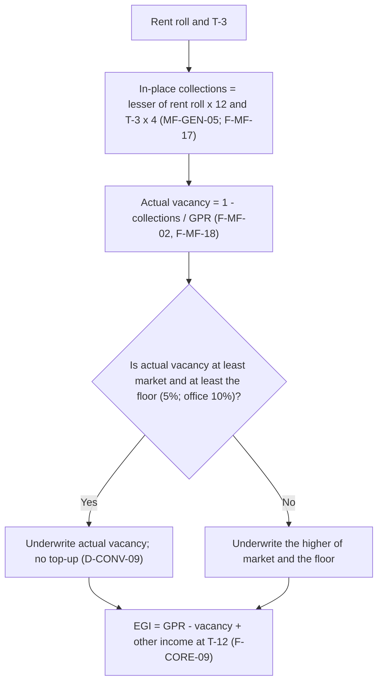
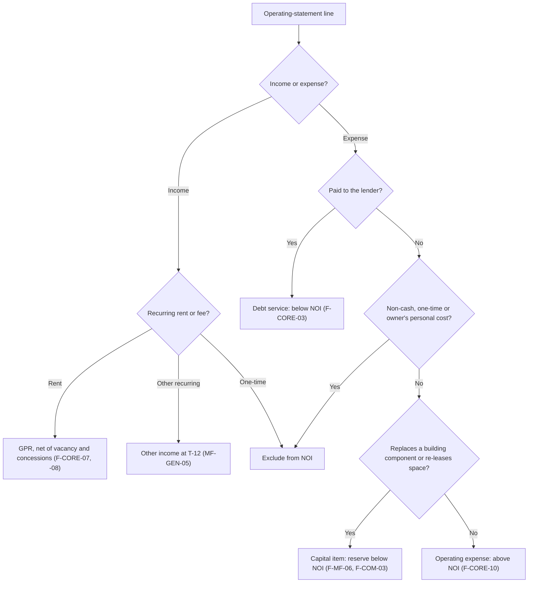
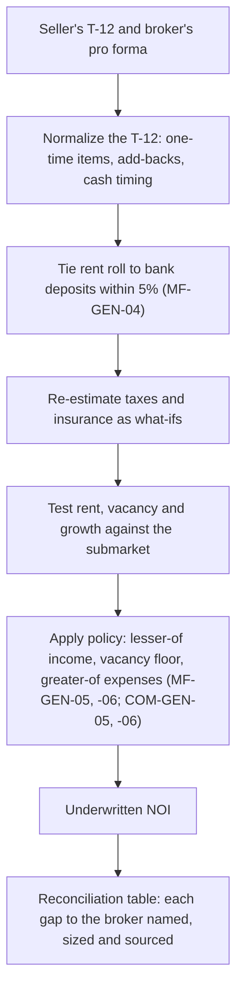
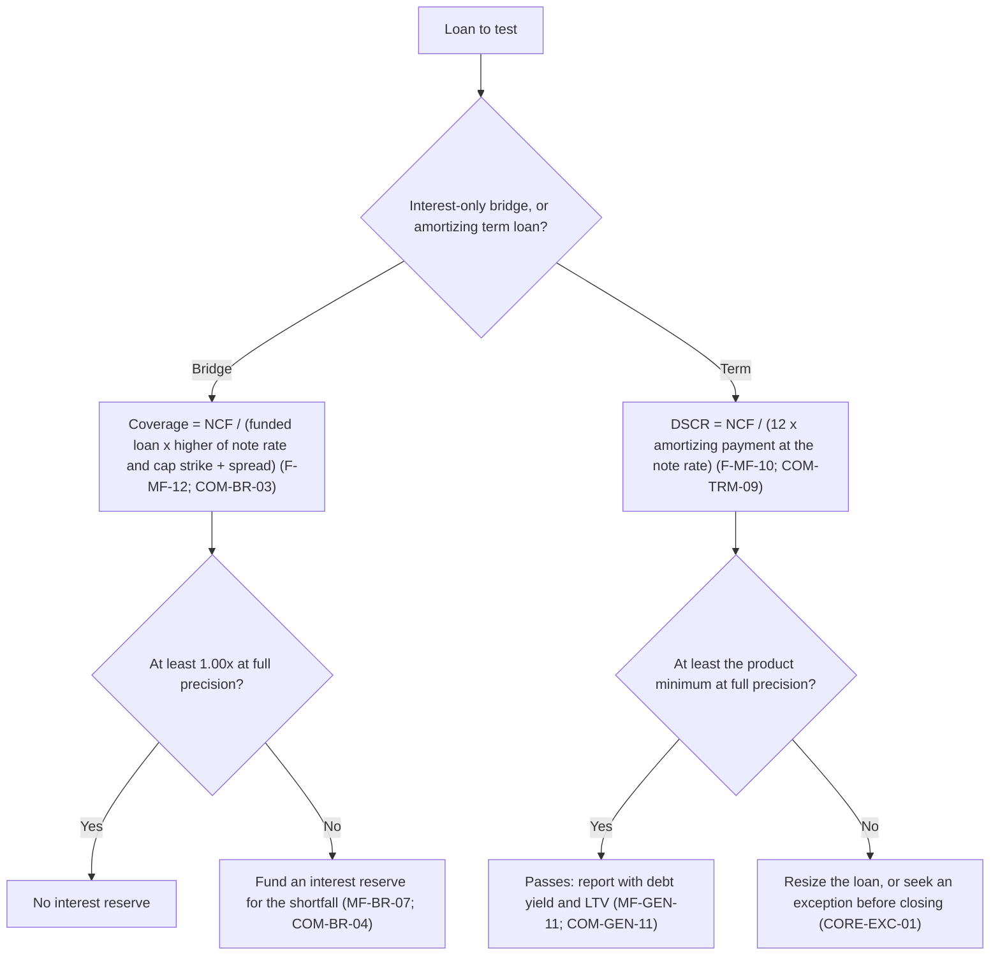
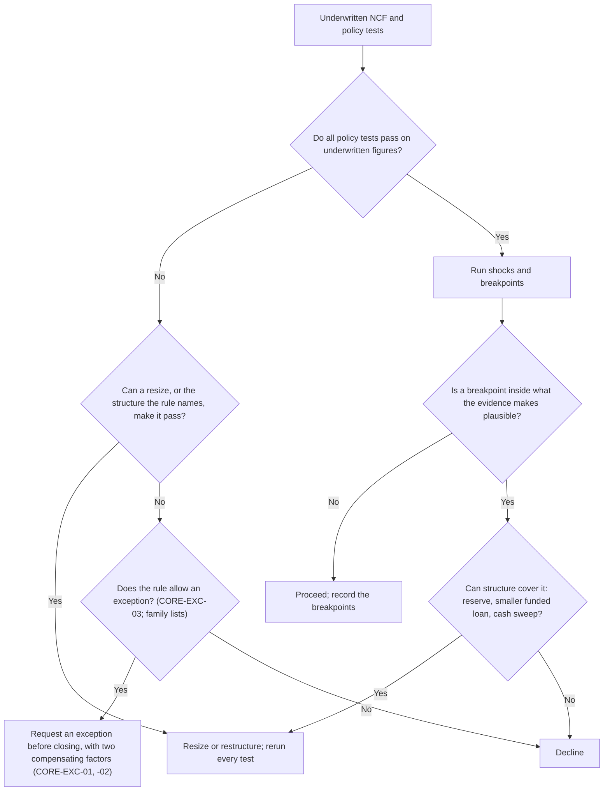

# C4: Property cash flow: from gross potential rent to NOI

**Model policy for training - not for live lending decisions.** Fictional data only.

| Item | Detail |
| --- | --- |
| Assets in this tab | C4-lesson-v1.0-draft, C4-quiz-v0 (sets A and B, unchanged until Phase 3), C4-ojt-v1.0-draft, C4-jobaid-v1.0-draft |
| Objectives | O1 calculate GPR, vacancy, loss-to-lease and EGI from a rent roll; O2 classify operating lines and lease expense terms; O3 reconcile a T-12 or pro forma to underwritten NOI with submarket evidence; O4 calculate NOI and NCF; O5 calculate DSCR, coverage and break-even at full precision; O6 evaluate shocks and recommend proceed, resize or decline |
| Hours | Projected 3.0 to 3.2 CPE credits (QAS Self Study word-count formula, qas-spec.md). About 15,600 to 16,000 counted words ÷ 180 = 87 to 89 minutes, plus 39 planned questions (16 review, 23 exam) × 1.85 = 72 minutes. That is 159 to 161 minutes ÷ 50 = 3.18 to 3.22, rounded down to fifths. The blueprint's 3.8 counted open-answer practice, which the amended counting rule excludes. Final count after Phase 3. The OJT task is extra |
| Knowledge level | Intermediate (qas-spec.md) |
| Field of study | Finance about 60%, Specialized Knowledge about 40% (lease structures, property-tax law, fraud checks), split by content time |
| Prerequisite | C3 (annual debt service, loan constant, test-rate basis, full-precision comparison). Reading an income statement and telling cash from accrual. No advance preparation |
| Bloom's levels | 2 Understand (O2), 3 Apply (O1, O4, O5), 4 Analyze (O3) and 5 Evaluate (O6), within LD-02 as amended 22 Nov 2026 |
| Formulas | F-CORE-03, F-CORE-07 to F-CORE-12; F-MF-02, -06, -09, -10, -11, -12, -17, -18, -21; F-COM-02, -03, -09; F-RES-07 |
| Rules | D-CONV-01, D-CONV-09; CORE-AUTH-01; CORE-EXC-01, -02, -03, -04; CORE-PRC-05; MF-GEN-04, -05, -06, -09, -10, -11; MF-BR-05, -07, -08, -09, -10, -13; MF-TRM-02; COM-GEN-05, -06, -07, -08, -09, -11, -12; COM-BR-02, -03, -04; COM-TRM-09; RES-DSCR-02 |
| Running deals | Worked examples: RD-MF-01 Cedar Court and RD-COM-01 Birchwood Plaza. Practice: RD-COM-01, fictional properties and the Alegre Park OM (LD-05, LD-08) |
| Status | v1.0-draft. Teach, Practice, OJT and Job aid rewritten to the C4 blueprint. Review questions and exam forms follow in Phase 3. Self-review is at the end of this tab |
| Change log | v0, 19 Nov 2026: first draft; all numbers computed in code. v0.2, 22 Nov 2026: review fixes, policy decisions D-CORE-17 onward, self-check. v1.0-draft, 22 Nov 2026: rewritten to blueprint (Phase 2b). Quant check, 22 Nov 2026: T6 resize what-if rounded down per CORE-PRC-05 |

## 1. Hook

The broker's package for Cedar Court shows net operating income (NOI) of $575,000. Your underwriting shows $410,000. It is the same 50-unit building, and the gap is $165,000 a year.

How much loan is that gap worth? At a 1.25x coverage minimum and a 7.00% loan constant, $165,000 of income supports $165,000 ÷ 1.25 ÷ 7.00% = $1,885,714.29 of debt. At 1.00x coverage it would support $2,357,142.86, so always state the coverage you used.

By the end of this module you can rebuild the $410,000 line by line from the rent roll. You can name every dollar of the $165,000 gap and test it against the submarket. And you can say how far cash flow can fall before coverage fails.

## 2. Objectives

By the end of C4, you will be able to:

1. **O1. Calculate** gross potential rent, vacancy and credit loss, loss-to-lease and effective gross income from a rent roll, applying the family vacancy floor (F-CORE-07 to F-CORE-09, F-MF-02; MF-GEN-05; COM-GEN-05).
2. **O2. Classify** each operating-statement line and each lease's expense terms (gross, modified gross, triple net) by where it sits in the NOI build.
3. **O3. Reconcile** a seller's trailing 12-month statement (T-12) or broker's pro forma to underwritten NOI, testing rent and vacancy against submarket evidence and naming each adjustment and its amount.
4. **O4. Calculate** underwritten NOI and net cash flow (NCF) with the family expense and reserve rules (F-CORE-10, F-MF-06, F-MF-09, F-COM-03; MF-GEN-06; COM-GEN-06, -07).
5. **O5. Calculate** the debt service coverage ratio (DSCR) on the family income base and break-even occupancy, and compare each with its minimum at full precision (F-CORE-11, F-CORE-12, F-MF-10, F-MF-12).
6. **O6. Evaluate** whether in-place cash flow supports the request after vacancy, rent and expense shocks, and recommend proceed, resize or decline.

O1, O4 and O5 are at Bloom level 3 (Apply). O2 is at level 2 (Understand), O3 at level 4 (Analyze) and O6 at level 5 (Evaluate).

## 3. Teach

### T1. Rent roll to effective gross income

**The point.** Effective gross income is the rent a property can collect, not the rent it advertises; the rent roll proves the difference.

**Why income comes first.** A commercial real estate (CRE) loan is repaid from the property's cash flow. Every later number in this course starts from the income line: NOI, net cash flow, value, loan size and coverage.

An error of $10,000 in income flows straight through to NOI. At a 1.25x coverage minimum and an 8.25% test rate, it moves the supportable loan by $10,000 ÷ 1.25 ÷ 8.25% = $96,969.70. So the underwriter's first job is to get income right.

**Four income lines.** Income is built in four steps, each with a Formula Library ID.

| Line | What it measures | Formula |
| --- | --- | --- |
| Gross potential rent (GPR) | Rent if every unit or suite is leased all year at its scheduled rent | F-CORE-07: GPR = 12 × Σ monthly rent per unit |
| Vacancy and credit loss | Rent not collected: empty units, unpaid rent, concessions and loss-to-lease | F-CORE-08: V = GPR × vacancy rate |
| Other income | Recurring non-rent income: parking, laundry, pet fees, utility reimbursements | Taken at the T-12 (MF-GEN-05) |
| Effective gross income (EGI) | What the property is expected to collect | F-CORE-09: EGI = GPR − V + other income |

**What a rent roll shows.** A rent roll is the owner's list of every unit or suite on one date. It is the starting document for income, because it shows each lease, not a total.

A good multifamily rent roll has one row per unit and these columns.

| Column | What to check |
| --- | --- |
| Unit and type | Every unit appears once, including vacant, model and down units |
| Tenant name | Vacant units say "vacant", not blank; employee units are flagged |
| Lease start and end | Expired leases are month-to-month; leases signed in the last 60 days are new and unproven |
| Market rent | The owner's asking rent for that unit type today |
| Contract rent | What the lease says the tenant pays each month |
| Concession | Free rent or discounts, with the months they apply |
| Deposit | Security deposit held; a missing deposit on a new lease is a question |
| Balance due | Past-due rent, aged 0-30, 31-60 and over 60 days |

The table below is a fictional eight-unit excerpt from a training rent roll, Linden Row. It is not a running deal. It shows the patterns an underwriter looks for.

| Unit | Status | Lease end | Market rent | Contract rent | Concession | Balance due |
| --- | --- | --- | --- | --- | --- | --- |
| 101 | Leased | Mar 2027 | $1,200 | $1,150 | None | $0 |
| 102 | Leased | Month-to-month | $1,200 | $1,050 | None | $0 |
| 103 | Vacant | n/a | $1,200 | $0 | n/a | n/a |
| 104 | Leased, signed 3 weeks ago | Nov 2027 | $1,200 | $1,200 | 1 month free | $0 |
| 201 | Leased | Jun 2027 | $1,250 | $1,250 | None | $2,500 (over 60 days) |
| 202 | Leased | Aug 2027 | $1,250 | $1,225 | None | $0 |
| 203 | Employee unit | n/a | $1,250 | $0 | n/a | n/a |
| 204 | Leased | Jan 2027 | $1,250 | $1,250 | None | $1,250 (0-30 days) |

Read it row by row. Unit 102 pays $150 below market and can leave on 30 days' notice. Unit 104 shows a full contract rent, but the first month is free, so year-one cash is one month lower.

Unit 201 owes two months and is likely a credit loss. Unit 203 earns no rent. Physically, six of eight units are leased (75%), but cash tells a different story.

**Linden Row in dollars.** Put the eight rows into one month's dollars. GPR at market is 4 × $1,200 + 4 × $1,250 = $9,800.

| Step | Monthly amount |
| --- | --- |
| GPR at market | $9,800 |
| Vacant unit 103 | −$1,200 |
| Employee unit 203 | −$1,250 |
| Loss-to-lease on units 101, 102 and 202 | −$225 |
| Concession on unit 104 ($1,200 ÷ 12) | −$100 |
| Unit 201, not paying | −$1,250 |
| Rent likely collected | $5,775 |

Economic occupancy is $5,775 ÷ $9,800 = 58.9% (F-MF-02), against 75% physical occupancy. The 16-point gap comes from three lines a unit count cannot see: loss-to-lease, the concession and the tenant who is not paying.

**Units that earn no rent.** Model units, employee units and units held out of service for repair are not vacant in the usual sense. They still earn nothing. List them separately, and ask whether each will return to the rent roll, and when.

A renovation plan such as Cedar Court's takes units out of service on purpose. So the count matters twice: for today's income, and for the plan's timing (T6).

**Reading the aging.** Past-due balances tell you about tenants and about management. A balance under 30 days is often a late payment. Over 60 days, treat it as lost unless the tenant has a payment plan that is being kept.

Add up the over-60 balances and compare them with a month of GPR. At Linden Row, unit 201's $2,500 alone is about a quarter of one month's scheduled rent on eight units.

**Month-to-month and expiring leases.** A month-to-month tenant can leave on short notice, and so can a lease ending in the next 90 days. Count how many units sit in each group.

A building with a third of its leases expiring in one quarter has a turnover risk that a single occupancy figure hides. Lease end dates also tell you when below-market rents can reset.

**Commercial rent rolls.** A retail or office rent roll lists suites, not units. Each row adds the suite's rentable square feet (sf), annual base rent and rent per sf, and the lease's expiry and renewal options.

It also shows the recovery terms: which expenses the tenant pays back, and how. T2 reads those terms. A commercial rent roll also names the guarantor of each lease and any co-tenancy or early-termination rights.

For a strip center like Birchwood Plaza, the suite list is short, so read every lease abstract behind it. The rent roll is the owner's summary; the lease is the contract (C9 covers lease documents).

**Physical versus economic occupancy.** Physical occupancy counts units: leased units ÷ total units. Economic occupancy counts dollars: rent collected ÷ GPR (F-MF-02).

The gap between them is the evidence. Concessions, delinquency, employee units and below-market leases all lower economic occupancy without changing the unit count.

The Office of the Comptroller of the Currency (OCC) makes the same point for apartments. "Even though a review of the rent roll might indicate a high rate of occupancy, actual collections should be examined to determine the true economic occupancy." \[VERIFY: OCC, Comptroller's Handbook: Commercial Real Estate Lending, v2.0, Mar 2022, p. 122; checked 22 Nov 2026\]

**Loss-to-lease.** Loss-to-lease is the gap between market rent and contract rent on leased units. Unit 102 above has a loss-to-lease of $150 a month.

It is real lost income today, but it can close as leases roll to market. A pro forma that assumes it closes in year one needs evidence: recent renewals at market, not just asking rents.

When contract rent is above market, the gap runs the other way. Some analysts call that gain-to-lease. It is a warning, because tenants paying above market are the ones most likely to leave at renewal.

**Concessions and bad debt.** A concession is free rent or a discount given to sign a lease. A month free on a 12-month lease cuts that year's rent by one-twelfth, or 8.3%.

Bad debt is rent billed but never collected. Both belong in vacancy and credit loss, not as an expense. The OCC lists "unusually generous concessions including rent" among its warning indicators for a CRE loan \[VERIFY: OCC CRE Handbook v2.0, p. 56; checked 22 Nov 2026\].

**Annualizing: rent roll versus T-3.** Owners report income in two ways. The rent roll shows scheduled rent on one date; multiply the month by 12. A trailing three months (T-3) shows cash actually collected; multiply by 4.

Each can mislead. A rent roll can show rents raised last week that no tenant has paid yet. A T-3 can include a one-off catch-up payment from a delinquent tenant.

Our policy takes the lesser of the two (MF-GEN-05; F-MF-17). That stops a freshly raised rent roll from being underwritten before the rents are collected.

Cedar Court shows both figures. Its rent roll schedules $702,000 ÷ 12 = $58,500 a month. Its T-3 collected $708,000 ÷ 4 = $177,000 over three months, or $59,000 a month.

The T-3 is $500 a month higher. That could be late payments from earlier months arriving, or fees counted as rent. Either way, the lesser figure is the one supported by today's leases.

**Seasonality.** Some markets lease in seasons. College towns fill in August; some Sun Belt markets peak in spring.

A T-3 taken in the strongest quarter overstates the year. When the T-12 shows a clear seasonal pattern, compare the T-3 with the same months a year earlier before relying on it.

**Other income.** Other income is recurring income that is not rent: parking, laundry, pet fees, late fees and utility reimbursements. Our policy takes it at the T-12 figure (MF-GEN-05). A full year smooths out seasonal fees, and it stops a seller from annualizing one good month.

Read the line items and remove anything that will not recur, such as an insurance payout or deposits forfeited in a wave of evictions. Cedar Court's other income is $18,000 a year, or $30 a unit a month. It is added after vacancy, so F-CORE-09 does not reduce it by the vacancy rate.

**The vacancy rate we underwrite.** Underwriting never uses a vacancy rate below the family floor, whatever the building shows today.

| Family | Rule | Underwritten vacancy and credit loss |
| --- | --- | --- |
| Multifamily | MF-GEN-05; F-MF-18 | Greater of actual, market or 5% |
| Commercial | COM-GEN-05 | Greater of actual, market or 5%; 10% for office |

"Actual" here is economic vacancy: 1 − economic occupancy (F-MF-18). "Market" comes from the appraisal's survey of competing properties. The 5% floor applies even to a building that is 100% leased today.

When the lesser-of test has already picked a lower income figure, D-CONV-09 stops you counting the same vacancy twice. You deduct only the vacancy above what the chosen income already reflects.

The flowchart shows the order of work. Choose the income figure first, then test its implied vacancy against market and the floor.

**The real-world rule.** No statute sets how a lender measures income on a business-purpose loan. Supervisors set expectations for regulated lenders, and market practice fills the rest.

The OCC says a lender's income analysis typically considers "historical, current, and projected rental rates, operating expenses, capital expenditures, and vacancy and absorption rates". The list also includes "volume and trends in past-due leases". \[VERIFY: OCC CRE Handbook v2.0, p. 42; checked 22 Nov 2026\]

It adds that "each of the factors should be considered under both normal and stressed conditions" \[VERIFY: OCC CRE Handbook v2.0, p. 42; checked 22 Nov 2026\]. T6 runs the stressed version.

The handbook also explains why underwritten vacancy can differ from the building's. NOI "may assume market vacancy rates that are above or below actual vacancy rates" \[VERIFY: OCC CRE Handbook v2.0, p. 42; checked 22 Nov 2026\]. Our policy only ever moves it up.

**How our model policy applies it.** Multifamily income is in-place rent, the lesser of rent roll and T-3 annualized. Vacancy is the greater of actual, market or 5%, and other income is taken at the T-12 (MF-GEN-05).

Commercial income counts only signed leases with tenants in occupancy and paying. Vacancy is the greater of actual, market or 5%, or 10% for office (COM-GEN-05). The rent roll must tie to bank deposits within 5% for the last three months (MF-GEN-04; T3).

**Worked example 1: Cedar Court income (RD-MF-01)**

1. **Formula.** F-CORE-07: GPR = units × monthly rent × 12. F-CORE-08: V = GPR × vacancy rate. F-CORE-09: EGI = GPR − V + other income.
2. **Inputs.** 50 units at $1,300 market rent; rent-roll collections annualized $702,000; T-3 annualized $708,000; other income (T-12) $18,000.
3. **Substitution.** GPR = 50 × $1,300 × 12 = $780,000.00. In-place collections = lesser of $702,000 and $708,000 = $702,000 (MF-GEN-05). Vacancy rate = 1 − $702,000 ÷ $780,000 = 10.0%. V = $780,000 × 10.0% = $78,000.00.
4. **Result.** EGI = $780,000 − $78,000 + $18,000 = $720,000.00. The 10.0% vacancy is above the 5% floor, so no top-up is needed (D-CONV-09).

Notice what the lesser-of test did. The T-3 is $6,000 higher than the rent roll. Using it would have added $6,000 of income that the current leases do not support.

**Worked example 2: Cedar Court physical versus economic occupancy (RD-MF-01)**

1. **Formula.** Physical occupancy = leased units ÷ total units. F-MF-02: economic occupancy = collections ÷ GPR. Implied rent per leased unit = collections ÷ 12 ÷ leased units.
2. **Inputs.** 44 of 50 units leased; collections $702,000; GPR $780,000; market rent $1,300.
3. **Substitution.** Physical = 44 ÷ 50 = 88.0%. Economic = $702,000 ÷ $780,000 = 90.0%. Implied rent = $702,000 ÷ 12 ÷ 44 = $1,329.545…
4. **Result.** Economic occupancy (90.0%) is above physical occupancy (88.0%). The 44 leased units appear to pay $1,329.55 a month, $29.55 above the $1,300 market rent.

That is the reverse of the normal pattern. Concessions and bad debt usually push economic occupancy below physical occupancy, as at Linden Row.

The table splits Cedar Court's collections into their parts.

| Part | Calculation | Amount |
| --- | --- | --- |
| GPR at market | 50 × $1,300 × 12 | $780,000.00 |
| Physical vacancy, 6 units | 6 × $1,300 × 12 | −$93,600.00 |
| Gain-to-lease on 44 units | $702,000 − 44 × $1,300 × 12 | +$15,600.00 |
| Collections | $780,000 − $93,600 + $15,600 | $702,000.00 |

Before renovation, a 1986 building should not out-earn its market rent. An underwriter asks why. Possible answers include fees in the rent line, a vacancy count taken on a different date from the collections, or catch-up payments.

Each answer changes the income. So you request the rent roll by unit and the bank statements for the same months (MF-GEN-04).

Running Deals keep these figures as they are. Treat the gap as a diligence question, not a reason to change the inputs.

**Verifying a rent roll.** A rent roll is the owner's document, so test it before you build on it. Five steps cover most files.

1. **Foot it.** Add the contract rents and compare with the total the owner reports. A rent roll that does not add up has been edited.
2. **Sample the leases.** Pull leases for at least the largest tenants and a random handful of units. Check names, rents, dates and concessions against the roll.
3. **Tie it to the bank.** Compare three months of rent with bank deposits, within 5% (MF-GEN-04; T3).
4. **Check the vacant units.** On the site visit, confirm vacant units are vacant and rentable. The OCC warns that cash-strapped owners sometimes strip vacant units of appliances \[VERIFY: OCC CRE Handbook v2.0, p. 123; checked 22 Nov 2026\].
5. **Confirm with tenants.** For commercial property, estoppel certificates confirm each lease's terms with the tenant (COM-GEN-09; C9).

**Commercial vacancy in place.** Birchwood Plaza shows how the commercial rule works. COM-GEN-05 counts only signed leases with tenants in occupancy and paying.

Its 28,000 leased sf of 40,000 give 70% physical occupancy. In-place income is the $420,000 of base rent and $84,000 of recoveries those leases pay: $504,000 in all.

Because the vacant 30% earns nothing, in-place income already reflects 30% vacancy, far above the 5% floor. No further vacancy is deducted from in-place income, the same logic as D-CONV-09. At stabilization the appraiser's 5% replaces it (practice problem 1).

**Common slips.**

- Using physical occupancy as the vacancy rate. Cedar Court's 12.0% physical vacancy is not the 10.0% economic vacancy the policy uses (F-MF-18).
- Applying vacancy to other income as well as rent. F-CORE-09 adds other income after vacancy.
- Mixing market rent for vacant units with contract rent for leased ones without saying so (F-CORE-07).
- Taking the higher of rent roll and T-3. The policy takes the lesser (MF-GEN-05).
- Counting vacancy twice when the lesser-of test already reflects it (D-CONV-09).

**Why it matters to a credit officer.** Income errors compound: every dollar of overstated income becomes overstated NOI, value and loan. The rent roll and the bank statements are where you catch it, before the appraisal and the credit memo repeat it.

### T2. Lease structures and line classification

**The point.** NOI is only as good as the sorting of each line, and a commercial lease decides who pays each expense.

**Above and below the line.** NOI measures what the property earns from operating, before financing, capital spending and the owner's taxes. A line belongs "above the line" only if it recurs as a cost of running the property.

Everything else sits below NOI or is left out. Four tests sort any line.

1. **Is it recurring?** A one-time insurance claim or lease buyout is not. Leave it out of NOI.
2. **Is it an operating cost or a capital item?** A roof replacement extends the building's life. It belongs in the replacement reserve, below NOI (F-MF-06, F-COM-03).
3. **Is it debt service?** Mortgage interest and principal are paid to the lender. NOI is measured before them, so coverage can compare the two (F-CORE-03).
4. **Is it cash?** Depreciation and amortization are accounting entries. They reduce taxable income but not cash, so they are excluded.

The flowchart is the order of questions for any line. Most errors come from skipping the "one-time" and "capital" questions.

**The classification table.**

| Item | Where it goes | Why |
| --- | --- | --- |
| Real estate taxes, insurance, utilities, repairs, payroll | Operating expense | Recur every year |
| Management fee | Operating expense, at least 3% of EGI | Charged even if the owner self-manages (MF-GEN-06, COM-GEN-06) |
| Roof, HVAC (heating, ventilation and air conditioning), parking lot replacement | Capital item, below NOI | Covered by replacement reserves (F-MF-06, F-COM-03) |
| Tenant improvements and leasing commissions | Capital item, below NOI | Covered by the tenant improvement and leasing commission (TI/LC) reserve (F-COM-03) |
| Mortgage interest and principal | Debt service | NOI is measured before debt (F-CORE-03) |
| Depreciation and amortization | Excluded | Non-cash accounting entries |
| Insurance claim proceeds, lease termination fees | Excluded | One-time, not recurring |
| Owner's personal costs (car, travel, salary) | Excluded | Not a property cost |
| Concessions (free rent) | Inside vacancy and credit loss | They cut collected rent (F-CORE-08) |
| Parking, laundry, pet fees, utility reimbursements | Other income | Recurring income that is not rent (MF-GEN-05) |
| Expense recoveries (commercial) | Income, inside GPR by course convention | Tenants repay the landlord under the lease (below) |

**Why management is charged even when the owner does it.** A self-managing owner shows no management fee. But a lender that takes the property back must hire a manager. So the fee is a real cost of the property, whoever does the work.

The OCC agrees. NOI can include expenses "that may not represent an actual or immediate cash expense, such as management fees and reserves for capital replacements" \[VERIFY: OCC, Comptroller's Handbook: Commercial Real Estate Lending, v2.0, Mar 2022, p. 42; checked 22 Nov 2026\].

It says multifamily properties are "typically underwritten with management fees of 5 percent of revenues" \[VERIFY: OCC CRE Handbook v2.0, p. 123; checked 22 Nov 2026\]. For retail, fees are "typically underwritten at 3 to 5 percent of effective gross income, exclusive of reimbursements" \[VERIFY: OCC CRE Handbook v2.0, p. 121; checked 22 Nov 2026\].

Our 3% is a floor, not a target (MF-GEN-06, COM-GEN-06). Where the appraiser or the actual contract shows more, the higher figure flows through the expense rule in T4.

**Lease structures.** Multifamily leases are almost always gross: the tenant pays rent, and the landlord pays the building's costs. Commercial leases vary, and the lease type decides who carries each expense.

| Lease type | Tenant pays | Landlord pays | What it means for NOI |
| --- | --- | --- | --- |
| Gross (full service) | Rent only | Taxes, insurance, maintenance, often utilities | Rent is higher; the landlord carries expense increases |
| Modified gross | Rent, plus some costs or increases over a base year | The rest | Shared; read the base year and the stop |
| Net (single or double) | Rent plus taxes, or taxes and insurance | Remaining costs | Partly passed through |
| Triple net (NNN) | Rent plus a share of taxes, insurance and common area maintenance (CAM) | Usually roof and structure; vacant space's share | Most costs pass through; rent is lower |

Market practice differs by property type. The OCC says office buildings are "usually leased on a gross basis (expenses paid by the landlord)". It also says retail leases are "commonly written on a net basis with tenants reimbursing the landlord for common area maintenance". \[VERIFY: OCC CRE Handbook v2.0, pp. 119-120; checked 22 Nov 2026\]

The OCC adds the warning that matters most. Terms vary, so lease agreements "should always be reviewed to determine which expenses are the landlord's responsibility" \[VERIFY: OCC CRE Handbook v2.0, p. 120; checked 22 Nov 2026\].

**How recoveries work.** Under a net lease, the landlord pays the property's bills and bills tenants back. The tenant's share is usually its pro rata share: its leased sf ÷ the building's rentable sf.

Tenants pay estimates monthly. After year-end the landlord reconciles actual costs against the estimates and bills or credits the difference.

Three terms change the arithmetic.

- **Base year or expense stop.** Under a modified gross lease, the tenant pays only increases above a base year's costs. Or it pays costs above a set figure per sf.
- **Caps.** Some leases cap how fast controllable CAM costs can rise each year.
- **Exclusions.** Most leases exclude capital items, the landlord's income taxes and often management above a set percentage.

Vacant space recovers nothing. Its share of taxes, insurance and CAM stays with the landlord. That is why falling occupancy hurts a net-leased center twice: it loses the rent and the recovery.

**A recovery calculation (fictional tenant).** Take a 2,000 sf tenant in a 40,000 sf center, on a NNN lease with no cap. Its pro rata share is 2,000 ÷ 40,000 = 5.0%.

If the year's recoverable taxes, insurance and CAM total $150,000, the tenant owes 5.0% × $150,000 = $7,500. It paid estimates of $500 a month, or $6,000. The reconciliation bills it $1,500 more.

Now change one term. Under a modified gross lease with a $4.00 per sf expense stop, the tenant pays only costs above $4.00 × 2,000 = $8,000. Its $7,500 share is below the stop, so it owes nothing extra; the landlord carries all of it.

The same tenant, the same costs, and two lease types give recoveries of $7,500 or $0. That is why the lease abstract, not the rent roll, decides the recovery line.

**Percentage rent.** Some retail tenants, usually anchors, pay a base rent plus a percentage of sales above a breakpoint. The OCC notes that percentage rents "may vary considerably and are inherently less predictable" \[VERIFY: OCC CRE Handbook v2.0, p. 120; checked 22 Nov 2026\].

Underwrite percentage rent only on a history of actual payments, and stress it hardest. Birchwood Plaza has none.

**RUBS and utility reimbursements.** In apartments, a ratio utility billing system (RUBS) bills tenants a share of water, sewer or trash. It is other income at the T-12 (MF-GEN-05).

Check that the matching utility cost sits in expenses. A seller who shows the RUBS income but nets the cost against it understates both lines.

**Where recoveries sit in this course.** The Formula Library puts commercial recoveries inside GPR, then applies vacancy to the total (F-CORE-09 fixtures). That is a course convention, chosen so one vacancy rate covers lost rent and lost recoveries together.

Many lenders and appraisers show recoveries as a separate line after base rent. The NOI is the same either way if vacancy is applied to both. State which method you use, and never apply vacancy to recoveries twice.

**Reading a lease abstract.** A lease abstract is a one-page summary of a lease. For each commercial tenant, pull these terms before you trust the recovery line.

| Term | Why it matters to cash flow |
| --- | --- |
| Commencement and expiry dates | Feed the rollover test (F-COM-02; T6) |
| Base rent and scheduled increases | Set GPR today and its path |
| Recovery type: gross, modified gross or net | Decides who pays expense increases |
| Base year or expense stop | Sets the level above which the tenant pays |
| Caps and exclusions | Limit what the landlord can bill back |
| Renewal options | An option at a fixed rent caps future rent |
| Termination and co-tenancy rights | Let the tenant leave, or pay less, if a named tenant goes |
| Guarantor | Says who stands behind the rent |

Compare the abstract with the lease itself for the largest tenants. An abstract is the owner's or broker's summary, so it can carry the same optimism as the rent roll. C9 covers the documents.

**Recovery timing.** A T-12 can hold more than 12 months of recoveries. Tenants pay estimates through the year, then a true-up after year-end. If last year's true-up landed in this T-12, recoveries are overstated.

Ask for the reconciliation statements, and match recoveries to the expenses of the same year.

**Hard cases.** A few lines trip up even experienced analysts.

- **Security deposits.** A deposit is the tenant's money held against damage. It is a liability, not income. Forfeited deposits applied to damage can be other income, but only on a history.
- **Late fees and application fees.** Recurring fees are other income at the T-12 (MF-GEN-05). A spike in late fees is also a delinquency signal.
- **Eviction legal costs.** These recur in most apartment portfolios. Keep them in operating expenses, even if the seller calls them one-time.
- **Utilities on vacant units.** The landlord pays them, so they stay in expenses. They usually fall as occupancy rises; do not assume that until it happens.
- **Capitalized repairs.** Some owners record large repairs as capital to lift NOI. If the work recurs every year, such as carpet or appliance replacement, it is an operating cost or reserve item. Look at the general ledger.

**The real-world rule.** No statute defines NOI for a business-purpose loan. Who pays each expense is a term of the lease between landlord and tenant. C9 covers lease documents, estoppels and subordination agreements.

For lenders, the OCC's handbook sets the supervisory expectation. Reported expenses should be compared "with expenses incurred by comparable properties, adjusted for supported variances and lease terms" \[VERIFY: OCC CRE Handbook v2.0, p. 42; checked 22 Nov 2026\]. Lease terms are part of the test.

**How our model policy applies it.** Expenses are the greater of T-12 and the appraiser's estimate, with management at least 3% of EGI (MF-GEN-06, COM-GEN-06). Capital items are covered by reserves below NOI: $300 per unit for multifamily (F-MF-06), and TI/LC plus replacement per sf for commercial (COM-GEN-07, F-COM-03).

Commercial income counts only signed leases with tenants in occupancy and paying (COM-GEN-05). Estoppels confirm the lease terms with tenants paying 20% or more of rent and the top five (COM-GEN-09).

**Worked example 3: Birchwood Plaza recoveries, in place (RD-COM-01)**

1. **Formula.** Rent per sf = annual rent ÷ leased sf. Pro rata expense share = expenses × leased sf ÷ rentable sf. Recovery ratio = recoveries ÷ pro rata share. (Lease arithmetic; no Formula Library ID.)
2. **Inputs.** 40,000 sf; 28,000 sf leased (70%); base rent $420,000; recoveries $84,000; expenses $204,000 (appraiser, greater of T-12 and appraiser, COM-GEN-06).
3. **Substitution.** Base rent $420,000 ÷ 28,000 = $15.00 per sf. Recoveries $84,000 ÷ 28,000 = $3.00 per sf. Expenses $204,000 ÷ 40,000 = $5.10 per sf. Leased share $204,000 × 70% = $142,800. Recovery ratio $84,000 ÷ $142,800 = 58.8%.
4. **Result.** Leased tenants repay $3.00 of the $5.10 per sf the building costs. The landlord carries $204,000 − $84,000 = $120,000 of expenses: $61,200 for vacant space and $58,800 not recovered from leased space.

What does that say about the leases? A pure NNN lease recovering every expense would bring in about $5.10 per sf. At $3.00, the leases are more likely modified gross, or net with exclusions such as management and structure.

The rent roll does not settle it, so the underwriter reads each lease. The stabilized figures fit the same pattern. $120,000 of recoveries on 40,000 sf is again $3.00 per sf; $600,000 of base rent is again $15.00.

| Lease type (what-if for Birchwood's leased 28,000 sf) | Recoveries | Base rent pattern | Landlord's exposure to a 10% expense rise |
| --- | --- | --- | --- |
| Gross | $0 | Higher, to cover expenses | All of the increase on leased space |
| Modified gross over a base year | Increases above the base year only | Middle | Little on leased space: tenants pay increases above the base year |
| As Birchwood's figures imply ($3.00 of $5.10 per sf) | $84,000 | $15.00 per sf | Depends on the lease terms: read them |
| Full NNN on every expense | About $142,800 | Lowest | Vacant space only |

**Common slips.**

- Treating recoveries as pure profit. They repay expenses the landlord has already paid.
- Assuming all retail is NNN. Birchwood's ratio says its leases are not, or not fully.
- Leaving a self-managing owner's statement without a management fee (MF-GEN-06).
- Expensing a roof replacement in the T-12 and also deducting a replacement reserve. Remove the one-time cost; keep the reserve.
- Keeping a lease termination fee in income. It is one-time.

**Why it matters to a credit officer.** Two properties with the same NOI can carry very different risk. A NNN center passes expense increases to tenants; a gross-leased office absorbs them. You see that only by reading the leases behind each line.

### T3. Reconciling the seller's numbers, with submarket evidence

**The point.** A seller's T-12 and a broker's pro forma are claims to test against documents and the submarket. Every gap to underwritten NOI needs a name and an amount.

**Three NOIs in every package.** A sale or refinance package usually carries three versions of NOI. Each answers a different question, and only one is ours.

| Version | Who prepares it | What it shows | How we use it |
| --- | --- | --- | --- |
| Trailing 12 months (T-12) | Owner or its manager | What happened over the last year, as the owner recorded it | Starting evidence, after normalizing |
| Broker's Year 1 or pro forma | Seller's broker | What a buyer might earn after changes the broker assumes | A claim to test, never a sizing input |
| Underwritten NOI | The lender | What the property can support today, under policy rules | The sizing and coverage base |

An offering memorandum (OM) is a sales document. Its job is to support the asking price. That does not make it dishonest, but it means every assumption leans one way.

**Normalizing a T-12.** Normalizing means turning the owner's record of last year into a fair estimate of a typical year. There are six common adjustments.

| Adjustment | What you look for | Direction |
| --- | --- | --- |
| One-time income | Insurance proceeds, lease termination fees, a tax refund | Remove: lowers NOI |
| One-time expenses | A storm repair, a lawsuit settlement, a roof paid from operations | Remove the cost; keep the reserve: raises NOI |
| Owner add-backs | The owner's salary, car, travel or other properties' costs | Remove; but add a market management fee: usually lowers NOI |
| Cash versus accrual | Expenses paid late or early; taxes unpaid at year-end | Restate to the year incurred: often lowers NOI |
| Taxes after a sale or revaluation | A new assessed value that resets the bill | Re-estimate: usually lowers NOI |
| Insurance repricing | The buyer's own quote, not the seller's old policy | Use the new premium: often lowers NOI |

The direction column is a pattern, not a rule. A one-time expense removed raises NOI, which is why sellers like to find them. Ask for the invoice before you accept any add-back.

**An add-back, worked through (fictional owner).** A self-managing owner's T-12 shows $24,000 of payroll that is really the owner's own salary, and no management fee. EGI is $500,000.

Remove the salary: NOI rises $24,000. Add a market fee of at least 3% × $500,000 = $15,000 (MF-GEN-06): NOI falls $15,000. The net change is +$9,000, not the +$24,000 the seller may claim.

**Cash versus accrual.** A cash-basis statement records income when received and expenses when paid. An accrual statement records them when earned or incurred.

The two can differ by a full tax bill. If the seller skipped a tax payment during the year, a cash T-12 looks better than the property really is.

The OCC describes exactly this case: a property whose real estate taxes went unpaid. Its tax return "would understate expenses and overstate income compared with financial statements prepared on an accrual basis". It adds: "This can also be the case with operating statements that are prepared on a cash basis." \[VERIFY: OCC, Comptroller's Handbook: Commercial Real Estate Lending, v2.0, Mar 2022, p. 42; checked 22 Nov 2026\]

Its remedy is the one we use: "compare reported expenses with expenses incurred by comparable properties, adjusted for supported variances and lease terms" \[VERIFY: OCC CRE Handbook v2.0, p. 42; checked 22 Nov 2026\]. Our policy does this through the greater of T-12 and the appraiser's estimate (MF-GEN-06, COM-GEN-06).

**Worked example 4: a cash-timing what-if on Cedar Court (RD-MF-01)**

1. **Formula.** Accrual expenses = cash expenses + costs incurred but unpaid. Operating expenses (OpEx) = greater of accrual T-12 and appraiser (MF-GEN-06). NOI (F-CORE-10), NCF (F-MF-09), coverage (F-MF-12).
2. **Inputs.** T-12 expenses $298,000; appraiser $310,000; a what-if that half the $74,000 tax bill, $37,000, was incurred but unpaid in the T-12 period; EGI $720,000; reserves $15,000; test debt service $358,050.
3. **Substitution.** Accrual T-12 = $298,000 + $37,000 = $335,000. OpEx = greater of $335,000 and $310,000 = $335,000. NOI = $720,000 − $335,000 = $385,000. NCF = $385,000 − $15,000 = $370,000. Coverage = $370,000 ÷ $358,050 = 1.0334.
4. **Result.** Restating to accrual cuts coverage from 1.10x to 1.03x. The greater-of rule protects you only if the T-12 you feed it is complete.

This is a what-if; Running Deals do not say Cedar Court's T-12 is cash-basis. The question to ask is simple: "Is this statement cash or accrual, and were all tax installments paid in the period?"

**Tax returns as evidence.** Tax returns are filed with the Internal Revenue Service (IRS), so they are harder to dress up than an OM. They are useful evidence of income, with three limits.

An individual owner reports rental real estate on Schedule E (Form 1040). The IRS says to use it "to report income or loss from rental real estate, royalties, partnerships" and other pass-through items \[VERIFY: IRS, About Schedule E (Form 1040), irs.gov; checked 22 Nov 2026\].

Partnerships and S corporations use Form 8825 "to report income and deductible expenses from rental real estate activities" \[VERIFY: IRS, About Form 8825, irs.gov; checked 22 Nov 2026\]. Most of our borrowers are limited liability companies (LLCs) taxed as partnerships, so expect Form 8825.

1. **Depreciation and interest are deducted.** Schedule E deducts mortgage interest (line 12) and depreciation (line 18). Form 8825 deducts interest (line 8) and depreciation (line 14). Add both back to reach NOI. \[VERIFY: IRS Schedule E (Form 1040) 2025 and Form 8825 (Rev. December 2025) form PDFs; checked 22 Nov 2026\]
2. **Capital items may be missing.** Recurring capital spending "may not be shown as an expense on tax returns", the OCC notes. It is "captured in a replacement reserve" instead \[VERIFY: OCC CRE Handbook v2.0, p. 42; checked 22 Nov 2026\].
3. **Timing.** A return covers a past tax year. It may be 6 to 18 months old by the time you read it.

Use the return to test the T-12, not to replace it. If the return's rents are well below the T-12's for the same year, ask which one the owner wants you to believe.

**Tying the rent roll to the bank.** Paper can be edited; bank deposits are harder to invent. Our policy requires the rent roll to tie to bank deposits within 5% for the last three months (MF-GEN-04).

Match the months, not just the totals. Strip out security deposits, transfers between accounts and any owner capital put in to cover a shortfall. Each can inflate deposits without being rent.

**Taxes after a sale or revaluation.** Real estate tax is usually the largest single expense. It is set by the assessed value times the tax rate, and both can change after you close.

A county revaluation resets the assessed value. It updates every parcel to market, and recent sale prices are the assessor's evidence. So the seller's tax bill may not be the buyer's.

The rules differ in each of our three states.

| State (running deal) | What the law says | What it means for underwriting |
| --- | --- | --- |
| North Carolina (Cedar Court) | Each county must reappraise "every eighth year", and may reappraise earlier by resolution | A revaluation can land during the loan term |
| Indiana (Birchwood Plaza) | A credit caps the tax on nonresidential real property at 3% of gross assessed value, before voter-approved referendum taxes | The bill has a ceiling, even if value rises |
| Ohio (Maple Run) | Franklin County reappraises every six years, with a triennial update between | The bill can move mid-hold |

North Carolina's statute requires each county to "reappraise all real property" as of January 1 on a set schedule and "every eighth year thereafter". A county "may conduct a reappraisal of real property earlier" if its commissioners adopt a resolution. \[VERIFY: N.C. Gen. Stat. 105-286(a), (a)(3), read on codes.findlaw.com, current as of 1 Jan 2023; checked 22 Nov 2026\]

The state's revenue department lists Mecklenburg County, where Cedar Court sits, with its latest reappraisal in 2023 and the next in 2027. Its notes say reappraisals "are effective January 1 of year shown" and property "must be assessed at 100% of appraised value". \[VERIFY: N.C. Department of Revenue, 2026-2027 Property Tax Rates and Reappraisal Schedules (spreadsheet); checked 22 Nov 2026\]

So Cedar Court's 2027 tax bill will rest on a new value, effective 1 Jan 2027. The county's own page says it "conducts a revaluation every four years", to market value as of 1 January \[VERIFY: Mecklenburg County, 2027 Property Revaluation page, engage.mecknc.gov; checked 22 Nov 2026\].

How much will values move? Local press reported a median residential rise of "about 15%" and commercial values up 30% (WFAE, 4 Sep 2026). That is secondary reporting, not an official figure, and it does not say how apartments are classed.

Value is only half the bill: the bill is assessed value times the tax rate, and a revaluation changes only the value. Mecklenburg's county rate was $0.4927 per $100 of value for fiscal year 2026-2027 \[VERIFY: N.C. Department of Revenue, 2026-2027 Property Tax Rates and Reappraisal Schedules (spreadsheet); checked 22 Nov 2026\]. City rates are added on top.

If values rise 15% and the rate is then cut, the bill rises by less than 15%. So a what-if that holds the rate unchanged is a cautious first pass, not a forecast.

Indiana law gives taxpayers a credit for tax above set shares of gross assessed value. The shares are 1% for homesteads, 2% for other residential property, and "three percent (3%)" for nonresidential real property. \[VERIFY: Ind. Code 6-1.1-20.6-7.5(a), read on codes.findlaw.com, current as of 1 Jan 2026; checked 22 Nov 2026\] Taxes that voters approve in a referendum are left out of the credit, so a bill can pass the cap. \[VERIFY: Ind. Code 6-1.1-20.6-7.5(b), read on codes.findlaw.com, current as of 1 Jan 2026; checked 22 Nov 2026\]

For Birchwood Plaza, the cap bounds the bill. If the gross assessed value equaled the $4,400,000 price, the cap would be $4,400,000 × 3% = $132,000. That is a ceiling before any referendum taxes, not an estimate; Running Deals do not split Birchwood's $204,000 of expenses.

Ohio's Franklin County, home to Maple Run, says "a full reappraisal of all properties in Franklin County is completed every six years". A triennial update falls at "the third-year midpoint". The 2026 update reviews arm's-length sales from 2023 to 2025. \[VERIFY: Franklin County Auditor, Real Estate Appraisal page, auditor.franklincountyohio.gov; checked 22 Nov 2026\] Ohio law requires the auditor to appraise each parcel "at least once in each six-year period". \[VERIFY: Ohio Rev. Code 5713.01(B), read on codes.findlaw.com, current as of 1 Jan 2026; checked 22 Nov 2026\]

The same page reports that the 2023 reappraisal "saw a median value increase of 41 percent for residential properties" \[VERIFY: Franklin County Auditor, Real Estate Appraisal page; checked 22 Nov 2026\]. A value jump does not always raise the bill in step, because rates can change. Ask the county treasurer or a tax consultant for an estimate.

The page also says "the next reappraisal will take place in 2030", seven years after 2023 \[VERIFY: Franklin County Auditor, Real Estate Appraisal page; checked 22 Nov 2026\]. Schedules move. Read the county's current page; do not count years forward from the last reappraisal.

**What our policy says, and does not say.** MF-GEN-06 and COM-GEN-06 take the greater of the T-12 and the appraiser's expense estimate. Neither rule tells you to re-estimate taxes after a sale or a revaluation.

So this lesson treats tax reassessment as market practice and a what-if. It sets no new limit. In a credit memo, show the reassessed tax as a sensitivity, and say which figure the policy uses.

**Worked example 5: Cedar Court tax reassessment what-if (RD-MF-01)**

1. **Formula.** Reassessed tax = current tax × (1 + value change), rate unchanged. NCF (F-MF-09) falls by the tax increase. Coverage (F-MF-12) = NCF ÷ test debt service.
2. **Inputs.** Real estate taxes $74,000; a what-if 15% rise (the press-reported residential median; secondary); NCF $395,000; test debt service $358,050.00.
3. **Substitution.** Tax = $74,000 × 1.15 = $85,100.00. Increase = $11,100.00. NCF = $395,000 − $11,100 = $383,900.00. Coverage = $383,900 ÷ $358,050 = 1.0722.
4. **Result.** Coverage falls from 1.10x to 1.07x. It still clears the 1.00x level below which MF-BR-07 requires an interest reserve.

At the press-reported 30% commercial rise, tax would be $96,200.00 and coverage $372,800 ÷ $358,050 = 1.04x. Both are what-ifs; the policy figure remains the greater of T-12 and appraiser.

The tax is already a large line. Taxes and insurance together are $74,000 + $38,000 = $112,000, or 36.1% of Cedar Court's $310,000 of expenses. On the $6,200,000 price, the current tax is 1.19% a year.

**Insurance repricing.** Insurance premiums are set at renewal, and the buyer's policy will differ from the seller's. Ask for the buyer's quote before closing, with the coverage our policy requires (MF-GEN-10).

A T-12 premium from an old policy understates the cost if rates have risen. Re-estimate it like taxes, as a what-if, and compare with the appraiser.

Run the insurance what-if the same way. If the buyer's quote came in 20% above the seller's $38,000, the premium would be $45,600. NCF would fall by $7,600 to $387,400, and coverage to $387,400 ÷ $358,050 = 1.08x.

**T-12 versus appraiser: reading the gap.** When the two expense figures differ, the gap itself is evidence. Cedar Court's appraiser is $12,000 above its T-12; Birchwood Plaza's is $8,000 above ($204,000 against $196,000).

A gap in that direction can mean deferred maintenance, a cash-timing gap, a self-managed owner or simply a cheaper operator. Policy takes the greater either way (MF-GEN-06, COM-GEN-06). The memo still names the likely cause, because it tells you how the buyer will run the property.

**Fraud patterns.** Most bad numbers are optimism, not fraud. But a few patterns recur in fraud cases, and each has a document test.

- **Related-party tenants.** The owner's own companies lease space at rents no outsider pays. Check tenant names against the borrower's ownership chart (C6).
- **Leases with no cash.** A lease exists, but no rent reaches the bank. The deposit tie-out finds it (MF-GEN-04).
- **Backdated or altered leases.** Dates, rents or signatures do not match the tenant's own copy. Estoppels find it for commercial tenants (COM-GEN-09).
- **Prepaid rent dressed as occupancy.** A tenant pays months ahead to make a T-3 look full. Look for one large deposit.

Never accuse; ask for the document. A borrower with clean numbers has no trouble producing it.

**Data red flags.** Some patterns in a package mean "ask for source documents before you trust any figure".

| Red flag | Why it matters | Ask for |
| --- | --- | --- |
| Several lines equal to the dollar | Figures typed in, not recorded | The general ledger |
| Round numbers in a T-12 | Estimates presented as actuals | Monthly statements |
| No management fee | Owner-managed; cost missing | A market fee (MF-GEN-06) |
| Economic occupancy above physical | Income not explained by leases | Rent roll by unit and bank statements (MF-GEN-04) |
| Rent roll far above T-3 | Rents raised, not yet collected | The lesser-of test (MF-GEN-05) |
| Expenses well below comparables | Skipped maintenance or cash timing | Invoices; the appraiser's comparables |
| Two different cap rates in one OM | Careless or selective | The broker's workings |

Cedar Court shows one of these: economic occupancy (90.0%) above physical (88.0%), from T1. Practice problem 6 finds others in a real OM.

**Submarket evidence.** Normalizing tests the seller's past. Submarket evidence tests the broker's future: the rent, vacancy and growth a pro forma assumes.

A submarket is the set of properties that compete for the same tenants. For an apartment building it might be a few square miles of similar-age complexes. For a strip center it is the trade area its shoppers come from.

The OCC lists factors that analysis typically considers, including "comparable rental rates, operating expenses, and sales prices" and "terms of current leases" \[VERIFY: OCC CRE Handbook v2.0, p. 42; checked 22 Nov 2026\]. For portfolio monitoring it names useful market data: "sales prices, rental rates and lease terms, vacancy rates, available inventory, absorption rates, construction starts, and permits granted" \[VERIFY: OCC CRE Handbook v2.0, p. 39; checked 22 Nov 2026\].

The federal real estate lending guidelines for banks list the same factors. A bank should weigh "current and projected vacancy, construction, and absorption rates". It should also weigh "current and projected lease terms, rental rates, and sales prices, including concessions". \[VERIFY: 12 CFR Part 34, Subpart D, Appendix A, Loan Portfolio Management Considerations; checked 22 Nov 2026\]

Four measures carry most of the weight.

| Measure | What it is | Pro forma line it tests |
| --- | --- | --- |
| Submarket vacancy | Vacant units ÷ total units in competing properties | The vacancy rate (MF-GEN-05: "market" in greater of actual, market or 5%) |
| Supply pipeline | Units permitted, under construction or delivering soon | Future vacancy and concessions |
| Absorption | Net units leased per month or year | How fast lease-up or renewal can happen |
| Rent growth | Change in rent for comparable units over a year | Rent increases and the renovation premium |

**Supply and absorption together.** Neither number means much alone. New supply raises vacancy unless absorption keeps up; strong absorption with no supply pushes rents up.

The OCC explains why supply runs late: property "has a long production cycle". So projects should "meet demand that exists at a point in the future", not demand at the start. It notes that "supply often overestimates the expected demand", leading to "prolonged lease-up" and "declines in rental rates". \[VERIFY: OCC CRE Handbook v2.0, pp. 35-36; checked 22 Nov 2026\]

A simple projection links the two. Future vacant units = vacant units today + new deliveries − units absorbed. Divide by the future inventory to get the future vacancy rate.

**Worked example 6: projecting submarket vacancy (illustrative submarket, fictional figures)**

1. **Formula.** Future vacancy = (vacant today + deliveries − absorption) ÷ (inventory + deliveries). (Market arithmetic; no Formula Library ID.)
2. **Inputs.** A fictional Cedar Court submarket: 12,000 units; 8.0% vacant (960 units); 1,200 units delivering over 24 months; absorption 50 units a month, or 35 in a slow case.
3. **Substitution.** Base case: (960 + 1,200 − 24 × 50) ÷ (12,000 + 1,200) = 960 ÷ 13,200 = 7.27%. Slow case: (960 + 1,200 − 24 × 35) ÷ 13,200 = 1,320 ÷ 13,200 = 10.00%.
4. **Result.** If absorption holds, vacancy dips from 8.0% to 7.27%. If it slows to 35 a month, vacancy rises to 10.0%, double our 5% floor.

The lesson is about the floor. A 5% floor is conservative only where the market runs tighter than 5%. In this fictional submarket, "market" vacancy would set the underwritten rate, not the floor (MF-GEN-05).

**National anchors.** Submarket data come mostly from brokers and data vendors. They are secondary, often paywalled, and differ by vendor. Label each figure with its source and date, and never let one replace a running-deal input.

Two free federal series give a national anchor. Both are real data, not running-deal inputs.

| Series | Latest figure | Use in underwriting |
| --- | --- | --- |
| Census Housing Vacancies and Homeownership (CPS/HVS): US rental vacancy rate | 7.6% in Q3 2026, up from 7.1% in Q3 2025 (released 28 Oct 2026) | A sanity check on a pro forma vacancy below the national rate |
| FRED series RRVRUSQ156N (the same HVS rate, quarterly) | 7.6% in Q3 2026 (updated 28 Oct 2026) | A charted history to compare with the submarket |
| Census New Residential Construction: units in buildings of 5 or more | October 2026, seasonally adjusted annual rates: permits 475,000; starts 433,000; completions 362,000 (released 18 Nov 2026) | Direction of the national apartment pipeline |

Read the national rate carefully. It covers all rental housing, including single-family rentals, and it is not seasonally adjusted. A submarket can sit far above or below it.

But the comparison still asks a fair question: if national rental vacancy is 7.6%, why would one submarket's pro forma assume 3%? The answer needs local evidence, dated and sourced. C0 teaches how to read a series; here you only use it.

**Reading the national pipeline.** In October 2026, units in buildings of five or more were permitted at an annual rate of 475,000. They were started at 433,000. They were completed at 362,000 (Census New Residential Construction, 18 Nov 2026; real data).

Permits and starts above completions mean more apartments are in the pipe than are arriving now. Locally, that pattern points to more deliveries in coming quarters. The release itself warns that monthly changes are irregular, so read trends over several months, not one.

**Five questions for a broker's pro forma.**

1. Which year is it? "Year 1" after a sale, or a stabilized year after renovation?
2. What vacancy does it assume, and is it below the submarket's or our 5% floor?
3. Which expenses changed from the T-12, by how much, and why?
4. Are taxes and insurance re-estimated for the buyer, or carried from the seller?
5. Does it include management and reserves?

Each answer becomes a line in the reconciliation table. Practice problems 5 and 6 apply these questions to a real offering memorandum.

**Testing a rent assumption.** A renovation premium is the extra rent the broker says renovated units will earn. Test it against rents actually achieved at renovated comparables, not asking rents.

You can also run the pro forma backwards. Ask what rent the broker's NOI requires, then compare it with the comparables.

**Worked example 7: Cedar Court, broker's $575,000 versus our $410,000 (RD-MF-01)**

1. **Formula.** F-CORE-10: NOI = EGI − OpEx; F-CORE-09: EGI = GPR − V + other income; F-CORE-07: GPR = units × rent × 12. Solve backwards for the rent.
2. **Inputs.** Underwritten NOI $410,000; broker NOI $575,000 (stabilized: RD-MF-01 NCF $560,000 + $15,000 reserves); T-12 expenses $298,000; appraiser $310,000; other income $18,000; a what-if 5% vacancy at stabilization (the floor).
3. **Substitution.** Expense step: T-12 instead of appraiser adds $310,000 − $298,000 = $12,000 (NOI $422,000). Rest of the gap: $575,000 − $422,000 = $153,000, from income. Backwards at $310,000 of expenses: EGI $575,000 + $310,000 = $885,000; rent collected $885,000 − $18,000 = $867,000; GPR $867,000 ÷ 95% = $912,631.58; rent $912,631.58 ÷ 600 = $1,521.05.
4. **Result.** The $165,000 gap is $12,000 of expenses and $153,000 of unearned income. Even with appraiser expenses, the broker's NOI needs about $1,521.05 a month per unit, 17.0% above the $1,300 market rent.

That is the claim to test. Are renovated units in the submarket achieving about $1,520? If the comparables say $1,450, the broker's NOI is not supported, even after the renovation.

The broker's figure is a stabilized pro forma. We size the day-one loan on in-place NOI and test the pro forma only at exit (MF-BR-08). C8 sizes that exit test.

| Step from our NOI to the broker's | Amount | Evidence to ask for |
| --- | --- | --- |
| Underwritten NOI (in place) | $410,000.00 | T1, T4 |
| Expenses at T-12 instead of appraiser | +$12,000.00 | Invoices; appraiser's comparables |
| Income after renovation: higher rent, lower vacancy | +$153,000.00 | Renovated comparables; a lease-up schedule |
| Broker's stabilized NOI | $575,000.00 | OM |

The table is a reconciliation waterfall. Each step has a name, an amount and the document that would prove it. A step nobody can document stays out of underwriting.

**Demand drivers.** The waterfall says what must be true; the market says whether it is. Vacancy and rent are outcomes. Behind them sit people and jobs: who wants to live, shop or work in the submarket, and whether that group is growing.

For apartments, the OCC lists "demographics: income levels, age distribution, rate of household formations, and household sizes". It adds "local employment conditions including current levels and trends", and "current levels and trends for local rents, and vacancy". \[VERIFY: OCC CRE Handbook v2.0, pp. 122-123; checked 22 Nov 2026\]

The same list names "rent control and or stabilization programs" among local laws \[VERIFY: OCC CRE Handbook v2.0, p. 123; checked 22 Nov 2026\]. Our policy requires that check at the address (MF-GEN-09), because a rent cap limits the rent growth a pro forma can assume.

For retail, the OCC lists several drivers: "population concentration and income levels, along with vehicular traffic volume, site configuration, ease of ingress and egress, parking, surrounding residential density, and tenant mix" \[VERIFY: OCC CRE Handbook v2.0, p. 120; checked 22 Nov 2026\]. A neighborhood strip center like Birchwood Plaza lives on its trade area, not the national economy.

**Where the evidence comes from.** Not all market data deserve the same weight. Rank each source before you use it.

| Source | Examples | Weight | How to label it |
| --- | --- | --- | --- |
| Federal statistical series | Census HVS, Census New Residential Construction | High for direction; national or metro only | Series name, release date |
| Local government records | Building permits, certificates of occupancy, assessor sales | High for the local pipeline | Office, date pulled |
| The appraisal | Rent and expense comparables, market vacancy | High, if the comparables are truly comparable | Appraiser, effective date |
| Property records | Leases, rent roll, bank deposits | Highest for the subject | Document and date |
| Data vendors and broker reports | Submarket vacancy, rent indices, pipeline lists | Medium; methods differ by vendor | "Market, secondary", vendor, date |
| The offering memorandum | Broker's rent and vacancy assumptions | Lowest; it is the claim being tested | "Seller's broker" |

Write the label beside every figure in the memo. A committee member should never have to ask where a number came from.

**Concessions as a signal.** Concessions move before asking rents do. Landlords prefer a month free to a lower contract rent, because the rent roll keeps the higher figure.

So a rise in concessions at comparable properties is an early sign of softening, even while asking rents hold. The OCC lists "unusually generous concessions including rent" among the warning signs (T1). Divide each comparable's concession by its lease term to get its true, effective rent.

**Rent comparables.** A rent comparable ("comp") is a nearby property with similar units, age and amenities, and a recent lease rate. The appraisal usually carries four to eight.

Adjust for differences before you average: a comp with in-unit laundry, or a newer roof, should rent for more. Use achieved rents on signed leases, not asking rents. Note any concessions the comp is offering.

**Worked example 8: testing the broker's rent against comparables (RD-MF-01; fictional comps)**

1. **Formula.** Average comp rent = Σ comp rents ÷ number of comps. Supported NOI (F-CORE-10) = comp rent × 600 unit-months × (1 − vacancy) + other income − OpEx.
2. **Inputs.** Four fictional renovated comps at $1,465, $1,490, $1,510 and $1,445; three unrenovated comps at $1,280, $1,310 and $1,295; 5% vacancy; other income $18,000; OpEx $310,000.
3. **Substitution.** Renovated average = $5,910 ÷ 4 = $1,477.50. Unrenovated average = $3,885 ÷ 3 = $1,295.00. Supported NOI = $1,477.50 × 600 × 95% + $18,000 − $310,000 = $550,175.00.
4. **Result.** The comps support the $1,300 market rent today. After renovation they support about $1,477.50, which is 2.9% below the $1,521.05 the broker's NOI needs. Supported stabilized NOI is $550,175.00, or $24,825.00 short of the broker's $575,000.

The gap is small, but it is not zero. It also ignores the tax revaluation and the time to renovate 50 units.

How long would ordinary rent growth take to close the gap without any renovation? At 3% a year, $1,300 grows to $1,521.05 in about 5.3 years; at 4%, about 4.0 years. A broker who credits renovation and full market growth to the same year is counting twice.

**Absorption from the subject's own history.** The best absorption evidence is often the property's own leasing. How many units did it lease in each of the last 12 months, and at what rent and concession?

A building that leased two units a month at full rent can plausibly re-let renovated units at that pace. One that needed a month free on every lease is already competing on price.

**What the market section of a memo says.** Keep it short and specific.

1. The submarket, defined: boundaries and the competing set.
2. Vacancy today, with source and date, and the national anchor beside it.
3. The pipeline: units under construction and delivering within the loan term.
4. Absorption: submarket and the subject's own history.
5. Rent: in-place, market and the renovation premium, each against comps.
6. The verdict on each pro forma line: supported, partly supported or unsupported, with the amount.

The flowchart is the order of work. Normalize first, then test, then apply the policy rules, then explain every gap.

**Common slips.**

- Reconciling only the total. Every line has its own evidence; a total hides which lines moved.
- Accepting an add-back without an invoice.
- Using a national vacancy figure as the submarket's. Use it as an anchor, not an input.
- Treating a press figure on revaluation as official. Open the county's notice.
- Sizing a bridge loan on the broker's stabilized NOI. Day-one sizing uses in-place NOI (MF-BR-08 tests the pro forma at exit).

**Why it matters to a credit officer.** Most losses on income property start with an income or expense line nobody tested. A reconciliation that names each gap, with its amount and evidence, is what a committee can challenge and an examiner can follow.

### T4. NOI and NCF

**The point.** NOI is what the property earns before debt and capital. NCF takes out the capital the building will need, so lenders size on NCF.

**NOI.** Net operating income is EGI less operating expenses (F-CORE-10). It is the property's earnings before debt service, capital items, depreciation and income tax.

NOI is the base for value (C5), debt yield (C8) and the core DSCR (F-CORE-11). It is also the number a buyer prices, so every party to a deal cares about it.

**Choosing the expense figure.** Our policy takes the greater of the T-12 and the appraiser's estimate (MF-GEN-06, COM-GEN-06). The T-12 is what this owner spent. The appraiser's figure is what comparable properties spend.

Taking the greater protects against both errors in T3: a seller who deferred maintenance, and a cash statement that missed a bill. It also means a buyer's plan to cut costs does not raise underwritten NOI until it is proven.

Then check management. The fee must be at least 3% of EGI. If the chosen expense figure carries less, add the difference.

**The management floor, as a what-if.** Suppose Cedar Court's chosen expense figure had carried management at only 2% of EGI, or $14,400. The floor is 3% × $720,000 = $21,600 (MF-GEN-06). You would add the $7,200 difference, and NOI would fall by the same amount.

The appraiser's actual 4%, $28,800, clears the floor, so nothing is added to Cedar Court.

**A reasonableness check.** The OCC gives ranges a credit officer can test against. For apartments, "operating expenses would usually range from 35 to 45 percent of revenue" \[VERIFY: OCC, Comptroller's Handbook: Commercial Real Estate Lending, v2.0, Mar 2022, p. 123; checked 22 Nov 2026\].

"Older properties, those with more amenities, and properties where the landlord provides heat, water, or electricity" sit at the upper end \[VERIFY: OCC CRE Handbook v2.0, p. 123; checked 22 Nov 2026\]. An expense ratio well below the range calls for an explanation.

These ranges are guidance for testing, not our policy limits. They never replace MF-GEN-06.

**Worked example 9: Cedar Court NOI (RD-MF-01)**

1. **Formula.** F-CORE-10: NOI = EGI − OpEx, where OpEx = greater of T-12 and appraiser (MF-GEN-06).
2. **Inputs.** EGI $720,000.00 (worked example 1); T-12 expenses $298,000; appraiser $310,000, including 4% management.
3. **Substitution.** OpEx = greater of $298,000 and $310,000 = $310,000. Management check: 4% × $720,000 = $28,800 against a 3% floor of $21,600. NOI = $720,000 − $310,000 = $410,000.00.
4. **Result.** Underwritten NOI is $410,000.00. Using the T-12 would give $422,000 and overstate NOI by $12,000.

The expense ratio is $310,000 ÷ $720,000 = 43.06%, inside the OCC's 35-45% range. Cedar Court is a 1986 building with a capital plan, so the upper half of the range is no surprise.

Per unit, expenses are $310,000 ÷ 50 = $6,200 a year. Comparing per-unit costs with the appraiser's comparables is a quick second test.

**Benchmarks per unit and per sf.** Expense totals compare badly across buildings of different sizes. Divide by units or square feet first.

Cedar Court spends $6,200 a unit. Birchwood Plaza spends $204,000 ÷ 40,000 = $5.10 per sf, of which leased tenants repay $3.00 (T2). Set each beside the appraiser's comparables, line by line, to see which costs look light.

**Which year's expenses?** Underwriting estimates a typical year at today's costs. It does not add next year's inflation to expenses, nor next year's rent growth to income.

The T-12 already lags by several months, so check whether any large cost has reset since its end date. Taxes after a revaluation and insurance at renewal are the usual cases (T3).

**Reading the expense lines.** The total is only the start. Running Deals give three of Cedar Court's expense lines; the rest is one figure.

| Line | Amount | Share of $310,000 | Test |
| --- | --- | --- | --- |
| Real estate taxes | $74,000.00 | 23.9% | Revaluation what-if (T3) |
| Property insurance | $38,000.00 | 12.3% | Buyer's quote at the required coverage (MF-GEN-10) |
| Management (4% of EGI) | $28,800.00 | 9.3% | At least 3% of EGI (MF-GEN-06) |
| All other expenses | $169,200.00 | 54.6% | Ask for the line detail: payroll, repairs, utilities, administration |
| Total | $310,000.00 | 100.0% | Greater of T-12 and appraiser (MF-GEN-06) |

"All other" is $169,200 ÷ 50 = $3,384 a unit. The appraiser's comparables should show where each component sits. A blank line in a seller's statement is a question, not a saving.

**NOI is not the owner's cash.** NOI ignores debt service, capital spending and income tax. An owner can report strong NOI and still run out of cash in a year with a new roof and a rate reset.

So the course carries three figures down the page. NOI is for value, NCF for sizing and coverage, and cash flow after debt service for the borrower's margin. C6 adds the borrower's other obligations.

**Management on recoveries.** The OCC's retail range is measured "exclusive of reimbursements" (T2). Our floor is 3% of EGI, which under the course convention includes recoveries (COM-GEN-06).

The difference is small but runs one way. On Birchwood Plaza's stabilized EGI of $684,000, the floor is $20,520; on base rent less 5% vacancy alone, $570,000, it would be $17,100. Our rule is the more conservative of the two, and the appraiser's 4% clears both.

**From NOI to NCF.** Every building wears out. Roofs, boilers and parking lots need replacing; commercial space needs new tenant improvements and leasing commissions when tenants change.

Those costs are lumpy. A roof might cost nothing for 19 years and $150,000 in year 20. Underwriting smooths them into an annual reserve, deducted below NOI.

Net cash flow (NCF) is NOI less those reserves.

- **Multifamily (F-MF-09):** NCF = EGI − OpEx − replacement reserves, at $300 per unit per year (F-MF-06; MF-GEN-06).
- **Commercial (F-COM-03):** NCF = NOI − TI/LC reserve − replacement reserve, at per-sf rates by property type (COM-GEN-07).

| Property type (COM-GEN-07) | TI/LC reserve per sf per year | Replacement reserve per sf per year |
| --- | --- | --- |
| Office | $1.50 | $0.20 |
| Retail and mixed-use | $1.00 | $0.15 |
| Industrial | $0.25 | $0.15 |
| Storage | Not set in COM-GEN-07 | $0.15 |

The commercial reserves apply to the whole rentable area, not only leased space (F-COM-03). Vacant space will need tenant improvements and commissions before it earns rent.

**Tenant improvements and leasing commissions.** Tenant improvements (TI) are the build-out a landlord pays for, such as walls, floors and fixtures for a new tenant. Leasing commissions (LC) are fees paid to brokers who find tenants.

The OCC notes that commissions are usually underwritten "at 4 percent of the total lease payments for new tenants and 2 percent for renewing tenants". It adds that retail TI "tend to be minimal", often a "white box". \[VERIFY: OCC CRE Handbook v2.0, p. 121; checked 22 Nov 2026\]

For office, it warns that re-leasing costs are a gap. They "are not always considered as an operating expense in calculating NOI but are an important consideration when analyzing cash flow" \[VERIFY: OCC CRE Handbook v2.0, p. 120; checked 22 Nov 2026\]. That is the gap between NOI and NCF.

**All rentable space carries the reserve.** Birchwood Plaza has 40,000 sf, of which 28,000 sf is leased. Its reserves are 40,000 × ($1.00 + $0.15) = $46,000 (F-COM-03; COM-GEN-07).

Charging them on leased space only would give 28,000 × $1.15 = $32,200, and overstate NCF by $13,800. The vacant 12,000 sf is exactly the space that needs TI and commissions next.

**Why reserves sit below NOI.** Recurring capital items such as heating and air conditioning, roofs and parking lots "are captured in a replacement reserve", says the OCC \[VERIFY: OCC CRE Handbook v2.0, p. 42; checked 22 Nov 2026\].

Replacement reserves for multifamily "are underwritten on an annual per-unit basis and vary based on the age and condition of the property" \[VERIFY: OCC CRE Handbook v2.0, p. 123; checked 22 Nov 2026\]. Retail and office reserves are typically set per sf \[VERIFY: OCC CRE Handbook v2.0, pp. 119, 121; checked 22 Nov 2026\].

Our policy fixes the amounts, so two underwriters get the same NCF. The flat $300 per unit is the policy's choice for every multifamily age and condition (MF-GEN-06). Where a property condition report shows heavier needs, those go to the repair escrow or the capital expenditure (capex) budget, not into a smaller reserve.

**A reserve is an average, not a forecast.** Cedar Court's $15,000 a year builds $150,000 over ten years, before any spending. A single roof or parking lot can cost that much. The reserve does not promise the cash will be enough in a given year.

It does two other things: it makes the borrower set cash aside steadily, and it makes NCF carry the cost every year. That is also why the reserve is not cut for a new roof. The roof is one component of many, and the next lender or buyer will underwrite a reserve too.

**Why lenders size on NCF.** A reserve is not money the borrower can spend on debt service. If the roof leaks, the owner must pay for it before or instead of the lender.

So coverage measured on NOI overstates what is truly available for debt. Our policy sizes and tests on NCF in both families (MF-GEN-11, COM-GEN-11). The exceptions are single-tenant NNN loans and small-balance commercial (SBC) DSCR loans, which test on NOI (COM-GEN-11).

The step is larger for commercial property. Birchwood Plaza's stabilized reserves are $46,000 against NOI of $480,000, or 9.6% of NOI; Cedar Court's take 3.7%. Commercial space costs more to re-lease than an apartment, so a ratio on NOI flatters a commercial loan more.

**Worked example 10: Cedar Court NCF (RD-MF-01)**

1. **Formula.** F-MF-06: reserves = units × $300. F-MF-09: NCF = EGI − OpEx − reserves.
2. **Inputs.** EGI $720,000.00; OpEx $310,000; 50 units.
3. **Substitution.** Reserves = 50 × $300 = $15,000.00. NCF = $720,000 − $310,000 − $15,000 = $395,000.00.
4. **Result.** Underwritten NCF is $395,000.00. Reserves take 3.7% of NOI. That is the figure every multifamily coverage and debt-yield test uses (F-MF-09).

Cedar Court's reserve is also an escrow. The borrower deposits $15,000 ÷ 12 = $1,250.00 a month with the lender (F-MF-06; MF-BR-13).

**The full build.** The table brings Cedar Court together from T1 to T4.

| Line | Amount | Source |
| --- | --- | --- |
| GPR | $780,000.00 | Worked example 1, F-CORE-07 |
| Vacancy and credit loss (10.0%) | −$78,000.00 | Worked example 1, F-CORE-08 |
| Other income | $18,000.00 | T-12, MF-GEN-05 |
| EGI | $720,000.00 | F-CORE-09 |
| Operating expenses | −$310,000.00 | Greater of T-12 and appraiser, MF-GEN-06 |
| NOI | $410,000.00 | F-CORE-10 |
| Replacement reserves | −$15,000.00 | F-MF-06 |
| NCF | $395,000.00 | F-MF-09 |

**Reserves, capex and the repair escrow.** Three different pots of money pay for the building's physical needs. They are easy to confuse.

| Pot | What it pays for | Cedar Court (RD-MF-01) | Where it sits |
| --- | --- | --- | --- |
| Replacement reserve | Recurring replacements over time | $15,000 a year, $1,250 a month (F-MF-06; MF-BR-13) | Below NOI, in NCF |
| Capex budget | The business plan's renovation | $800,000, funded by the loan in arrears (MF-BR-10) | Outside NCF; a use of loan proceeds |
| Repair escrow | Immediate repairs in the condition report | 125% × $40,000 = $50,000 at closing (MF-BR-13) | Cash held by the lender at closing |

Only the first reduces NCF. The other two are funded from the loan or the borrower's equity. Adding them to NCF as well would count the same cost twice.

**NOI and value (preview).** A buyer prices NOI: value = NOI ÷ cap rate. So each dollar of NOI is worth many dollars of value. C5 owns the cap rate and value; C4's job is to hand it an NOI it can trust.

That is also why sellers push NOI up. At a 7.00% cap rate, the $12,000 gap between Cedar Court's T-12 and appraiser expenses is $12,000 ÷ 7.00% = $171,428.57 of value.

**Covenant definitions differ.** The NCF you underwrite is not always the NCF a loan covenant tests. Covenant calculations "may differ from the DSCR used for underwriting and risk-rating analysis", says the OCC. The definitions "should be clearly defined" \[VERIFY: OCC CRE Handbook v2.0, p. 42; checked 22 Nov 2026\].

Our commercial sweep test is an example. It uses trailing three months' NCF, annualized, against debt service actually due (COM-GEN-12). C12 owns covenants; here, just check that the memo says which definition each ratio uses.

**Common slips.**

- Deducting debt service or depreciation in NOI (F-CORE-10).
- Taking the lower of T-12 and appraiser. The policy takes the greater.
- Charging commercial reserves on leased sf only. F-COM-03 applies them to all rentable sf.
- Reporting coverage on NOI for a family that tests NCF (MF-GEN-11, COM-GEN-11).
- Cutting the reserve because the property condition report is clean. The amount is fixed by policy.

**Why it matters to a credit officer.** The NOI-to-NCF step is where real capital needs enter the loan. A borrower that cannot fund a roof from cash flow will fund it from your collateral. The reserve protects the loan as much as the building.

### T5. DSCR, coverage and break-even

**The point.** A coverage ratio has three parts: an income base, a debt service basis and a minimum. State all three, then compare at full precision.

**What the ratio measures.** The debt service coverage ratio (DSCR) divides a year of property income by a year of debt service (F-CORE-11). A DSCR of 1.25x means income is 1.25 times the payments.

Below 1.00x the property cannot pay its debt from its own income. Someone must fund the gap: the borrower, a guarantor or a reserve.

A ratio also tells you how far income can fall. With debt service fixed, income can drop by 1 − 1 ÷ DSCR before the ratio reaches 1.00x.

| Ratio | Fall in income that takes it to 1.00x |
| --- | --- |
| 1.10x | 9.1% |
| 1.25x | 20.0% |
| 1.30x | 23.1% |
| 1.40x | 28.6% |

So the gap between 1.10x and 1.25x is not small. It is the difference between a 9% and a 20% margin for error.

**Three choices behind every ratio.** Two analysts can report different ratios on the same loan and both be right. They made different choices on three questions.

1. **Which income?** NOI, NCF or gross rent.
2. **Which debt service?** Interest only or amortizing, at the note rate or a test rate.
3. **Which minimum?** The rule that sets the pass mark.

Our policy fixes all three for each product, so two underwriters get the same answer.

| Family and product | Income base | Debt service basis | Minimum | Formula and rule |
| --- | --- | --- | --- | --- |
| Residential rental (DSCR loan) | Gross monthly rent | Monthly principal, interest, taxes, insurance and association dues (PITIA) | 1.00x; 1.10x for cash-out | F-RES-07; RES-DSCR-02 |
| Multifamily bridge | NCF | Interest only on the funded loan, at the higher of the note rate and cap strike plus spread | 1.00x, or fund an interest reserve | F-MF-12; MF-BR-07 |
| Multifamily term | NCF | Note rate, 30-year amortization | 1.25x; 1.35x outside the top 50 metro areas | F-MF-10; MF-TRM-02 |
| Commercial bridge | NCF | Interest only, at the higher of the note rate and cap strike plus spread | 1.00x, or fund an interest reserve | COM-BR-03; COM-BR-04 |
| Commercial term | NCF | Note rate, 25-year amortization | By property type, such as 1.30x for unanchored retail | COM-TRM-09; COM-GEN-11 |

C8 and the family modules own sizing and the full set of limits. Here you need only the pattern: each product names its income base and its payment basis.

**Why the bases differ.** A residential DSCR loan divides gross rent by PITIA. In the Formula Library's example, $2,300 of rent over a $1,800.60 payment is 1.28x (F-RES-07). Nothing is deducted for repairs, management or vacancy; taxes and insurance sit in the payment instead.

So 1.00x on a rental house and 1.25x on an apartment building are not points on one scale. The first is rent before most costs; the second is cash flow after all of them. Never compare ratios across families without restating the base.

**DSCR or coverage?** This course uses two words on purpose. "DSCR" means income over amortizing debt service: principal and interest. "Coverage", or interest coverage, means income over interest alone.

A bridge loan pays interest only, so its day-one test is coverage (F-MF-12). Calling that figure a DSCR invites a false comparison with a term loan's 1.25x. At the same rate an interest-only payment is smaller than an amortizing one, so coverage looks better.

**The test rate.** C3 taught which rate a test uses. Tests use the nominal annual rate, not the Actual/360 billing figure (D-CONV-01). A floating-rate bridge is tested at the higher of today's note rate and the cap strike plus the spread (MF-BR-09; COM-BR-03).

That rate is the most the borrower can pay, net of the cap, while the cap is in force. So the coverage test already carries a rate shock inside it.

The flowchart shows the two tests side by side. A bridge loan is tested on coverage; a term loan is tested on DSCR.

**The real-world rule.** No statute sets a minimum DSCR for a business-purpose loan. Federal rules do require each national bank to keep a written real estate lending policy. For commercial property, that policy should set "minimum standards for net worth, cash flow, and debt service coverage of the borrower or underlying property". \[VERIFY: 12 CFR 34.62(a) and 12 CFR Part 34, Subpart D, Appendix A, Underwriting Standards; checked 22 Nov 2026\]

So the regulator asks for a minimum and leaves the number to each lender. The OCC's handbook describes how to choose it: the DSCR is "calculated by dividing the NOI by the annual debt service requirements". The right level "should consider the loan amortization period and the expected volatility of the cash flow". \[VERIFY: OCC, Comptroller's Handbook: Commercial Real Estate Lending, v2.0, Mar 2022, p. 43; checked 22 Nov 2026\]

A lower ratio may suit "properties with stable and certain cash flows, such as those with long-term net leases to highly creditworthy tenants". Properties with volatile cash flows "may warrant a higher ratio". \[VERIFY: OCC CRE Handbook v2.0, p. 43; checked 22 Nov 2026\]

Our term-loan table follows that logic. Industrial and grocery-anchored retail need 1.25x, unanchored retail 1.30x and general office 1.40x (COM-TRM-09). These sources bind banks, not private lenders; our policy uses them as a benchmark.

**How our model policy applies it.** Every multifamily and commercial loan reports DSCR or coverage, debt yield and loan-to-value (LTV) or loan-to-cost (LTC) together (MF-GEN-11; COM-GEN-11). The income base is NCF. Test results stay at full precision; only the loan amount is rounded, down to the nearest $1,000 (CORE-PRC-05).

A bridge loan with in-place coverage below 1.00x must fund an interest reserve for the shortfall (MF-BR-07; COM-BR-04). The rate cap's strike must keep coverage at 1.00x or more (MF-BR-09).

**The test returns.** Coverage is not checked once. A commercial bridge needs in-place coverage of at least 1.00x to extend (COM-BR-02). A commercial cash sweep starts if DSCR falls below 1.10x (COM-GEN-12).

C12 owns monitoring. The point here is that the day-one ratio is the first in a series.

**Worked example 11: Cedar Court in-place coverage (RD-MF-01)**

1. **Formula.** F-MF-12: coverage = NCF ÷ (funded loan × the higher of the note rate and cap strike + spread).
2. **Inputs.** NCF $395,000.00 (worked example 10); initial funded loan $4,340,000; note rate 3.65% + 4.00% = 7.65%; cap strike 4.25% + spread 4.00% = 8.25%.
3. **Substitution.** Higher rate = 8.25%. Test debt service = $4,340,000 × 8.25% = $358,050.00. Coverage = $395,000 ÷ $358,050 = 1.1032.
4. **Result.** In-place coverage is 1.10x on NCF. It is above 1.00x, so no interest reserve is needed (MF-BR-07).

Why the funded loan and not the $5,140,000 commitment? The $800,000 of capex is drawn later, and interest accrues on drawn funds only (MF-BR-10).

**One building, four ratios.** The table shows why the label matters. Every row is Cedar Court on day one.

| Ratio | Income | Debt service | Result | Status |
| --- | --- | --- | --- | --- |
| NCF ÷ interest at the test rate, 8.25% | $395,000.00 | $358,050.00 | 1.10x (1.1032) | The policy test (F-MF-12; MF-BR-07) |
| NOI ÷ interest at the test rate | $410,000.00 | $358,050.00 | 1.15x (1.1451) | Not a policy test: ignores reserves |
| NCF ÷ interest at today's note rate, 7.65% | $395,000.00 | $332,010.00 | 1.19x (1.1897) | Not a policy test: ignores the cap strike |
| NCF ÷ amortizing payment, 7.000%, 30 years | $395,000.00 | $346,489.56 | 1.14x (1.1400) | The F-MF-10 method, as the Formula Library illustrates it |

The results run from 1.10x to 1.19x on the same income statement. A memo that says "DSCR 1.19x" without its basis tells the committee nothing. The OCC makes the same point about covenants: the definitions "should be clearly defined" (T4).

**Full precision.** Compare the unrounded ratio with the minimum. Round only for display, to two decimals, half up.

The reason is the edge case. Income of $124,950 over debt service of $100,000 is 1.2495. It displays as 1.25x, but it fails a 1.25x minimum (F-CORE-11).

A rounded pass is a breach nobody approved. If the ratio is short by any amount, resize the loan or request an exception before closing (CORE-EXC-01). Record four decimals in the workpapers and two in the memo.

**Debt yield, the companion test.** Coverage depends on the rate. Debt yield does not: it is NCF ÷ loan (F-MF-11). The OCC says debt yield "provides a measurement of risk that is independent of the interest rate, amortization period, and capitalization rate" \[VERIFY: OCC CRE Handbook v2.0, p. 43; checked 22 Nov 2026\].

Cedar Court's as-is debt yield is $395,000 ÷ $4,340,000 = 9.10%, above the 7.0% floor (MF-BR-05). The handbook defines debt yield on NOI; our policy uses NCF. C8 owns sizing by debt yield; note here only that it uses the same NCF.

**Break-even occupancy.** DSCR says how many times income covers debt. Break-even says how full the building must be to pay its bills. Break-even occupancy is operating expenses plus debt service, divided by GPR (F-CORE-12).

The cushion is current occupancy minus break-even. Use economic occupancy, because collected rent pays the bills, not a count of units (F-MF-02).

**Worked example 12: Cedar Court break-even (RD-MF-01)**

1. **Formula.** F-CORE-12: break-even = (OpEx + ADS) ÷ GPR, where ADS is annual debt service. Cushion = economic occupancy − break-even.
2. **Inputs.** OpEx $310,000; test debt service $358,050.00; GPR $780,000; economic occupancy 90.0% (worked example 2).
3. **Substitution.** ($310,000 + $358,050) ÷ $780,000 = $668,050 ÷ $780,000 = 85.647%. Cushion = 90.0% − 85.647% = 4.353 points.
4. **Result.** Break-even occupancy is 85.6% and the cushion is 4.4 points. In dollars, the cushion is 4.353% × $780,000 = $33,950 a year.

**What the cushion says, and does not say.** A 4.4-point cushion is about 2.2 of 50 units (4.353% × 50). Lose that much rent, and collected rent just pays operating expenses and debt service. Cash flow after debt service is then about zero.

It does not mean nothing is left for the debt. At break-even the debt is still paid in full; there is simply nothing left over.

F-CORE-12 also leaves two lines out: other income and reserves. Add them, and the figure ties to NCF.

| Step | Amount |
| --- | --- |
| Rent collected (90.0% × $780,000) | $702,000.00 |
| Less operating expenses | −$310,000.00 |
| Less test debt service | −$358,050.00 |
| Rent cushion (F-CORE-12 basis) | $33,950.00 |
| Add other income | $18,000.00 |
| Less replacement reserves | −$15,000.00 |
| NCF less test debt service | $36,950.00 |

The two measures differ by $3,000, because other income and reserves nearly offset. The NCF cushion of $36,950 is 4.74% of GPR. T6 measures every shock against it.

**Reading a break-even.** The policy sets no minimum for break-even or the cushion. F-CORE-12 is context for the vacancy rules (MF-GEN-05; COM-GEN-05). Read it against three things.

- **The property's history.** Has economic occupancy fallen below break-even in the last three years?
- **The submarket.** If market vacancy is 8%, a building needs a break-even well below 92% (T3).
- **The plan.** A renovation takes units out of service. Cedar Court will renovate 50 units over 18 months, so occupancy can dip before it rises.

A break-even above 100% means the property cannot pay its bills even when full. The loan then depends on reserves and the sponsor, not the building.

Lenders define break-even in different ways. Some add reserves to the costs, or count other income with rent. Ours is the Formula Library version; as with DSCR, say which one you used.

**Break-even moves with the debt.** The same building has a different break-even under each loan. On Cedar Court's interest-only test payment it is 85.6%. On the amortizing payment in the table above it is ($310,000 + $346,489.56) ÷ $780,000 = 84.2%.

So quote break-even with its debt service basis, and expect it to change at refinance.

**Common slips.**

- Reporting a bridge loan's interest coverage as "DSCR" beside a term loan's minimum.
- Using NOI where the family tests NCF (MF-GEN-11; COM-GEN-11).
- Testing at today's note rate when the cap strike plus spread is higher (F-MF-12).
- Testing a bridge on the commitment instead of the funded loan (F-MF-12).
- Rounding before comparing. A ratio of 1.2495 fails 1.25x.
- Comparing break-even with physical occupancy when economic occupancy differs (F-CORE-12).

**Why it matters to a credit officer.** Coverage is the test that fails first when income slips. A ratio with no stated base, payment and minimum cannot be checked. A cushion nobody has put in dollars cannot be managed.

### T6. Shocks and the recommendation

**The point.** A loan that passes on today's numbers can fail on a small change. Shock the cash flow, find what breaks it, and let that shape your recommendation.

**Why shock a cash flow that passes.** Underwriting produces one figure for NCF. The real year will differ: a tenant leaves, the tax bill resets, the insurer reprices. A shock asks how far each line can move before a test fails.

Supervisors expect this of banks. The OCC says each cash-flow factor "should be considered under both normal and stressed conditions" (T1). Its list of underwriting weaknesses includes "underwriting analyses that fail to consider possible stressed market conditions" \[VERIFY: OCC, Comptroller's Handbook: Commercial Real Estate Lending, v2.0, Mar 2022, p. 57; checked 22 Nov 2026\].

The federal real estate lending guidelines name the variables. For commercial property, a bank's policy should require "sensitivity and risk analyses". The example given is "sensitivity of income projections to changes in economic variables such as interest rates, vacancy rates, or operating expenses". \[VERIFY: 12 CFR Part 34, Subpart D, Appendix A, Underwriting Standards; checked 22 Nov 2026\]

Those are the three shocks this section runs: vacancy, expenses and the rate. Rent is the fourth, because a value-add plan rests on it.

**Three kinds of test.**

| Test | Question it answers | Example |
| --- | --- | --- |
| Single-variable shock | What if one line moves by a set amount? | Vacancy rises five points |
| Breakpoint | How far can one line move before the test fails? | The vacancy rise that takes coverage to 1.00x |
| Combined scenario | What if two or three lines move together? | Vacancy up three points and expenses up 5% |

Single shocks are easy to explain. Breakpoints are the most useful, because you can compare them with evidence. Combined scenarios are the most realistic, because a bad year rarely moves one line alone.

**Start from the cushion.** T5 found Cedar Court's NCF cushion: $395,000 − $358,050 = $36,950 a year. Every shock is measured against it. A shock larger than $36,950 takes coverage below 1.00x.

Price each line before you shock it.

| Line | One step | Cost to NCF |
| --- | --- | --- |
| Vacancy | 1 point of GPR | $780,000 × 1% = $7,800 |
| Rent collected | 1% of in-place rent | $702,000 × 1% = $7,020 |
| Operating expenses | 1% of expenses | $310,000 × 1% = $3,100 |
| Real estate taxes | 15% rise (T3 what-if) | $11,100 |

Income lines cost more than expense lines, because the income base is larger. That is why vacancy and rent are shocked first.

**Worked example 13: Cedar Court, vacancy up five points (RD-MF-01)**

1. **Formula.** Shocked NCF = NCF − GPR × vacancy rise. F-MF-12: coverage = shocked NCF ÷ test debt service. F-MF-21: interest reserve = max(0, test debt service − NCF).
2. **Inputs.** NCF $395,000.00; GPR $780,000; vacancy rises five points, from 10.0% to 15.0%; test debt service $358,050.00.
3. **Substitution.** Lost rent = $780,000 × 5% = $39,000. Shocked NCF = $395,000 − $39,000 = $356,000.00. Coverage = $356,000 ÷ $358,050 = 0.9943. Shortfall = $358,050 − $356,000 = $2,050.00.
4. **Result.** Coverage falls from 1.10x to 0.99x, below the 1.00x level in MF-BR-07. Had this been the underwritten case, the loan would need a $2,050.00 interest reserve for 12 months (F-MF-21).

Five points is 2.5 of 50 units. The shock holds expenses flat, which slightly overstates the damage.

Management at 4% of EGI would fall by 4% × $39,000 = $1,560. Even then, coverage is $357,560 ÷ $358,050 = 0.9986, still below 1.00x.

**A sensitivity table.** Run the same arithmetic for each line. All rows are what-ifs on RD-MF-01; none changes the running deal.

| Shock | Change in NCF | Shocked NCF | Coverage (F-MF-12) |
| --- | --- | --- | --- |
| Underwritten case | None | $395,000.00 | 1.10x (1.1032) |
| Vacancy up 2 points | −$15,600.00 | $379,400.00 | 1.06x (1.0596) |
| Vacancy up 5 points | −$39,000.00 | $356,000.00 | 0.99x (0.9943) |
| Rent collected down 5% | −$35,100.00 | $359,900.00 | 1.01x (1.0052) |
| Expenses up 10% | −$31,000.00 | $364,000.00 | 1.02x (1.0166) |
| Taxes up 15% (T3) | −$11,100.00 | $383,900.00 | 1.07x (1.0722) |
| Vacancy up 3 points and expenses up 5% | −$38,900.00 | $356,100.00 | 0.99x (0.9946) |

No single moderate shock breaks 1.00x, but the last row does. Three points of vacancy and 5% on expenses are each ordinary. Together they use the whole cushion.

**Breakpoints.** Turn the question around: how far can each line move before coverage reaches 1.00x? Divide the cushion by the line.

| Line | Breakpoint | Calculation |
| --- | --- | --- |
| Vacancy | 4.74 points, to 14.74% | $36,950 ÷ $780,000 |
| Rent collected | 5.26% lower | $36,950 ÷ $702,000 |
| Operating expenses | 11.92% higher | $36,950 ÷ $310,000 |

Now compare each breakpoint with evidence. In T3's fictional submarket, the slow case took vacancy from 8.0% to 10.0%, a two-point rise. A 4.74-point breakpoint would survive that, but not a renovation that empties five units at once.

So the breakpoint points to the plan. Cedar Court will renovate 50 units over 18 months. How many units are offline in any month decides whether coverage holds, and that question belongs in the memo.

**The rate is already shocked.** Coverage is tested at 8.25%, the cap strike plus spread, not today's 7.65% (F-MF-12). In month 10, the Secured Overnight Financing Rate (SOFR) rises to 5.00% and the note rate becomes 9.00%.

On the initial $4,340,000, a year at 9.00% costs $390,600. The cap pays the 0.75% above its 4.25% strike: $32,550. Net interest is $358,050, exactly the test figure.

So a rate rise cannot push coverage below the tested level while the cap is in force. That is why the cap is required for the whole initial term, and why no exception to MF-BR-09 is allowed.

**What these shocks leave out.** C4 shocks in-place cash flow only. The exit is a separate test: can a take-out loan repay the bridge on stabilized figures (MF-BR-08)? C8 owns exit and take-out stress.

The shocks also ignore the borrower. A sponsor with liquidity can fund a shortfall; C6 measures that. Property cash flow comes first, because it is the primary source of repayment.

**Rollover: a preview.** For commercial property, the shock that matters most is leases ending. Rollover is the share of base rent expiring in a period (F-COM-02). If more than 15% expires within 24 months, policy stresses NCF and requires a stressed DSCR of at least 1.20x (COM-GEN-08; F-COM-09).

The OCC makes the same point about lease terms. Properties with shorter leases are more exposed when rents fall, and lenders should assess "tenant rollover risk" from the rent roll \[VERIFY: OCC CRE Handbook v2.0, pp. 11, 49; checked 22 Nov 2026\].

**Worked example 14: Birchwood Plaza rollover stress (RD-COM-01)**

1. **Formula.** F-COM-02: rollover = rent expiring within 24 months ÷ total base rent. F-COM-09: stressed NCF = NCF − expiring rent × haircut (15%; 20% for office). Stressed DSCR = stressed NCF ÷ ADS.
2. **Inputs.** In place: $60,000 of $420,000 expires within 24 months. At the month-24 term loan: $120,000 of $600,000 expires; NCF $434,000; ADS $330,772.68.
3. **Substitution.** In place: $60,000 ÷ $420,000 = 14.3%, under the 15% trigger. Term loan: $120,000 ÷ $600,000 = 20.0%, over the trigger. Stress = $120,000 × 15% = $18,000. Stressed NCF = $434,000 − $18,000 = $416,000. Stressed DSCR = $416,000 ÷ $330,772.68 = 1.2577.
4. **Result.** No rollover stress applies in place. At the term loan, the stressed DSCR is 1.26x, above the 1.20x floor (COM-GEN-08).

This is one of the few places where the policy itself sets a shock and a pass mark. CM2 and CM3 teach the lease-by-lease version.

**From shocks to a recommendation.** Keep two things apart: policy tests and sensitivity.

1. **Policy tests decide compliance.** They run on underwritten figures. If one fails, resize the loan until it passes, or use the structure the rule names, such as an interest reserve (MF-BR-07; COM-BR-04). The other routes are an exception or a decline.
2. **Shocks inform judgment.** Apart from the rollover stress, the policy sets no shock size and no pass mark for a shocked case. A failed shock is not a breach. It is evidence about structure, and about how hard to press the plan.

An exception needs approval before closing, a log entry and at least two compensating factors (CORE-EXC-01, CORE-EXC-02). A loan may carry two at most (CORE-EXC-04). Some rules allow none, such as the rate cap (MF-BR-09) and the rent regulation check (MF-GEN-09).

| Recommendation | When it fits | What the memo must show |
| --- | --- | --- |
| Proceed | Every policy test passes on underwritten figures. Breakpoints sit beyond what the evidence makes plausible, or structure already covers them | The tests, the breakpoints and the evidence beside each |
| Resize or restructure | A policy test fails, or a plausible shock breaks coverage. A smaller funded loan, an interest reserve or tighter cash controls would fix it | The change, and the tests rerun after it |
| Decline | A rule with no exception fails. Or cash flow fails and no resize leaves a workable loan. Or the income cannot be verified (T3) | The failed rule or the missing document |

The flowchart puts policy first and judgment second. The underwriter recommends; the approver named in CORE-AUTH-01 decides.

**Cedar Court: the recommendation.** Every in-place test passes. Coverage is 1.10x against 1.00x (MF-BR-07), and as-is debt yield is 9.10% against 7.0% (MF-BR-05). The cap fixes the rate risk (MF-BR-09).

The cushion is thin: $36,950, or 4.74 points of vacancy. Two facts decide whether that is acceptable.

- **Is the income real?** Economic occupancy above physical is unexplained (T1). If the deposit tie-out cuts collections by more than $36,950, coverage falls below 1.00x and MF-BR-07 applies (MF-GEN-04).
- **How is the renovation phased?** Units offline are vacancy. The capex schedule should keep the count under the breakpoint, or the structure should cover the gap.

A supportable recommendation is to proceed as structured, subject to the tie-out, with the breakpoints stated. If the tie-out fails, the answer changes to restructure: fund the shortfall reserve MF-BR-07 requires.

A resize is the other tool. As a what-if, the funded loan that holds 1.00x after a five-point vacancy shock is $356,000 ÷ 8.25% = $4,315,151.52. Rounded down, that is $4,315,000 (CORE-PRC-05).

The resized loan is $25,000 below the $4,340,000 request. The policy does not require this; it shows the committee what the shock costs in loan dollars.

**Writing it down.** A recommendation is three sentences.

1. **The result.** "In-place coverage is 1.10x on NCF at the 8.25% test rate, against 1.00x (MF-BR-07)."
2. **The breakpoint.** "Coverage reaches 1.00x if vacancy rises 4.74 points or expenses rise 11.92%."
3. **The mitigant and the ask.** "The rate is capped and the renovation is phased; we recommend approval subject to the deposit tie-out (MF-GEN-04)."

A committee member can challenge each sentence. That is the purpose.

**Common slips.**

- Treating a failed shock as a policy breach, or a passed test as proof of safety.
- Shocking the rate a second time on a capped loan. The test rate already includes it (F-MF-12).
- Shocking one line at a time only. Combined scenarios find what single shocks miss.
- Quoting a breakpoint without the evidence that makes it plausible or not.
- Recommending "proceed" when the income itself is unverified (MF-GEN-04).

**Why it matters to a credit officer.** Approval is a judgment about a range of outcomes, not one number. A recommendation that shows what breaks the loan, and what protects it, lets the committee price the risk it is taking.

### Sources for Teach

Every primary source cited in T1 to T6, with the page opened and the date checked. Where an official site blocked access, the mirror used is named.

1. OCC, Comptroller's Handbook: Commercial Real Estate Lending, v2.0, Mar 2022, pp. 11, 35-36, 39, 42-43, 49, 56-57 and 119-123: [occ.treas.gov PDF](https://www.occ.treas.gov/publications-and-resources/publications/comptrollers-handbook/files/commercial-real-estate-lending/pub-ch-commercial-real-estate.pdf). Checked 22 Nov 2026.
2. 12 CFR Part 34, Subpart D (Real Estate Lending Standards), 34.62 and Appendix A, Interagency Guidelines for Real Estate Lending Policies. eCFR API: [ecfr.gov/api/versioner/v1/full/2026-11-01/title-12.xml?part=34&subpart=D](https://www.ecfr.gov/api/versioner/v1/full/2026-11-01/title-12.xml?part=34&subpart=D). Checked 22 Nov 2026.
3. N.C. Gen. Stat. 105-286, time for general reappraisal of real property. The legislature's site blocked automated access, so the text was read on FindLaw, current as of 1 Jan 2023: [codes.findlaw.com/nc/chapter-105-taxation/nc-gen-st-sect-105-286](https://codes.findlaw.com/nc/chapter-105-taxation/nc-gen-st-sect-105-286/). Checked 22 Nov 2026.
4. N.C. Department of Revenue, County Property Tax Rates and Reappraisal Schedules, fiscal year 2026-2027 (spreadsheet; Mecklenburg row and notes 2 and 3): [ncdor.gov page](https://www.ncdor.gov/taxes-forms/property-tax/property-tax-rates/county-property-tax-rates-and-reappraisal-schedules/fiscal-year-2026-2027). Checked 22 Nov 2026.
5. Mecklenburg County, 2027 Property Revaluation page: [engage.mecknc.gov/r70311](https://engage.mecknc.gov/r70311). Checked 22 Nov 2026.
6. Ind. Code 6-1.1-20.6-7.5, credit for excessive property taxes. Read on FindLaw, current as of 1 Jan 2026: [codes.findlaw.com/in/title-6-taxation/in-code-sect-6-1-1-20-6-7-5](https://codes.findlaw.com/in/title-6-taxation/in-code-sect-6-1-1-20-6-7-5/). Checked 22 Nov 2026.
7. Franklin County (Ohio) Auditor, Real Estate Appraisal page: [auditor.franklincountyohio.gov/Real-Estate/Appraisal](https://auditor.franklincountyohio.gov/Real-Estate/Appraisal). Checked 22 Nov 2026.
8. IRS, About Schedule E (Form 1040): [irs.gov/forms-pubs/about-schedule-e-form-1040](https://www.irs.gov/forms-pubs/about-schedule-e-form-1040). Form, 2025: [irs.gov/pub/irs-pdf/f1040se.pdf](https://www.irs.gov/pub/irs-pdf/f1040se.pdf). Checked 22 Nov 2026.
9. IRS, About Form 8825: [irs.gov/forms-pubs/about-form-8825](https://www.irs.gov/forms-pubs/about-form-8825). Form, Rev. December 2025: [irs.gov/pub/irs-pdf/f8825.pdf](https://www.irs.gov/pub/irs-pdf/f8825.pdf). Checked 22 Nov 2026.
10. U.S. Census Bureau, Housing Vacancies and Homeownership (CPS/HVS), third quarter 2026, released 28 Oct 2026: [census.gov/housing/hvs/current](https://www.census.gov/housing/hvs/current/index.html). Checked 22 Nov 2026.
11. FRED, series RRVRUSQ156N, rental vacancy rate in the United States (not seasonally adjusted), updated 28 Oct 2026: [fred.stlouisfed.org/series/RRVRUSQ156N](https://fred.stlouisfed.org/series/RRVRUSQ156N). Checked 22 Nov 2026.
12. U.S. Census Bureau and HUD, Monthly New Residential Construction, October 2026, release CB26-187, 18 Nov 2026: [census.gov/construction/nrc/pdf/newresconst.pdf](https://www.census.gov/construction/nrc/pdf/newresconst.pdf). Checked 22 Nov 2026.
13. Secondary, not a primary source: WFAE, "Mecklenburg County nears end of property revaluation process", 4 Sep 2026: [wfae.org](https://www.wfae.org/politics/2026-09-04/mecklenburg-county-nears-end-of-property-revaluation-process). Used only for the what-if percentages in T3. Checked 22 Nov 2026.
14. Course Bible tabs: Model Credit Policy, Formula Library and Running Deals (RD-MF-01, RD-COM-01), as they stood on 22 Nov 2026.
15. Ohio Rev. Code 5713.01, county auditor as assessor; six-year appraisal cycle. The official site (codes.ohio.gov) refused the connection, so the text was read on FindLaw, current as of 1 Jan 2026: [codes.findlaw.com/oh/title-lvii-taxation/oh-rev-code-sect-5713-01](https://codes.findlaw.com/oh/title-lvii-taxation/oh-rev-code-sect-5713-01/). Checked 22 Nov 2026.

## 5. Practice

Work each problem alone, then check the model answer beneath it. Keep full precision and round only for display.

Problems 1 and 9 to 12 use RD-COM-01 Birchwood Plaza, the second running deal. Problems 2 to 4, 7 and 8 use fictional properties. Problems 5 and 6 use a real offering memorandum.

1. **Income from stabilized leases (T1).** Birchwood Plaza at stabilization has base rent of $600,000 and expense recoveries of $120,000 (appraiser). By course convention, commercial GPR is base rent plus recoveries. The appraiser's vacancy is 5%. Find GPR, vacancy and EGI.

   **Model answer:** GPR (F-CORE-07) = $600,000 + $120,000 = $720,000.00. Vacancy (F-CORE-08) = $720,000 × 5% = $36,000.00. The appraiser's 5% equals the commercial floor (COM-GEN-05). EGI (F-CORE-09) = $720,000 − $36,000 + $0 = $684,000.00. Putting recoveries inside GPR is a course convention (T2). One vacancy rate then covers lost rent and lost recoveries.
2. **Rent roll, T-3 and the floor (T1).** Aspen Flats (fictional) has 36 units at a market rent of $1,150, and 34 are leased. The rent roll annualizes to $468,000 and the T-3 to $459,000. The appraisal shows market vacancy of 6%. Other income (T-12) is $14,400. (a) Find GPR, in-place collections, the underwritten vacancy rate and EGI. (b) Find physical occupancy, economic occupancy and the implied rent per leased unit. (c) Redo the vacancy and EGI if collections were $481,896.

   **Model answer:** (a) GPR (F-CORE-07) = 36 × $1,150 × 12 = $496,800.00. In-place collections = lesser of $468,000 and $459,000 = $459,000 (MF-GEN-05; F-MF-17). Actual vacancy = 1 − $459,000 ÷ $496,800 = 7.609%. The greater of 7.609%, 6% and 5% is 7.609% (F-MF-18). Vacancy = $496,800 − $459,000 = $37,800.00. EGI (F-CORE-09) = $496,800 − $37,800 + $14,400 = $473,400.00. (b) Physical occupancy = 34 ÷ 36 = 94.4%. Economic occupancy (F-MF-02) = $459,000 ÷ $496,800 = 92.4%. Implied rent = $459,000 ÷ 12 ÷ 34 = $1,125.00, which is $25 below market. This is the normal pattern: economic below physical. (c) Actual vacancy = 1 − $481,896 ÷ $496,800 = 3.0%. The greater of 3.0%, 6% and 5% is 6%. Vacancy = $496,800 × 6% = $29,808.00. EGI = $496,800 − $29,808 + $14,400 = $481,392.00. The top-up is three points, or $14,904, not a second six (D-CONV-09).
3. **Classify 12 lines (T2).** Juniper Square is a fictional retail center. Sort each line of its T-12 into one group. The groups are operating expense, capital item covered by a reserve, debt service, excluded, income, or vacancy and credit loss. (a) Real estate taxes $61,000. (b) Mortgage interest $118,000. (c) Depreciation $85,000. (d) Parking lot resurfacing $42,000. (e) Lease termination fee received $30,000. (f) CAM reimbursements from tenants $54,000. (g) Owner's vehicle lease $7,200. (h) Landscaping and snow removal $18,500. (i) Leasing commission on a new lease $12,000. (j) One month's free rent to a new tenant $4,000. (k) Property insurance $16,400. (l) Management fee: none, because the owner self-manages. Then total the operating expenses.

   **Model answer:** (a) Operating expense. (b) Debt service, below NOI (F-CORE-03). (c) Excluded: non-cash. (d) Capital item, covered by the replacement reserve (F-COM-03). (e) Excluded: one-time income. (f) Income, inside GPR by course convention. (g) Excluded: the owner's personal cost. (h) Operating expense. (i) Capital item, covered by the TI/LC reserve (F-COM-03). (j) Vacancy and credit loss (F-CORE-08). (k) Operating expense. (l) Add a fee of at least 3% of EGI (COM-GEN-06). Operating expenses in this list = $61,000 + $18,500 + $16,400 = $95,900.00, before the management fee is added.
4. **Recoveries under two lease types (T2).** A tenant leases 3,600 sf in a fictional 48,000 sf center. Recoverable taxes, insurance and CAM total $264,000 for the year. The tenant paid estimates of $1,500 a month. (a) Under a NNN lease with no cap, find its share and the reconciliation bill. (b) Under a modified gross lease with a $4.50 per sf expense stop, what does it pay? (c) If the center is 80% leased, all on NNN leases, how much does the landlord carry?

   **Model answer:** This is lease arithmetic with no Formula Library ID. (a) Pro rata share = 3,600 ÷ 48,000 = 7.5%. Share of costs = 7.5% × $264,000 = $19,800.00. Estimates paid = $1,500 × 12 = $18,000. The reconciliation bills $1,800.00 more. (b) The stop is $4.50 × 3,600 = $16,200. The tenant pays only the excess: $19,800 − $16,200 = $3,600.00. (c) Tenants repay 80% × $264,000 = $211,200. The landlord carries $52,800.00 for the vacant space.
5. **Reconcile a real offering memorandum (T3).** Alegre Park is a 24-unit building in Tempe, Arizona, offered in 2026 at $3,800,000. It is a real property, so it is used only for this exercise and never as a running deal. Its offering memorandum, read on 19 Nov 2026, showed these figures. T-12: EGI $301,886, expenses $83,332, NOI $218,554. Broker's Year 1: EGI $310,248, expenses $78,037, NOI $232,211. Pro forma NOI: $265,813. Management was 3.87% of EGI in the T-12 and 5.00% in Year 1. The document had no rent roll, T-3, appraisal or reserves. (a) Reconcile T-12 NOI to Year 1 NOI. (b) Build underwritten NOI and NCF under our policy. (c) Size the gap to the pro forma, and find the cap rate on underwritten NOI at the asking price.

   **Model answer:** (a) Income rises $310,248 − $301,886 = $8,362. Expenses fall $83,332 − $78,037 = $5,295. Together that is $13,657, which equals $232,211 − $218,554. (b) Income: with no rent roll or T-3, the T-12's $301,886 is the only supported figure; request both (MF-GEN-05). Expenses: there is no appraisal yet, and the T-12's $83,332 is above the broker's $78,037, so use $83,332 (MF-GEN-06). Management at 3.87% clears the 3% floor. NOI (F-CORE-10) = $301,886 − $83,332 = $218,554.00. Reserves (F-MF-06) = 24 × $300 = $7,200. NCF (F-MF-09) = $211,354.00. (c) The pro forma is $265,813 − $218,554 = $47,259 above underwritten NOI, or 17.8% of the pro forma. Of that, $13,657 is the Year 1 changes and $33,602 is further growth. At $3,800,000, underwritten NOI is a 5.75% cap rate, not the 7.00% the pro forma supports.
6. **Find the data flags (T3).** The same memorandum showed four expense changes from the T-12 to Year 1. Repairs fell from $17,939 to $9,600. Administration fell from $11,694 to $2,400. Payroll of $3,380 was removed. Insurance rose from $5,964 to $9,600. It also showed T-12 vacancy, concessions and loss-to-lease of exactly $13,064 each. T-12 administration equaled the management fee to the dollar. The pro forma cap rate appeared as both 7.00% and 7.30%. (a) Find the net effect of the four changes, and say what the other lines must do. (b) Find the T-12 expense ratio and compare it with the OCC range in T4. (c) Name three red flags and the document that tests each.

   **Model answer:** (a) −$8,339 − $9,294 − $3,380 + $3,636 = −$17,377. Total expenses fall only $5,295, so the other lines rise $12,082 net. About $3,829 of that is the higher management fee (5.00% × $310,248 against 3.87% × $301,886). The three cuts are unproven savings, so the greater-of rule keeps the T-12 (MF-GEN-06). (b) $83,332 ÷ $301,886 = 27.6%, or $3,472 a unit. That is below the OCC's 35 to 45 percent range. Ask who pays utilities and who does the work. (c) Any three of these. Three lines equal to the dollar: ask for the general ledger. Administration equal to management: ask for monthly statements. Two cap rates in one document: ask for the broker's workings. Expenses below comparables: ask for invoices and the appraiser's comparables. In every case, also ask for the rent roll and bank deposits (MF-GEN-04).
7. **Normalize a T-12 (T3).** Hawthorn Flats (fictional) has 30 units. The seller's T-12 shows EGI of $520,000 and NOI of $232,000. EGI includes $18,000 of insurance claim proceeds. Expenses include a $26,000 storm repair, with an invoice, and $30,000 of payroll that is the owner's salary. There is no management fee. The seller claims "adjusted NOI" of $288,000. Real estate taxes are $48,000, and a tax consultant expects the sale to lift the assessed value 25%, rate unchanged. (a) Find normalized NOI. (b) Explain the gap to the seller's figure. (c) Run the tax what-if.

   **Model answer:** (a) Normalized EGI = $520,000 − $18,000 = $502,000. Management at the floor = 3% × $502,000 = $15,060 (MF-GEN-06). NOI = $232,000 − $18,000 + $26,000 + $30,000 − $15,060 = $254,940.00. (b) The seller added back the repair and the salary: $232,000 + $26,000 + $30,000 = $288,000. It kept the one-time claim and charged no fee. Those two items are $18,000 + $15,060 = $33,060, the whole gap. (c) Tax rises $48,000 × 25% = $12,000, so the what-if NOI is $242,940.00. The policy figure stays the greater of T-12 and appraiser; show the tax case as a sensitivity (T3).
8. **Test a vacancy assumption (T3).** A fictional submarket has 9,500 units and is 6.0% vacant. Another 900 units deliver over 18 months. Absorption is 40 units a month, or 25 in a slow case. A broker's pro forma assumes 5% vacancy. (a) Project vacancy in each case. (b) Give your verdict on the 5%, and say what the policy underwrites.

   **Model answer:** Market arithmetic, no Formula Library ID. (a) Vacant today = 6.0% × 9,500 = 570 units. Base case: (570 + 900 − 18 × 40) ÷ (9,500 + 900) = 750 ÷ 10,400 = 7.21%. Slow case: (570 + 900 − 18 × 25) ÷ 10,400 = 1,020 ÷ 10,400 = 9.81%. (b) Unsupported. Vacancy is already above 5% and rises in both cases. Policy underwrites the greater of actual, market or 5% (MF-GEN-05). Here market is at least 6.0%, so the floor does not set the rate. Label the figures with source and date.
9. **Stabilized NOI and NCF (T4).** Birchwood Plaza's stabilized EGI is $684,000. T-12 expenses are $196,000, and the appraiser estimates $204,000 including 4% management. The center has 40,000 sf of retail space. Find the expense figure, NOI, reserves and NCF.

   **Model answer:** Expenses = greater of $196,000 and $204,000 = $204,000 (COM-GEN-06). Management at 4% × $684,000 = $27,360 clears the 3% floor of $20,520. NOI (F-CORE-10) = $684,000 − $204,000 = $480,000.00. TI/LC reserve = 40,000 × $1.00 = $40,000. Replacement reserve = 40,000 × $0.15 = $6,000 (COM-GEN-07). NCF (F-COM-03) = $480,000 − $40,000 − $6,000 = $434,000.00.
10. **In-place NCF, and an office what-if (T4).** (a) In place, Birchwood Plaza has base rent of $420,000 and recoveries of $84,000 from signed leases. Expenses are $204,000. Find in-place NOI and NCF. (b) A fictional 60,000 sf office building has NOI of $900,000. Find its NCF.

    **Model answer:** (a) In-place income = $420,000 + $84,000 = $504,000. It already reflects 30% vacancy, so nothing more is deducted (COM-GEN-05; T1). NOI (F-CORE-10) = $504,000 − $204,000 = $300,000.00. Reserves apply to all 40,000 sf: $40,000 + $6,000 = $46,000 (F-COM-03). NCF = $300,000 − $46,000 = $254,000.00. (b) Office TI/LC = 60,000 × $1.50 = $90,000. Replacement = 60,000 × $0.20 = $12,000 (COM-GEN-07). NCF (F-COM-03) = $900,000 − $90,000 − $12,000 = $798,000.00.
11. **DSCR, break-even and precision (T5).** At month 24 Birchwood Plaza refinances into a $3,900,000 term loan at 7.00% with 25-year amortization. ADS is $330,772.68. NCF is $434,000, NOI $480,000, GPR $720,000 and expenses $204,000. Occupancy is 93%. (a) Find the DSCR on the policy base and test it. (b) Find break-even occupancy and the cushion. (c) Would the loan pass if NCF were $430,000?

    **Model answer:** (a) DSCR (F-CORE-11 on NCF; COM-GEN-11) = $434,000 ÷ $330,772.68 = 1.3121, or 1.31x. The minimum is 1.30x (COM-TRM-09 unanchored retail: 65% LTV, 1.30x, 9.0%). It passes. On NOI the ratio is 1.45x, but that is not the policy test. (b) Break-even (F-CORE-12) = ($204,000 + $330,772.68) ÷ $720,000 = 74.3%. Cushion = 93.0% − 74.3% = 18.7 points. Running Deals give 93% as occupancy at month 16; confirm economic occupancy before relying on the cushion. (c) No. $430,000 ÷ $330,772.68 = 1.299986. It displays as 1.30x but fails a 1.30x minimum. The NCF needed is 1.30 × $330,772.68 = $430,004.48. Resize the loan, or request an exception before closing (CORE-EXC-01).
12. **Shock the in-place cash flow and recommend (T6).** On day one Birchwood Plaza's funded loan is $2,860,000 and the test rate is 8.25%. In-place NCF is $254,000 on in-place income of $504,000. The largest tenant pays $90,000 of base rent. (a) Find coverage and the NCF cushion. (b) Find the breakpoint as a share of in-place income. (c) Find coverage and the yearly shortfall if the largest tenant leaves and is not replaced; count base rent only. (d) Recommend proceed, resize or decline, with reasons.

    **Model answer:** (a) Test debt service = $2,860,000 × 8.25% = $235,950.00. Coverage = $254,000 ÷ $235,950 = 1.0765, or 1.08x. It is above 1.00x, so no interest reserve is needed (COM-BR-03; COM-BR-04). Cushion = $254,000 − $235,950 = $18,050.00. (b) $18,050 ÷ $504,000 = 3.58% of in-place income. At $18.00 per sf of rent and recoveries, that is about 1,003 sf. (c) NCF = $254,000 − $90,000 = $164,000. Coverage = $164,000 ÷ $235,950 = 0.6951, or 0.70x. The shortfall is $71,950.00 a year, before lost recoveries. (d) Proceed, with the risk stated. Every in-place test passes on underwritten figures, and a failed shock is not a policy breach. But the cushion is thin, and one tenant's exit breaks it. Policy already covers part of this. That tenant pays 21.4% of rent, so its notice starts a cash sweep (COM-GEN-12). Rollover is 14.3%, under the 15% trigger (COM-GEN-08). The memo should give the 3.58% breakpoint and the tenant's lease expiry. It should also ask whether the sponsor can fund about $72,000 a year (C6). Had underwritten coverage been below 1.00x, COM-BR-04 would require an interest reserve to projected stabilization.

## 6. Quiz: C4-quiz-v0

Pass mark: 80% (10 of 12) and every item marked **critical** correct. Each retake uses the other form. Items 1-12 in each set are independent unless they say otherwise.

### Set A

A 24-unit building has an average market rent of $1,450 a month. Items 1, 2, 3, 5, 7 and 10 use it.

1. (O1) GPR? A) $34,800.00 B) $417,600.00 C) $348,000.00 D) $397,968.00
2. (O1) Underwritten vacancy and credit loss is 7.0%. Amount? A) $29,232.00 B) $24,360.00 C) $20,880.00 D) $2,436.00
3. **(Critical, O1)** Other income is $9,600. EGI? A) $427,200.00 B) $388,368.00 C) $397,968.00 D) $417,600.00
4. (O2) A $60,000 roof replacement appears in the T-12 expenses. Where does it belong? A) Operating expense B) Capital item, below NOI C) Debt service D) Other income
5. (O3) Operating expenses are $151,000. NOI? A) $246,968.00 B) $266,600.00 C) $237,368.00 D) $548,968.00
6. (O2) Which is NOT an operating expense? A) Property taxes B) Management fee C) Mortgage interest D) Insurance
7. (O4) ADS is $158,400. DSCR on NOI? A) 1.46x B) 1.56x C) 1.64x D) 0.64x
8. **(Critical, O4)** NOI $124,950; ADS $100,000; policy minimum 1.25x. Result? A) Passes at 1.25x B) Fails at 1.2495 C) Passes after rounding D) Needs a second appraisal
9. **(Critical, O3)** Multifamily T-12 expenses are $151,000; the appraiser estimates $158,000. Which expense figure is underwritten? A) $151,000 B) $154,500 C) $158,000 D) $309,000
10. (O5) With OpEx $151,000 and ADS $158,400, break-even occupancy? A) 74.1% B) 77.8% C) 70.6% D) 36.2%
11. (O3) EGI is $397,968. The minimum management charge under MF-GEN-06? A) $11,939.04 B) $15,918.72 C) $12,528.00 D) $0, if the owner self-manages
12. (O5) Break-even is 86% and occupancy is 88%. What does that tell you? A) Strong cushion B) Thin cushion: a small vacancy rise stops debt service being covered C) The loan is in default D) DSCR is 0.88x

**Answer key, Set A**

1. B. 24 × $1,450 × 12 = $417,600.00 (F-CORE-07).
2. A. 7% × $417,600 = $29,232.00 (F-CORE-08).
3. C. $417,600 − $29,232 + $9,600 = $397,968.00 (F-CORE-09). A adds other income without vacancy.
4. B. Capital items sit below NOI and are covered by reserves (T2; F-MF-06).
5. A. $397,968 − $151,000 = $246,968.00 (F-CORE-10).
6. C. Debt service is below NOI.
7. B. $246,968 ÷ $158,400 = 1.559, so 1.56x (F-CORE-11).
8. B. Compare at full precision: 1.2495 is below 1.25.
9. C. Greater of T-12 and appraiser (MF-GEN-06).
10. A. ($151,000 + $158,400) ÷ $417,600 = 74.1% (F-CORE-12).
11. A. 3% × $397,968 = $11,939.04. Management is charged even if self-managed (MF-GEN-06).
12. B. A 2-point cushion is thin.

### Set B

A 36-unit building has an average market rent of $1,180 a month. Items 1, 2, 3, 5, 7 and 10 use it.

1. (O1) GPR? A) $42,480.00 B) $509,760.00 C) $479,174.40 D) $424,800.00
2. (O1) Underwritten vacancy and credit loss is 6.0%. Amount? A) $25,488.00 B) $30,585.60 C) $2,548.80 D) $35,683.20
3. **(Critical, O1)** Other income is $12,000. EGI? A) $491,174.40 B) $521,760.00 C) $479,174.40 D) $509,760.00
4. (O2) A $25,000 leasing commission on a retail suite appears in expenses. Where does it belong? A) Operating expense B) Capital item covered by the TI/LC reserve C) Other income D) Debt service
5. (O3) Operating expenses are $205,000. NOI? A) $286,174.40 B) $304,760.00 C) $274,174.40 D) $696,174.40
6. (O2) Which IS an operating expense? A) Depreciation B) Property insurance C) Principal repayment D) A one-time insurance claim
7. **(Critical, O4)** ADS is $212,000 and the minimum is 1.35x. DSCR on NOI, and the result? A) 1.35x, passes B) 1.3499, fails C) 1.40x, passes D) 0.74x, fails
8. **(Critical, O1)** A commercial retail center: actual vacancy 3%, market 4%. Underwritten vacancy rate? A) 3% B) 4% C) 5% D) 10%
9. (O3) Commercial T-12 expenses are $212,500; the appraiser estimates $205,000. Which figure is underwritten? A) $205,000 B) $208,750 C) $212,500 D) $417,500
10. (O5) With OpEx $205,000 and ADS $212,000, break-even occupancy? A) 81.8% B) 40.2% C) 84.9% D) 78.0%
11. (O3) EGI is $491,174.40. The minimum management charge (3%)? A) $14,735.23 B) $19,646.98 C) $15,292.80 D) $0
12. (O5) Break-even is 81.8% and economic occupancy is 90%. The cushion? A) 8.2 points B) 18.2 points C) 9.0 points D) 1.10x

**Answer key, Set B**

1. B. 36 × $1,180 × 12 = $509,760.00 (F-CORE-07).
2. B. 6% × $509,760 = $30,585.60 (F-CORE-08).
3. A. $509,760 − $30,585.60 + $12,000 = $491,174.40 (F-CORE-09).
4. B. Leasing commissions are TI/LC, covered by the reserve below NOI (F-COM-03).
5. A. $491,174.40 − $205,000 = $286,174.40 (F-CORE-10).
6. B. Insurance recurs every year. Depreciation is non-cash, principal is debt service and a claim is one-time.
7. B. $286,174.40 ÷ $212,000 = 1.3499: displays 1.35x but fails a 1.35x minimum (full precision).
8. C. Greater of actual, market or the 5% floor (COM-GEN-05; office would be 10%).
9. C. Greater of T-12 and appraiser (COM-GEN-06).
10. A. ($205,000 + $212,000) ÷ $509,760 = 81.8% (F-CORE-12).
11. A. 3% × $491,174.40 = $14,735.23.
12. A. 90.0% − 81.8% = 8.2 points.

## 7. OJT task: C4-ojt-v1.0-draft (solo mode)

| Item | Detail |
| --- | --- |
| Role | Underwriter |
| Output | A one-page cash-flow page for Cedar Court's credit memo: the underwritten build from GPR to NCF with a source and rule for each line; the reconciliation to the broker's $575,000; in-place coverage and break-even; two breakpoints; and a three-sentence recommendation |
| Source | RD-MF-01 property table (occupancy, income, expenses, business plan) and market inputs (SOFR, cap strike) |
| Time allowed | 60 minutes |
| Sign-off | Self-review against the rubric and model answer (solo mode). Record your score and gaps with the date |
| Data | All fictional; nothing to remove |

**Rubric (meets standard = all six)**

1. Every line shows a source and a formula or rule ID.
2. Income uses the lesser of rent roll and T-3; expenses use the greater of T-12 and appraiser. NOI is exactly $410,000.00 and NCF exactly $395,000.00.
3. The reconciliation to $575,000 names each step, its amount and the evidence to request.
4. Coverage is on NCF at the 8.25% test rate, on the funded loan, and is labeled coverage, not DSCR.
5. Break-even and at least two breakpoints are stated, each with its calculation.
6. The recommendation is proceed, resize or decline, with rule IDs and the open diligence item.

**Model answer**

| Line | Amount | Source and rule |
| --- | --- | --- |
| GPR | $780,000.00 | 50 × $1,300 × 12 (F-CORE-07) |
| Vacancy and credit loss | −$78,000.00 | 10.0% = 1 − $702,000 ÷ $780,000, using the lesser of $702,000 and $708,000; above the 5% floor (MF-GEN-05; F-CORE-08) |
| Other income | $18,000.00 | T-12 (MF-GEN-05) |
| EGI | $720,000.00 | F-CORE-09 |
| Operating expenses | −$310,000.00 | Greater of T-12 $298,000 and appraiser $310,000; management 4% (MF-GEN-06) |
| NOI | $410,000.00 | F-CORE-10 |
| Replacement reserves | −$15,000.00 | 50 × $300 (F-MF-06) |
| NCF | $395,000.00 | F-MF-09 |
| Test debt service | $358,050.00 | $4,340,000 funded × 8.25%, the higher of 7.65% and 4.25% + 4.00% (F-MF-12) |
| In-place coverage | 1.10x (1.1032) | $395,000 ÷ $358,050; at least 1.00x, so no interest reserve (MF-BR-07) |
| Break-even occupancy | 85.6% | ($310,000 + $358,050) ÷ $780,000 (F-CORE-12); cushion 4.4 points against 90.0% economic occupancy |
| NCF cushion | $36,950.00 | $395,000 − $358,050 |
| Breakpoints | Vacancy +4.74 points; expenses +11.92% | $36,950 ÷ $780,000; $36,950 ÷ $310,000 |

**Reconciliation to the broker's $575,000.** The gap is $165,000. Expenses at the T-12 instead of the appraiser explain $12,000; ask for invoices and the appraiser's comparables. The other $153,000 is income after the $800,000 renovation: higher rents and lower vacancy. Ask for renovated comparables and a lease-up schedule. It is not yet earned, so the day-one loan rests on $410,000. Only the exit test uses the stabilized figures (MF-BR-08).

**Recommendation.** "In-place coverage is 1.10x on NCF at the 8.25% test rate, against 1.00x (MF-BR-07). Coverage reaches 1.00x if vacancy rises 4.74 points or expenses rise 11.92%. The rate is capped (MF-BR-09); we recommend approval, subject to the rent roll tying to bank deposits (MF-GEN-04), because economic occupancy is above physical."

## 8. Job aid: C4-jobaid-v1.0-draft (one page)

**Model policy for training - not for live lending decisions.**

**Build NCF in eight lines**

1. GPR = units × monthly market rent × 12. Commercial, by course convention: base rent + recoveries (F-CORE-07).
2. In-place collections = lesser of rent roll × 12 and T-3 × 4 (MF-GEN-05; F-MF-17). Commercial: signed leases, in occupancy and paying (COM-GEN-05).
3. Vacancy and credit loss = GPR × the greater of actual, market or 5%; office 10% (F-CORE-08; F-MF-18). Never count vacancy twice (D-CONV-09).
4. EGI = GPR − vacancy + other income at the T-12 (F-CORE-09).
5. OpEx = greater of T-12 and appraiser; management at least 3% of EGI (MF-GEN-06; COM-GEN-06).
6. NOI = EGI − OpEx (F-CORE-10).
7. Reserves: multifamily $300 a unit (F-MF-06). Commercial, per sf on all rentable area: retail TI/LC $1.00 and replacement $0.15; office $1.50 and $0.20 (COM-GEN-07).
8. NCF = NOI − reserves (F-MF-09; F-COM-03).

**Above or below the line?** Recurring operating costs sit above NOI. Capital items and TI/LC go to reserves below it. Debt service, depreciation, one-time items and the owner's personal costs stay out.

**Before you trust the numbers**

- Tie the rent roll to bank deposits within 5% for three months (MF-GEN-04).
- Compare physical with economic occupancy (F-MF-02). Explain any gap.
- Normalize the T-12: one-time items, add-backs, cash timing.
- Re-estimate taxes and insurance as what-ifs; the policy figure stays the greater of T-12 and appraiser.
- Label every market figure with its source and date.

**Coverage and DSCR.** Always state the income base, the payment basis and the minimum. Compare unrounded.

| Loan | Test |
| --- | --- |
| Bridge | Coverage = NCF ÷ (funded loan × higher of note rate and cap strike + spread). Below 1.00x: interest reserve (F-MF-12; MF-BR-07; COM-BR-03, -04) |
| Term | DSCR = NCF ÷ amortizing ADS at the note rate. Multifamily 1.25x (MF-TRM-02); commercial by type (COM-TRM-09) |

**Break-even (F-CORE-12)** = (OpEx + ADS) ÷ GPR. Cushion = economic occupancy − break-even.

**Shocks.** NCF cushion = NCF − test debt service. Breakpoint = cushion ÷ the line (GPR, collected rent or expenses). Policy tests decide compliance; shocks inform the recommendation.

**Mini-example** (10 units at $1,500 a month):

| Line | Amount |
| --- | --- |
| GPR | $180,000 |
| Vacancy (5%) | −$9,000 |
| Other income | $6,000 |
| EGI | $177,000 |
| OpEx | −$72,000 |
| NOI | $105,000 |
| Reserves (10 × $300) | −$3,000 |
| NCF | $102,000 |
| ADS | $84,000 |
| NOI ÷ ADS (F-CORE-11) | 1.25x |
| NCF ÷ ADS | 1.21x (1.2143) |
| Break-even | 86.7% |
| NCF cushion; vacancy breakpoint | $18,000; 10.0 points |

## Alignment matrix (LD-07)

| Objective | Teach | Worked examples | Practice | Quiz A / B (current v0 items) | OJT rubric |
| --- | --- | --- | --- | --- | --- |
| O1 GPR, vacancy, loss-to-lease, EGI | T1 | 1, 2 | 1, 2 | 1-3 / 1-3, 8 | 1, 2 |
| O2 Classify lines and lease terms | T2 | 3 | 3, 4 | 4, 6 / 4, 6 | 1 |
| O3 Reconcile to underwritten NOI | T3 | 4, 5, 6, 7, 8 | 5, 6, 7, 8 | None yet (Phase 3) | 3 |
| O4 NOI and NCF | T4 | 9, 10 | 9, 10 | 5, 9, 11 / 5, 9, 11 | 2 |
| O5 DSCR, coverage, break-even | T5 | 11, 12 | 11 | 7, 8, 10, 12 / 7, 10, 12 | 4, 5 |
| O6 Shocks and recommendation | T6 | 13, 14 | 12 | None yet (Phase 3) | 5, 6 |

The OJT covers all six objectives. The v0 quiz items keep their old objective labels (O1-O5) until Phase 3 replaces them with review questions and two exam forms (blueprint section 6). O3 and O6 have no quiz items yet, so LD-07 is not met for them until Phase 3.

## Self-review against Bible Section 7 (22 Nov 2026, v1.0-draft)

| Check | Result |
| --- | --- |
| Named code-asset-vN with change log | Met (v1.0-draft) |
| No open \[VERIFY\], \[POLICY\], \[CONFIRM\] or \[DATA\] tags | Partly met: every source was opened on 22 Nov 2026. N.C. Gen. Stat. 105-286 and Ind. Code 6-1.1-20.6-7.5 were read on FindLaw, not the official sites. The Mecklenburg value changes rest on press reporting and are labeled secondary |
| Every calculation cites a formula ID; thresholds cite rules | Met. Lease, market and shock arithmetic with no Formula Library ID is labeled as such |
| Four-line worked formulas; re-checked by a second person | Four lines met (14 worked examples); every number recomputed in Python with Decimal, half up; second-person check pending (solo: re-run in a spreadsheet) |
| Deal numbers match the running deals | Met: RD-MF-01, RD-COM-01. What-ifs, fictional properties and real data are labeled |
| Lesson follows LD-04 order; alignment matrix; fits the hours | Order met; review questions after each chunk pending Phase 3. See the Hours row |
| Quiz: items per objective, critical flagged, two sets, pass mark | Not met for O3 and O6: v0 sets A and B unchanged until Phase 3 |
| OJT: output, source, time, rubric, sign-off, data note | Met |
| Job aid fits one page | Longer after the rewrite; confirm when printed |
| Accessibility (LD-09) | Tables have headers; no color-only meaning; each flowchart has a sentence that states its point |

**Self-check.**

1. A 20-unit building rents at $1,200 a month, with 5% vacancy and $4,000 of other income. What is EGI? **Answer:** GPR = 20 × $1,200 × 12 = $288,000 (F-CORE-07). Vacancy = $288,000 × 5% = $14,400 (F-CORE-08). EGI = $288,000 − $14,400 + $4,000 = $277,600 (F-CORE-09).
2. A multifamily T-12 shows $120,000 of expenses; the appraiser estimates $126,000. Which do you underwrite? **Answer:** $126,000, the greater of the two (MF-GEN-06).
3. NOI is $249,900 and ADS is $200,000. Does it pass a 1.25x minimum? **Answer:** No. $249,900 ÷ $200,000 = 1.2495, below 1.25 at full precision (F-CORE-11).
4. OpEx is $120,000, ADS $100,000 and GPR $288,000. What is break-even occupancy? **Answer:** ($120,000 + $100,000) ÷ $288,000 = 76.4% (F-CORE-12).

**Real-world check (researched 22 Nov 2026).** These sources show the conventions in T1 to T6 at work outside the course. Full links are in Sources for Teach or in the tag.

- **An agency's version of the same build.** Fannie Mae's underwritten NCF table sets its vacancy lines, in total, at no less than 5% of GPR. It sets the management fee at the greatest of 3% of EGI, the actual fee or the appraiser's. A footnote allows 2.5% in limited cases. It sets replacement reserves at a minimum of $200 a unit. \[VERIFY: Fannie Mae Multifamily Selling and Servicing Guide, Part II, Chapter 2, Section 203.01, effective 16 Nov 2026, mfguide.fanniemae.com/fnmf-pdf/download/7526; checked 22 Nov 2026\] Our 5% and 3% match; our $300 a unit is higher (MF-GEN-05; MF-GEN-06).
- **A supervisor's ranges.** The OCC puts apartment operating expenses at 35 to 45 percent of revenue \[VERIFY: OCC CRE Handbook v2.0, p. 123; checked 22 Nov 2026\]. Cedar Court's 43.06% sits inside the range.
- **A national anchor.** The US rental vacancy rate was 7.6% in the third quarter of 2026 \[VERIFY: U.S. Census Bureau, Housing Vacancies and Homeownership, released 28 Oct 2026; checked 22 Nov 2026\]. A 5% floor is conservative only where the submarket is tighter than that.
- **A real offering memorandum.** Practice problems 5 and 6 use Alegre Park, a 24-unit building in Tempe, Arizona, marketed by Matthews in 2026. Its figures were read from the public memorandum on 19 Nov 2026. On 22 Nov 2026 the listing showed as closed and the document link no longer opened, so the figures could not be read again. They are reproduced in the problems so the exercise still works.

**What to look up yourself.** These were tried on 22 Nov 2026 and need an official copy or a later release.

1. N.C. Gen. Stat. 105-286 on ncleg.gov and Ind. Code 6-1.1-20.6-7.5 on iga.in.gov. FindLaw copies were read instead. Confirm the reappraisal cycle and the 3% credit on the official sites.
2. Ohio Rev. Code 5713.01 on codes.ohio.gov. The official site refused the connection, so a FindLaw copy was read. Confirm the six-year cycle there. Then ask the Auditor why the next reappraisal is 2030.
3. Mecklenburg County's 2027 notices of value, once issued. The county rate was $0.4927 per $100 for fiscal year 2026-2027 (N.C. Department of Revenue). Find the new rate and an apartment property's value change.
4. The Census HVS table for the South region. Compare its rental vacancy rate with the 7.6% national figure.
5. At work, pull one rent roll and one T-12. Compute physical and economic occupancy, and list every line you would normalize.

**How to check it**

1. In a spreadsheet, `=(395000-780000*5%)/358050` should return 0.9943: the five-point shock fails 1.00x.
2. `=702000/12/44` should return 1,329.55, the implied in-place rent per leased unit.
3. `=165000/1.25/0.07` should return 1,885,714.29, the hook figure.
4. `=(310000+4340000*8.25%)/780000` should return 0.8565, the 85.6% break-even in worked example 12.
5. `=430000/330772.68` should return 1.299986: it displays as 1.30x but fails a 1.30x minimum.
