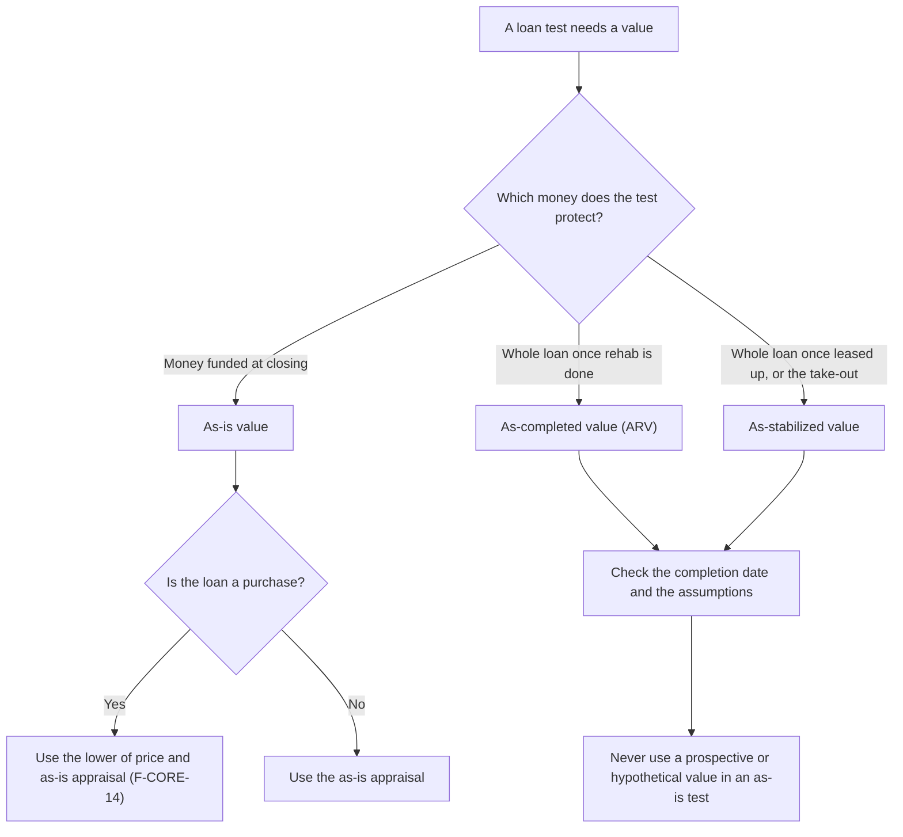
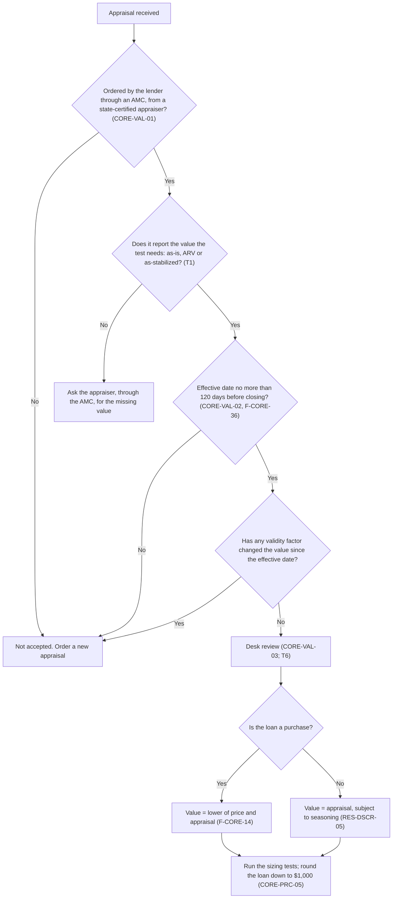
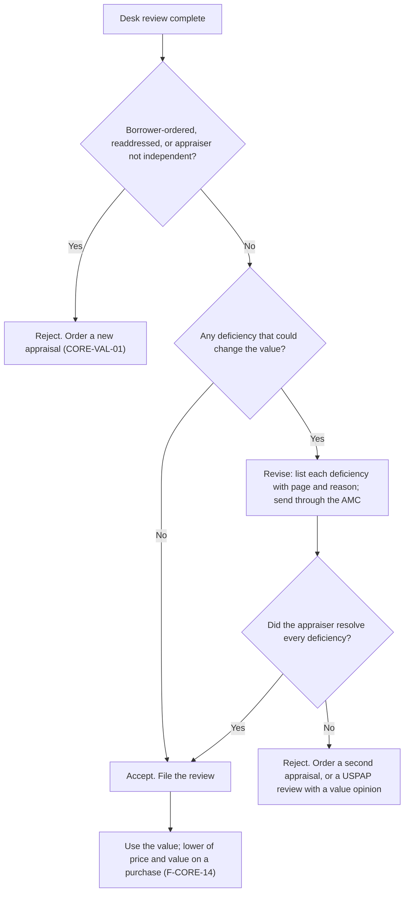

# C5: Valuation: appraisals, cap rates, as-is, ARV and as-stabilized

**Model policy for training - not for live lending decisions.** Fictional data only.

| Item | Detail |
| --- | --- |
| Assets in this tab | C5-lesson-v1.0-draft, C5-quiz-v0 (sets A and B, unchanged until Phase 3), C5-ojt-v1.0-draft, C5-jobaid-v1.0-draft |
| Objectives | O1 distinguish the values an appraisal reports and the test each feeds; O2 calculate value by direct capitalization and discounted cash flow; O3 calculate value by the sales comparison and cost approaches and reconcile; O4 apply the lender's value rules and the federal appraisal framework; O5 analyze leverage; O6 evaluate an appraisal in a desk review |
| Hours | Blueprint projection 4.0 CPE credits (QAS Self Study word-count formula, blueprint section 7). Recount from the final lesson and assessment under the amended counting rule (qas-spec.md). The OJT task is extra |
| Knowledge level | Intermediate (qas-spec.md) |
| Prerequisite | C1, C3 and C4: the purpose test and regulatory map, the loan constant, and underwritten NOI and NCF. No advance preparation |
| Bloom's levels | 2 Understand (O1), 3 Apply (O2-O4), 4 Analyze (O5) and 5 Evaluate (O6), within LD-02 as amended 22 Nov 2026 |
| Formulas | F-CORE-03, F-CORE-04, F-CORE-13, F-CORE-14, F-CORE-34, F-CORE-36, F-CORE-44, F-CORE-45; F-RES-02, F-RES-03; F-MF-13, F-MF-20; F-COM-08 |
| Rules | CORE-VAL-01, -02, -03; CORE-PRC-05; D-CONV-01; RES-GEN-06; RES-FF-01, -04; RES-DSCR-05; MF-GEN-08; MF-BR-02, -04, -08; COM-GEN-13; COM-BR-09; COM-TRM-01, -02, -09 |
| Running deals | Worked examples: RD-COM-01 Birchwood Plaza and RD-RES-01 Maple Run. Practice: RD-MF-01 Cedar Court and a fictional office building (LD-05, LD-08) |
| Status | v1.0-draft. Teach, Practice, OJT task and Job aid rewritten to the C5 blueprint. Review questions and exam forms follow in Phase 3. Self-review is at the end of this tab |
| Change log | v0, 20 Nov 2026: first draft; all numbers computed in code; market and legal facts researched 19-20 Nov 2026. v0.2, 22 Nov 2026: review fixes, policy decisions D-CORE-17 onward, self-check. v1.0-draft, 22 Nov 2026: rewritten to blueprint (Phase 2b) |

## 1. Hook

Birchwood Plaza's term loan is sized at $3,900,000. That is 65% of a $6,000,000 as-stabilized value. The value is $480,000 of net operating income (NOI) divided by an 8.00% capitalization rate.

Move the cap rate up a quarter point, to 8.25%. The value falls to $5,818,181.82 and the same loan is 67.03% of value. It now fails the 65% limit, and nothing about the building changed.

The same file holds a second value. The appraiser put the center's as-is value at $4,500,000, a full $1,500,000 below the stabilized figure.

By the end of this module you can explain both numbers and choose the right one for each loan test. You can also decide whether to rely on the report that produced them.

## 2. Objectives

By the end of C5, you will be able to:

1. **O1. Distinguish** market value, as-is, prospective (as-completed and as-stabilized) and hypothetical values, and the loan test each one feeds.
2. **O2. Calculate** value by direct capitalization and by discounted cash flow, with a ±25 basis point cap-rate sensitivity (F-CORE-13).
3. **O3. Calculate** value indications by the sales comparison and cost approaches, and reconcile them with the income approach.
4. **O4. Apply** the lender's value rules: lower of cost or value, appraisal ordering, age and review, and the federal appraisal framework (F-CORE-14, F-CORE-36; CORE-VAL-01 to -03; CORE-PRC-05).
5. **O5. Analyze** leverage by comparing the going-in cap rate with the loan constant and the cash-on-cash return (F-CORE-04, F-CORE-44).
6. **O6. Evaluate** an appraisal in a desk review and recommend accept, revise or reject, citing each deficiency.

O1 is at Bloom level 2 (Understand). O2 to O4 are at level 3 (Apply), O5 at level 4 (Analyze) and O6 at level 5 (Evaluate).

## 3. Teach

### T1. Values, premises and dates

**The point.** An appraisal can report several values for one property, and each loan test must use the value that matches its question and its date.

**What an appraisal is.** Real estate does not trade on an exchange. No screen shows today's price for a strip center in Indianapolis. So a lender needs a reasoned opinion of what the collateral would sell for.

Federal banking rules define that opinion. An appraisal is "a written statement independently and impartially prepared by a qualified appraiser setting forth an opinion as to the market value of an adequately described property as of a specific date(s), supported by the presentation and analysis of relevant market information" [VERIFY: 12 CFR 34.42(a); checked 22 Nov 2026].

Four ideas sit in that sentence, and each one returns in this module.

1. **Independent.** The appraiser has no stake in the deal (T4).
2. **An opinion.** It is a judgment, not a measurement, so it can be tested and challenged (T6).
3. **As of a specific date.** A value without a date means nothing (this section).
4. **Supported.** The report must show the market evidence behind the number (T2 and T3).

**Market value: the federal definition.** Every value in a loan file is a kind of market value. The banking agencies define it in the same words. Market value is "the most probable price which a property should bring in a competitive and open market under all conditions requisite to a fair sale, the buyer and seller each acting prudently and knowledgeably, and assuming the price is not affected by undue stimulus" [VERIFY: 12 CFR 34.42(h) (OCC) and 12 CFR 323.2(h) (FDIC); checked 22 Nov 2026].

The definition then lists five conditions. Read each as a test of whether a sale price is good evidence of value.

| Condition in 12 CFR 34.42(h) | What it rules out as evidence |
| --- | --- |
| (1) "Buyer and seller are typically motivated" | A forced sale, a sale between relatives, a buyer who must have this one site |
| (2) Both parties are "well informed or well advised" | A sale where one side did not know of a defect or a zoning change |
| (3) "A reasonable time is allowed for exposure in the open market" | A quick off-market sale, or a foreclosure auction held on short notice |
| (4) Payment is in cash in US dollars or comparable financial arrangements | A price paid partly in a swap or other non-cash terms |
| (5) The price is "unaffected by special or creative financing or sales concessions" | A price raised because the seller lent the money cheaply or paid the buyer's costs |

"Most probable price" matters too. Market value is not the highest price a hopeful seller might get. It is the price a typical buyer would most likely pay.

**Exposure time and marketing time.** Condition (3) hides a point about dates. Market value assumes the property has already been offered for a reasonable time before the effective date. Appraisers call that period exposure time.

The agencies' glossary defines it as the time the property "would have been offered on the market prior to the hypothetical consummation of a sale at market value on the effective date of the appraisal". It adds that exposure time "is always presumed to precede the effective date" [VERIFY: Interagency Appraisal and Evaluation Guidelines, Appendix D, 75 FR 77472; checked 22 Nov 2026].

Marketing time looks the other way. It is the time it might take to sell at the appraised value after the effective date. A lender may ask the appraiser for it, but the appraisal regulations do not require it [VERIFY: Interagency Appraisal and Evaluation Guidelines, Appendix D, 75 FR 77472; checked 22 Nov 2026].

The distinction matters in a default. Suppose an appraisal assumes 9 months of exposure. A lender that must sell in 60 days should not expect the market value.

It should expect something nearer a liquidation value. C13 uses that idea to value foreclosed property.

**A sum of parts is not market value.** Reports on multi-unit projects sometimes show one more figure: the total of the retail prices of every unit, sold one by one. The Guidelines are direct.

An institution may ask for "the sum of retail sales for a proposed development", but "the result of such calculation is not the market value of the property" [VERIFY: Interagency Appraisal and Evaluation Guidelines, Appendix C, 75 FR 77470; checked 22 Nov 2026]. A single buyer of the whole project would pay less, because selling the units takes time, cost and risk.

**Price, cost and value are three different things.** Price is what one buyer agreed to pay. Cost is what was spent to buy and improve the property. Value is the appraiser's opinion of the most probable price.

The three often differ. Harborline agreed to pay $300,000 for Maple Run, and the appraiser put the as-is value at $310,000.

Neither number is wrong. T4 explains why the lender uses the lower one.

**What market value is not.** Other value types appear in files. None of them may stand in for market value in a loan test.

| Value type | What it measures | Why it is not market value |
| --- | --- | --- |
| Liquidation value | The price in a quick or forced sale | It breaks conditions (1) and (3) |
| Investment value | Worth to one named investor, with that investor's taxes and plans | It is specific to one buyer, not a typical one |
| Value in use | Worth to the current user for its current use | It ignores what the open market would pay |
| Going concern value | The value of a business, such as a hotel operation | It is "the value of a business entity rather than the value of the real property" |
| Assessed value | The tax assessor's figure | It is set by tax law and cycle, not by today's market |
| Insurable value | The cost to replace the building, without land | It measures cost, and it leaves out the land (F-CORE-34; C9) |

The agencies say this directly. "Going concern value", "value in use" or "a special value to a specific property user may not be used as market value for federally related transactions" [VERIFY: Interagency Appraisal and Evaluation Guidelines, 75 FR 77450 (10 Dec 2010), Section VIII, 75 FR 77459, and Appendix D, 75 FR 77472; checked 22 Nov 2026].

**Premises of value: one property, several conditions.** Market value always describes the property in a stated condition. That stated condition is the premise of value. Bridge and rehab lending uses three.

- **As-is.** The agencies' glossary defines it as the market value of the property "in its current physical condition, use, and zoning as of the appraisal's effective date". It is the property as the appraiser found it.
- **As-completed.** A prospective value "as of the time that development is expected to be completed". In residential rehab lending the trade name is after-repair value (ARV).
- **As-stabilized.** A prospective value "as of the time the property is projected to achieve stabilized occupancy".

&#91;VERIFY: Interagency Appraisal and Evaluation Guidelines, Appendix D, Glossary of Terms, 75 FR 77471-77472; checked 22 Nov 2026]

The glossary also defines stabilized occupancy. It is the level a property is expected to reach after it is "exposed to the market for lease over a reasonable period of time" on terms like those of similar properties. It is a market norm, not 100%.

The agencies tell banks which premises to ask for. On a loan that funds construction or renovation, an institution "would generally request" the current market value in "as is" condition. It also asks, "as applicable", for prospective market value on completion or on stabilization, or both [VERIFY: Interagency Appraisal and Evaluation Guidelines, Section VIII, 75 FR 77459; checked 22 Nov 2026].

The same passage adds a duty. The lender "should understand the real property's 'as is' market value".

It "should consider" the prospective value that matches "the credit decision and the phase of the project being funded" [VERIFY: Interagency Appraisal and Evaluation Guidelines, Section VIII, 75 FR 77459; checked 22 Nov 2026]. That one sentence is the logic of this whole section.

**Effective date and report date.** Every value has an effective date: the date the opinion applies to. The report date is when the appraiser signed. They are rarely the same.

| Date | Meaning | Where you use it |
| --- | --- | --- |
| Effective date of an as-is value | Usually the inspection date | Appraisal age (F-CORE-36; T4) |
| Effective date of a prospective value | A future date: completion or stabilization | Check it against the business plan's timeline |
| Report date | The day the report was signed | Never for age; only to see how long the report took |

A prospective value has an effective date after the report date. The glossary says so: it "reflects an effective date that is subsequent to the date of the appraisal report" [VERIFY: Interagency Appraisal and Evaluation Guidelines, Appendix D, 75 FR 77472; checked 22 Nov 2026]. It is a forecast, however carefully made.

**Extraordinary assumptions and hypothetical conditions.** Prospective values rest on things that are not yet true. Appraisal standards make the appraiser label them. The agencies' glossary repeats the two labels from the Uniform Standards of Professional Appraisal Practice (USPAP).

| Term | Glossary definition | Glossary example | What it means for you |
| --- | --- | --- | --- |
| Extraordinary assumption | An assumption "which, if found to be false, could alter the appraiser's opinions or conclusions" | Assuming a pending zoning change will be approved | The fact is uncertain. If it fails, so does the value |
| Hypothetical condition | A condition "that is contrary to what exists but is supposed for the purpose of analysis" | Assuming the zoning is different from what it actually is | The fact is known to be false today |

&#91;VERIFY: Interagency Appraisal and Evaluation Guidelines, Appendix D, 75 FR 77472; checked 22 Nov 2026]

The difference is what the appraiser knows. An extraordinary assumption might be true. A hypothetical condition is not true, and everyone knows it.

"Value as if the renovation were complete today" is a hypothetical value. The renovation is not complete today. "Value on the expected completion date, assuming the work follows the plans" is a prospective value with an extraordinary assumption.

Read the assumptions page before the value page. A value that rests on an approved rezoning, a signed anchor lease or a clean environmental report is only as good as that fact.

**The interest appraised.** A report also states which ownership interest it values. Fee simple is full ownership with no leases in place. Leased fee is the landlord's interest, subject to the leases.

For a leased building the difference can be large. Where long leases pay below-market rent, the leased fee is worth less than the fee simple, and "the market value of the leased fee interest should be used" [VERIFY: Interagency Appraisal and Evaluation Guidelines, Appendix C, 75 FR 77470; checked 22 Nov 2026]. Birchwood Plaza is valued as a leased fee, because its tenants and their leases come with it.

**Why bank rules matter to a non-bank lender.** These definitions bind federally regulated banks, not our fictional lender. They still shape our files. Appraisers write every commercial report to these definitions.

Banks that finance or buy private loans expect them (C0, C2). So the course uses them as its vocabulary.

**The three values and the tests they feed.** Each loan test asks about one moment in the life of the loan. Match the value to the moment.

| Value | Question it answers | Effective date | Loan tests that use it |
| --- | --- | --- | --- |
| As-is | What would it sell for today, as it stands? | Inspection date | Day-one advance: loan-to-as-is value (F-RES-03; RES-FF-01); bridge as-is test (MF-BR-02; COM-BR-09); purchase loan-to-value, or LTV (F-CORE-14) |
| As-completed (ARV) | What will it sell for when the work is done? | Projected completion date | Loan-to-ARV on a flip (F-RES-02; RES-FF-04) |
| As-stabilized | What will it sell for once leased to market occupancy? | Projected stabilization date | Bridge stabilized LTV (F-MF-13; MF-BR-04); exit test (MF-BR-08); term loan LTV when the refinance closes (COM-TRM-09) |



The flowchart shows the choice. Money already funded is protected only by what exists today, so it is tested on as-is value. Money to be funded later can be tested on what the work will create.

**How our model policy applies it.** The policy follows the agencies' pattern. Multifamily files need an appraisal with "as-is and as-stabilized" values (MF-GEN-08).

Commercial files need "as-is, and as-stabilized or as-complete" (COM-GEN-13). Residential rehab files need a full interior appraisal with as-is value and ARV (RES-GEN-06).

Each value then has its own limit. On a flip, the initial advance is capped against as-is value (RES-FF-01) and the full loan against ARV (RES-FF-04).

On a multifamily bridge, the initial funding is capped at 70% of as-is value (MF-BR-02). The fully funded loan is capped at 70% of as-stabilized value (MF-BR-04).

**Worked example 1: Maple Run's two values (RD-RES-01)**

1. **Formula.** F-RES-03: LTAIV = initial advance ÷ as-is value. F-RES-02: LTARV = total loan ÷ ARV.
2. **Inputs.** Price $300,000; as-is appraisal $310,000; ARV $520,000; initial advance $240,000; total loan $340,000. Tier 2 caps: 85% LTAIV (RES-FF-01) and 70% LTARV (RES-FF-04).
3. **Substitution.** As-is value for the test = lower of $300,000 and $310,000 = $300,000 (F-CORE-14). LTAIV = $240,000 ÷ $300,000 = 80.00%. LTARV = $340,000 ÷ $520,000 = 65.38%.
4. **Result.** Both pass: 80.00% against 85%, and 65.38% against 70%. The $240,000 funded at closing rests on the house as it stands. The $100,000 holdback rests on the house as it will be.

Swap the values and the tests stop working. The initial advance against ARV would be $240,000 ÷ $520,000 = 46.15%. That looks very safe.

It is not. If the borrower defaults before any work is done, the lender holds a house worth about $300,000, not $520,000. The ARV has not been built yet.

**Worked example 2: Birchwood Plaza's two values on a timeline (RD-COM-01)**

1. **Formula.** F-CORE-14: LTV = loan ÷ value, with the value that matches the test date.
2. **Inputs.** Price $4,400,000; as-is appraisal $4,500,000; as-stabilized appraisal $6,000,000. Initial bridge funding $2,860,000 at closing. Term loan $3,900,000 at month 24, after lease-up.
3. **Substitution.** Closing: $2,860,000 ÷ lower of $4,400,000 and $4,500,000 = $2,860,000 ÷ $4,400,000 = 65.00% (COM-BR-09 unanchored retail: 65% as-is LTV). Month 24: $3,900,000 ÷ $6,000,000 = 65.00% (COM-TRM-09 unanchored retail: 65% LTV).
4. **Result.** Each loan passes at exactly 65.00%, on the value for its own date. The term loan is 86.67% of the as-is value, so it could never have been made at closing.

The as-stabilized value is a forecast for month 24. By then the center must actually be leased. COM-TRM-01 checks that with occupancy over three months before the term loan closes.

**Common slips.**

- Sizing the day-one advance on ARV or as-stabilized value. Those values do not exist yet.
- Measuring appraisal age from the report date. Age runs from the effective date (T4).
- Treating a hypothetical value as a forecast. It describes a world that is known to be false today.
- Skipping the assumptions page. An unmet extraordinary assumption can void the value.
- Reading stabilized as fully leased. Stabilized occupancy is the market norm, below 100%.

**Why it matters to a credit officer.** Most valuation losses in bridge lending come from a mismatch, not a bad appraisal.

The report was right about the finished, leased building. The loan was funded against it before the building was finished or leased. Matching value to test date is the first control.

### T2. The income approach: direct capitalization and discounted cash flow

**The point.** An income property is worth the present value of the income it will produce. The cap rate and the discount rate are two ways of pricing that income.

**Three approaches to value.** Appraisers have three ways to reach a value.

The income approach values the income. The sales comparison approach looks at what similar properties sold for. The cost approach adds up land and building cost.

This section covers the income approach, which carries most of the weight for leased property. T3 covers the other two and how the appraiser reconciles all three.

The Office of the Comptroller of the Currency (OCC) describes the income approach in one sentence. It "converts expected future NOI into present value through direct capitalization or discounted cash-flow analysis" [VERIFY: OCC, Comptroller's Handbook: Commercial Real Estate Lending, v2.0, Mar 2022, p. 43; checked 22 Nov 2026].

So there are two methods inside one approach. Direct capitalization uses one year of income and one rate. Discounted cash flow (DCF) uses several years of income, a sale at the end, and a different rate.

**Direct capitalization (F-CORE-13).** The method is one division.

```latex
V = \frac{NOI}{CR} \qquad CR = \frac{NOI}{V}
```

V is value, NOI is one year of net operating income (C4), and CR is the capitalization rate, or cap rate. Turn the formula around and a price implies a cap rate: NOI ÷ price.

A cap rate is the first-year return an all-cash buyer earns on the price. Pay $6,000,000 for $480,000 of NOI and you earn 8.00% before any loan.

The inverse is a multiple. An 8.00% cap rate means the buyer pays 1 ÷ 0.08 = 12.5 times NOI.

A 6.00% cap rate means 16.7 times. So a lower cap rate is a higher price for the same income.

Investors accept a lower cap rate when income looks safer or likely to grow. They demand a higher one when income looks risky or flat. The cap rate packs risk and growth into one number.

**Which income goes on top.** The cap rate and the income must be on the same basis. Three checks keep them matched.

1. **Stabilized, not transitional.** The OCC says direct capitalization "is appropriate when applied to a stabilized NOI and the future income stream is expected to be stable" [VERIFY: OCC CRE Handbook v2.0, p. 43; checked 22 Nov 2026]. A half-empty building has no stable year to capitalize.
2. **NOI, not NCF, unless the rate was derived on NCF.** Market cap rates are quoted on NOI, before replacement and leasing reserves. Net cash flow (NCF) is lower, so capping NCF at an NOI cap rate understates value.
3. **The appraiser's NOI against yours.** C4 built underwritten NOI with the lender's haircuts. Compare it line by line with the appraiser's. A large gap is a review finding (T6).

Birchwood shows the second check. Its stabilized NOI is $480,000 and its NCF is $434,000. On the $6,000,000 value the NOI cap rate is 8.00%.

The NCF cap rate is $434,000 ÷ $6,000,000 = 7.23%. Both describe the same value. Quote the basis every time.

The table shows where the two figures part. It sets the appraiser's stabilized income for Birchwood beside the lender's (RD-COM-01; C4).

| Line | Appraiser, stabilized | Lender, underwritten | Note |
| --- | --- | --- | --- |
| Base rent | $600,000 | $600,000 | 40,000 sf leased at market rent |
| Expense recoveries | $120,000 | $120,000 | Paid by tenants |
| Vacancy at 5% | −$36,000 | −$36,000 | 5% of $720,000 |
| Effective gross income | $684,000 | $684,000 |  |
| Operating expenses | −$204,000 | −$204,000 | Greater of trailing 12 months and the appraiser's estimate |
| NOI | $480,000 | $480,000 | The figure the appraiser capitalizes |
| Replacement and tenant improvement and leasing commission (TI/LC) reserves | Not deducted | −$46,000 | Lender's reserves (C4) |
| NCF | n/a | $434,000 | The figure in the debt service coverage ratio (DSCR) and debt-yield tests |

Here the two NOI figures agree, which is the result a reviewer hopes for. They agree because the lender adopted the appraiser's expense estimate as the higher of two figures. When they differ, the review starts with the line that differs.

**Worked example 3: Birchwood Plaza as-stabilized value and sensitivity (RD-COM-01)**

1. **Formula.** F-CORE-13: V = NOI ÷ CR. F-CORE-14: LTV = L ÷ V.
2. **Inputs.** Stabilized NOI $480,000 (C4); appraiser's cap rate 8.00%; term loan $3,900,000; limit 65% LTV (COM-TRM-09 unanchored retail: 65% LTV, 1.30x, 9.0%).
3. **Substitution.** At 8.00%: $480,000 ÷ 0.0800 = $6,000,000.00; LTV = $3,900,000 ÷ $6,000,000 = 65.00%. At 8.25%: $480,000 ÷ 0.0825 = $5,818,181.82; LTV = 67.03%. At 7.75%: $480,000 ÷ 0.0775 = $6,193,548.39; LTV = 62.97%.
4. **Result.** The base case passes at exactly 65.00%. At 8.25% the 65% test allows only $3,781,818.18. Rounded down to the nearest $1,000 (CORE-PRC-05), the loan is $3,781,000, which is $119,000 less.

| Cap rate | Value (F-CORE-13) | Change from $6,000,000 | LTV of the $3,900,000 loan | Loan at 65% LTV, rounded down (CORE-PRC-05) |
| --- | --- | --- | --- | --- |
| 7.50% | $6,400,000.00 | +6.67% | 60.94% | $4,160,000 |
| 7.75% | $6,193,548.39 | +3.23% | 62.97% | $4,025,000 |
| 8.00% | $6,000,000.00 | 0.00% | 65.00% | $3,900,000 |
| 8.25% | $5,818,181.82 | −3.03% | 67.03% | $3,781,000 |
| 8.50% | $5,647,058.82 | −5.88% | 69.06% | $3,670,000 |

The table shows two things.

First, the effect is not symmetric. A quarter point down adds $193,548.39. A quarter point up removes $181,818.18.

Second, the effect is large. Each 25 basis points moves value by about 3%.

A basis point (bp) is one hundredth of a percentage point. The lower the starting cap rate, the bigger the swing: at a 5.00% cap rate, 25 bp moves value by almost 5%.

That is why this course runs ±25 bp on every direct-cap value. The appraiser's rate is an opinion drawn from a range. A loan sized at the limit on the middle of that range fails at its upper end.

**Three cap rates on one deal.** A value-add deal has more than one cap rate, and each tells you something different. Birchwood has three.

| Name | Calculation (F-CORE-13) | Result | What it tells you |
| --- | --- | --- | --- |
| Going-in cap rate | In-place NOI $300,000 ÷ price $4,400,000 | 6.82% | What the buyer earns on day one |
| Stabilized (market) cap rate | Stabilized NOI $480,000 ÷ as-stabilized value $6,000,000 | 8.00% | What the market pays for the finished, leased center |
| Yield on cost | Stabilized NOI $480,000 ÷ total cost $5,180,000 | 9.27% | What the borrower earns on everything spent |

The going-in rate is below the market rate. That looks odd until you see what the buyer is paying for. The price includes the right to lease 12,000 empty square feet.

A low going-in cap rate on a half-empty building is normal. On a full building it means the buyer overpaid.

The yield on cost is above the market rate by 9.27% − 8.00% = 1.27 points. That gap is the borrower's reward for the work. It is the same $820,000 of value above cost shown in T3.

If the yield on cost were at or below the market cap rate, the plan would create no value. The stabilized appraisal would then deserve a hard look.

A fourth figure checks all three: value per square foot. The stabilized value is $6,000,000 ÷ 40,000 sf = $150.00 per sf, against a price of $110.00 per sf. The appraiser's sales comparison approach should show finished centers selling near the higher figure (T3).

**Where cap rates come from.** An appraiser must support the cap rate with market evidence. There are four common routes, and a good report uses more than one.

**Route 1: market extraction.** Find recent sales of similar properties. Divide each one's NOI by its price. The results give a range.

| Illustrative sale (not a running-deal fact) | NOI at sale | Price | Extracted cap rate (F-CORE-13) |
| --- | --- | --- | --- |
| Strip center A | $546,000 | $7,000,000 | 7.80% |
| Strip center B | $352,000 | $4,400,000 | 8.00% |
| Strip center C | $287,000 | $3,500,000 | 8.20% |

These three sales would support a range of 7.80% to 8.20%. The appraiser then places the subject inside the range by quality, location and lease strength.

Extraction is the strongest evidence, because it comes from real prices. Its weak point is the NOI. The appraiser must use each sale's income on the same basis as the subject's.

**Route 2: band of investment.** A buyer funds a purchase with debt and equity. Each source demands a yearly return. The cap rate is the weighted average of the two.

```latex
CR = M \times K + (1 - M) \times R_E
```

M is the loan-to-value ratio. K is the loan constant (F-CORE-04; C3). R_E is the equity dividend rate, which is the cash-on-cash return equity investors require (F-CORE-44; T5).

The Formula Library has no separate ID for the band of investment. It is market practice, taught here as a check on the appraiser's rate.

**Worked example 4: band of investment on the Birchwood term loan (RD-COM-01)**

1. **Formula.** Band of investment: CR = M × K + (1 − M) × R_E, with K from F-CORE-04 and R_E from F-CORE-44.
2. **Inputs.** M = 65% (COM-TRM-09). K = $330,772.68 ÷ $3,900,000 = 8.4814% (C3). R_E = 7.1061%, Birchwood's cash-on-cash return at the appraised value (T5).
3. **Substitution.** Debt band: 0.65 × 8.4814% = 5.5129%. Equity band: 0.35 × 7.1061% = 2.4871%.
4. **Result.** CR = 5.5129% + 2.4871% = 8.0000%, the appraiser's cap rate.

The bands add back to 8.00% because the three numbers describe one deal. The use of the method runs the other way.

Take the loan terms a lender offers today and the cash return investors say they need. The result is the cap rate at which buyers can afford to pay.

Notice what this implies. When loan constants rise, the debt band rises. Unless investors accept a lower cash return, cap rates must rise and values must fall.

**Route 3: yield less growth.** Suppose an investor wants a total return of r a year and expects income to grow at g a year. That investor can accept a first-year return of r minus g.

```latex
CR = r - g
```

Suppose investors in centers like Birchwood want 10.00% a year and expect NOI to grow 2.00% a year. Both figures are illustrations, not running-deal facts. The supported cap rate is 10.00% − 2.00% = 8.00%.

This route explains why cap rates differ so much between property types. Take two buildings with the same required return. The one with rents expected to grow 4% a year can sell at a cap rate two points lower than one with flat rents.

**Route 4: spread over the 10-year Treasury.** Investors can buy a US Treasury note with no credit risk. Property must pay more. The gap between a cap rate and the 10-year Treasury yield is the spread.

Birchwood's 8.00% cap rate sits 400 bp over the course's month-24 Treasury yield of 4.00% (RD-COM-01). Real markets differ from the course path.

The actual 10-year Treasury yield was 5.04% on 19 Nov 2026 (Federal Reserve Economic Data, or FRED, series DGS10, read 22 Nov 2026). Against that real figure the spread would be 8.00% − 5.04% = 296 bp.

A spread is a cross-check, not a method. If an appraiser's cap rate implies a spread far thinner than recent history, ask what makes this property safer than the market.

The OCC states the link to interest rates plainly. "Rising interest rates may lead to higher capitalization rates and lower property values without any change to the actual property's fundamentals." It adds that discount and cap rates "should reflect reasonable expectations for the rate of return that investors and lenders require under normal, orderly, and sustainable market conditions" [VERIFY: OCC CRE Handbook v2.0, p. 44; checked 22 Nov 2026].

**Discounted cash flow.** Direct capitalization assumes next year is typical of every year. Often it is not. A lease expires, a rent step arrives, or space is still empty.

DCF handles that by valuing each year on its own. The appraiser forecasts NOI for each year of a holding period, usually five to ten years.

The forecast then assumes a sale at the end. The sale price is called the reversion.

Each amount is discounted to today at the discount rate. Discounting is the time-value arithmetic from C3 (F-CORE-45): a sum due in t years is worth that sum divided by (1 + r)^t today.

```latex
V = \sum_{t=1}^{n} \frac{NOI_t}{(1+r)^{t}} + \frac{Reversion_n}{(1+r)^{n}}, \qquad Reversion_n = \frac{NOI_{n+1}}{CR_{terminal}}
```

The reversion is itself a direct capitalization. It divides the NOI of the year after the sale by a terminal cap rate, sometimes called the exit cap rate.

The Formula Library has no separate DCF formula. The method is F-CORE-45 applied year by year, with F-CORE-13 for the reversion.

**Discount rate and cap rate are different rates.** Learners mix them up more than any other pair in this module.

| Rate | What it is | Applied to | Typical relation |
| --- | --- | --- | --- |
| Cap rate | First-year income ÷ value | One year of NOI | Lower than the discount rate when income is expected to grow |
| Discount rate | The total yearly return the investor requires | Every year's cash flow and the reversion | Equal to the cap rate plus expected growth (Route 3) |
| Terminal cap rate | The cap rate assumed at the future sale | NOI of the year after the holding period | Often set a little above today's cap rate, because the building will be older and the future is less certain |

**Worked example 5: Birchwood Plaza by discounted cash flow (RD-COM-01, what-if inputs)**

Running Deals gives Birchwood's stabilized NOI and its 8.00% cap rate. It gives no discount rate, growth rate or terminal cap rate.

The three below are what-if inputs chosen to show the method. They are not policy and not deal facts.

1. **Formula.** DCF: V = sum of NOI_t ÷ (1 + r)^t, plus Reversion ÷ (1 + r)^n. Reversion = NOI in year n + 1 ÷ terminal cap rate (F-CORE-45; F-CORE-13).
2. **Inputs.** Year-1 NOI $480,000 (RD-COM-01). What-if: growth 2.00% a year; discount rate 10.00%; five-year hold; terminal cap rate 8.00%.
3. **Substitution.** The table discounts each year. Year-6 NOI = $480,000 × 1.02^5 = $529,958.79. Reversion = $529,958.79 ÷ 0.08 = $6,624,484.82. Its present value = $6,624,484.82 ÷ 1.10^5 = $4,113,283.88.
4. **Result.** Value = $1,886,716.12 + $4,113,283.88 = $6,000,000.00, the same as direct capitalization.

| Year | NOI (2.00% growth) | Discount factor at 10.00% | Present value |
| --- | --- | --- | --- |
| 1 | $480,000.00 | 0.909091 | $436,363.64 |
| 2 | $489,600.00 | 0.826446 | $404,628.10 |
| 3 | $499,392.00 | 0.751315 | $375,200.60 |
| 4 | $509,379.84 | 0.683013 | $347,913.28 |
| 5 | $519,567.44 | 0.620921 | $322,610.50 |
| Five years of NOI |  |  | $1,886,716.12 |
| Reversion at end of year 5 | $6,624,484.82 | 0.620921 | $4,113,283.88 |
| Value |  |  | $6,000,000.00 |

The match is not luck. A 10.00% discount rate less 2.00% growth is an 8.00% cap rate (Route 3).

When growth is steady and the terminal cap rate equals today's, DCF and direct capitalization give the same answer. Direct capitalization is a DCF with the steady-growth assumption built in.

The two methods part when an assumption changes. The table changes one input at a time.

| Change to the what-if inputs | DCF value | Change from $6,000,000.00 |
| --- | --- | --- |
| Terminal cap rate 8.50% instead of 8.00% | $5,758,042.12 | −$241,957.88 |
| Discount rate 10.50% instead of 10.00% | $5,883,591.85 | −$116,408.15 |
| Discount rate 9.50% instead of 10.00% | $6,119,462.93 | +$119,462.93 |
| No NOI growth instead of 2.00% | $5,545,105.59 | −$454,894.41 |

Two lessons follow. The reversion is $4,113,283.88 of the $6,000,000.00, or 68.55% of the value. More than two-thirds of a five-year DCF rests on one guess about a sale five years away.

So the terminal cap rate deserves the hardest look in any DCF. Half a point on it moved Birchwood's value by about $242,000. Half a point on the discount rate moved it by about $116,000.

Appraisers also deduct selling costs from the reversion. This example leaves them out to keep the arithmetic clear.

**Choosing the holding period.** The holding period is also a judgment. It should be long enough to carry the income past every known event: the end of lease-up, a large lease expiry, a rent step. The sale is then assumed in a normal year.

A short hold puts more weight on the reversion. A three-year DCF can rest more than 80% of its value on the assumed sale. A ten-year DCF rests less on it, but its later years are harder to forecast.

Neither length is more accurate. The reviewer's task is to see which assumption carries the value and test that one.

**When each method fits.** The OCC gives the rule. Direct capitalization fits "a stabilized NOI". The DCF method "is useful in estimating the as-is market value of properties that have not reached stabilized occupancy or values of properties that are expected to experience material fluctuations in income" [VERIFY: OCC CRE Handbook v2.0, p. 43; checked 22 Nov 2026].

| Situation | Method that fits | Why |
| --- | --- | --- |
| Stabilized apartments or a fully leased center | Direct capitalization | Next year is typical |
| As-is value of a building in lease-up | DCF | Income changes each year until stabilization |
| A large lease expiring in year 3 | DCF | One year cannot show the dip and recovery |
| As-stabilized value at a future date | Direct capitalization of the stabilized year | The premise assumes stable income from that date |

**Do not cap in-place income to get an as-is value.** Birchwood is 70% leased at closing. Its in-place NOI is $300,000. Two shortcuts tempt the analyst, and both are wrong.

The first caps in-place income at the stabilized rate: $300,000 ÷ 0.08 = $3,750,000. That treats the empty 12,000 square feet as worthless forever. A buyer would pay for the chance to lease it.

The second caps stabilized income and calls it today's value: $480,000 ÷ 0.08 = $6,000,000. That ignores the time, cost and risk of leasing the space.

The appraiser's as-is value is $4,500,000, between the two. It comes from a lease-up analysis: the stabilized value, less the costs and lost rent on the way there. T6 rebuilds that gap line by line.

A DCF can express the same analysis. As a what-if, take a two-year lease-up. Year 1 earns the in-place $300,000 and spends the $300,000 capex budget, a net of $0.

Year 2 earns a what-if $390,000 and spends the $360,000 TI/LC budget, a net of $30,000. At the end of year 2 the center is worth its stabilized $6,000,000.

The discount rate that turns those flows into $4,500,000 today solves ($30,000 + $6,000,000) ÷ (1 + r)^2 = $4,500,000. That gives (1 + r)^2 = 1.34, so r is about 15.8% a year.

Compare that with the 10.00% what-if rate on the stabilized center in worked example 5. The buyer of a transitional property demands a much higher return, because the leasing may be slow or may fail.

That extra return is the entrepreneurial profit the appraisal rules require the appraiser to deduct (T4, T6). A lease-up DCF discounted at a stabilized rate overstates the as-is value.

**How our model policy applies it.** The policy sets no cap rate, discount rate or growth rate. The appraiser sets them (F-CORE-13; CORE-VAL-01), and the desk reviewer tests them (CORE-VAL-03).

The policy does control how value becomes a loan. LTV uses the value for the right date (T1).

After every sizing test, the loan is rounded down to the nearest $1,000 and never up (CORE-PRC-05). Credit tests use NOI or NCF as each rule states (C4), so always check which one a limit names.

**Common slips.**

- Capping a pro forma NOI and calling the result as-is value.
- Capping NCF with a cap rate extracted on NOI. Birchwood's 7.23% and 8.00% are the same value on two bases.
- Using the discount rate as a cap rate. $480,000 ÷ 0.10 = $4,800,000 understates Birchwood by $1,200,000.
- Accepting a terminal cap rate below the going-in cap rate without a stated reason.
- Reporting one value with no sensitivity. Always show ±25 bp.

**Why it matters to a credit officer.** You will rarely build an appraisal. You will often decide whether to lend 65% of one.

Know where the cap rate came from and what a quarter point does to the loan. Then you know how much of the cushion is real.

### T3. Sales comparison, cost and reconciliation

**The point.** The sales comparison and cost approaches test the income value against what buyers paid and what building would cost. Reconciliation weighs the three by how reliable each is.

**Why more than one approach.** Each approach looks at the property through a different market.

The income approach asks what investors pay for income. The sales comparison approach asks what buyers paid for similar buildings. The cost approach asks what it would cost to create the same thing new.

In a healthy market the three should land close together. When they do not, the gap is information. A reviewer who reads only the final value misses it.

**The sales comparison approach.** The idea is substitution. A sensible buyer will not pay more for a property than the price of a similar one.

The OCC describes the method. It "values a property using sales data of similar properties to determine the value. An appraiser typically compares the subject property to at least three recently sold properties in the area with similar characteristics" [VERIFY: OCC CRE Handbook v2.0, p. 44; checked 22 Nov 2026].

The approach carries the most weight where buyers really do compare one property with another. Houses are the clearest case.

An ARV on a flip is almost always a sales comparison value. The finished house will sell to a buyer who compares it with other finished houses.

The work follows five steps.

1. Select comparable sales, called comps.
2. Verify each sale: price, date, terms and who the parties were.
3. Reduce each price to a unit of comparison.
4. Adjust each comp for its differences from the subject.
5. Reconcile the adjusted prices into one value indication.

**Selecting comps.** A comp is evidence of market value only if the sale itself met the market value conditions in T1. Four tests screen the list.

| Test | A good comp | A warning sign |
| --- | --- | --- |
| Recent | Sold close to the effective date | Sales more than a year old in a moving market |
| Near | Same neighborhood or competing submarket | Comps drawn from a stronger area across town |
| Similar | Same type, size range, age and condition | A renovated subject compared with unrenovated sales, or the reverse |
| Arm's length | Unrelated parties, open-market exposure, normal financing | A foreclosure sale, a sale between relatives, or seller financing |

Good comps bracket the subject. Some are a little better and some a little worse. If every comp is superior and every adjustment runs down, the subject sits outside the evidence.

**Units of comparison.** Prices are compared per unit, so buildings of different sizes can be set side by side.

| Property type | Usual unit | Running-deal example |
| --- | --- | --- |
| Houses | Price per square foot of living area, and whole-house price | Maple Run ARV: $520,000 ÷ 1,640 sf = $317.07 per sf |
| Apartments | Price per unit | Cedar Court price: $6,200,000 ÷ 50 units = $124,000 per unit |
| Retail, office, industrial | Price per square foot of building | Birchwood price: $4,400,000 ÷ 40,000 sf = $110.00 per sf |

A unit price is a fast sanity check. If an appraisal values a building at twice the per-unit price of every recent sale nearby, something needs explaining.

**Sale comps and rent comps.** Comparison is used twice in most reports. Sale comps support the value in this approach. Rent comps support the market rent inside the income approach (T2).

The same four tests apply to both. A rent comp from a newer building in a better location proves little about what the subject's empty space will lease for.

Maple Run's file holds one of each kind. The sales support the ARV, and the Form 1007 market rent of $3,100 a month supports the refinance (RD-RES-01).

**Adjusting the comps.** No two properties are the same, so each comp's price is adjusted. Two rules prevent most errors.

First, adjust the comp, never the subject. The question is: what would this comp have sold for if it were like the subject?

Second, mind the sign. If the comp is better than the subject, subtract. If the comp is worse, add.

A comp with an extra half bath sold for more than it would have without one, so its price comes down.

Adjustments are made in a set order. Differences in the deal come first, then differences in the property.

| Order | Element | Typical adjustment |
| --- | --- | --- |
| 1 | Property rights | Leased fee against fee simple (T1) |
| 2 | Financing terms | Remove the price effect of cheap seller financing |
| 3 | Conditions of sale | Remove or reject a forced or related-party sale |
| 4 | Market conditions | Bring an older sale up or down to the effective date |
| 5 | Location | Better or worse street, traffic or school district |
| 6 | Physical features | Size, age, condition, baths, parking, quality of finish |

Elements 2 and 3 enforce the market value definition. A price lifted by seller concessions is not evidence until the concession is taken out [VERIFY: 12 CFR 34.42(h)(5); checked 22 Nov 2026].

Each adjustment needs its own support. The best support is a paired sale: two sales alike in everything but one feature, so the price gap measures that feature.

**Net and gross adjustments.** Two totals show how much the appraiser had to change each comp. The net adjustment adds the adjustments with their signs. The gross adjustment adds their sizes and ignores the signs.

A comp with a small gross adjustment is close to the subject, so it is strong evidence. A comp with a large gross adjustment is a weak match, even when pluses and minuses cancel to a small net figure.

The policy sets no limit on either total. The reviewer judges them (CORE-VAL-03).

**Worked example 6: supporting Maple Run's ARV (RD-RES-01, illustrative comps)**

Running Deals gives Maple Run's ARV of $520,000 and the house's size. It lists no comparable sales. The three comps and the adjustment rates below are illustrations, not running-deal facts.

1. **Formula.** Adjusted price = sale price + market conditions adjustment + size adjustment + bath adjustment. Net % = sum of adjustments ÷ price. Gross % = sum of adjustment sizes ÷ price.
2. **Inputs.** Subject after rehab: 1,640 sf, 2 baths (RD-RES-01). Illustrative rates: prices rising 0.5% a month; $90 per sf of size difference; $4,000 for a half bath.
3. **Substitution.** Comp A: $512,000 + $512,000 × 0.5% × 4 months + (1,640 − 1,600) × $90 = $512,000 + $10,240 + $3,600 = $525,840. Comp B: $541,000 + $2,705 − $10,800 − $4,000 = $528,905. Comp C: $506,000 + $5,060 + $5,400 = $516,460.
4. **Result.** The adjusted prices run from $516,460 to $528,905. The $520,000 ARV sits inside that range.

| Item | Comp A | Comp B | Comp C |
| --- | --- | --- | --- |
| Sale price | $512,000 | $541,000 | $506,000 |
| Months before the effective date | 4 | 1 | 2 |
| Living area | 1,600 sf | 1,760 sf | 1,580 sf |
| Baths | 2 | 2.5 | 2 |
| Unadjusted price per sf | $320.00 | $307.39 | $320.25 |
| Market conditions, +0.5% a month | +$10,240 | +$2,705 | +$5,060 |
| Size, $90 per sf against 1,640 sf | +$3,600 | −$10,800 | +$5,400 |
| Baths, $4,000 per half bath | $0 | −$4,000 | $0 |
| Adjusted price | $525,840 | $528,905 | $516,460 |
| Net adjustment | +2.70% | −2.24% | +2.07% |
| Gross adjustment | 2.70% | 3.24% | 2.07% |

Read the grid the way a reviewer would. All three comps sold within four months. Two are smaller than the subject and one is larger, so the subject is bracketed.

Comp C needed the least adjustment, 2.07% gross, so it is the best match. It also gives the lowest adjusted price. An appraiser who leaned toward comp C would conclude near $520,000, which supports the report.

Now test the loan against the weakest reading. At comp C's $516,460, the loan-to-ARV is $340,000 ÷ $516,460 = 65.83%, still under the 70% cap (RES-FF-04).

The ARV would have to fall to $340,000 ÷ 0.70 = $485,714.29 before the cap binds. That is 6.59% below $520,000. So the comps would all have to be wrong by more than their whole range for the test to fail.

**Stress the adjustments, not only the value.** The grid's weakest input is the market conditions rate. The appraiser says prices are rising 0.5% a month.

Suppose they are flat. Remove that line and the adjusted prices become $515,600, $526,200 and $511,400.

The range drops to $511,400 to $526,200, and $520,000 is still inside it. So the ARV does not depend on the rising-market assumption. If it had fallen outside the range, the reviewer would ask the appraiser for the evidence behind the 0.5%.

This is the sales comparison version of the ±25 bp test in T2. Find the adjustment the value leans on most, change it, and see whether the conclusion survives.

**What is special about an ARV.** An ARV is a prospective value (T1). The appraiser has not seen the finished house, only the scope of work and the budget. Three checks follow from that.

- **The comps must be finished homes.** Renovated sales support a renovated value. Unrenovated sales support the as-is value.
- **The scope must match the comps.** If the comps have new kitchens and baths, the budget must pay for new kitchens and baths.
- **The neighborhood sets a ceiling.** A house improved far beyond its street will not recover the cost. Appraisers call this an over-improvement.

The ARV also rests on an extraordinary assumption: the work is finished as planned. If the borrower cuts the scope, the ARV no longer describes the house.

**The cost approach.** The OCC puts the method in one line. It "values a property by estimating the cost of the land, plus costs of construction, less depreciation" [VERIFY: OCC CRE Handbook v2.0, p. 44; checked 22 Nov 2026].

```latex
V = Land + Cost_{new} - Depreciation
```

The logic is again substitution. A buyer will not pay more for an existing building than the cost of buying a site and building an equal one.

Each piece has its own method. Land is valued by sales comparison, as if vacant.

Cost new comes from cost manuals or contractor bids, and includes soft costs such as design fees. Depreciation is every loss in value against a new building.

| Kind of depreciation | Cause | Example |
| --- | --- | --- |
| Physical | Wear and age | A roof near the end of its life |
| Functional | The design no longer suits the market | Shallow retail bays with no rear loading |
| External | Something outside the property | A new bypass that pulls traffic away |

The simplest measure is the age-life method. Divide the building's effective age by its total economic life.

Effective age reflects condition, not the calendar. A well-renovated 1998 building can have an effective age far below its actual age.

**Worked example 7: a cost approach for Birchwood Plaza (RD-COM-01, illustrative inputs)**

Running Deals gives Birchwood's 40,000 sf size and its $6,000,000 as-stabilized value. It gives no land value, cost figure or effective age. The inputs marked illustrative are not running-deal facts.

1. **Formula.** Cost approach: V = land + cost new − depreciation. Age-life depreciation = cost new × effective age ÷ economic life.
2. **Inputs.** Building 40,000 sf (RD-COM-01). Illustrative: cost new $165 per sf; effective age 14 years after the planned capex; economic life 50 years; land $1,250,000.
3. **Substitution.** Cost new = 40,000 × $165 = $6,600,000. Depreciation = $6,600,000 × 14 ÷ 50 = $1,848,000. Depreciated building = $6,600,000 − $1,848,000 = $4,752,000.
4. **Result.** Value indication = $1,250,000 + $4,752,000 = $6,002,000, close to the $6,000,000 income value.

The result looks precise. It is not.

Depreciation is 28% of cost new on one judgment about effective age. Use 20 years instead of 14 and the indication falls by $792,000.

That is the weakness of the cost approach on older buildings. The older the building, the larger the depreciation guess, and the less the approach can be trusted.

| Where the cost approach is strong | Where it is weak |
| --- | --- |
| New or proposed construction, where cost is known and depreciation is small | Older buildings with large, uncertain depreciation |
| Special-purpose buildings with few sales and no rent market | Leased investment property, where buyers price income |
| Testing feasibility: is the finished value above total cost? | Markets where prices sit well below the cost to build |

**A lender's cost check.** The last strong use is one you can do yourself. Compare the prospective value with the borrower's total cost.

| Deal | Total cost | Prospective value | Value above cost |
| --- | --- | --- | --- |
| Maple Run (RD-RES-01) | $300,000 + $100,000 + $9,000 = $409,000 | ARV $520,000 | $111,000, or 27.14% of cost |
| Birchwood Plaza (RD-COM-01) | $5,180,000 | As-stabilized $6,000,000 | $820,000, or 15.83% of cost |

A margin near zero means the plan creates no value, and the borrower has little reason to finish it. A very large margin deserves a second look at the value. Rehab rarely doubles what a house is worth.

**Highest and best use.** All three approaches assume a use for the property. Appraisers value a property at its highest and best use: the legal, physically possible and financially feasible use that produces the highest value.

Usually that is the current use. Sometimes it is not.

The as-is value must still describe the property as it stands. The Guidelines give the rule: the as-is value reflects "the property's actual physical condition, use, and zoning designation". If the highest and best use is redevelopment, "the cost of demolition and site preparation should be considered in the analysis" [VERIFY: Interagency Appraisal and Evaluation Guidelines, Appendix C, 75 FR 77470; checked 22 Nov 2026].

For a lender the warning sign is a value built on a use the borrower has not asked us to finance. A report that values an old warehouse as a future apartment site is describing a different loan.

**Reconciliation.** The appraiser ends with up to three value indications and must report one value. Reconciliation is the reasoning that gets there. It is not an average.

The appraiser weighs each approach by two questions. How good was the data? How closely does the approach match the way buyers of this property type think?

| Approach | Birchwood indication | Weight a typical buyer gives it | Why |
| --- | --- | --- | --- |
| Income | $6,000,000 (RD-COM-01) | Most | Buyers of leased retail price the income |
| Sales comparison | $5,900,000, or $147.50 per sf (illustrative) | Some | Few sales are truly alike; leases differ |
| Cost | $6,002,000 (illustrative; worked example 7) | Least | Depreciation on a 1998 building is a judgment |
| Reconciled value | $6,000,000 |  | Rests on the income approach, checked by the other two |

For Maple Run the weights reverse. The sales comparison approach leads, because house buyers compare houses. The income approach is thin for a single house, and the cost approach is weak for a 1962 structure.

A reviewer reads the reconciliation for three things.

1. **The spread.** Indications within a few percent support each other. A spread of 20% means at least one approach is wrong.
2. **A missing approach.** Appraisers may omit an approach that does not apply, but the report should say why.
3. **The direction of the choice.** A final value at the top of the range, on the weakest approach, needs a reason.

**How our model policy applies it.** The policy requires a full appraisal on every loan and names the appraiser's qualifications by family. Residential loans need a full interior appraisal, and broker price opinions (BPOs) and automated valuation models (AVMs) "never size a loan" (RES-GEN-06).

Multifamily and commercial loans need an MAI appraisal (MF-GEN-08; COM-GEN-13). MAI is a designation of the Appraisal Institute, a professional body.

The policy does not say which approach must lead. That is the appraiser's judgment. The desk review checks that the judgment was reasoned and that the evidence supports it (CORE-VAL-03; T6).

**Common slips.**

- Adjusting the subject instead of the comp, which reverses every sign.
- Adding for a feature the comp has and the subject lacks. A superior comp is adjusted down.
- Accepting unrenovated comps for an ARV, or renovated comps for an as-is value.
- Treating a small net adjustment as proof of a good comp. Check the gross figure.
- Averaging the three approaches. Reconciliation weighs them.

**Why it matters to a credit officer.** On a flip, the whole loan rests on the ARV, and the ARV rests on three or four sales. Ten minutes on the comp grid tells you more about that loan's risk than any other page in the file.

### T4. The lender's value rules and the federal appraisal framework

**The point.** A value counts in a loan test only if the right person ordered it, a qualified appraiser produced it and it is still valid. On a purchase it is also capped at the price.

**Where the rules come from.** After the savings and loan failures of the 1980s, Congress required federal standards for appraisals used by regulated lenders. The banking agencies wrote matching appraisal regulations under Title XI of the Financial Institutions Reform, Recovery, and Enforcement Act (FIRREA) [VERIFY: 12 CFR 34.41(a)-(b); checked 22 Nov 2026].

The OCC's version is 12 CFR part 34, subpart C. The Federal Deposit Insurance Corporation (FDIC) has the same text in 12 CFR part 323.

The OCC summarizes the scope. The regulations specify "which transactions require the services of an appraiser". They also "prescribe minimum appraisal standards, requirements for appraiser independence, appraisal reviews, and competency" [VERIFY: OCC CRE Handbook v2.0, p. 60; 12 CFR 34.41(b)(2); checked 22 Nov 2026].

In 2010 the agencies added the Interagency Appraisal and Evaluation Guidelines. The Guidelines are supervisory guidance, not regulation. They explain what examiners expect a bank's valuation program to look like [VERIFY: Interagency Appraisal and Evaluation Guidelines, 75 FR 77450 (10 Dec 2010); checked 22 Nov 2026].

| Source | What it covers | Where taught here |
| --- | --- | --- |
| 12 CFR 34.42 | Definitions: appraisal, market value, transaction value, residential and commercial transactions | T1 and this section |
| 12 CFR 34.43 | When an appraisal is required, and who may write it | This section |
| 12 CFR 34.44 | Minimum standards every appraisal must meet | This section and T6 |
| 12 CFR 34.45 | Appraiser independence | This section |
| Guidelines Sections V and VI | Independence of the program; selecting and engaging appraisers | This section |
| Guidelines Section XIV | When an existing appraisal is still valid | This section |
| Guidelines Section XV | Reviewing appraisals | T6 |

**Who is bound.** These rules bind federally regulated institutions. Our fictional lender is a non-bank, so they do not apply to it directly.

They matter anyway, for the reason given in T1. The banks that fund and buy private loans expect files built to them, so the model policy is written to meet or beat them.

**Step 1: classify the transaction.** The regulation sorts every real estate loan into one of two classes [VERIFY: 12 CFR 34.42(e), (k), (o); checked 22 Nov 2026].

- A **residential real estate transaction** is one "secured by a single 1-to-4 family residential property".
- A **commercial real estate transaction** is one "that is not secured by a single 1-to-4 family residential property".

The class depends on the collateral, not the borrower or the purpose. A loan to a limited liability company (LLC) on one rental house is residential under this rule. A loan on a 50-unit apartment property is commercial.

The **transaction value** of a loan is "the amount of the loan or extension of credit" [VERIFY: 12 CFR 34.42(o)(1); checked 22 Nov 2026]. It is the loan amount, not the property value.

**Step 2: apply the thresholds.** An appraisal by a state-certified or state-licensed appraiser is required for every real estate loan, with listed exceptions. Three exceptions matter most in our lending [VERIFY: 12 CFR 34.43(a)(1), (a)(5), (a)(13), (b), (d); checked 22 Nov 2026. The FDIC text at 12 CFR 323.3 has the same figures; checked 22 Nov 2026].

| Exception | Test | What the bank must still do |
| --- | --- | --- |
| Residential, 34.43(a)(1) | Transaction value of $400,000 or less | Obtain an evaluation, 34.43(b) |
| Commercial, 34.43(a)(13) | Transaction value of $500,000 or less | Obtain an evaluation, 34.43(b) |
| Business loan, 34.43(a)(5) | $1 million or less, and not dependent on the sale of, or rental income from, real estate as the primary source of repayment | Obtain an evaluation, 34.43(b) |

An evaluation is a lighter estimate of market value. It need not come from a licensed appraiser. It must still be "consistent with safe and sound banking practices" [VERIFY: 12 CFR 34.43(b); checked 22 Nov 2026].

The third exception rarely helps an investor lender.

A rental loan is repaid from rent. A flip loan is repaid from a sale. Both depend on the real estate, so neither fits.

Above the thresholds, the rule also says who may sign.

| Transaction | Appraiser required |
| --- | --- |
| Any transaction of $1,000,000 or more | State certified, 34.43(d)(1) |
| Commercial transaction of more than $500,000 | State certified, 34.43(d)(2) |
| Complex residential appraisal, transaction of more than $400,000 | State certified, 34.43(d)(3) |
| All other transactions that need an appraisal | State certified or state licensed, 34.43(e) |

A state-certified appraiser meets a state's certification rules, and those rules must meet the Appraiser Qualifications Board's minimum criteria. The appraiser has also passed a state exam equivalent to the Board's uniform exam [VERIFY: 12 CFR 34.42(l); checked 22 Nov 2026]. A license is the lower credential.

**Worked example 8: the federal thresholds applied to the running deals**

This example asks what a national bank would need if it made each loan. It then compares that floor with our policy.

1. **Formula.** Classify by collateral (12 CFR 34.42(e), (k)). Compare the transaction value with the threshold (12 CFR 34.43(a), (d)).
2. **Inputs.** Maple Run: one single-family house; loan $340,000. Cedar Court: 50 units; commitment $5,140,000. Birchwood Plaza: a strip center; commitment $3,520,000.
3. **Substitution.** Maple Run is residential, and $340,000 is not more than $400,000. Cedar Court is commercial, and $5,140,000 is more than $500,000 and more than $1,000,000. Birchwood is commercial, and $3,520,000 is more than both figures.
4. **Result.** A bank could use an evaluation on Maple Run. It would need a state-certified appraiser on Cedar Court and Birchwood. Our policy requires a full appraisal by a state-certified appraiser on all three (CORE-VAL-01).

| Deal | Class | Transaction value | Federal floor for a bank | Our policy |
| --- | --- | --- | --- | --- |
| Maple Run (RD-RES-01) | Residential | $340,000 | Evaluation allowed, 34.43(a)(1), (b) | Full interior appraisal, state certified (CORE-VAL-01; RES-GEN-06) |
| Cedar Court (RD-MF-01) | Commercial | $5,140,000 | State-certified appraiser, 34.43(d) | MAI appraisal, as-is and as-stabilized (MF-GEN-08) |
| Birchwood Plaza (RD-COM-01) | Commercial | $3,520,000 | State-certified appraiser, 34.43(d) | MAI appraisal, as-is and as-stabilized (COM-GEN-13) |

The policy is stricter than the floor where the floor is lowest. Small residential rehab loans are where our volume is, and where an inflated ARV does the most harm. So the policy requires a full appraisal even where a bank could use an evaluation.

**Step 3: the minimum standards.** Every appraisal for a federally related transaction must meet six standards. Learn them as a checklist, because T6 reviews against them [VERIFY: 12 CFR 34.44(a)-(f); checked 22 Nov 2026].

1. Conform to USPAP, unless safe and sound banking needs a stricter standard.
2. "Be written and contain sufficient information and analysis to support the institution's decision to engage in the transaction."
3. "Be subject to appropriate review" for compliance with USPAP.
4. "Analyze and report appropriate deductions and discounts for proposed construction or renovation, partially leased buildings, non-market lease terms, and tract developments with unsold units."
5. Be based on the regulation's definition of market value (T1).
6. Be performed by a state-licensed or state-certified appraiser.

Standard 4 is the one bridge lenders live by. A building under renovation or in lease-up cannot be valued as if it were finished and full.

The appraiser must show the deductions that take the finished value back to today. T6 applies it to Birchwood.

**Step 4: independence.** The appraiser must work for the lender and have no stake in the outcome. For an outside appraiser the rule reads: "the appraiser shall be engaged directly by the regulated institution or its agent, and have no direct or indirect interest, financial or otherwise, in the property or the transaction" [VERIFY: 12 CFR 34.45(b)(1); checked 22 Nov 2026].

The Guidelines draw the practical line. "An institution's use of a borrower-ordered or borrower-provided appraisal violates the Agencies' appraisal regulations." They add that "independence is compromised when a borrower recommends an appraiser". It is also compromised when loan production staff select the appraiser for a deal [VERIFY: Interagency Appraisal and Evaluation Guidelines, Section VI, 75 FR 77458; checked 22 Nov 2026].

The reason is incentive. A borrower wants a high value, because value sets the loan.

A loan officer paid on volume wants the same. An appraiser hired by either one knows what number keeps the client happy.

So the valuation function is walled off. The Guidelines say the program "should be isolated from influence by the institution's loan production staff". That covers ordering, reviewing and accepting appraisals [VERIFY: Interagency Appraisal and Evaluation Guidelines, Section V, 75 FR 77457; checked 22 Nov 2026].

One exception exists. A bank may accept an appraisal that another financial services institution engaged directly.

The appraiser must have been independent, and the report must meet the rules [VERIFY: 12 CFR 34.45(b)(2); checked 22 Nov 2026]. A borrower can tell the lender such a report exists. The lender then requests it from the other institution, never from the borrower.

The model policy does not use that exception. It is one sentence long and stricter than the rule: "The lender orders the appraisal through an appraisal management company from a state-certified appraiser. Borrower-supplied appraisals are not accepted" (CORE-VAL-01).

An appraisal management company (AMC) is a third party that selects and engages the appraiser when the lender requests a report [VERIFY: Interagency Appraisal and Evaluation Guidelines, Appendix D, 75 FR 77471; checked 22 Nov 2026]. It adds a second wall: the originator never speaks to the appraiser about value.

**The engagement letter.** The order itself is a document, and it belongs in the file. The Guidelines say an institution "should use written engagement letters when ordering appraisals, particularly for large, complex, or out-of-area commercial real estate properties". The letter "will identify the intended use and user(s)", and work "should not commence until the institution has selected and engaged a person for the assignment" [VERIFY: Interagency Appraisal and Evaluation Guidelines, Section VI.B, 75 FR 77458; checked 22 Nov 2026].

The engagement letter is where the lender names the values it needs. For Birchwood it asks for as-is and as-stabilized values (COM-GEN-13). An appraiser who was never asked for an as-is value will not supply one.

In practice the order follows a fixed sequence.

1. The originator tells the valuation desk that a file needs an appraisal, and supplies the property facts and the purchase contract.
2. The valuation desk, not the originator, places the order with the AMC.
3. The AMC selects a state-certified appraiser who knows the property type and the market, and issues the engagement letter.
4. The appraiser inspects, analyzes and delivers the report to the lender.
5. A reviewer independent of the originator performs the desk review (CORE-VAL-03; T6).

Giving the appraiser the purchase contract is proper. The Guidelines allow a lender to provide "a copy of the sales contract for a purchase transaction". The same passage bars any attempt to "coerce, influence, or otherwise encourage an appraiser" to misstate the value [VERIFY: Interagency Appraisal and Evaluation Guidelines, Section V, 75 FR 77457; checked 22 Nov 2026].

**Readdressed reports.** One trick defeats the engagement rule on paper. A borrower orders an appraisal, then asks the appraiser to reissue it with the lender's name on the cover. The Guidelines forbid accepting it.

A bank "must not accept an appraisal that has been readdressed or altered by the appraiser with the intent to conceal the original client" [VERIFY: Interagency Appraisal and Evaluation Guidelines, Section XV.B, 75 FR 77463; checked 22 Nov 2026]. Check the engagement letter date against the inspection date. An inspection that came before the lender's order is a red flag.

**Lower of cost or value.** On a purchase there are two numbers: the price and the appraisal. The federal real estate lending standards choose between them. "For loans to purchase an existing property, the term 'value' means the lesser of the actual acquisition cost or the estimate of value" [VERIFY: 12 CFR part 365, subpart A, Appendix A (FDIC), and 12 CFR part 34, subpart D, Appendix A (OCC), definition of value; checked 22 Nov 2026].

The model policy adopts the rule in F-CORE-14.

```latex
LTV = \frac{L}{\min(Price,\ Appraisal)}
```

The logic is simple. An arm's-length price is itself strong evidence of market value: a real buyer just paid it. An appraisal above the price is an opinion that the buyer got a bargain.

It may be right. But the lender does not lend against a bargain the market has not confirmed.

The rule also protects equity. If a lender advanced 65% of a high appraisal, the borrower would put in less cash than 35% of what was actually paid.

**Worked example 9: Birchwood Plaza bridge LTV (RD-COM-01)**

1. **Formula.** F-CORE-14: LTV = L ÷ min(price, appraisal).
2. **Inputs.** Price $4,400,000; as-is appraisal $4,500,000; initial funding $2,860,000; limit 65% of as-is value (COM-BR-09 unanchored retail: 65% as-is LTV, 70% loan-to-cost (LTC), 1.30x, 9.5%).
3. **Substitution.** min($4,400,000, $4,500,000) = $4,400,000. LTV = $2,860,000 ÷ $4,400,000 = 65.00%.
4. **Result.** Passes at exactly 65.00%. Dividing by the appraisal would show $2,860,000 ÷ $4,500,000 = 63.56%. That would invite a loan of 65% × $4,500,000 = $2,925,000, which is $65,000 too much.

The rule cuts the other way too. If the appraisal comes in below the price, the appraisal is the value.

The buyer must then bring more cash or renegotiate the price. Practice problem 10 works that case on Cedar Court.

A refinance has no purchase price, so the appraisal stands alone. That creates an opening: buy cheaply, refinance quickly at a higher appraisal, and take out more than was paid. The policy closes it with a seasoning rule.

On a rental loan, a property owned under 6 months is valued at the lesser of the appraisal and the documented cost basis (RES-DSCR-05). Maple Run's month-14 refinance is past that window, so it uses the $520,000 appraisal (RD-RES-01).

**Supervisory loan-to-value limits.** The same appendix sets ceilings for banks. They put our limits in context [VERIFY: 12 CFR part 365, subpart A, Appendix A, Supervisory Loan-to-Value Limits; checked 22 Nov 2026].

| Loan category | Supervisory LTV limit for banks | Model policy limit on a like loan |
| --- | --- | --- |
| Raw land | 65% | Not offered in the core examples |
| Land development | 75% | Not offered in the core examples |
| Construction: commercial, multifamily and other nonresidential | 80% | Family modules |
| Construction: 1- to 4-family residential | 85% | 70% of ARV on a flip (RES-FF-04) |
| Improved property | 85% | 65% for unanchored retail (COM-TRM-09); 70% as-is on a multifamily bridge (MF-BR-02) |

The ceilings are not targets. The OCC says supervisory limits "do not establish a safe harbor", and the right LTV "should consider the particular risks presented by each loan" [VERIFY: OCC CRE Handbook v2.0, p. 44; checked 22 Nov 2026]. Our limits sit well inside them.

**Validity: how old may a value be?** Markets move, buildings change and leases end. So a value has a shelf life.

The policy sets a bright line: the appraisal's effective date is "no more than 120 days before closing" (CORE-VAL-02). Age is counted in actual days (F-CORE-36).

```latex
Age = Date_{close} - Date_{eff}
```

Count from the effective date, not the report date (T1). Count to the closing date, not the application date. Exactly 120 days passes.

**Worked example 10: Maple Run appraisal age (RD-RES-01)**

1. **Formula.** F-CORE-36: age = closing date − effective date, in actual days.
2. **Inputs.** Closing 15 Jan 2027. The appraisal is dated 12 days before closing, so its effective date is 3 Jan 2027. Limit 120 days (CORE-VAL-02).
3. **Substitution.** 15 Jan 2027 − 3 Jan 2027 = 12 days. 12 is not more than 120.
4. **Result.** Passes. The last closing date this appraisal can support is 3 Jan 2027 + 120 days = 3 May 2027. A closing on 4 May 2027 would need a new appraisal or an update.

**The regulators' view: factors, not a calendar.** The agencies set no fixed age. The Guidelines tell a bank to set criteria for whether an existing appraisal "continues to reflect the market value of the property". They list ten factors that can make a new one necessary [VERIFY: Interagency Appraisal and Evaluation Guidelines, Section XIV, 75 FR 77461; checked 22 Nov 2026].

| Validity factor in Section XIV | Example in a bridge file |
| --- | --- |
| Passage of time | The effective date is 121 days before closing |
| Volatility of the local market | Prices in the submarket fell after the effective date |
| Changes in terms and availability of financing | Loan rates jumped, so buyers pay less |
| Natural disasters | A storm damaged the roof last week |
| Limited or over supply of competing properties | A new center opened across the road |
| Improvements to the subject or competing properties | The rehab scope was cut in half |
| Lack of maintenance of the subject or competing properties | The building sat vacant and unheated all winter |
| Changes in underlying assumptions, such as capitalization rates and lease terms | The largest tenant gave notice |
| Changes in zoning, building materials or technology | The planned use is no longer permitted |
| Environmental contamination | A Phase II report found a release |

The OCC is blunt about calendars. "An arbitrary period of time, such as 12 months, should not be used as the decisive criteria for determining the validity of an appraisal or evaluation. The passage of time is just one component of that assessment" [VERIFY: OCC CRE Handbook v2.0, p. 61; checked 22 Nov 2026].

So read CORE-VAL-02 as a ceiling, not a safe harbor. An appraisal older than 120 days always fails.

An appraisal younger than 120 days fails too if one of the ten factors has changed the value. A 30-day-old report on a building that burned last week is not valid.

Birchwood shows the factor test. At month 9 its largest tenant gave notice (RD-COM-01). That changes a lease assumption inside the as-stabilized value.

The month-24 term loan is a new loan in any case. It needs an appraisal with an effective date within 120 days of that closing.

**Automated valuation models and broker price opinions.** An AVM is "a computer program that estimates a property's market value based on market, economic, and demographic factors". A BPO is a broker's estimate of the probable sale or listing price. The Guidelines note that a BPO "is not by itself an appraisal or evaluation" [VERIFY: Interagency Appraisal and Evaluation Guidelines, Appendix D, 75 FR 77471; checked 22 Nov 2026].

A federal rule in force since 1 Oct 2025 sets quality control standards for AVMs. It applies to mortgage originators and secondary market issuers that use AVMs in credit decisions.

Their controls must ensure confidence in the estimates and protect against data manipulation. The controls must also avoid conflicts of interest, require random testing and comply with nondiscrimination law [VERIFY: 12 CFR 34.222 (12 CFR part 34, subpart I; eCFR version dated 1 Oct 2025); checked 22 Nov 2026].

Read the scope before applying it. The rule covers a "mortgage", defined as a security interest "in a consumer's principal dwelling". An AVM under the rule is a model used to value "a consumer's principal dwelling collateralizing a mortgage" [VERIFY: 12 CFR 34.221; checked 22 Nov 2026].

Maple Run is owned by an LLC and no one lives in it as a principal dwelling. So the AVM rule does not reach it, or any other business-purpose collateral in this course. The policy sets its own, stricter line: "BPOs and AVMs are secondary checks only" (CORE-VAL-03), and they "never size a loan" (RES-GEN-06).

**Putting the rules in order.** The flowchart shows the checks a value passes before it enters a loan test.



**How our model policy applies it.** Three core rules carry this section.

CORE-VAL-01 covers who orders and who signs. CORE-VAL-02 sets the 120-day ceiling. CORE-VAL-03 requires a desk review on every appraisal and keeps BPOs and AVMs as checks.

Family rules name the report each property needs (RES-GEN-06; MF-GEN-08; COM-GEN-13). F-CORE-14 caps purchase value at the price. CORE-PRC-05 rounds the sized loan down to the nearest $1,000, so a value change never rounds a loan up past a test.

**Common slips.**

- Accepting an appraisal the borrower ordered because the appraiser is certified. Certification does not cure the engagement.
- Using the appraisal when it is above the purchase price.
- Counting age from the report date, or to the application date.
- Treating 120 days as a safe harbor after a fire, a flood or a lost tenant.
- Citing the AVM rule for an investment property. It covers a consumer's principal dwelling.
- Classing a rental house as commercial because the borrower is an LLC. The collateral sets the class.

**Why it matters to a credit officer.** Every leverage limit in the policy is a percentage of a value. If the value came from the wrong person, the wrong date or the higher of two numbers, the limit protects nothing. These rules are what make a 65% loan a 65% loan.

### T5. Leverage: cap rate, loan constant and cash-on-cash return

**The point.** Borrowing raises the owner's cash return only when the property's cap rate is above the loan constant. The same comparison tells you which sizing test will bind.

**Two returns on one property.** An owner who pays all cash earns the cap rate: NOI divided by the price (T2). An owner who borrows earns something else. Part of the NOI goes to the lender, and less of the owner's own cash is in the deal.

The owner's return on that cash is the cash-on-cash return (F-CORE-44).

```latex
CoC = \frac{NOI - ADS}{E}
```

NOI is one year of net operating income. ADS is annual debt service (F-CORE-03). E is the owner's equity.

The Formula Library calls E the cash invested, and notes that this module takes E as value less loan. Be exact about what that is. Value less loan is the owner's equity at the appraised value.

It is not always the cash the owner actually paid in. This section uses equity at appraised value and shows the difference below.

Cash-on-cash is a borrower's measure. The policy sets no minimum for it. A credit officer uses it to see the deal as the borrower sees it.

**Positive and negative leverage.** Compare two rates.

- The **cap rate** is what each dollar of property earns: NOI ÷ value (F-CORE-13).
- The **loan constant** is what each dollar of debt costs in a year, interest and principal together: ADS ÷ loan (F-CORE-04; C3).

| Comparison | Name | Effect on the owner's cash return |
| --- | --- | --- |
| Cap rate above the constant | Positive leverage | Each borrowed dollar earns more than it costs. Cash-on-cash is above the cap rate |
| Cap rate equal to the constant | Neutral leverage | Borrowing changes nothing. Cash-on-cash equals the cap rate |
| Cap rate below the constant | Negative leverage | Each borrowed dollar costs more than it earns. Cash-on-cash is below the cap rate |

The band of investment in T2 proves the table. The cap rate is a weighted average of the constant and the cash-on-cash return. If the constant is above the average, the cash-on-cash return must be below it.

**Worked example 11: Birchwood Plaza term loan (RD-COM-01)**

1. **Formula.** F-CORE-04: K = ADS ÷ L. F-CORE-44: cash-on-cash = (NOI − ADS) ÷ E, with E = equity at appraised value.
2. **Inputs.** NOI $480,000; value $6,000,000 at an 8.00% cap rate; loan $3,900,000; ADS $330,772.68 (C3).
3. **Substitution.** K = $330,772.68 ÷ $3,900,000 = 8.4814%. E = $6,000,000 − $3,900,000 = $2,100,000. Cash flow after debt service = $480,000 − $330,772.68 = $149,227.32. Cash-on-cash = $149,227.32 ÷ $2,100,000 = 7.11%.
4. **Result.** The 8.00% cap rate is below the 8.4814% constant, so leverage is negative. Equity earns 7.11% in cash, against 8.00% with no loan.

**More debt makes it worse.** Under negative leverage, each added dollar of debt lowers the cash return. The table holds Birchwood's value, NOI, rate and amortization and changes only the loan. Only the 65% row is the actual loan; the others are what-ifs.

| LTV | Loan | ADS (F-CORE-03) | Cash flow after debt service | Equity at appraised value | Cash-on-cash (F-CORE-44) |
| --- | --- | --- | --- | --- | --- |
| 0% | $0 | $0.00 | $480,000.00 | $6,000,000 | 8.00% |
| 50% (what-if) | $3,000,000 | $254,440.56 | $225,559.44 | $3,000,000 | 7.52% |
| 65% (actual) | $3,900,000 | $330,772.68 | $149,227.32 | $2,100,000 | 7.11% |
| 75% (what-if) | $4,500,000 | $381,660.72 | $98,339.28 | $1,500,000 | 6.56% |

Under positive leverage the column would rise instead. That is why borrowers push for more debt when cap rates are well above loan constants. Negative leverage is a signal to ask what the borrower expects to gain.

**Why a borrower accepts negative leverage.** Negative leverage is common when interest rates rise faster than cap rates. Borrowers still borrow, for four reasons.

1. **They do not have the cash.** A loan lets $2,100,000 control a $6,000,000 property.
2. **Amortization is not lost money.** Part of the constant repays principal. Birchwood's first year repays $59,662.74 (C3). Add that back and the owner's return is ($149,227.32 + $59,662.74) ÷ $2,100,000 = 9.95%.
3. **They expect growth.** Cash-on-cash is a first-year figure. If NOI grows and debt service is fixed, the cash return climbs.
4. **They expect to refinance or sell.** A bridge borrower plans to hold the loan for two or three years, not thirty.

The second reason deserves a closer look. Compare the note rate, not the constant, with the cap rate.

Birchwood's rate is 7.00% and its cap rate is 8.00%. On interest alone, leverage is positive.

As a what-if, take interest-only terms. ADS would be $3,900,000 × 7.00% = $273,000.00 and cash-on-cash would be ($480,000 − $273,000) ÷ $2,100,000 = 9.86%.

The 25-year amortization (COM-TRM-02) is what turns the cash measure negative. The owner is being made to save, not losing money.

So be precise when you write it up. "Negative leverage on the constant" and "negative leverage on the rate" are different findings. The second is far more serious, because the property earns less than the interest alone.

**Which equity goes on the bottom.** Cash-on-cash changes with the denominator. Birchwood gives two honest answers.

| Denominator | Amount | Cash-on-cash on $149,227.32 |
| --- | --- | --- |
| Equity at appraised value: $6,000,000 − $3,900,000 | $2,100,000 | 7.11% |
| Cash the borrower paid at the bridge closing (RD-COM-01) | $1,735,200 | 8.60% |

The first figure measures the return on what the equity is worth today. The second measures the return on what the owners put in at closing. It is a simple comparison only: it ignores later costs and the proceeds of the refinance.

Neither is wrong. A memo must say which one it uses. The Formula Library test values use equity at appraised value, so this course does too.

**From leverage to the binding test.** Leverage is the borrower's concern. The same two rates also tell the lender which sizing test will set the loan (C8 owns sizing; this is the valuation link).

A term loan must pass an LTV test and a DSCR test. Write each as a maximum loan.

```latex
L_{LTV} = LTV_{max} \times \frac{NCF}{CR_{NCF}} \qquad L_{DSCR} = \frac{NCF}{DSCR_{min} \times K}
```

Here the cap rate is on NCF, because the DSCR test uses NCF (C4). Set the two loans equal and the income cancels. DSCR binds when the NCF cap rate is below a break-even level.

```latex
CR_{break-even} = LTV_{max} \times DSCR_{min} \times K
```

The break-even formula is an analysis tool, not a Library formula. It follows from F-CORE-14 and F-COM-08.

**Worked example 12: which test binds on Birchwood Plaza (RD-COM-01)**

1. **Formula.** Break-even NCF cap rate = LTV limit × minimum DSCR × K. DSCR binds if the property's NCF cap rate is below it.
2. **Inputs.** COM-TRM-09 unanchored retail: 65% LTV, 1.30x. K = 8.4814% (F-CORE-04). NCF $434,000; value $6,000,000.
3. **Substitution.** Break-even = 0.65 × 1.30 × 8.4814% = 7.1667%. Birchwood's NCF cap rate = $434,000 ÷ $6,000,000 = 7.2333%.
4. **Result.** 7.2333% is just above 7.1667%, so LTV binds, narrowly. The sizing confirms it: the LTV test gives $3,900,000 and the DSCR test gives $3,936,238.02 (F-COM-08).

The margin is thin. Raise the note rate and K rises, so the break-even rises past 7.2333% and DSCR takes over. Lower the appraiser's cap rate and the value rises, so the NCF cap rate falls below the break-even and DSCR takes over again.

This is the deeper reason negative leverage matters to a lender. When constants are high against cap rates, value stops being the constraint.

A generous appraisal then adds nothing to the loan, because the income cannot carry more debt. Cedar Court's exit test shows the pattern clearly in practice problem 11.

**How the picture moves with the note rate.** The table reruns Birchwood's term loan at four note rates. Value, NOI, NCF and the 25-year amortization stay fixed.

Only the 7.00% row is the actual loan (RD-COM-01). The other rows are what-ifs, not forecasts and not policy rates.

| Note rate | Constant K (F-CORE-04) | Cash-on-cash at $3,900,000 (F-CORE-44) | Break-even NCF cap rate | DSCR-test loan (F-COM-08) | Binding test at a 7.2333% NCF cap rate |
| --- | --- | --- | --- | --- | --- |
| 6.00% (what-if) | 7.7316% | 8.50% | 6.5332% | $4,317,935.35 | LTV: $3,900,000 |
| 6.50% (what-if) | 8.1025% | 7.81% | 6.8466% | $4,120,292.80 | LTV: $3,900,000 |
| 7.00% (actual) | 8.4814% | 7.11% | 7.1667% | $3,936,238.02 | LTV: $3,900,000 |
| 8.00% (what-if) | 9.2618% | 5.66% | 7.8262% | $3,604,551.77 | DSCR: $3,604,000 after rounding down |

Read across the rows. At 6.00% the constant is below the 8.00% cap rate, so leverage is positive and the owner earns 8.50%.

At 6.50% it has already turned negative. By 8.00% the owner earns 5.66% in cash.

Read the last two columns. Up to 7.00% the appraisal sets the loan.

At 8.00% the break-even passes Birchwood's NCF cap rate and the income sets the loan. The loan falls by $296,000, though the $6,000,000 value has not moved.

A single point of rate did that. It is the lender's version of the hook.

A quarter point on the cap rate cost $119,000 of loan through the LTV test. A point on the note rate costs $296,000 through the DSCR test.

**Debt yield: the measure that ignores both rates.** A third test avoids the cap rate and the constant altogether. Debt yield is income divided by the loan. Birchwood's is $434,000 ÷ $3,900,000 = 11.13%, against a 9.0% minimum (COM-TRM-09).

The OCC explains its value. Debt yield "provides a measurement of risk that is independent of the interest rate, amortization period, and capitalization rate".

It is "especially useful during periods of low interest and capitalization rates". In those periods, loans sized on DSCR and LTV "may be prudent only as long as the low rate environment is sustained" [VERIFY: OCC CRE Handbook v2.0, p. 43; checked 22 Nov 2026].

| Measure | Depends on the cap rate? | Depends on the loan rate and amortization? | What it protects against |
| --- | --- | --- | --- |
| LTV (F-CORE-14) | Yes | No | A fall in value |
| DSCR | No | Yes | A fall in income or a rise in rates |
| Debt yield | No | No | A loan that only works at today's rates and today's cap rates |

That is why the policy sets all three for term loans (COM-TRM-09). Each one catches a risk the others miss.

**What to write in the memo.** A leverage finding belongs in the valuation section of the credit memo (C14). Four lines cover it.

1. The cap rate and its basis: 8.00% on NOI, 7.23% on NCF.
2. The constant and the comparison: 8.4814%, so leverage is negative on the constant and positive on the 7.00% rate.
3. The cash-on-cash return and the equity used: 7.11% on equity at appraised value.
4. The binding test and its margin: LTV binds, with the DSCR test only $36,238.02 higher.

The fourth line tells the committee how much weight the appraisal carries. On Birchwood it carries nearly all of it, so the desk review in T6 matters more than usual.

**How our model policy applies it.** The policy has no leverage test by name and no cash-on-cash minimum (F-CORE-44 is a suggested formula). It reaches the same risk through its limits. LTV limits use the reviewed value (CORE-VAL-03).

DSCR tests use the constant on the policy's amortization, at the nominal rate (D-CONV-01; COM-TRM-09). The loan is the lowest amount that passes every test, rounded down (CORE-PRC-05).

**Common slips.**

- Comparing the cap rate with the note rate and calling the result the leverage test. State which comparison you made.
- Calling value less loan "cash invested". It is equity at appraised value.
- Mixing bases: an NOI cap rate against a test that uses NCF.
- Reading negative leverage as a failed credit test. Birchwood's DSCR is 1.31x and it passes.
- Assuming a higher appraisal means a bigger loan. When DSCR binds, it does not.

**Why it matters to a credit officer.** A borrower in negative leverage is betting on growth, a refinance or a sale. Your memo should name the bet and test it. And when DSCR binds, your time is better spent on the income than on arguing about the cap rate.

### T6. The desk review

**The point.** A desk review tests whether an appraisal's value is supported well enough to lend on. It ends in one of three calls: accept, revise or reject.

**Why every appraisal is reviewed.** An appraisal is an opinion (T1). Opinions can rest on thin evidence, wrong facts or optimistic assumptions. So the federal standard requires that every appraisal "be subject to appropriate review" [VERIFY: 12 CFR 34.44(c); checked 22 Nov 2026].

The Guidelines say when and why. An institution should review appraisals "as part of the credit approval process and prior to a final credit decision". Through the review it "should be able to assess the reasonableness of the appraisal or evaluation, including whether the valuation methods, assumptions, and data sources are appropriate and well-supported" [VERIFY: Interagency Appraisal and Evaluation Guidelines, Section XV, 75 FR 77461-77462; checked 22 Nov 2026].

Note the three objects of that sentence: methods, assumptions and data sources. A review is not a second appraisal. The reviewer does not ask "what is this property worth?" The reviewer asks "has this appraiser shown it?"

The model policy applies the standard to every loan. "Every appraisal gets an internal or third-party desk review" (CORE-VAL-03).

**Kinds of review.** The word review covers several levels of work.

| Level | What is done | Who can do it |
| --- | --- | --- |
| Compliance check | Confirms the report is complete: right property, right values, right dates, signed and certified | Trained staff |
| Desk review | Reads the whole report and tests the methods, assumptions and data from the desk, with no site visit | A trained reviewer independent of the deal |
| Field review | A desk review plus a visit to the subject and the comps | Usually an appraiser |
| Appraisal review with a value opinion | A review under USPAP by a certified or licensed appraiser, which may give a second opinion of market value | A state-certified or state-licensed appraiser |

This course teaches the desk review, because it is the level CORE-VAL-03 requires and the one a credit officer performs or reads most often.

**Who may review.** The reviewer must be independent of the deal. The Guidelines set the test. Reviewers "should be independent of the transaction and have no direct or indirect interest, financial or otherwise, in the property or transaction, and be independent of and insulated from any influence by loan production staff" [VERIFY: Interagency Appraisal and Evaluation Guidelines, Section XV.A, 75 FR 77462; checked 22 Nov 2026].

They must also be competent. Reviewers should have "the requisite education, expertise, and competence to perform the review commensurate with the complexity of the transaction, type of real property, and market".

CORE-VAL-03 requires the review but does not name the reviewer. The Guidelines supply the standard: not the originator of the loan, and not anyone paid on its closing. In solo study you play the reviewer, so hold yourself to the same test and argue against the deal.

**How deep to go.** Not every report needs the same effort. The Guidelines call for "a risk-focused approach for determining the depth of the review". Commercial loans that are large, complex, specialized or outside the lender's usual market "should be reviewed more comprehensively" [VERIFY: Interagency Appraisal and Evaluation Guidelines, Section XV.B, 75 FR 77462; checked 22 Nov 2026].

| Factor | Lighter review | Deeper review |
| --- | --- | --- |
| Loan size and leverage | Small loan well inside the limit | Large loan, or a loan sized at the limit |
| Premise of value | As-is value of a stabilized property | Prospective value with extraordinary assumptions |
| Property type | Common type with many sales | Special-purpose or unusual property |
| Market | A market the lender knows | An out-of-area market |
| Sensitivity | Loan passes at +25 bp on the cap rate | Loan fails at +25 bp |

Birchwood's term loan scores "deeper" on three rows. It is sized at exactly 65% of a prospective value, and it fails at +25 bp (T2).

**The desk review in eight steps.** Work through the report in this order. Each step names the section that taught the test.

| Step | Question | What to check | Taught in |
| --- | --- | --- | --- |
| 1 | Who engaged the appraiser? | Engagement by the lender through the AMC; state certification current; no interest in the deal (CORE-VAL-01) | T4 |
| 2 | What was valued, and when? | Address, interest appraised, each premise of value, each effective date; age no more than 120 days (CORE-VAL-02) | T1, T4 |
| 3 | What was assumed? | Every extraordinary assumption and hypothetical condition, and whether each is still true | T1 |
| 4 | Is the income supported? | Appraiser's NOI against underwritten NOI, line by line; market rent and vacancy evidence | C4, T2 |
| 5 | Is the rate supported? | Source of the cap rate, discount rate and terminal cap rate; ±25 bp on value and on the loan | T2 |
| 6 | Are the comps sound? | Recent, near, similar, arm's length; direction and size of adjustments; bracketing | T3 |
| 7 | Were deductions taken? | For renovation and lease-up: costs, rent loss and profit between as-is and prospective values | T4, this section |
| 8 | Does it hang together? | Arithmetic, facts consistent across the report, reasoned reconciliation | T3 |

Step 4 often produces the largest finding. C4 built underwritten NOI with the lender's haircuts.

If the appraiser's NOI is far above it, the appraiser has assumed higher rent, lower vacancy or lower expenses. Find which, and ask for the evidence.

**Step 7 in depth: deductions and discounts.** This is the standard bridge lenders rely on most. An appraisal must "analyze and report appropriate deductions and discounts for proposed construction or renovation, partially leased buildings, non-market lease terms, and tract developments with unsold units" [VERIFY: 12 CFR 34.44(d); checked 22 Nov 2026].

The Guidelines spell it out for a building in lease-up. The appraiser "must make appropriate deductions and discounts to reflect that the property has not achieved stabilized occupancy". The deductions "should include items such as leasing commission, rent losses, tenant improvements, and entrepreneurial profit, if such profit is not included in the discount rate" [VERIFY: Interagency Appraisal and Evaluation Guidelines, Appendix C, Partially Leased Buildings, 75 FR 77470; checked 22 Nov 2026].

Entrepreneurial profit is the reward a buyer demands for doing the work and taking the risk. Nobody buys a 70%-leased center at a price that leaves no gain from leasing it up.

So the as-is value of a transitional property is not a separate guess. It is the stabilized value walked back to today.

**Worked example 13: explaining Birchwood Plaza's $1,500,000 gap (RD-COM-01)**

Running Deals gives both values and the two cost budgets. It does not give the appraiser's rent-loss figure. The rent-loss line below is a what-if to show the method.

1. **Formula.** As-is value = as-stabilized value − costs to stabilize − rent loss during lease-up − profit and discount for time and risk (12 CFR 34.44(d); Guidelines Appendix C).
2. **Inputs.** As-stabilized $6,000,000; as-is $4,500,000; capex $300,000; tenant improvements and leasing commissions (TI/LC) $360,000; in-place NOI $300,000; stabilized NOI $480,000 at month 24.
3. **Substitution.** Gap = $6,000,000 − $4,500,000 = $1,500,000. Costs to stabilize = $300,000 + $360,000 = $660,000. Remainder = $1,500,000 − $660,000 = $840,000. What-if rent loss: the full $180,000 NOI shortfall in year 1 and half of it in year 2 = $180,000 + $90,000 = $270,000. Residual = $840,000 − $270,000 = $570,000.
4. **Result.** The gap is explained: $660,000 of cost, about $270,000 of lost rent, and $570,000 for profit, time and risk. The residual is 9.50% of the stabilized value.

| Step from stabilized to as-is | Amount | Source |
| --- | --- | --- |
| As-stabilized value | $6,000,000 | RD-COM-01 appraisal |
| Less capex | −$300,000 | RD-COM-01 budget |
| Less TI/LC | −$360,000 | RD-COM-01 budget |
| Less rent loss during lease-up | −$270,000 | What-if |
| Less profit and discount for time and risk | −$570,000 | Residual |
| As-is value | $4,500,000 | RD-COM-01 appraisal |

A reviewer draws three conclusions.

First, the as-is value is reasonable in shape. Every deduction the Guidelines name has room in the gap.

If the as-is value were $5,340,000, the gap would cover the cost budgets and nothing else. That report would have skipped rent loss and profit, and the finding would be a deficiency under 34.44(d).

Second, the market agrees. The arm's-length price is $4,400,000, within 2.2% of the as-is value. A buyer and a seller priced the same deductions.

Third, neither shortcut from T2 works. Capping in-place NOI gives $3,750,000, which is $750,000 too low.

It values the vacant space at nothing. The as-is value is 75.00% of the stabilized value, which is what a lease-up discount looks like.

**Three outcomes.** Every review ends in a written conclusion.

| Outcome | When | What happens next |
| --- | --- | --- |
| Accept | Methods, assumptions and data support the value. Any flaws are minor and do not move the value | The value enters the loan tests. Findings are filed |
| Revise | A deficiency could move the value, and the appraiser can cure it: a missing premise, an unsupported cap rate, a weak comp, an arithmetic error | Send the deficiencies to the appraiser, through the AMC. Hold the credit decision |
| Reject | The report breaks a rule that cannot be cured, or the appraiser cannot or will not support the value | Do not use it. Order a second appraisal |



The flowchart shows that independence failures skip the revise step. They cannot be cured by a better report.

**The reviewer cannot change the value.** This rule surprises new reviewers. You may disagree with the value. You may not replace it with your own.

The Guidelines state it. "Though a reviewer cannot change the value conclusion in the original appraisal", a review by a qualified state-certified or state-licensed appraiser under USPAP "may result in a second opinion of market value". The institution may rely on that second opinion [VERIFY: Interagency Appraisal and Evaluation Guidelines, Section XV, 75 FR 77462; checked 22 Nov 2026].

Some significant deficiencies cannot be resolved with the original appraiser. The Guidelines expect them to be addressed "prior to the final credit decision". They name two routes: "obtaining a second appraisal", or relying on a review under USPAP Standards Rule 3 by a qualified state-certified or state-licensed appraiser [VERIFY: Interagency Appraisal and Evaluation Guidelines, Section XV.C, 75 FR 77463; checked 22 Nov 2026].

A credit officer still has one lawful lever. The policy limits are maximums.

You may always lend less than the limit allows, and say why in the memo. What you may not do is write a higher or lower value into the file as if it were the appraisal's.

**Talking to the appraiser.** Asking for a correction is proper. Pressing for a number is not. The Guidelines require controls so that communications "do not result in any coercion or undue influence on the appraiser" [VERIFY: Interagency Appraisal and Evaluation Guidelines, Section XV.C, 75 FR 77463; checked 22 Nov 2026].

The OCC lists what staff may and may not do [VERIFY: OCC CRE Handbook v2.0, p. 63; checked 22 Nov 2026].

| Proper | Improper |
| --- | --- |
| Ask the appraiser to "consider additional information about the subject property or about comparable properties" | "Communicating a predetermined, expected, or qualifying estimate of value or a loan amount or target LTV ratio" |
| Ask for "additional supporting information about the basis for a valuation" | "Specifying a minimum value requirement for the property that is needed to approve the loan" |
| Ask the appraiser to "correct factual errors" | "Conditioning a person's compensation on loan consummation" |

Write a revision request the same way every time. Give the page, the item, what is missing or wrong, and the evidence you want. Never state the value you hope to see.

**Document the review.** The file must show what you found and how it ended. The Guidelines ask for "an audit trail that documents the resolution of noted deficiencies or details the reasons for relying on a second opinion of market value" [VERIFY: Interagency Appraisal and Evaluation Guidelines, Section XV.D, 75 FR 77463; checked 22 Nov 2026]. A review with no written findings did not happen, as far as a loan buyer can tell.

**Typical deficiencies and the call.**

| Deficiency | Rule or standard | Usual call |
| --- | --- | --- |
| The borrower ordered the report | CORE-VAL-01; 12 CFR 34.45(b)(1) | Reject |
| Effective date 130 days before closing | CORE-VAL-02 | Reject for this closing; order an update or a new report |
| Only an as-stabilized value on a bridge loan | 12 CFR 34.44(d); MF-GEN-08; COM-GEN-13 | Revise: request the as-is value |
| Cap rate stated with no sales or survey support | 12 CFR 34.44(b) | Revise: request the evidence |
| All comps superior, all adjusted down | 12 CFR 34.44(b) | Revise: request bracketing comps |
| As-is value equals stabilized value less hard costs only | 12 CFR 34.44(d) | Revise: request rent loss and profit deductions |
| An extraordinary assumption has since failed | Guidelines Section XIV | Reject for this loan; the value no longer describes the property |

**Appraisal bias and fair housing.** One more test applies to residential collateral. Under the Fair Housing Act it is unlawful for a business engaged in residential real estate-related transactions to discriminate "because of race, color, religion, sex, handicap, familial status, or national origin". The definition of those transactions includes "the selling, brokering, or appraising of residential real property" [VERIFY: 42 U.S.C. 3605(a), (b)(2); checked 22 Nov 2026].

The statute leaves room for proper appraisal work.

An appraiser may "take into consideration factors other than" the protected ones [VERIFY: 42 U.S.C. 3605(c); checked 22 Nov 2026]. Condition, size, sales and rents are proper. Who lives in a neighborhood is not.

This reaches the houses behind fix-and-flip and rental loans, even though the borrower is an LLC. C1 owns fair lending. In a desk review the duty is narrow and concrete: read the neighborhood and comp sections for anything that describes people instead of property.

| Red flag in a residential report | Why it matters |
| --- | --- |
| Words about the residents of an area, not its housing or sales | Describes people, not property |
| Comps drawn from a distant area when closer sales exist, with no reason given | May carry a judgment about the neighborhood |
| A large location adjustment with no paired-sale support | An unsupported adjustment can hide bias |

A red flag is a reason to revise or reject, and to tell compliance. It is never something the reviewer resolves by adjusting the number.

**How our model policy applies it.** CORE-VAL-03 makes the desk review universal. CORE-VAL-01 and CORE-VAL-02 give the two hard rejects: wrong engagement and an expired date.

The family rules say which values the report must hold (RES-GEN-06; MF-GEN-08; COM-GEN-13). The policy sets no review template, so this course uses the eight steps above.

**Common slips.**

- Reviewing only the value page. Most findings sit in the assumptions, the NOI and the comp grid.
- Editing the value. The reviewer accepts, asks for revision or rejects.
- Telling the appraiser the value the loan needs.
- Letting the originator write the review.
- Filing no written findings because the report was accepted.

**Why it matters to a credit officer.** The desk review is the last independent look before the value enters every leverage test. Say exactly why a value is supported, or exactly what is missing. A reviewer who can do that protects the lender far more than a lower limit would.

### Sources for Teach

Every primary source cited in T1 to T6, with the page opened and the date checked.

1. 12 CFR 34.41 to 34.45 (OCC appraisal regulation, subpart C). eCFR API, one call per section: [ecfr.gov/api/versioner/v1/full/2026-11-19/title-12.xml?part=34&section=34.42](https://www.ecfr.gov/api/versioner/v1/full/2026-11-19/title-12.xml?part=34&section=34.42), then 34.41, 34.43, 34.44 and 34.45. Checked 22 Nov 2026.
2. 12 CFR 323.2 and 323.3 (FDIC appraisal regulation). eCFR API: [ecfr.gov/api/versioner/v1/full/2026-11-19/title-12.xml?part=323&section=323.2](https://www.ecfr.gov/api/versioner/v1/full/2026-11-19/title-12.xml?part=323&section=323.2), then 323.3. Checked 22 Nov 2026.
3. 12 CFR 34.221 and 34.222 (part 34, subpart I: quality control standards for automated valuation models; eCFR version dated 1 Oct 2025). eCFR API: [ecfr.gov/api/versioner/v1/full/2026-11-19/title-12.xml?part=34&section=34.221](https://www.ecfr.gov/api/versioner/v1/full/2026-11-19/title-12.xml?part=34&section=34.221), then 34.222. Checked 22 Nov 2026.
4. 12 CFR part 365, subpart A, Appendix A (FDIC, Interagency Guidelines for Real Estate Lending Policies): [ecfr.gov/api/versioner/v1/full/2026-11-19/title-12.xml?part=365](https://www.ecfr.gov/api/versioner/v1/full/2026-11-19/title-12.xml?part=365). The OCC copy is 12 CFR part 34, subpart D, Appendix A: [ecfr.gov/api/versioner/v1/full/2026-11-19/title-12.xml?part=34&subpart=D](https://www.ecfr.gov/api/versioner/v1/full/2026-11-19/title-12.xml?part=34&subpart=D). Checked 22 Nov 2026.
5. Interagency Appraisal and Evaluation Guidelines, 75 FR 77450-77473 (10 Dec 2010), Sections V, VI, VIII, XIV and XV and Appendixes C and D, read in the Federal Register PDF: [govinfo.gov/content/pkg/FR-2010-12-10/pdf/2010-30913.pdf](https://www.govinfo.gov/content/pkg/FR-2010-12-10/pdf/2010-30913.pdf). Checked 22 Nov 2026.
6. OCC, Comptroller's Handbook: Commercial Real Estate Lending, v2.0, Mar 2022, pp. 43, 44, 60, 61 and 63: [occ.gov/publications-and-resources/publications/comptrollers-handbook/files/commercial-real-estate-lending/pub-ch-commercial-real-estate.pdf](https://www.occ.gov/publications-and-resources/publications/comptrollers-handbook/files/commercial-real-estate-lending/pub-ch-commercial-real-estate.pdf). Checked 22 Nov 2026.
7. 42 U.S.C. 3605 (Fair Housing Act, residential real estate-related transactions), read on the Legal Information Institute copy: [law.cornell.edu/uscode/text/42/3605](https://www.law.cornell.edu/uscode/text/42/3605). Checked 22 Nov 2026.
8. FRED, series DGS10, 10-year Treasury constant maturity (Federal Reserve Board H.15): [fred.stlouisfed.org/series/DGS10](https://fred.stlouisfed.org/series/DGS10). 5.04% on 19 Nov 2026. Checked 22 Nov 2026.

## 5. Practice

Work each problem alone, then check the model answer under it. Problems 1 to 5 and 9 to 11 use RD-MF-01 Cedar Court. Problems 6, 7 and 12 use a fictional 9,600 sf medical office on Harlow Street. Problem 8 uses three fictional loans.

Each problem differs from its section's worked example in at least two inputs. Show the formula ID and every step.

1. Cedar Court's appraisal reports an as-is value of $6,300,000 and an as-stabilized value of $8,600,000. The price is $6,200,000. Initial funding is $4,340,000 and the full commitment is $5,140,000. Name the value each test uses, and work the day-one test (MF-BR-02) and the stabilized test (MF-BR-04).

   **Model answer:** Day-one test: as-is value, capped at the price. Lower of $6,200,000 and $6,300,000 = $6,200,000 (F-CORE-14). $4,340,000 ÷ $6,200,000 = 70.00%, which meets the 70% limit (MF-BR-02). Stabilized test: as-stabilized value. $5,140,000 ÷ $8,600,000 = 59.77%, under the 70% limit (MF-BR-04). The exit test also uses the as-stabilized value: 80% × $8,600,000 = $6,880,000 (MF-BR-08).
2. A second report on Cedar Court gives two more figures. (a) "Value as if all 50 units were renovated as of today's inspection." (b) "Value on the expected stabilization date, assuming the capex is finished on budget." Classify each. Which one may size the day-one funding?

   **Model answer:** (a) is a hypothetical value. The units are not renovated today, so the condition is known to be false. (b) is a prospective as-stabilized value. It rests on an extraordinary assumption: the capex finishes on budget. Neither may size the day-one funding. Only the as-is value, capped at the price, does that (MF-BR-02; F-CORE-14).
3. Cedar Court's stabilized NOI is $575,000 (C4) and its as-stabilized value is $8,600,000. Find the implied cap rate. A reviewer thinks 7.00% is the right rate. Find the value at 7.00%, and at 25 bp either side. Find the stabilized LTV of the $5,140,000 commitment at each. At what cap rate does the 70% limit bind?

   **Model answer:** F-CORE-13: $575,000 ÷ $8,600,000 = 6.69%. At 6.75%: $575,000 ÷ 0.0675 = $8,518,518.52; LTV 60.34%. At 7.00%: $8,214,285.71; LTV 62.57%. At 7.25%: $7,931,034.48; LTV 64.81%. All pass 70% (MF-BR-04). The limit binds at a value of $5,140,000 ÷ 0.70 = $7,342,857.14, which is a cap rate of $575,000 ÷ $7,342,857.14 = 7.83%.
4. Value stabilized Cedar Court by DCF with these what-if inputs: year-1 NOI $575,000; growth 3.00% a year; three-year hold; discount rate 9.00%; terminal cap rate 7.00%. What share of the value is the reversion?

   **Model answer:** F-CORE-45 year by year, with F-CORE-13 for the reversion. Year 1: $575,000.00 ÷ 1.09 = $527,522.94. Year 2: $592,250.00 ÷ 1.09^2 = $498,484.98. Year 3: $610,017.50 ÷ 1.09^3 = $471,045.44. Year-4 NOI = $628,318.03. Reversion = $628,318.03 ÷ 0.07 = $8,975,971.79; present value $6,931,097.13. Value = $1,497,053.35 + $6,931,097.13 = $8,428,150.48, with the three years summed at full precision. The reversion is 82.24% of the value. On these inputs the DCF sits $171,849.52 below the $8,600,000 appraisal.
5. A take-out lender offers Cedar Court 70% LTV at a loan constant of 8.0240%. Investors in similar properties want a 6.00% cash-on-cash return (a what-if). Find the cap rate by band of investment, and the value of $575,000 of NOI at that rate.

   **Model answer:** Band of investment: CR = M × K + (1 − M) × R_E. Debt band: 0.70 × 8.0240% = 5.6168%. Equity band: 0.30 × 6.00% = 1.8000%. CR = 7.4168%. Value = $575,000 ÷ 0.074168 = about $7,752,694 with the constant at full precision (F-CORE-13). That is well below $8,600,000, so buyers on these terms could not pay the appraised value.
6. The Harlow Street office is 9,600 sf. Three office sales are below. Percentage adjustments are added, not compounded. Find each comp's adjusted price per sf, its net and gross adjustment, and the value range for the subject. Which comp is the best match?

   | Comp | Price | Size | Market conditions | Location | Condition |
   | --- | --- | --- | --- | --- | --- |
   | 1 | $2,150,000 | 10,000 sf | +3% | −5% | 0% |
   | 2 | $1,764,000 | 8,400 sf | +1% | 0% | +5% |
   | 3 | $2,484,000 | 10,800 sf | +2% | 0% | −10% |

   **Model answer:** Comp 1: $215.00 per sf; net −2%, gross 8%; adjusted $210.70. Comp 2: $210.00 per sf; net +6%, gross 6%; adjusted $222.60. Comp 3: $230.00 per sf; net −8%, gross 12%; adjusted $211.60. Range $210.70 to $222.60 per sf. Times 9,600 sf, that is $2,022,720 to $2,136,960. Comp 2 has the smallest gross adjustment, so it is the best match. Comp 3 is the weakest.
7. Value the Harlow Street office by the cost approach: land $420,000; cost new $240 per sf; effective age 12 years; economic life 40 years. The income approach gives $147,000 of NOI at a 7.00% cap rate. Using problem 6 as well, is a reconciled value of $2,100,000 supported?

   **Model answer:** Cost new = 9,600 × $240 = $2,304,000. Depreciation = $2,304,000 × 12 ÷ 40 = $691,200. Cost indication = $420,000 + $2,304,000 − $691,200 = $2,032,800. Income indication = $147,000 ÷ 0.07 = $2,100,000.00 (F-CORE-13). Sales comparison: $2,022,720 to $2,136,960. The three approaches sit within about 6% of each other. For a leased office the income approach leads, so $2,100,000 is supported.
8. A national bank considers three loans. (a) $450,000 on one single-family rental. (b) $450,000 on a 6-unit apartment building. (c) $1,200,000 on one duplex. For each, state the class, and whether the bank needs an appraisal or may use an evaluation. What would our policy require?

   **Model answer:** (a) Residential, and $450,000 is more than $400,000, so an appraisal is required (12 CFR 34.43(a)(1)). A licensed or certified appraiser may sign unless the appraisal is complex (34.43(d)(3), (e)). (b) Commercial, because six units is not a single 1-to-4 family property. $450,000 is not more than $500,000, so an evaluation is allowed (34.43(a)(13), (b)). (c) Residential, but $1,000,000 or more, so a state-certified appraiser is required (34.43(d)(1)). Our policy requires a lender-ordered appraisal by a state-certified appraiser on all three (CORE-VAL-01).
9. Suppose Cedar Court's appraisal has an effective date of 19 Jul 2026 and closing is 20 Nov 2026. Find the age and state the result. What if the effective date were 23 Jul 2026? What if it were 23 Jul and a hailstorm damaged the roofs on 10 Nov?

   **Model answer:** F-CORE-36: 20 Nov 2026 − 19 Jul 2026 = 124 days. That is more than 120, so it fails CORE-VAL-02. Order an update or a new appraisal before closing. From 23 Jul the age is 120 days, which passes, because the rule is no more than 120. After the hailstorm the date still passes, but a validity factor has changed the property's condition. The value is no longer valid without an update.
10. Suppose Cedar Court's as-is appraisal had come in at $6,000,000, below the $6,200,000 price. Find the as-is value for sizing and the day-one loan at 70% (MF-BR-02). How much smaller is it than $4,340,000, and who covers the difference?

    **Model answer:** F-CORE-14: lower of $6,200,000 and $6,000,000 = $6,000,000. Day-one loan = 70% × $6,000,000 = $4,200,000.00, already a multiple of $1,000 (CORE-PRC-05). That is $140,000 less than $4,340,000. The buyer brings $140,000 more cash, or renegotiates the price.
11. Cedar Court's exit test uses a 7.05% rate over 30 years, for a constant of 8.0240%. It applies a 1.25x DSCR and 80% LTV to stabilized NCF of $560,000 and a value of $8,600,000 (MF-BR-08). Is leverage at exit positive or negative? Find the break-even NCF cap rate and say which test binds.

    **Model answer:** NCF cap rate = $560,000 ÷ $8,600,000 = 6.5116%. It is below the 8.0240% constant, so leverage is negative. Break-even = 0.80 × 1.25 × 8.0240% = 8.0240%. The NCF cap rate is far below it, so DSCR binds. The loans confirm it: DSCR gives $5,583,273.69 (F-MF-20) and LTV gives $6,880,000. The take-out is only 64.92% of value. A higher appraisal would add nothing to it.
12. You desk-review an appraisal of the Harlow Street office for a bridge loan. The lender engaged the appraiser through its AMC. The effective date is 95 days before closing. The building is 80% leased. The report gives one value, $2,100,000 "as stabilized". It states a 7.00% cap rate "based on the appraiser's experience". All three comps are larger, newer buildings, and every adjustment is downward. Recommend accept, revise or reject, citing each deficiency.

    **Model answer:** Revise. Engagement and age pass (CORE-VAL-01; CORE-VAL-02), so there is no ground to reject outright. Three deficiencies could move the value. First, there is no as-is value for a partly leased building, so no deductions for lease-up are shown (12 CFR 34.44(d); COM-GEN-13). Second, the cap rate has no market support (12 CFR 34.44(b)). Third, the comps do not bracket the subject, since all are superior. Send the three items through the AMC with page references, and state no target value. Hold the credit decision. If the appraiser cannot cure them, reject and order a second appraisal (CORE-VAL-03).

## 6. Quiz: C5-quiz-v0

Pass mark: 80% (10 of 12) and every item marked **critical** correct. Each retake uses the other form. Items are independent unless they say otherwise.

### Set A

A small office building has NOI of $252,000. Items 1, 2, 6 and 11 use it.

1. (O2) The appraiser's cap rate is 7.20%. Value? A) $1,814,400.00 B) $3,500,000.00 C) $3,150,000.00 D) $3,600,000.00
2. (O2) The asking price is $3,600,000. Implied cap rate? A) 7.20% B) 6.50% C) 7.00% D) 14.29%
3. **(Critical, O3)** Purchase price $2,000,000; appraisal $2,100,000; loan $1,400,000. LTV for the policy test? A) 66.7% B) 70.0% C) 68.3% D) 67.5%
4. (O1) Which value sizes the day-one advance on a renovation loan? A) As-is B) As-completed (ARV) C) As-stabilized D) Insurable value
5. (O1) An appraiser reports a value "as if the renovation were complete today." That is: A) An as-is value B) A hypothetical value C) A market rent D) An evaluation
6. (O2) The cap rate moves from 7.00% to 7.50%. Change in value? A) −$240,000 B) −$180,000 C) +$240,000 D) −$126,000
7. **(Critical, O4)** Appraisal effective 15 Jul 2026; closing 18 Nov 2026. Result under CORE-VAL-02? A) 126 days: passes B) 126 days: fails C) 120 days: passes D) 4 months: passes
8. (O4) Which date measures appraisal age? A) Report signature date B) Application date C) Effective date of value D) Inspection booking date
9. (O4) The borrower sends an appraisal it ordered last month. Under CORE-VAL-01: A) Accept if certified B) Accept with a desk review C) Not accepted; the lender orders its own D) Accept if under 120 days
10. **(Critical, O5)** Cap rate 6.50%; loan constant 7.80%. Which is true? A) Positive leverage B) Negative leverage: levered equity return is below 6.50% C) DSCR must be under 1.00x D) LTV must exceed 80%
11. (O3) Value $3,360,000; LTV limit 65%. Maximum loan? A) $2,184,000.00 B) $2,340,000.00 C) $5,169,230.77 D) $2,016,000.00
12. (O1) Which is NOT part of the market value definition in 12 CFR 323.2? A) Typically motivated buyer and seller B) Reasonable exposure time C) Price inflated by seller financing D) Cash or equivalent terms

**Answer key, Set A**

1. B. $252,000 ÷ 0.072 = $3,500,000.00 (F-CORE-13).
2. C. $252,000 ÷ $3,600,000 = 7.00%.
3. B. $1,400,000 ÷ min($2,000,000, $2,100,000) = 70.0% (F-CORE-14). A uses the appraisal.
4. A. As-is (T1).
5. B. A hypothetical condition: not true today (T1).
6. A. $252,000 ÷ 0.07 = $3,600,000; ÷ 0.075 = $3,360,000; change −$240,000.
7. B. 126 days is over 120 (F-CORE-36).
8. C. Age runs from the effective date of value; the report is often signed later (T4).
9. C. The lender orders its own appraisal through an AMC; borrower-supplied reports are never accepted (CORE-VAL-01).
10. B. The constant is above the cap rate (T5).
11. A. 65% × $3,360,000 = $2,184,000.00.
12. C. Market value excludes prices distorted by special financing or concessions.

### Set B

A retail building has NOI of $315,000. Items 1, 2, 6 and 11 use it.

1. (O2) The appraiser's cap rate is 7.50%. Value? A) $2,362,500.00 B) $4,000,000.00 C) $4,200,000.00 D) $4,500,000.00
2. (O2) The asking price is $4,500,000. Implied cap rate? A) 7.50% B) 7.00% C) 6.50% D) 14.29%
3. **(Critical, O3)** Purchase price $1,500,000; appraisal $1,440,000; loan $1,008,000. LTV for the policy test? A) 67.2% B) 68.6% C) 70.0% D) 65.0%
4. (O1) Which value is the denominator in loan-to-ARV (F-RES-02)? A) As-is B) As-completed C) Purchase price D) Assessed value
5. (O1) A value "as of the projected stabilization date, 18 months from now" is: A) As-is B) Prospective as-stabilized, with extraordinary assumptions C) A BPO D) Liquidation value
6. (O2) The cap rate moves from 7.50% to 7.00%. Change in value? A) +$300,000 B) −$300,000 C) +$210,000 D) +$157,500
7. **(Critical, O4)** Appraisal effective 21 Jul 2026; closing 18 Nov 2026. Result under CORE-VAL-02? A) 120 days: fails B) 121 days: fails C) 120 days: passes D) 119 days: passes
8. (O4) An AVM comes in $50,000 above the appraisal. Under CORE-VAL-03 you: A) Use the AVM B) Average them C) Treat the AVM as a secondary check and keep the reviewed appraisal D) Order a BPO to replace the appraisal
9. (O4) What review does every appraisal get (CORE-VAL-03)? A) None if certified B) A desk review C) A second full appraisal D) A borrower sign-off
10. **(Critical, O5)** NOI $480,000; value $6,000,000; loan $3,900,000; ADS $330,772.68. Levered cash-on-cash? A) 8.00% B) 7.11% C) 12.31% D) 3.83%
11. (O3) Value $4,200,000; LTV limit 65%. Maximum loan? A) $2,730,000.00 B) $2,925,000.00 C) $6,461,538.46 D) $2,520,000.00
12. (O1) For a renovation loan, the 2010 Interagency Guidelines say a lender generally asks for: A) As-is only B) As-is and, as needed, prospective values on completion and stabilization C) Stabilized only D) Liquidation value only

**Answer key, Set B**

1. C. $315,000 ÷ 0.075 = $4,200,000.00 (F-CORE-13).
2. B. $315,000 ÷ $4,500,000 = 7.00%.
3. C. $1,008,000 ÷ min($1,500,000, $1,440,000) = 70.0%. A uses the price; here the appraisal is lower.
4. B. Loan-to-ARV divides the loan by the as-completed value (F-RES-02).
5. B. A value as of a future date is prospective and rests on extraordinary assumptions (T1).
6. A. $4,500,000 − $4,200,000 = +$300,000.
7. C. Exactly 120 days passes (no more than 120).
8. C. AVMs and BPOs are secondary checks only, so the reviewed appraisal stands (CORE-VAL-03).
9. B. Every appraisal gets a desk review, however it was prepared (CORE-VAL-03).
10. B. ($480,000 − $330,772.68) ÷ $2,100,000 = 7.11% (T5).
11. A. 65% × $4,200,000 = $2,730,000.00.
12. B. The guidelines ask for the as-is value and, as needed, prospective values on completion and stabilization (T1).

## 7. OJT task: C5-ojt-v1.0-draft (solo mode)

| Item | Detail |
| --- | --- |
| Role | Underwriter (appraisal desk reviewer), independent of the originator |
| Output | A one-page desk review of the Birchwood Plaza appraisal for the month-24 term loan, ending in accept, revise or reject |
| Source | RD-COM-01 property table, bridge sizing and month-24 sizing; C4 NOI and NCF; the eight-step table in T6; the 10-year Treasury yield from FRED series DGS10 |
| Time allowed | 45 minutes |
| Sign-off | Self-review against the rubric and model answer (solo mode). Record your score and gaps with the date |
| Data | All deal data is fictional. Market data is real and cited; label it as real and do not attach it to a running deal as fact |

**Rubric (meets standard = all six)**

1. Names each value in the file (as-is $4,500,000; as-stabilized $6,000,000), its effective date and the test each one feeds.
2. Recomputes value from NOI and cap rate (F-CORE-13), with ±25 bp sensitivity, the LTV at each and the rounded loan (CORE-PRC-05).
3. Confirms the bridge used the lower of price and appraisal (F-CORE-14), and checks engagement and age (CORE-VAL-01, CORE-VAL-02).
4. Tests the 8.00% cap rate by at least two routes from T2, with any real market data labeled.
5. Explains the $1,500,000 gap between the as-is and as-stabilized values by deductions (12 CFR 34.44(d)).
6. States the leverage position and the binding test, and gives a clear accept, revise or reject call with reasons.

**Model answer**

| Check | Finding | Rule or source |
| --- | --- | --- |
| Values and uses | As-is $4,500,000 fed the bridge, capped by the $4,400,000 price: $2,860,000 ÷ $4,400,000 = 65.00%. As-stabilized $6,000,000 feeds the term loan: $3,900,000 ÷ $6,000,000 = 65.00% | F-CORE-14; COM-BR-09; COM-TRM-09; T1 |
| Engagement and age | Lender-ordered MAI appraisal. The term loan is a new loan, so the value needs an effective date within 120 days of the month-24 closing | CORE-VAL-01; CORE-VAL-02; COM-GEN-13 |
| Direct cap | $480,000 ÷ 8.00% = $6,000,000.00. At 8.25%: $5,818,181.82, LTV 67.03%, loan cut to $3,781,000. At 7.75%: $6,193,548.39, LTV 62.97% | F-CORE-13; CORE-PRC-05 |
| Cap rate support | Band of investment: 0.65 × 8.4814% + 0.35 × 7.1061% = 8.00%. Spread: 400 bp over the course's 4.00% Treasury. Against the real 5.04% on 19 Nov 2026 (FRED DGS10) the spread would be 296 bp. No market sales are in the file, so ask for the appraiser's extracted cap rates | T2 |
| Deductions | Gap $1,500,000 = $660,000 capex and TI/LC, plus rent loss, profit and discount of $840,000. The as-is value is 75.00% of stabilized and within 2.2% of the price | 12 CFR 34.44(d); T6 |
| Leverage and binding test | Constant 8.4814% against cap rate 8.00%: negative on the constant, positive on the 7.00% rate. Cash-on-cash 7.11% on equity at appraised value. LTV binds narrowly: $3,900,000 against $3,936,238.02 on DSCR | F-CORE-04; F-CORE-44; F-COM-08; T5 |
| Recommendation | Accept the value, with one request through the AMC for the sales behind the cap rate. Size the term loan at 65% of the value in the updated report, rounded down. Note that 25 bp on the cap rate takes $119,000 off the loan | CORE-VAL-03; CORE-PRC-05 |

## 8. Job aid: C5-jobaid-v1.0-draft (one page)

**Model policy for training - not for live lending decisions.**

**Which value for which test**

| Test | Value | Rule |
| --- | --- | --- |
| Day-one advance; purchase LTV | As-is, capped at the price | F-CORE-14; F-RES-03; MF-BR-02; COM-BR-09 |
| Full loan on a flip | As-completed (ARV) | F-RES-02; RES-FF-04 |
| Bridge stabilized test; exit test; term loan | As-stabilized | MF-BR-04; MF-BR-08; COM-TRM-09 |

Never put a prospective or hypothetical value in an as-is test. Read the assumptions page first.

**Direct cap (F-CORE-13)**: value = NOI ÷ cap rate; implied cap rate = NOI ÷ price. Use stabilized NOI. Keep NOI and NCF bases apart. Always run ±25 bp.

**Cap rate checks**: extraction from sales (NOI ÷ price); band of investment (LTV × constant + equity share × cash-on-cash); discount rate less growth; spread over the 10-year Treasury.

**DCF (F-CORE-45 with F-CORE-13)**: discount each year's NOI and the reversion. Reversion = next year's NOI ÷ terminal cap rate. Test the terminal cap rate hardest.

**Sales comparison**: comps recent, near, similar and arm's length. Adjust the comp, not the subject: superior comp down, inferior comp up. Check gross adjustments and bracketing.

**Cost approach**: land + cost new − depreciation. Strong for new buildings; weak for old ones. Lender's check: prospective value against total cost.

**LTV (F-CORE-14)** = loan ÷ lower of price and appraisal on a purchase; the appraisal on a refinance, subject to seasoning (RES-DSCR-05). Round the sized loan down to $1,000 (CORE-PRC-05).

**Appraisal rules**

1. Ordered by the lender through an AMC from a state-certified appraiser. Never borrower-supplied (CORE-VAL-01).
2. Effective date no more than 120 days before closing (CORE-VAL-02; F-CORE-36). Count from the effective date to closing.
3. 120 days is a ceiling. A fire, a lost tenant or a market drop can end validity sooner.
4. Desk review on every report. BPOs and AVMs are checks only (CORE-VAL-03; RES-GEN-06).

**Federal floor for banks (12 CFR 34.43)**: evaluation allowed at $400,000 or less residential and $500,000 or less commercial; certified appraiser at $1,000,000 or more, and for commercial loans over $500,000. Our policy requires an appraisal on every loan.

**Leverage (F-CORE-04, F-CORE-44)**: cap rate above the constant is positive; below is negative. Cash-on-cash = (NOI − ADS) ÷ equity; say which equity. DSCR binds when the NCF cap rate is below LTV limit × minimum DSCR × constant.

**Desk review, eight steps**: engagement; what and when; assumptions; income; rates; comps; deductions; consistency. End with accept, revise or reject. Never change the value and never give the appraiser a target.

**Mini-example**: NOI $105,000 at 7.00% = $1,500,000. At 7.25% = $1,448,275.86. A $1,050,000 loan is 70.0% and 72.5%.

## Alignment matrix (LD-07)

| Objective | Teach | Worked examples | Practice | Quiz A / B (current v0 items) | OJT rubric |
| --- | --- | --- | --- | --- | --- |
| O1 Values and the tests they feed | T1 | 1, 2 | 1, 2 | 4, 5, 12 / 4, 5, 12 | 1 |
| O2 Direct cap and DCF | T2 | 3, 4, 5 | 3, 4, 5 | 1, 2, 6 / 1, 2, 6 | 2, 4 |
| O3 Sales comparison, cost, reconciliation | T3 | 6, 7 | 6, 7 | None yet (Phase 3) | n/a |
| O4 Lender value rules and federal framework | T4 | 8, 9, 10 | 8, 9, 10 | 3, 7, 8, 9, 11 / 3, 7, 8, 9, 11 | 3 |
| O5 Leverage | T5 | 11, 12 | 11 | 10 / 10 | 6 |
| O6 Desk review | T6 | 13 | 12 | None yet (Phase 3) | 5, 6 |

The v0 quiz items keep their old objective labels (O1 to O5) until Phase 3 replaces them with review questions and two exam forms (blueprint section 6). No v0 item tests content that was removed, so none was deleted. O3 and O6 have no quiz items yet, so LD-07 is not met for them until Phase 3.

## Self-review against Bible Section 7 (22 Nov 2026, v1.0-draft)

| Check | Result |
| --- | --- |
| Named code-asset-vN with change log | Met (v1.0-draft) |
| No open [POLICY], [CONFIRM] or [DATA] tags | Met for tags. Running Deals holds no DCF inputs, comparable sales or cost-approach inputs, so worked examples 5, 6 and 7 use inputs labeled what-if or illustrative. [VERIFY] tags carry source and date |
| Every calculation cites a formula ID; thresholds cite rules | Met where the Library has an ID. The band of investment, DCF and break-even cap rate have no Library ID and are labeled as market practice or analysis tools |
| Four-line worked formulas; re-checked by a second person | Four lines met (13 worked examples); every number recomputed in Python with Decimal, half up; second-person check pending (solo: re-run in a spreadsheet) |
| Deal numbers match the running deals | Met: RD-COM-01, RD-RES-01, RD-MF-01. What-if and illustrative inputs are labeled |
| Lesson follows LD-04 order; alignment matrix; fits the hours | Order met. Projected 4.0 credits (blueprint section 7); recount in Phase 3 |
| Quiz: items per objective, critical flagged, two sets, pass mark | Not met for O3 and O6: v0 sets A and B unchanged until Phase 3 |
| OJT: output, source, time, rubric, sign-off, data note | Met |
| Job aid fits one page | Longer after the rewrite; confirm when printed |
| Accessibility (LD-09) | Tables have headers; no color-only meaning; each flowchart has a sentence that states its point |

**Self-check.**

1. Which value sizes the day-one advance on a purchase? **Answer:** The as-is value, capped at the price: the lower of price and appraisal (F-CORE-14).
2. NOI is $200,000 and the cap rate is 8.00%. What is the value, and what is it at 8.25%? **Answer:** $200,000 ÷ 0.0800 = $2,500,000.00; $200,000 ÷ 0.0825 = $2,424,242.42 (F-CORE-13).
3. The price is $1,000,000, the appraisal $950,000 and the loan $650,000. What is the LTV? **Answer:** $650,000 ÷ min($1,000,000, $950,000) = $650,000 ÷ $950,000 = 68.4% (F-CORE-14).
4. An appraisal is effective 1 Aug 2026 and closing is 1 Dec 2026. Does it pass? **Answer:** No. 31 + 30 + 31 + 30 = 122 days, over the 120-day limit (CORE-VAL-02, F-CORE-36).
5. The cap rate is 7.00% and the loan constant is 7.50%. Is leverage positive or negative? **Answer:** Negative, because the constant is above the cap rate (F-CORE-04, T5).

**Real-world check (researched 19-20 Nov 2026): where cap rates and appraisal rules stand.**

- **Cap rates held flat in the first half of 2026.** CBRE's survey drew on about 3,600 estimates in over 50 markets, gathered in late June. The 10-year Treasury peaked at 4.67% in mid-May. Neighborhood retail compressed the most; infill multifamily drew the most bearish outlook ([CBRE, 12 Aug 2026](https://www.cbre.com/insights/reports/us-cap-rate-survey-h1-2026); market ranges via [Orion summary](https://www.orionprop.com/?p=32516)).
- **Negative leverage is common now.** A broker's Q2 2026 report puts multifamily cap rates near 5.2% and retail near 6.7% (secondary source, [Apartment Loan Store, 10 Aug 2026](https://apartmentloanstore.com/index.php/node/12718)). Freddie Mac's 10-year small-balance rate was 6.55% on 16 Nov 2026 (C3 research), a constant above 7.6%. So most stabilized multifamily buys at today's caps sit in negative leverage, like Cedar Court.
- **Appraisal standards.** The 2024 edition of USPAP took effect 1 Jan 2024. It has no set end date; the Appraisal Standards Board updates it as needed [VERIFY: [The Appraisal Foundation, USPAP page](https://www.appraisalfoundation.org/pages/uspap); checked 22 Nov 2026]. New appraiser qualification criteria took effect 1 Jan 2026 [VERIFY: AQB Criteria dated 1 Jan 2026, per Iowa Real Estate Appraiser Examining Board ARC 0079D, rules.iowa.gov; checked 22 Nov 2026].
- **New federal law.** The 21st Century ROAD to Housing Act (P.L. 119-101) became law on 11 Jul 2026. Its appraisal provisions mainly cover federally backed home mortgages, such as reconsideration-of-value procedures and FHA appraiser eligibility. Sec. 403 also lets a state-certified appraiser use a trainee's help under FIRREA. None of it changes the federal appraisal thresholds [VERIFY: [govinfo P.L. 119-101](https://www.govinfo.gov/content/pkg/PLAW-119publ101/pdf/PLAW-119publ101.pdf), Secs. 403 and 704; checked 22 Nov 2026].

**What to look up yourself.** Research or confirm these yourself.

1. CBRE's H1 2026 Cap Rate Survey sits behind a registration form. Register to get the Class B and C neighborhood retail range for Indianapolis or the nearest Midwest market, and compare it with Birchwood's 8.00%.
2. USPAP Standard 3 on appraisal review, 2024 edition, from The Appraisal Foundation. Read what a reviewer must do before giving a value opinion.
3. The minimum requirements for appraisal management companies in 12 CFR part 34, subpart H.
4. FRED series COMREPUSQ159N, commercial real estate prices for the United States. Read the latest year-on-year change and consider what it implies for appraisal validity.
5. At work, find the assumptions page of a recent appraisal and list each extraordinary assumption and hypothetical condition.

**How to check it**

1. In a spreadsheet, `=480000/8.25%` should give 5,818,181.82, and `=3900000/(480000/8.25%)` should give 0.6703, the failing LTV in worked example 3.
2. `=300000/8%` should return 3,750,000: Birchwood's in-place NOI capped, below the $4,500,000 as-is value.
3. `=NPV(10%,480000,489600,499392,509379.84,519567.44+6624484.82)` should return about 6,000,000, the DCF in worked example 5.
4. `=0.65*330772.68/3900000+0.35*149227.32/2100000` should return 0.08, the band of investment in worked example 4.
5. `=8%-5.04%` should return 2.96%, the spread to the real 10-year Treasury yield.
6. `=DATE(2027,1,3)+120` should return 3 May 2027, the last closing date in worked example 10.
7. Open 12 CFR 34.43 on eCFR and confirm the $400,000, $500,000 and $1,000,000 figures.
