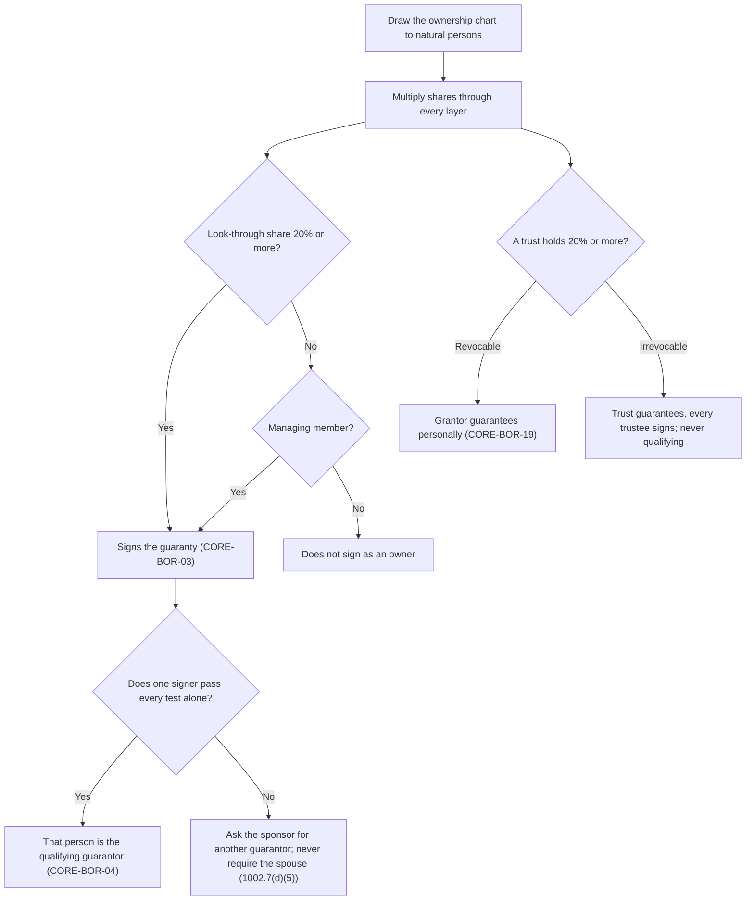
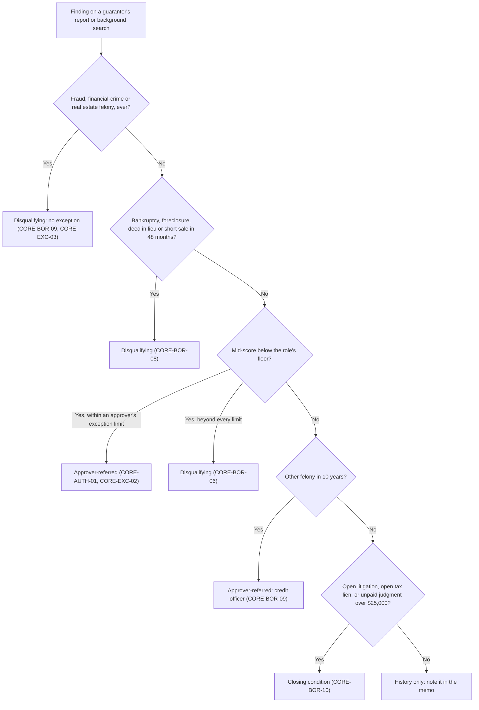
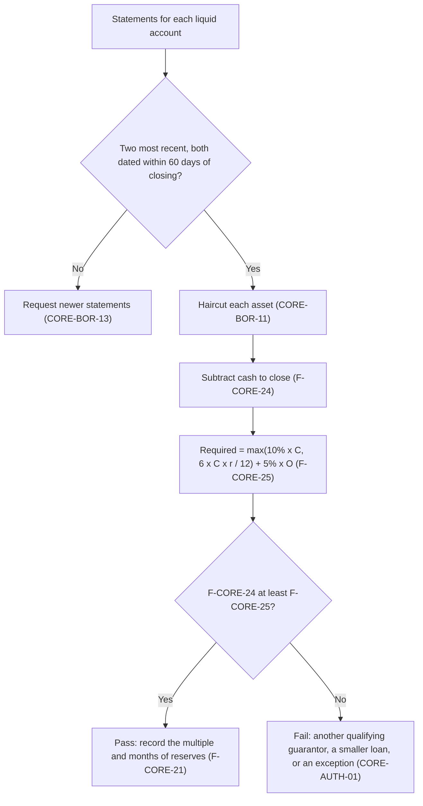
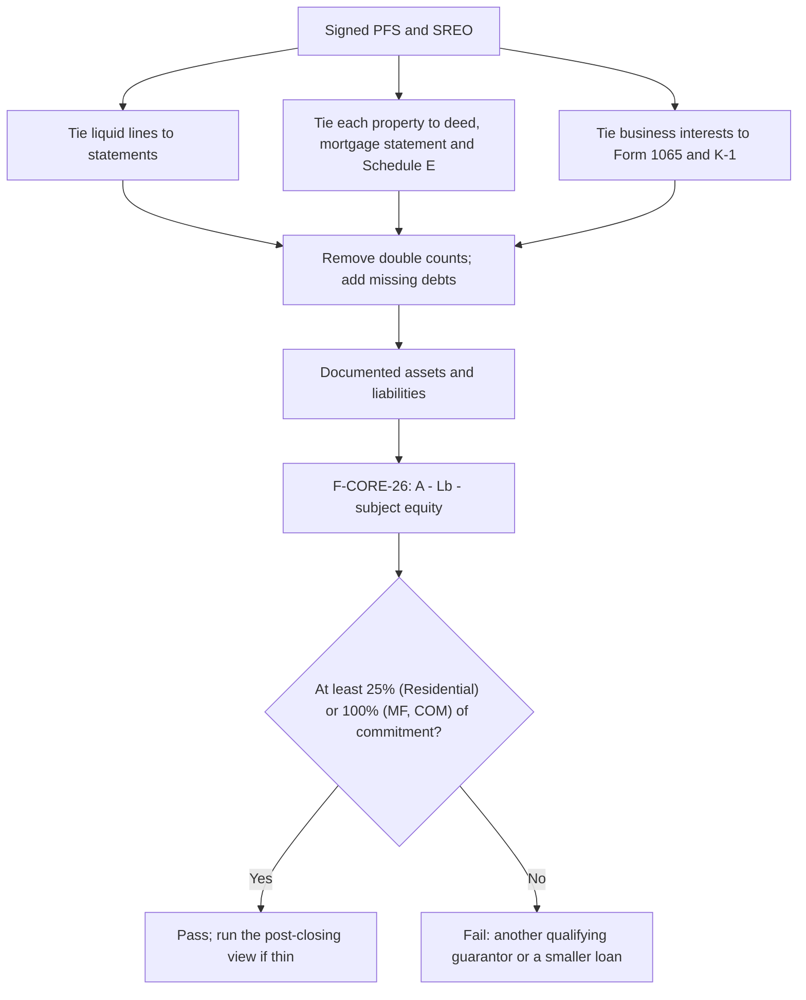
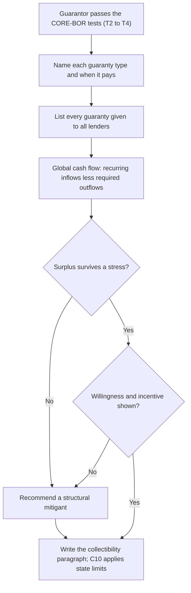

# C6: Borrower, sponsor and guarantor analysis

**Model policy for training - not for live lending decisions.** Fictional data only.

| Item | Detail |
| --- | --- |
| Assets in this tab | C6-lesson-v1.0-draft, C6-quiz-v0 (sets A and B, unchanged until Phase 3), C6-ojt-v1.0-draft, C6-jobaid-v1.0-draft |
| Objectives | O1 determine every guarantor, the qualifying guarantor and the guaranty type; O2 differentiate credit and background findings into four bins; O3 calculate adjusted and required liquidity, the coverage multiple and months of reserves; O4 reconcile a PFS and calculate adjusted net worth; O5 evaluate what a guaranty adds and recommend a mitigant; O6 apply the experience count, family gates and exposure caps to name the tier and approver |
| Hours | Blueprint projection 4.4 CPE credits (QAS Self Study word-count formula, blueprint section 7). Recount from the final lesson and assessment under the counting rule in qas-spec.md. The OJT task (45 minutes) is extra and earns no credit |
| Knowledge level | Intermediate (qas-spec.md) |
| Field of study | Specialized Knowledge; Finance for the liquidity, net worth and exposure math (split by content time) |
| Prerequisite | C2 and C3 (F-CORE-21 uses C3's interest math). C1 introduces Regulation B and adverse-action notices; C6 applies them. No advance preparation |
| Bloom's levels | 3 Apply (O1, O3, O6), 4 Analyze (O2, O4), 5 Evaluate (O5), within LD-02 as amended 22 Nov 2026 |
| Formulas | F-CORE-21, F-CORE-24, F-CORE-25, F-CORE-26, F-CORE-27, F-CORE-29; F-CORE-30 (look-ahead to C14) |
| Rules | CORE-BOR-01 to -19; CORE-KYC-02, -03, -07, -08, -09; CORE-DOC-01 to -04; CORE-DEF-03; CORE-EXC-01 to -04; CORE-CONC-01 to -03; CORE-AUTH-01; CORE-CLS-04; CORE-PRC-02; MF-BR-12; MF-GEN-07; COM-BR-07; COM-GEN-15; COM-DSCR-07; RES-DSCR-08; RES-GU-01; D-CONV-01, -03; D-CORE-01, -02, -04, -06, -18, -26, -27 |
| Running deals | Worked examples: RD-RES-01 Maple Run and RD-MF-01 Cedar Court. Practice: RD-COM-01 Birchwood Plaza (LD-08). What-if and Formula Library examples are labelled and are not running-deal data |
| Status | v1.0-draft. Teach, Practice, OJT and Job aid rewritten to the C6 blueprint. Review questions and exam forms follow in Phase 3. Policy gaps P-C6-1 to -4 stay open for the owner. Self-review is at the end of this tab |
| Change log | v0, 20 Nov 2026: first draft; all numbers computed in code. v0.2, 22 Nov 2026: review fixes, policy decisions D-CORE-17 onward, self-check. v1.0-draft, 22 Nov 2026: rewritten to blueprint (Phase 2b) |

## 1. Hook

Marcus Hale has a net worth of $6,800,000 and $930,000 of liquidity. That is 1.81 times the $514,000 that Cedar Court's $5,140,000 loan requires. On money alone, he is an easy yes.

Yet no one below the credit committee can approve the loan. Only 2 of his 3 apartment deals count, which makes him Tier 1, and Tier 1 caps exposure at $3,000,000. His guaranty, meanwhile, pays only if he commits a listed bad act.

By the end of this module you can find all of that in any sponsor file, and say what it means for the loan.

## 2. Objectives

By the end of C6, you will be able to:

1. **O1. Determine** every required guarantor, the qualifying guarantor and the guaranty type for a multi-layer ownership chart, including trusts and spouses (CORE-BOR-03 to -05, -19; CORE-DOC-01 to -03).
2. **O2. Differentiate** each credit-report and background finding as disqualifying, approver-referred, a closing condition or history only (CORE-BOR-06 to -10; CORE-KYC-03).
3. **O3. Calculate** adjusted liquidity, required post-closing liquidity, the coverage multiple and months of reserves from dated statements (F-CORE-24, -25, -21; CORE-BOR-11 to -13).
4. **O4. Reconcile** a personal financial statement to statements, tax returns and a schedule of real estate owned, then calculate adjusted net worth before and after closing (F-CORE-26; CORE-BOR-14).
5. **O5. Evaluate** whether a guaranty adds real credit support, given contingent liabilities, global cash flow and enforceability, and recommend one structural mitigant.
6. **O6. Apply** the experience count, family gates and sponsor-exposure caps to name the tier and the approver (F-CORE-27, -29; CORE-BOR-15 to -18; MF-GEN-07; COM-GEN-15; CORE-CONC-01, -02; CORE-AUTH-01; RES-GU-01).

O1, O3 and O6 are at Bloom level 3 (Apply). O2 and O4 are at level 4 (Analyze). O5 is at level 5 (Evaluate).

## 3. Teach

### T1. Who signs and on what

**The point.** The borrower is an empty entity, so the credit sits with the people behind it: find every one who must guarantee, the one who must qualify alone, and what each guaranty covers.

**Why the people matter more than the entity.** Our borrower is always an LLC, LP or corporation formed in a US state (CORE-BOR-01). Its purpose is limited to owning and operating real estate (CORE-BOR-02).

Most are single-purpose entities formed for one deal. Harborline Holdings LLC, Cedar Court Partners LLC and Birchwood Plaza LLC have no history, no other income and no other assets. Their only asset is the property we lend on.

That design protects the lender from the sponsor's other troubles. It also means the entity cannot support the loan if the property fails. The support has to come from the people who own and run it.

A guaranty is how we reach them. A guarantor promises to pay, or to perform, if the borrower does not. Each guarantor becomes a second source of repayment, behind the property's cash flow and ahead of the collateral sale.

So underwriting a sponsor starts with two questions. Who must sign? And what exactly do they sign?

**Look-through ownership: multiply each layer.** Ownership charts rarely stop at people. A borrower is often owned by holding LLCs, family partnerships or trusts.

To find a person's share of the borrower, multiply the shares down every layer. A person who owns 45% of a holding LLC that owns 50% of the borrower owns 0.45 × 50% = 22.5% of the borrower.

Here is a what-if chart, not a running deal. Borrower Elm Street LLC is owned 50% by Ortega Capital LLC and 50% by Ann Lee. Ortega Capital is owned 45% by Raul Ortega and 55% by Mia Ortega.

| Person | Path to the borrower | Look-through share | Signs under CORE-BOR-03? |
| --- | --- | --- | --- |
| Ann Lee | Direct, 50% | 50.0% | Yes |
| Mia Ortega | 55% × 50% | 27.5% | Yes |
| Raul Ortega | 45% × 50% | 22.5% | Yes |

Every person here clears 20%, so all three sign. Ortega Capital itself does not guarantee: CORE-BOR-03 reaches individuals, and the holding LLC is as empty as the borrower.

Now change one fact. If Raul owned only 35% of Ortega Capital, his share would be 0.35 × 50% = 17.5%. He would not sign, unless he were the managing member.

**Why 20%, not 25%.** Some sources set the guaranty line at 25%, the share the Model Credit Policy records for FinCEN's bank due-diligence rule (CORE-KYC-02; C7). Our policy chose 20% instead (D-CORE-01).

The reason is arithmetic. With a 25% test, five equal owners at 20% each would leave no one who must guarantee. A 20% test catches all five. With six or more small owners, the managing member still signs. CORE-KYC-02 sets ID collection at the same 20% line, so the guarantor list and the identity list match.

**Reading the operating agreement.** The ownership chart is only as good as the document behind it. For an LLC, that is the operating agreement, plus any amendments and the state filing. Check five things.

| Item | Where it sits | Why it matters |
| --- | --- | --- |
| Members and percentages | Member schedule or exhibit | The source for every share on the chart; must total 100% |
| Manager | Management article | Names the managing member who signs under CORE-BOR-03 |
| Authority to borrow and guarantee | Powers article; any consent requirement | Shows who may sign for the borrower, and whether members must consent |
| Transfer restrictions | Transfer article | Shows whether owners can change without our consent; our carve-outs cover unpermitted transfers (CORE-DOC-02) |
| Classes of interest | Capital or units article | Profits and votes may not follow the same percentages; chart economic ownership and control separately |

A gap between the chart and the agreement is a stop. Ask for the corrected chart, signed and certified, before you run any test.

**The managing member signs whatever their share.** CORE-BOR-03 adds the managing member to the 20% owners. The manager controls the cash, the contractor and the decision to file for bankruptcy. A manager with 5% still decides what happens to the property, so the manager guarantees too.

**The qualifying guarantor.** Many people may sign. One must carry the file. CORE-BOR-04 requires at least one guarantor, the qualifying guarantor, to meet the FICO, liquidity, net worth and experience tests alone.

The market often lets co-guarantors combine their strengths. A strong balance sheet covers a thin track record, or the reverse. Our policy does not (D-CORE-02). One person meeting every test is simpler to audit, and it answers a plain question: if only one person stands behind this loan, is that enough?

Other guarantors still matter. Every guarantor must clear the credit and background rules in T2: the 620 score floor, the credit-event bar, the felony screen and the lien rule (CORE-BOR-06 to -10; CORE-KYC-03). They do not have to meet the liquidity, net worth and experience tests.

**What a usable chart looks like.** Ask the sponsor for a one-page chart, signed and certified as true. It should show four things.

1. The borrower at the top, with its state of formation.
2. Every entity between the borrower and a natural person, with each owner's percentage.
3. Every natural person at the bottom, with their look-through share worked out.
4. The managing member or manager of the borrower and of each holding entity.

Percentages at each level must total 100%. A box marked "investors" or "others" is not finished. If a passive-investor LLC owns 20% or more of the borrower, its own members must be charted too.

**A guarantor who is not an owner.** Sometimes a sponsor offers a wealthy parent or a partner company as an extra guarantor. Regulation B allows a creditor to request such a party when its standards need one (see the Regulation B table below).

The model policy does not say whether a non-owner may be the qualifying guarantor. CORE-BOR-04 speaks of "at least one guarantor", and CORE-BOR-03 lists owners and the manager. Treat a non-owner qualifying guarantor as a question for the credit officer, not a default yes.

**Trusts in the chart.** Trusts are common in estate-planned families. A trust may own part of a borrower, but it may never be the borrower (CORE-KYC-08; CORE-BOR-01).

When a trust holds 20% or more, two rules apply. CORE-KYC-08 says who goes on the chart: every trustee, the grantor of a revocable trust, and any beneficiary with a 20% look-through share. CORE-KYC-09 adds the documents: a certification of trust signed by every trustee, and the trust pages naming trustees, beneficiaries, revocability and powers.

CORE-BOR-19 then says who guarantees.

| Trust type (20%+ owner) | Who guarantees | Signed by | Can be the qualifying guarantor? |
| --- | --- | --- | --- |
| Revocable | The grantor, personally | The grantor | Yes, the grantor can, if the grantor passes alone |
| Irrevocable | The trust itself | Every trustee | No: a trust is never the qualifying guarantor (CORE-BOR-19) |
| Beneficiaries of an irrevocable trust | Not required to guarantee | n/a | n/a |

The policy's reasoning is practical. It treats a revocable trust's grantor as the real economic owner, since the grantor keeps the power to revoke. An irrevocable trust has no FICO score and no track record, so it can add assets but never qualify. Whether a trustee has power to sign a guaranty depends on the trust document. The policy sends that question to counsel [VERIFY: trust instrument; counsel, as CORE-BOR-19 requires; not a source C6 can open].

**Spouses: what Regulation B allows.** The spouse question is where credit policy meets federal law. The Equal Credit Opportunity Act bars a creditor from discriminating against an applicant "on the basis of race, color, religion, national origin, sex or marital status, or age" [VERIFY: 15 U.S.C. 1691(a)(1), Cornell LII; checked 22 Nov 2026]. Regulation B implements it.

Regulation B covers business credit, not just consumer loans. It defines business credit as credit "primarily for business or commercial" purposes [VERIFY: 12 CFR 1002.2(g), Cornell LII; checked 22 Nov 2026]. Every loan in this course is business credit.

The core rule is short. A creditor "shall not require the signature of an applicant's spouse or other person" if the applicant qualifies under the creditor's standards for the amount and terms requested [VERIFY: 12 CFR 1002.7(d)(1), Cornell LII; checked 22 Nov 2026].

For this rule only, "applicant" includes "guarantors, sureties, endorsers, and similar parties" [VERIFY: 12 CFR 1002.2(e), Cornell LII; checked 22 Nov 2026]. So a qualifying guarantor's spouse is protected in the same way.

Three further paragraphs shape what we may ask for.

| Paragraph | What it allows | How CORE-BOR-05 uses it |
| --- | --- | --- |
| 1002.7(d)(4), secured credit | The spouse's signature on any instrument state law needs to make the collateral available, for example to create a valid lien or waive inchoate rights | Our collateral is owned by the LLC, so a spouse rarely needs to sign a lien document. If one does, it is that document only, never the guaranty |
| 1002.7(d)(5), additional parties | If the creditor's standards need another party's liability, it may ask for a guarantor. The spouse may serve, but the creditor "shall not require" that the spouse be that party | If a guarantor falls short, we may ask for another guarantor. The sponsor chooses who; we never name the spouse |
| Comment 7(d)(6)-1, business guarantees | A creditor may require personal guarantees from partners, officers and shareholders of a closely held firm, "even if the business or corporation is creditworthy" | CORE-BOR-03 rests on ownership and control, a relationship with the business, not on marriage |

&#91;VERIFY: 12 CFR 1002.7(d)(4) and (d)(5), Cornell LII; checked 22 Nov 2026] [VERIFY: 12 CFR Part 1002, Supplement I, comment 7(d)(6)-1 and -2, Cornell LII; checked 22 Nov 2026]

The official comment adds a warning. A creditor may not require guarantees only from the married officers of a business. Nor may it automatically require the spouses of guarantors to sign [VERIFY: 12 CFR Part 1002, Supplement I, comment 7(d)(6)-2, Cornell LII; checked 22 Nov 2026].

So CORE-BOR-05 says two things. A spouse who owns nothing is not asked to sign when the guarantor qualifies alone. A spouse who owns 20% or more signs as an owner, under the same rule as everyone else. Marriage is never the reason.

**This area of law is not settled.** Whether a guarantor is really an "applicant" under the statute has divided the federal courts. The Supreme Court took a case on the point, then "affirmed by an equally divided Court", which settled nothing [VERIFY: Hawkins v. Community Bank of Raymore, No. 14-520 (U.S. 22 Mar 2016), Cornell LII; checked 22 Nov 2026]. C1 teaches the split. For C6, the practical answer is simple: follow Regulation B as written.



The flowchart is the order of work. Chart people, multiply, apply the 20% and manager tests, handle trusts, then pick the one person who carries the file.

**What each guarantor signs.** Signing "the guaranty" is not one thing. The guaranty type decides what the lender can collect, and when. Our policy sets the type by family and structure.

| Guaranty | What the guarantor promises | When it bites | Policy |
| --- | --- | --- | --- |
| Full-recourse guaranty of payment | To pay the whole debt if the borrower does not | On any payment default | CORE-DOC-01 (Residential); MF-BR-12 (Multifamily under $2,000,000); COM-BR-07 (Commercial above 60% LTV, burning off at stabilization) |
| Carve-out (non-recourse) guaranty | To pay losses, or the whole debt, if a listed "bad act" occurs | Fraud, misapplied funds, unpermitted transfer, voluntary bankruptcy | CORE-DOC-02 (Multifamily and Commercial bridge); MF-BR-12 ($2,000,000 and up) |
| Completion guaranty | To finish the funded work and pay overruns | When work stalls or costs exceed the budget | CORE-DOC-03 (any loan with future funding or construction) |
| Environmental indemnity | To pay environmental cleanup and related losses | When contamination is found | CORE-DOC-03 (Multifamily and Commercial) |

T5 explains what each is worth. C9 owns the law of each document.

**How our model policy applies it.** Every 20% look-through owner and the managing member sign (CORE-BOR-03). One qualifying guarantor passes every test alone (CORE-BOR-04). Spouses are handled under CORE-BOR-05, and trusts under CORE-BOR-19 and CORE-KYC-08 and -09. Every 20% owner and one control person are also identified with government ID (CORE-KYC-02), which C7 covers.

**Worked example 1: Maple Run guarantors (RD-RES-01)**

1. **Rule.** CORE-BOR-03, -04, -05; guaranty type CORE-DOC-01 and -03.
2. **Inputs.** Harborline Holdings LLC: Dana Reyes 60% (managing member); Sam Okafor 40%. Dana is married to Chris Reyes, who owns nothing. Residential loan with a $100,000 rehab holdback.
3. **Apply.** Dana (60%) and Sam (40%) both clear 20%, so both sign. Chris owns nothing, and Dana passes every test alone, so Regulation B bars requiring him to sign. Future funding adds a completion guaranty.
4. **Result.** Guarantors: Dana and Sam, on a full-recourse guaranty of payment plus a completion guaranty. Qualifying guarantor: Dana. Sam must still pass every credit and background rule in T2.

**Worked example 2: Cedar Court guarantors (RD-MF-01)**

1. **Rule.** CORE-BOR-03, -04; CORE-DOC-02, -03; MF-BR-12.
2. **Inputs.** Cedar Court Partners LLC: Marcus Hale 60% (managing member); Priya Nand 40%. Commitment $5,140,000 with an $800,000 capex plan. Passive investors sit in a separate holding LLC that funds equity.
3. **Apply.** Marcus and Priya both clear 20%, so both sign. The commitment is $2,000,000 or more, so the loan is non-recourse with carve-outs. Future funding for capex adds a completion guaranty. Multifamily adds an environmental indemnity.
4. **Result.** Carve-out guaranty, completion guaranty and environmental indemnity. Marcus is the qualifying guarantor and must sign the carve-out guaranty (CORE-DOC-02). The passive investors are not in the borrower's chart, so they do not sign.

Notice the difference. Dana's guaranty pays on any default. Marcus's guaranty pays only if a carve-out is triggered, the capex stalls, or contamination appears. Same word, very different credit support.

**Questions to ask the sponsor.** A short interview catches most chart problems before you test anything. Ask these five.

1. Who else has any interest in the borrower or its holding entities, including family members and lenders with conversion rights?
2. Who decides day to day, and who can sign for the borrower?
3. Has ownership changed in the last 12 months, or will it before closing?
4. Does any trust, estate or partnership hold an interest, and who controls it?
5. Who is putting up the cash to close, and from which account?

Write the answers down and compare them with the operating agreement. A sponsor who cannot answer the second question may not be the real decision-maker. T6 explains why that matters.

**What changes after closing.** The chart is a snapshot. Owners sell, die or bring in partners during the loan.

A new owner who crosses 20% changes who should be on the guaranty. That is one reason the carve-out guaranty lists unpermitted transfers as a trigger (CORE-DOC-02). C12 covers transfer requests in servicing. For underwriting, the rule is simple: the chart you test must be the chart at closing.

**Common slips.**

- Stopping at the first layer of the chart. A 30% holding LLC can hide a 24% individual owner.
- Treating the managing member's small share as a reason to skip the guaranty.
- Asking a non-owner spouse to "just sign too". When the guarantor qualifies alone, that breaches Regulation B.
- Letting an irrevocable trust be the qualifying guarantor because it holds large assets.

**Why it matters to a credit officer.** A missing signer is a hole you cannot fix after funding. A wrongly required spouse is a fair-lending violation. And a guaranty of the wrong type can leave the lender with far less than the memo claimed.

### T2. Credit report and background

**The point.** Every guarantor's credit report and background search must be read finding by finding, and each finding sorted into one of four bins: disqualifying, approver-referred, closing condition or history only.

**Why personal credit matters on a business loan.** The borrower LLC has no credit history of its own. The guarantors do. Their reports show how they have handled debt for years, across lenders and cycles.

A guarantor who pays late, piles up judgments or walks away from properties is telling you how the guaranty may perform. The report is the cheapest evidence of willingness to pay that you will ever get. T5 shows why willingness matters as much as wealth.

So the model policy tests every guarantor's credit, not only the qualifying guarantor's. The score floors differ by role. The event, felony and lien rules do not (CORE-BOR-06 to -10; CORE-KYC-03).

**Why we may pull the report: permissible purpose.** A consumer report is a regulated product. The Fair Credit Reporting Act (FCRA) lets a credit bureau furnish one only "under the following circumstances and no other" [VERIFY: 15 U.S.C. 1681b(a), Cornell LII; checked 22 Nov 2026].

The purpose that fits lending is a user who intends to use the report "in connection with a credit transaction involving the consumer" [VERIFY: 15 U.S.C. 1681b(a)(3)(A), Cornell LII; checked 22 Nov 2026]. A user "shall not use or obtain a consumer report for any purpose" outside the list [VERIFY: 15 U.S.C. 1681b(f), Cornell LII; checked 22 Nov 2026].

Our loans go to an LLC, not to a consumer. So does a guarantor's report qualify? The Federal Trade Commission staff answered this in its 2011 FCRA report.

A lender has a permissible purpose "when the consumer is or will be personally liable on the loan as a co-signer or guarantor". A lender has none for a person "who will not be personally liable", even a shareholder or officer [VERIFY: FTC, 40 Years of Experience with the Fair Credit Reporting Act, Jul 2011, Summary of Interpretations, section 604(a)(3)(A), item 5; checked 22 Nov 2026].

That staff view is guidance, not a regulation. But it gives a clean order of work. Build the chart first (T1). Pull reports only on the people who will sign a guaranty.

| Person on the chart | Signs a guaranty? | Pull a consumer report? |
| --- | --- | --- |
| 20% owner or managing member (CORE-BOR-03) | Yes | Yes: personally liable |
| Grantor of a revocable trust that owns 20% (CORE-BOR-19) | Yes, personally | Yes |
| Trustee signing for an irrevocable trust | Signs for the trust, not personally | Check with counsel first |
| 10% passive owner | No | No: no permissible purpose |
| Non-owner spouse of a qualifying guarantor (CORE-BOR-05) | No | No |

The last row ties T1 to T2. If Regulation B bars us from requiring a spouse's signature, we also have no reason to pull the spouse's report.

**What is in a credit report.** A report from Equifax, Experian or TransUnion has the same main parts. Learn to read each part, not just the score at the top.

| Part | What it shows | What the underwriter looks for |
| --- | --- | --- |
| Identification | Names, addresses, birth date, Social Security number match | A mismatch with the ID and the PFS; an address that is the collateral |
| Tradelines | Each account: lender, type, limit, balance, payment history | Late payments, high use of revolving lines, debts missing from the PFS |
| Inquiries | Who pulled the report, and when | Many recent mortgage inquiries: undisclosed loans in progress |
| Public records and collections | Bankruptcies; in some files, judgments and liens; accounts in collection | Events inside the CORE-BOR-08 window; open items under CORE-BOR-10 |
| Alerts and freezes | Fraud alerts, active-duty alerts, security freezes | A reason to verify identity before going further |
| Score | A model's summary of the file, usually 300 to 850 | The mid-score under CORE-BOR-07 |

Tradelines do double duty. They test credit behavior, and they test the PFS. A $95,000 home equity line on the report that is missing from the PFS is a T4 problem as well as a T2 one.

Inquiries matter for the same reason. Three mortgage inquiries in the last 60 days suggest other loans in progress. Those loans may soon sit beside ours as contingent liabilities (T5).

**Reading tradelines well.** A tradeline is more than "paid as agreed". Read four fields on every open account.

| Field | What it tells you | A warning sign |
| --- | --- | --- |
| Payment history | Months paid on time, 30, 60 or 90 days late | Lates in the last 12 months, or lates that cluster in one period |
| Balance against limit | How much of each revolving line is in use | Cards and lines near their limits: the guarantor may be funding life on credit |
| Date opened | How new the debt is | Several accounts opened in the last six months |
| Account type and owner | Individual, joint, or authorized user; mortgage, installment or revolving | A mortgage on a property that is missing from the SREO (T4) |

High use of revolving credit matters for a sponsor in particular. Our liquidity test ignores unused lines (T3). But a guarantor who has already drawn them owes that money, and the payments come out of the same cash we counted.

Mortgage tradelines are the best free check on the schedule of real estate owned. Each one names a lender and a balance. Match every one to a property before T4 begins.

**Fraud alerts.** A consumer can place an initial fraud alert, which stays at least one year. A user who sees one may not open new credit in the consumer's name unless it forms "a reasonable belief" that it knows who is asking [VERIFY: 15 U.S.C. 1681c-1(a)(1)(A) and (h)(1)(B)(i), Cornell LII; checked 22 Nov 2026].

Our credit goes to an LLC, so the statute may not reach every guaranty. Treat the alert as a stop anyway. Confirm identity with the government ID collected under CORE-KYC-02 before you rely on anything else in the file. C7 covers identity checks.

**Freezes, disputes and thin files.** Three other report conditions stop the analysis until they are handled.

| Condition | What it means | What to do |
| --- | --- | --- |
| Security freeze | The bureau will not release the file | Ask the guarantor to lift it for that bureau; nothing is read until they do |
| Account in dispute | The guarantor has challenged a tradeline | Ask for the dispute letter and the outcome; read the account as reported meanwhile |
| Only one or two scores | A bureau has too little data to score | Two scores: use the lower (CORE-BOR-07). One or none: the policy has no rule, so ask the credit officer |

A thin file is not a bad file. But a qualifying guarantor with almost no credit history gives us little evidence of willingness, which T5 treats as half of a guaranty's value.

**The mid-score and the floors.** Each bureau runs its own model on its own data. The three scores rarely match. The policy uses the middle one, the mid-score. With only two scores, use the lower (CORE-BOR-07).

The middle score blunts one bureau's error without rewarding the best file. Taking the lower of two keeps the same bias toward caution.

The report must be no older than 90 days at closing (CORE-BOR-07). A report pulled at application can go stale if the closing slips. Diary the date and re-pull before day 90.

| Guarantor | Mid-score floor (CORE-BOR-06) |
| --- | --- |
| Qualifying guarantor, Experience Tier 1 to 3 | 680 |
| Qualifying guarantor, Experience Tier 0 | 700 |
| Every other guarantor | 620 |

Compare at face value. A 679 is below 680. There is no rounding and no "close enough".

The Tier 0 floor is higher for a reason. A new investor has no track record to show how they handle a project that goes wrong. Credit history is the only behavior evidence left, so the policy asks for more of it.

**Credit events and why seasoning exists.** CORE-BOR-08 bars any guarantor with a bankruptcy discharge, foreclosure, deed in lieu or short sale in the last 48 months.

Each of these events means a lender took a loss or a borrower gave up a property. Recent events predict more of the same. Older events say less, because people and markets change.

The waiting period is called seasoning. Market practice ranges from 24 months to 7 years. Our policy chose 48 months, the middle of that range (D-CORE-04).

Federal law also limits how far back a report may reach. Bankruptcies drop off after 10 years and most other adverse items after 7 years. Criminal convictions have no limit [VERIFY: 15 U.S.C. 1681c(a)(1) and (a)(5), Cornell LII; checked 22 Nov 2026].

Those limits do not apply to a credit transaction with "a principal amount of $150,000 or more" [VERIFY: 15 U.S.C. 1681c(b)(1), Cornell LII; checked 22 Nov 2026]. Most of our loans clear that line, so a bureau may report older items. Read them, then apply our 48-month rule.

**The background search.** A credit report does not show everything. Criminal records, many liens and most lawsuits sit in court and county files. CORE-KYC-03 therefore requires a background search on each guarantor.

The search covers criminal history, bankruptcy, foreclosure, liens, judgments and litigation, with a 10-year lookback (CORE-KYC-03). Compare it line by line with the credit report and the sponsor's own disclosures. A gap between them is a question to ask, and sometimes a red flag (CORE-KYC-07; C7).

**The felony screen.** CORE-BOR-09 sets two tiers. A felony for fraud, financial crime or a real estate offence, at any time, makes the guarantor ineligible. Any other felony in the last 10 years goes to a credit officer.

The first tier is absolute. No exception is ever allowed to the fraud bar in CORE-BOR-09 (CORE-EXC-03). The reasoning is direct: a guaranty is a promise, and a fraud conviction is evidence about promises.

The second tier is judgment, not a ban. The credit officer weighs the offence, its age and what has happened since. The policy's own notes flag state fair-chance laws as an open check before this rule is used live; C7 picks that up.

**Liens, judgments and litigation.** CORE-BOR-10 says active material litigation, open tax liens, or unpaid judgments over $25,000 must be resolved at or before closing. Read the rule as written: the $25,000 figure qualifies judgments.

Why at closing and not before approval? These items can usually be paid or settled from the closing funds or the guarantor's cash. The fix is a condition, not a decline. But an open tax lien can attach to the guarantor's other assets, so it must be gone when we fund.

"Resolved" needs evidence: a release of lien, a satisfaction of judgment, or a dismissal. A promise to pay is not a resolution.

**Exceptions: when a failure can move up the ladder.** Most credit rules can bend only through a documented exception (CORE-EXC-01, -02). The approval matrix sets what each approver may grant (CORE-AUTH-01).

| Approver | Score exception allowed (CORE-AUTH-01) |
| --- | --- |
| Senior underwriter | None |
| Credit officer | One exception, up to 20 points below the floor |
| Credit committee | Up to two exceptions, up to 40 points below the floor |

Each exception needs at least two compensating factors in the log (CORE-EXC-02). No loan may carry more than two (CORE-EXC-04).

The matrix lists no exception type for a credit event inside 48 months. So treat a CORE-BOR-08 event as disqualifying. Never use an exception to clear the fraud bar (CORE-EXC-03).

**The four bins.** Every finding lands in one bin. The bin decides what you write in the memo and who acts.

| Bin | What it means | Findings that land here |
| --- | --- | --- |
| Disqualifying | The guarantor cannot sign, so the structure must change or the loan is declined | Fraud, financial-crime or real estate felony at any time (CORE-BOR-09; no exception, CORE-EXC-03). Bankruptcy discharge, foreclosure, deed in lieu or short sale in 48 months (CORE-BOR-08). Mid-score below the floor with no exception approved (CORE-BOR-06) |
| Approver-referred | A named approver must decide before the file can pass | Any other felony in 10 years: credit officer (CORE-BOR-09). Mid-score within an approver's exception limit: that approver (CORE-AUTH-01; CORE-EXC-02) |
| Closing condition | The loan may be approved, but cannot fund until the item is cleared | Open material litigation, open tax liens, unpaid judgments over $25,000 (CORE-BOR-10). A report that will be over 90 days old at closing: re-pull (CORE-BOR-07) |
| History only | Noted in the memo; no action | Released liens, satisfied judgments, events older than 48 months, a non-fraud felony older than 10 years |



Run the flowchart once per finding, not once per guarantor. One guarantor can have findings in three bins at once.

**Adverse action when a guarantor sinks the file.** Suppose Sam Okafor's report showed a foreclosure 30 months ago. Sam could not sign, and Harborline would need a new structure or a decline. Who gets the notice?

Under Regulation B, "applicant" includes guarantors only for the spouse-signature rule in 1002.7(d) [VERIFY: 12 CFR 1002.2(e), Cornell LII; checked 22 Nov 2026]. So the adverse-action notice goes to the business that applied, not to Sam.

C1 teaches the notice rules for business credit. Firms with gross revenues of $1 million or less get the near-consumer process. Larger firms get notice "within a reasonable time", with reasons on written request within 60 days [VERIFY: 12 CFR 1002.9(a)(3)(i)-(ii), Cornell LII; checked 22 Nov 2026].

Harborline is a new single-purpose LLC, so it falls in the $1 million or less group. Give reasons that name the finding plainly, such as "guarantor credit history: recent foreclosure". Never name a protected trait.

**Matching the report, the search and the sponsor's story.** Three sources describe the same person. Read them together, not one at a time.

| Source | Strong on | Weak on |
| --- | --- | --- |
| Credit report | Debts, payment behavior, recent inquiries, bankruptcies | Most lawsuits, many liens, criminal records |
| Background search (CORE-KYC-03) | Court records, liens, judgments, criminal history over 10 years | Debts that are current; private settlements |
| Sponsor's own disclosure and interview | Context: why an event happened and what changed | Anything the sponsor would rather not mention |

Ask the sponsor to disclose every bankruptcy, foreclosure, judgment and lawsuit before you pull anything. Then compare. A finding the sponsor disclosed and explained is ordinary underwriting. A finding the sponsor left out is a credibility question, and conflicting documents are a red flag for the BSA officer (CORE-KYC-07).

The same applies to entities. A guarantor's LLC may carry a judgment or a lien that never appears on the personal report. Run the background search on the names in the chart, and read the results for the sponsor's other entities too.

**Writing it up.** The credit paragraph in the memo names each guarantor, each score, each finding and its bin. A good line for Maple Run reads: "Dana Reyes: mid-score 712 (705/712/730) against the Tier 2 qualifying floor of 680. Background: 2019 state tax lien of $8,000, released 2020, history only. Sam Okafor: 655 against 620; no findings. Reports dated within 90 days of the 15 Jan 2027 closing (CORE-BOR-06, -07, -10; CORE-KYC-03)."

**How our model policy applies it.** Pull reports only on guarantors, once the chart is final. Use the mid-score and the role's floor (CORE-BOR-06, -07). Apply the 48-month event bar (CORE-BOR-08) and the felony screen (CORE-BOR-09) to every guarantor. Clear open liens, judgments and litigation by closing (CORE-BOR-10). Run the 10-year background search (CORE-KYC-03). Route any exception through CORE-EXC and the CORE-AUTH-01 matrix.

**Worked example 3: Maple Run credit (RD-RES-01)**

1. **Rule.** CORE-BOR-06 to -10; CORE-KYC-03.
2. **Inputs.** Dana Reyes: scores 705, 712 and 730; one $8,000 state tax lien filed 2019, paid and released 2020; no bankruptcy, foreclosure, felony or open litigation. Dana is Tier 2 (T6). Sam Okafor: scores 640, 655 and 668; no adverse items.
3. **Apply.** Dana's mid-score is 712, the middle of three. As a Tier 2 qualifying guarantor her floor is 680: 712 ≥ 680. Sam's mid-score is 655; his floor is 620: 655 ≥ 620. The lien is released, so it is not open under CORE-BOR-10.
4. **Result.** Both pass. The 2019 lien goes in the memo as history only, with the release attached. Diary both reports to be re-pulled if closing on 15 Jan 2027 slips past day 90.

**Worked example 4: a what-if on the same file**

What-if, not running-deal data. Change two facts: Dana's scores are 650, 664 and 702, and Sam has an unpaid $27,500 judgment.

1. **Rule.** CORE-BOR-06, -07, -10; CORE-AUTH-01; CORE-EXC-02.
2. **Inputs.** Dana's mid-score 664 against her 680 floor. Sam's judgment $27,500 against the $25,000 line.
3. **Apply.** 680 − 664 = 16 points short. That is within the credit officer's one exception of up to 20 points, so the file goes up from the senior underwriter. Sam's $27,500 judgment is over $25,000, so it must be satisfied at or before closing.
4. **Result.** Dana: approver-referred to a credit officer, with two compensating factors logged. Sam: closing condition, cleared only by a recorded satisfaction of judgment.

Notice how one finding changed the approver. Without the exception, a senior underwriter could approve Maple Run (T6). With it, only a credit officer can.

**Common slips.**

- Averaging the three scores instead of taking the middle one.
- Applying the 680 floor to a Tier 0 qualifying guarantor, who needs 700.
- Treating a released lien as open, or an unreleased "paid" lien as closed.
- Pulling a report on a passive owner who will not sign.
- Letting a non-qualifying guarantor skip the event and felony rules.

**Why it matters to a credit officer.** The credit file is where willingness to pay shows up in data. A misread bin either declines a good sponsor or funds a guarantor who cannot legally sign. And a report pulled without permissible purpose is a federal compliance problem of its own.

### T3. Liquidity and reserves

**The point.** Liquidity is the cash a guarantor could actually put into a stalled project after closing, so count it after haircuts and after cash to close, size the requirement on the commitment, and prove it with dated statements.

**Why liquidity comes first.** Net worth says what a guarantor owns. Liquidity says what they can spend this month. When a renovation runs over or a tenant leaves, the project needs cash in days, not equity in a building that takes a year to sell.

Bridge and rehab loans are exactly the loans where that happens. The property earns little or nothing while work is under way. So the guarantor's liquid assets are the first line of support when the plan slips.

Examiners say so directly. Analysis "should consider the liquidity of any assets that collateralize the guarantee". And "Guarantor liquidity should be verified by the bank" [VERIFY: OCC, Comptroller's Handbook: Commercial Real Estate Lending, v2.0, Mar 2022, p. 30; checked 22 Nov 2026].

No statute sets a private lender's liquidity test. The numbers below are the model policy's own choices, each logged with its basis in the Model Credit Policy.

**Step 1: haircut each asset (CORE-BOR-11).** A dollar in a brokerage account is not a dollar of cash. Prices fall, sales take days, and taxes and penalties come off retirement money.

A haircut is the discount for that. Each asset counts at a set share of its statement value.

| Asset | Counts at | Why |
| --- | --- | --- |
| Cash and money-market funds | 100% | Spendable today |
| Listed securities | 70% | Price can fall in a downturn, just when the project needs cash |
| Vested retirement accounts | 70% | Taxes, early-withdrawal penalties and plan delays reduce what reaches the project |
| Unused credit lines, including a HELOC | 0% | Borrowed money is not liquidity, and a lender can freeze the line |
| Crypto assets | 0% | Volatile and hard to verify at a point in time |
| Business equity, including other LLC interests | 0% | Not saleable on demand; often already pledged |

The 70% on retirement money has a tax basis. Federal law adds a 10% tax to the taxable part of an early distribution from a qualified plan, with an exception at age 59½ [VERIFY: 26 U.S.C. 72(t)(1) and (t)(2)(A)(i), Cornell LII; checked 22 Nov 2026]. Income tax comes on top, so the haircut is a fair estimate, not a precise one.

The 0% on credit lines is the policy's most important choice. One market source counted lines at 50%. The policy chose 0%, so only real cash counts (D-CORE-06).

**Assets that need a closer look.** Statements rarely fall neatly into the six rows above. Four cases come up often.

| Case | The question to ask | How to handle it |
| --- | --- | --- |
| Joint account with a spouse or partner | Can the guarantor withdraw it all alone? | Ask for the account terms; record whose money it is. Counting it does not make the spouse an applicant (T4) |
| Business operating account | Whose money is it? | An LLC's account is the LLC's cash, not the guarantor's. It falls under business equity at 0% |
| Recent large deposit | Where did it come from? | Ask for the source document. A loan or gift is not the guarantor's own liquidity |
| An asset class the policy does not list | Which haircut applies? | None is set. Do not pick your own; ask the credit officer to decide, and record it |

The last row matters. CORE-BOR-11 lists six classes. If a guarantor offers something else, such as a certificate of deposit with a penalty or a life policy's cash value, the policy is silent. Silence is a question for the approver, never a gap you fill with a number.

**Step 2: subtract cash to close (F-CORE-24).** Statements are dated before closing. At closing, the guarantor wires the down payment, closing costs and points. That money becomes equity in the project and cannot also be a reserve.

So F-CORE-24 takes the haircut assets and subtracts cash to close:

```latex
LA_{adj} = Cash + 0.70,Sec + 0.70,Ret - CTC
```

A negative result means the guarantor cannot close from their own funds. Stop and find out where the money is coming from. Cash to close from an unrelated third party is a red flag (CORE-KYC-07), which C7 covers.

**Step 3: size the requirement on the commitment (F-CORE-25).** CORE-BOR-12 sets the minimum post-closing liquidity:

```latex
LR = \max(0.10,C,\ 6 \times \tfrac{C,r}{12}) + 0.05,O
```

Here C is the total commitment, r the note rate, and O the guarantor's other open commitments with us.

Each piece has a job.

| Piece | What it covers | Note |
| --- | --- | --- |
| 10% of the commitment | A cushion for overruns and slow leasing, scaled to the loan | The bridge-market norm |
| 6 months' interest | Carry while the plan recovers | Uses the nominal rate ÷ 12, not Actual/360 (D-CONV-01) |
| The greater of the two | Whichever is larger binds | At rates under 20%, the 10% leg always binds, because 6 × r ÷ 12 is under 10% |
| 5% of other open commitments with us | The guarantor's other loans with us may need the same cash | Commitments, not balances |

Two choices in that formula trip people up.

First, C is the commitment, not the initial advance. Maple Run funds $240,000 at closing, but the commitment is $340,000. The guarantor stands behind the whole $340,000, so the test does too.

Second, the test uses the nominal rate. Billing is Actual/360, which runs slightly higher over a year (C3). Every sizing and liquidity test uses the nominal rate so that one rule covers the book (D-CONV-01).

**Step 4: compare and express the margin.** The pass test is simple: F-CORE-24 must be at least F-CORE-25. Two further numbers describe how strong the pass is.

The **coverage multiple** is adjusted liquidity ÷ required liquidity. A 1.00x guarantor passes with nothing to spare. The policy accepts liquidity of at least 2x F-CORE-25 as a compensating factor for an exception (CORE-EXC-02).

**Months of reserves (F-CORE-21)** turns the same cash into time:

```latex
Months = \frac{LA_{adj}}{P_{month}}
```

On an interest-only bridge, P_month is the monthly interest. On a rental loan it is PITIA: principal, interest, taxes, insurance and any association dues. The answer tells you how long the guarantor could carry the loan with no income at all.

**Months of reserves in other loan types.** F-CORE-21 is a measure here, not a test. On rental term loans it becomes a test, because the family rules set a minimum.

| Loan type | Reserve rule | Payment used |
| --- | --- | --- |
| Residential DSCR rental | 3 months of PITIA for loans up to $1,000,000; 6 months from $1,000,000 to $2,000,000; cash-out proceeds do not count (RES-DSCR-08) | PITIA |
| Commercial DSCR term | 6 months of PITIA (COM-DSCR-07) | PITIA |
| Bridge and rehab (this module) | No months test; CORE-BOR-12 governs | Interest, as a measure |

Maple Run shows both in one deal. At closing, Dana's 31.3 months is a measure of staying power. At the month-14 DSCR refinance, RES-DSCR-08 turns into a test: she must show three months of PITIA, $9,130, in reserves.

**Step 5: prove it with dated statements (CORE-BOR-13).** A personal financial statement lists balances the guarantor typed in. CORE-BOR-13 requires the two most recent monthly statements, dated within 60 days of closing.

Read the rule literally: both statements must fall inside the 60-day window. Two statements also show movement. A balance that jumped in the last month needs a source; borrowed or gifted money is not the guarantor's liquidity.

| Statement date | Days before a 15 Jan 2027 closing | Inside 60 days? |
| --- | --- | --- |
| 31 Dec 2026 | 15 | Yes |
| 30 Nov 2026 | 46 | Yes |
| 31 Oct 2026 | 76 | No: ask for a newer statement |

Check four things on each statement. The account holder's name must match the guarantor. The statement must be complete, with all pages. The balance must match the personal financial statement. Any large recent deposit needs a source document.



The flowchart puts the document check first. A calculation on the wrong statements is wasted work.

**If the guarantor falls short.** A credit officer may approve one exception: liquidity up to 10% below the requirement. Committee may approve up to 25% below. Each needs at least two compensating factors (CORE-AUTH-01; CORE-EXC-02). Beyond those limits, no one has authority.

**Where the cash came from.** A balance is only liquidity if it belongs to the guarantor and stays after closing. Two statements show the trend; the source of a large deposit shows the owner.

| Deposit pattern | Likely source | What to ask for |
| --- | --- | --- |
| Regular salary or distributions | Earned income | Nothing more; it supports the global cash flow view (T5) |
| One large transfer from another of the guarantor's accounts | Moving savings | The statement for the source account |
| One large transfer from an outside party | A gift, a loan or a partner's money | The source document; a loan adds a liability, and an outside party's cash to close is a red flag (CORE-KYC-07) |
| A sale of property | Proceeds from a closed deal | The settlement statement; it may also prove experience (T6) |

Borrowed money fails twice. It is not the guarantor's liquidity, and its repayment is a new liability on the PFS (T4).

**Which guarantors are tested.** Only the qualifying guarantor must pass the liquidity test (CORE-BOR-04). Other guarantors' liquidity is still worth recording.

Sam Okafor, Maple Run's 40% owner, has $12,000 of liquidity. He is not tested, and he does not need to be. But the memo should show it, because it tells the approver how little Sam could add if Dana could not.

**The add-on for other loans.** The 5% add-on is easy to forget, because most running deals have no other loans with us. The Formula Library's own example shows how it works.

**Worked example 5: a guarantor with other loans (Formula Library example, not a running deal)**

1. **Formula.** F-CORE-24 and F-CORE-25.
2. **Inputs.** Cash $110,000; securities $30,000; vested retirement $50,000; cash to close $75,800. Commitment $340,000 at 11.00%; other open commitments with us $600,000.
3. **Substitution.** Adjusted = $110,000 + $21,000 + $35,000 − $75,800 = $90,200.00. Required = max($34,000.00; 6 × $340,000 × 11.00% ÷ 12 = $18,700.00) + 5% × $600,000 = $34,000 + $30,000 = $64,000.00.
4. **Result.** $90,200 ≥ $64,000: passes with $26,200.00 to spare. Without the add-on, the margin would look like $56,200.

The add-on uses commitments with us, not every loan the guarantor has. Loans with other lenders belong in the contingent-liability review in T5.

**How our model policy applies it.** Haircuts are fixed (CORE-BOR-11). Post-closing liquidity must meet F-CORE-25 (CORE-BOR-12). Statements are dated within 60 days (CORE-BOR-13). Only the qualifying guarantor must pass the liquidity test (CORE-BOR-04).

**Worked example 6: Dana Reyes's liquidity (RD-RES-01)**

1. **Formula.** F-CORE-24: Cash + 0.70 × Sec + 0.70 × Ret − CTC. F-CORE-25: max(10% × C, 6 × C × r ÷ 12) + 5% × O. F-CORE-21: LA_adj ÷ monthly interest.
2. **Inputs.** Cash $95,000; brokerage $40,000; vested 401(k) $60,000; unused HELOC $75,000; cash to close $74,100. Commitment $340,000 at 10.25%; no other loans with us.
3. **Substitution.** Adjusted = $95,000 + $28,000 + $42,000 + $0 − $74,100 = $90,900.00. Required = max($34,000.00; 6 × $340,000 × 10.25% ÷ 12 = $17,425.00) + $0 = $34,000.00. Monthly interest = $340,000 × 10.25% ÷ 12 = $2,904.17.
4. **Result.** Passes by $56,900.00. Coverage $90,900 ÷ $34,000 = 2.67x. Reserves $90,900 ÷ $2,904.1667 = 31.3 months. The HELOC counts for nothing.

**One step further: prepaid interest.** CORE-CLS-04 adds a closing detail. Maple Run funds $240,000 on 15 Jan 2027, so interest from 15 to 31 January is prepaid at closing: $240,000 × 10.25% ÷ 360 × 17 days = $1,161.67 (F-CORE-33). Running Deals' $74,100 cash to close does not include it, so $75,261.67 actually leaves at the table.

Liquidity after it is $90,900.00 − $1,161.67 = $89,738.33. That gives 2.64x and 30.9 months. The test still passes. The lesson is to subtract every dollar that leaves at the table, not just the line called "cash to close".

**Common slips.** Three come up most. Counting a HELOC or business account as cash. Sizing the requirement on the initial advance instead of the commitment. And, most often, forgetting cash to close. Dana's statements show $195,000 of gross liquid assets. After haircuts and the $74,100 that leaves at closing, only $90,900 remains.

**Worked example 7: Marcus Hale's liquidity (RD-MF-01)**

1. **Formula.** F-CORE-24; F-CORE-25; F-CORE-21 on monthly interest.
2. **Inputs.** Cash $650,000; listed securities $400,000; no personal funds used for equity, so cash to close from Marcus is $0. Commitment $5,140,000 at 7.65%; no other loans with us.
3. **Substitution.** Adjusted = $650,000 + 0.70 × $400,000 − $0 = $930,000.00. Required = max($514,000.00; 6 × $5,140,000 × 7.65% ÷ 12 = $196,605.00) = $514,000.00. Monthly interest = $5,140,000 × 7.65% ÷ 12 = $32,767.50.
4. **Result.** Passes by $416,000.00. Coverage $930,000 ÷ $514,000 = 1.81x. Reserves $930,000 ÷ $32,767.50 = 28.4 months.

Compare the two guarantors. Dana covers 2.67x her requirement; Marcus covers 1.81x. Yet Marcus holds ten times Dana's adjusted liquidity.

The multiple is relative to the loan. A large loan needs a large reserve, and the 10% leg grows with it.

Also note what the months figure uses. Marcus's 28.4 months use the full $5,140,000 commitment, though only $4,340,000 funds at closing. That is conservative by design: interest on the full commitment is the worst case once the capex is drawn.

**What the cash may have to cover.** Liquidity is not tested for its own sake. It stands behind specific calls the project may make on the guarantor. List them, and see how much of the cushion each would use.

| Call on liquidity | Where it comes from | Maple Run (RD-RES-01) |
| --- | --- | --- |
| Interest carry if the work runs late | The monthly interest bill (C3) | $2,904.17 a month on the full commitment |
| Cost overruns beyond the contingency | The rehab budget (C12) | Contingency is $9,000; anything more is the sponsor's |
| A refinance shortfall at exit | The exit test (C5) | Running Deals flags about $9,000 at the DSCR refinance, plus $9,130 of reserves to show |
| Calls from other loans | Other lenders' guaranties (T5) | None recorded |

Dana's $90,900 covers the $9,000 refinance gap ten times over. That is why the deal file says her liquidity covers it. The test and the story agree, which is what a credit officer wants to see.

**Stress the months, not just the pass.** Months of reserves at today's rate can flatter a floating-rate loan. Cedar Court floats over Term SOFR. Running Deals sets SOFR at 5.00% from month 10, which makes the note rate 9.00% (D-CORE-27).

At 9.00%, a month's interest on the full commitment is $5,140,000 × 9.00% ÷ 12 = $38,550.00. Marcus's $930,000 then covers $930,000 ÷ $38,550 = 24.1 months, not 28.4. The pass test does not change, because F-CORE-25 uses the note rate at closing. But a credit officer should know how fast the cushion shrinks if rates rise.

**Which leg binds, and why.** Put the two deals side by side and the structure of F-CORE-25 shows.

| Leg of F-CORE-25 | Maple Run ($340,000 at 10.25%) | Cedar Court ($5,140,000 at 7.65%) |
| --- | --- | --- |
| 10% of commitment | $34,000.00 | $514,000.00 |
| 6 months' interest | $17,425.00 | $196,605.00 |
| Binding leg | 10% | 10% |
| 6-month leg as a share of the 10% leg | 51.25% | 38.25% |

The 6-month leg is always half the rate times the commitment, so it is r ÷ 2 as a share of C. It would bind only above a 20% rate, far above our 12.75% ceiling (CORE-PRC-02). In practice, the requirement is 10% of the commitment plus the add-on. The 6-month leg is there as a floor if rates ever rose that far.

**Whose cash closes Cedar Court?** Running Deals says Marcus's personal funds are not used for equity. The $2,240,066.67 comes from the owners and passive investors through a holding LLC. So his cash to close is $0, and all $930,000 counts after closing.

That is good for the liquidity test and less good for incentive. A guarantor with no personal cash in the deal has less to lose if it fails. T5 picks up that trade-off.

**After closing: keeping the cushion.** CORE-BOR-12 is a test at closing. Nothing in the policy re-tests liquidity during the loan. Yet the cash that passed on day one is the same cash that will be spent first if the project slips.

Many lenders write a liquidity covenant into the guaranty: the guarantor keeps a minimum balance and sends statements on a schedule. The policy sets no covenant level. If you recommend one, tie it to a number the policy already has, such as the F-CORE-25 requirement, and say it is a recommendation (T5).

**Writing it up.** A good liquidity line for the memo reads: "Dana Reyes: adjusted liquidity $90,900.00 (F-CORE-24; statements 30 Nov and 31 Dec 2026) against $34,000.00 required (F-CORE-25): 2.67x, 31.3 months of interest. HELOC excluded (CORE-BOR-11). After prepaid interest, $89,738.33." Every figure carries its source.

**Why it matters to a credit officer.** Liquidity is the support that arrives first, when a project is in trouble. Count it wrong and the memo promises a cushion that does not exist. Count it on stale statements and you may be relying on cash that has already gone.

### T4. Personal financial statement, tax returns and SREO

**The point.** A personal financial statement is the guarantor's own claim, so reconcile every material line to an independent document before you calculate adjusted net worth, then look at it again after closing.

**The personal financial statement.** The personal financial statement (PFS) is a one- or two-page form the guarantor signs. It lists assets, liabilities and contingent liabilities at a stated date, and its bottom line is net worth.

It is also the easiest document in the file to inflate. The guarantor fills it in, often from memory, and values their own real estate. So treat it as a list of claims to test, not as evidence.

Federal law treats it seriously too. Knowingly making "any false statement or report" to influence "a mortgage lending business" is a federal crime, punishable by up to 30 years in prison [VERIFY: 18 U.S.C. 1014, Cornell LII; checked 22 Nov 2026]. The term reaches any organization that "finances or refinances any debt secured by an interest in real estate", including "private mortgage companies" [VERIFY: 18 U.S.C. 27, Cornell LII; checked 22 Nov 2026]. So it covers a private lender like ours. C7 covers the fraud statutes and how to escalate.

Examiners expect the bank to "obtain appropriate financial information" on guarantors, "including income, liquidity, cash flow, contingent liabilities" [VERIFY: OCC, Comptroller's Handbook: Commercial Real Estate Lending, v2.0, Mar 2022, p. 29; checked 22 Nov 2026]. The 2023 interagency workout statement uses the same list, adding "global financial condition" [VERIFY: Policy Statement on Prudent Commercial Real Estate Loan Accommodations and Workouts, 88 FR 43115 (6 Jul 2023), Section IV.B, p. 43121; checked 22 Nov 2026].

**The PFS, line by line.** Each line on a PFS has a natural source document. Reconciling means putting the two side by side.

| PFS line | Tie it to | What goes wrong |
| --- | --- | --- |
| Cash and deposits | The two most recent bank statements (CORE-BOR-13) | Balance as of a better month; a joint account listed in full |
| Securities and retirement | Brokerage and plan statements | Unvested balances; a margin loan not shown as a liability |
| Real estate owned | The SREO, then deeds, mortgage statements and tax bills | Values set by the owner; properties owned by an LLC listed as personal |
| Business interests | Entity tax returns (Form 1065 or 1120-S) and the Schedule K-1 | Value claimed for an LLC whose properties are also listed one by one |
| Personal residence | Deed and mortgage statement | Equity counted without the second mortgage or HELOC balance |
| Mortgages and notes | Mortgage statements; the credit report's tradelines | A loan on the credit report that is missing from the PFS |
| Contingent liabilities | A schedule of guaranties given; other lenders' loan documents | Left blank. T5 shows why this line matters most |

**The schedule of real estate owned (SREO).** Real estate sponsors hold most of their wealth in property. The SREO is the property-by-property list behind the PFS real estate line.

A useful SREO has one row per property: address, owner of record, ownership share, date bought, market value, mortgage balance, monthly payment, gross rent and net operating income. Each column has a source.

| SREO column | Independent check |
| --- | --- |
| Owner of record | The recorded deed at the county recorder |
| Mortgage balance and payment | The lender's latest mortgage statement; the credit report |
| Value | Recent appraisal, sale price, or broker opinion; never the owner's number alone |
| Rent and operating income | Rent roll; Schedule E or the entity's return |
| Ownership share | Operating agreement; Schedule K-1 |

The owner-of-record column catches the most errors. If a property is titled to an LLC, it is not a personal asset. The guarantor's asset is the LLC interest, worth the guarantor's share of the LLC's equity.

**Testing the owner's values.** The SREO value column is the guarantor's opinion. A quick test is the implied capitalization rate: the property's net operating income divided by the stated value.

Take a what-if rental listed at $900,000 with net operating income of $54,000 on Schedule E and the rent roll. The implied rate is $54,000 ÷ $900,000 = 6.0%. If similar properties trade at a visibly higher rate, the value is probably too high.

The policy sets no cap rate for this check, so use it to ask questions, not to replace a value. C4 teaches valuation and where market cap rates come from.

**Joint statements and spouses.** Many guarantors file a joint PFS with a spouse. That does not make the spouse a party to the loan. Regulation B says a creditor "shall not deem the submission of a joint financial statement or other evidence of jointly held assets as an application for joint credit" [VERIFY: 12 CFR 1002.7(d)(1), Cornell LII; checked 22 Nov 2026].

So analyze the joint statement, but count only what the guarantor can reach. Ask how each major asset is titled. If the guarantor relies on jointly held property to qualify, T1's rules on spouse signatures still apply.

**Tax returns: what each form tells you.** Tax returns are signed and filed with the IRS, so they are better evidence than a PFS. They show income, not net worth, but income reveals assets and debts.

| Form | What it shows | What to look for |
| --- | --- | --- |
| Form 1040 | The guarantor's total income and tax | Income that cannot support the lifestyle and debts the PFS implies |
| Schedule E (Form 1040) | Income or loss "from rental real estate, royalties, partnerships, S corporations, estates, trusts" | Every property listed here should be on the SREO; mortgage interest proves a loan exists |
| Form 1065 | A partnership's (or multi-member LLC's) own return and balance sheet | Entity-level debt behind the guarantor's LLC interest |
| Schedule K-1 (Form 1065) | Each partner's share of the entity's income and capital | Ownership share, and losses or distributions that contradict the SREO |

&#91;VERIFY: IRS, About Schedule E (Form 1040), irs.gov, last reviewed 30 Mar 2026; checked 22 Nov 2026]

**Reading a Schedule K-1.** A K-1 is the partnership's report to one partner. Three items matter most to an underwriter.

1. **The partner's share** of profit, loss and capital. It should match the ownership share on the SREO and the chart.
2. **The partner's capital account** at the start and end of the year. A falling capital account means losses or distributions are eating the guarantor's stake.
3. **Distributions.** Cash the entity actually paid out. Taxable income can exist with no cash behind it, so use distributions, not income, in a cash flow view (T5).

Schedule E is the strongest cross-check. A property with mortgage interest on Schedule E but no line on the SREO is either sold, or a debt the guarantor left out.

**Confirming the returns are real.** A guarantor can hand over a return they never filed. The fix is an IRS transcript. The IRS Income Verification Express Service (IVES) lets a taxpayer authorize a lender to receive transcripts, using Form 4506-C [VERIFY: IRS, Income Verification Express Service, irs.gov, last reviewed 11 Sep 2026; checked 22 Nov 2026].

The IRS gives tax records to a third party only with the taxpayer's consent [VERIFY: same IRS page; checked 22 Nov 2026]. So the guarantor signs Form 4506-C, and the transcript comes from the IRS, not from the guarantor. Compare the transcript totals to the copy in the file.

**What the policy does and does not require.** The Model Credit Policy has no rule requiring tax returns or IRS transcripts for guarantors (gap P-C6-1). It also sets no maximum age for a PFS, although CORE-BOR-13 dates the bank statements (gap P-C6-3).

Until the owner decides, treat both as best practice with no scored threshold. Request two years of returns and a transcript on the qualifying guarantor. Ask for a PFS dated close to the statements. Record in the memo what you got and what you did not.

**What to request, and from whom.** A complete guarantor package for the qualifying guarantor looks like this. Items marked best practice have no policy rule yet.

| Item | From | Status in policy |
| --- | --- | --- |
| Signed and dated PFS | Guarantor | Required for the net worth test; no age rule (gap P-C6-3) |
| SREO with one row per property | Guarantor | Best practice |
| Two most recent monthly statements for each liquid account | Guarantor's bank and brokerage | Required (CORE-BOR-13) |
| Two years of personal returns, with Schedule E and K-1s | Guarantor | Best practice (gap P-C6-1) |
| Signed Form 4506-C and the IRS transcript | Guarantor signs; IRS sends | Best practice (gap P-C6-1) |
| Deeds and mortgage statements for each SREO property | County recorder; lenders | Best practice; deeds are already required for experience (CORE-BOR-15) |
| Schedule of guaranties given | Guarantor | Best practice; see T5 |

Ask for everything at once, at the term sheet. A package that arrives piece by piece is harder to reconcile, and gaps are easier to miss.

**Valuing a business interest.** Sponsors often list each LLC at "my share of what the buildings are worth". Rebuild the figure from the entity's own numbers.

1. Start with the properties' market values from the SREO, each tested as above.
2. Subtract the entity's debt, from its loan statements and its Form 1065 balance sheet.
3. Add the entity's cash, and subtract its other liabilities.
4. Multiply by the guarantor's share from the K-1 and the operating agreement.

The result is the guarantor's share of the entity's equity. It is not cash. It counts in net worth but at 0% in liquidity (CORE-BOR-11), because the guarantor cannot sell a minority LLC interest on demand.

**Dating the package.** The PFS, statements, SREO and returns all speak at different dates. Line them up before you compare them.

| Document | As of | Rule |
| --- | --- | --- |
| Bank and brokerage statements | Month-ends within 60 days of closing | CORE-BOR-13 |
| Credit report | No older than 90 days at closing | CORE-BOR-07 |
| PFS and SREO | The date the guarantor signs | No rule (gap P-C6-3) |
| Tax returns | The last tax year filed | No rule (gap P-C6-1) |

A PFS dated a year before the statements will not match them, and the gap tells you nothing. Ask for a PFS signed near the statement dates. Then any difference is a real question.

**Spotting double counts.** The commonest PFS error is not invention; it is counting the same dollar twice. Watch for three patterns.

1. **Entity equity and its properties.** The PFS lists "Interest in Pike Rentals LLC, $600,000" and also lists each LLC property under real estate. The properties' equity is already inside the LLC value.
2. **Cash and the entity's cash.** The guarantor lists the LLC's operating account as personal cash. It belongs to the LLC, and its tenants' deposits may be in it.
3. **Gross value without the debt.** A property is listed at full value under assets, but its mortgage is missing from liabilities because "the LLC pays it".

The test for each is the same. Find who holds legal title or the account, then count the asset once, at the guarantor's share, net of its debt.

**Red flags on a PFS.** Some patterns deserve a second look on any statement, whatever the totals.

- Round numbers on every line, with no statement behind them.
- Real estate values that rose sharply since last year's PFS with no improvements.
- No liabilities at all on a sponsor with several properties.
- A contingent-liability line left blank or marked "none" by a portfolio sponsor.
- Assets held by a spouse or a trust listed as the guarantor's own.

None of these proves a problem. Each is a question to put in writing and to answer from documents before the figure goes in the memo.

**Adjusted net worth (F-CORE-26).** Once the lines are documented, calculate adjusted net worth:

```latex
NW_{adj} = A - Lb - E_{subj}
```

A is total documented assets, Lb is total liabilities, and E_subj is the guarantor's equity in the subject property.

The subject's equity comes out because it is our collateral. If the loan fails, that equity is what we foreclose on. It cannot also back the guaranty, or we would count one asset twice.

On a purchase, the subject is not yet on the PFS, so E_subj is usually $0. On a refinance, the guarantor owns it already and its equity is on the PFS. Take it out.

CORE-BOR-14 sets the floor: at least 25% of the total commitment for Residential, and at least 100% for Multifamily and Commercial. The higher floor for larger loans reflects their size: a guaranty must be worth something relative to the debt it backs.

**The post-closing view.** The PFS is dated before closing. At closing, cash to close moves from the guarantor's bank account into the subject property. That cash then becomes subject equity, which F-CORE-26 excludes.

So a post-closing view subtracts the cash to close from pre-closing adjusted net worth. It is not a policy rule; it is a tip. Run it whenever the margin over CORE-BOR-14 is thin.



The flowchart shows that the formula comes last. Most of the work, and most of the judgment, is in the reconciliation above it.

**Why test both liquidity and net worth.** The two tests answer different questions. Liquidity asks whether the guarantor can pay now. Net worth asks whether there is enough behind the guaranty to make a judgment worth collecting.

A guarantor can pass one and fail the other. A salaried professional with $400,000 in cash and no property may pass liquidity on a small loan but fail a 100% net worth floor. A landlord with $8,000,000 of buildings and $50,000 in cash fails liquidity, whatever their net worth. The policy requires both of the qualifying guarantor because a stalled project needs cash first and recovery later.

**How our model policy applies it.** Adjusted net worth follows F-CORE-26, and the floor is CORE-BOR-14. Only the qualifying guarantor must pass it (CORE-BOR-04). Documents beyond the statements are best practice until gaps P-C6-1 and P-C6-3 are closed.

**Worked example 8: Dana Reyes's net worth (RD-RES-01)**

1. **Formula.** F-CORE-26: NW_adj = A − Lb − E_subj; test CORE-BOR-14 at 25% × C.
2. **Inputs.** Total assets $1,150,000; total liabilities $610,000; subject equity $0 (a purchase). Commitment $340,000. Cash to close $74,100.
3. **Substitution.** $1,150,000 − $610,000 − $0 = $540,000.00. Floor = 25% × $340,000 = $85,000.00. Post-closing view = $540,000 − $74,100 = $465,900.00.
4. **Result.** Passes, by $455,000.00 before closing and still by $380,900.00 after.

**Reconcile before you rely.** The Running Deals file gives Dana's liquid lines: $95,000 + $40,000 + $60,000 = $195,000, each tied to a statement in T3. That leaves $1,150,000 − $195,000 = $955,000 of assets, 83.0% of the total, with no breakdown in the file.

That $955,000 is mostly real estate: at least the Columbus home she owns. Before approval, ask for her SREO and tie each property to a deed and a mortgage statement. The deal file has no SREO, so this example stops here (gap P-C6-4).

**Worked example 9: reconciling a PFS (what-if guarantor, not a running deal)**

Jordan Pike, a what-if sponsor, asks for a $560,000 Residential DSCR refinance of a rental he owns (Property B). His signed PFS shows assets of $4,100,000, liabilities of $1,925,000 and net worth of $2,175,000.

The reconciliation finds four differences.

| PFS line | PFS figure | Document | Documented figure | Change to net worth |
| --- | --- | --- | --- | --- |
| Cash | $210,000 | Two bank statements | $165,000 | −$45,000 |
| Property C, value $700,000 and mortgage $420,000 | Listed personally | Deed: titled to Pike Rentals LLC, already in the $600,000 LLC line | Remove both lines | −$280,000 |
| Property A mortgage | $560,000 | Mortgage statement | $610,000 | −$50,000 |
| Property D | Not listed | Schedule E rent and mortgage interest; deed; credit report tradeline | Value $340,000; mortgage $310,000 | +$30,000 |

1. **Formula.** F-CORE-26: NW_adj = A − Lb − E_subj; test CORE-BOR-14 at 25% × C.
2. **Inputs.** Documented assets $4,100,000 − $45,000 − $700,000 + $340,000 = $3,695,000. Documented liabilities $1,925,000 − $420,000 + $50,000 + $310,000 = $1,865,000. Subject Property B: value $800,000, mortgage $520,000.
3. **Substitution.** E_subj = $800,000 − $520,000 = $280,000. NW_adj = $3,695,000 − $1,865,000 − $280,000 = $1,550,000.00. Floor = 25% × $560,000 = $140,000.00.
4. **Result.** Passes. But documented net worth ($1,830,000) is $345,000 below the PFS figure, a 15.9% overstatement before the subject exclusion.

Jordan still passes easily. The finding matters anyway. A PFS that overstates by $345,000 and omits a property is a credibility problem. Ask him to explain, in writing. If the explanation fails or the documents conflict, that is a red flag for the BSA officer (CORE-KYC-07), covered in C7.

**Writing it up.** The memo's guarantor section should show the reconciliation, not just the answer. A good paragraph for Jordan Pike reads like this.

> Jordan Pike's signed PFS shows net worth of $2,175,000. Reconciled to statements, deeds, mortgage statements and Schedule E, documented net worth is $1,830,000. Differences: cash overstated $45,000; Property C double counted ($280,000 net), as it is owned by Pike Rentals LLC; Property A mortgage understated $50,000; Property D omitted (+$30,000 net). Excluding $280,000 of subject equity, adjusted net worth (F-CORE-26) is $1,550,000 against a $140,000 floor (CORE-BOR-14). Passes. The guarantor has been asked to explain the omission in writing.

Each sentence gives a figure and its source. An approver can check any line without redoing the work. That is the standard to aim for.

**Common slips.**

- Calculating net worth from the PFS without reconciling it.
- Leaving the subject's equity in on a refinance.
- Counting an LLC interest and the LLC's properties.
- Ignoring Schedule E properties that are missing from the SREO.

**Why it matters to a credit officer.** Net worth is the number most often overstated in a sponsor file. A reconciled figure tells you what the guaranty can really reach. An unreconciled one tells you only what the guarantor hopes.

### T5. What a guaranty is worth

**The point.** A guaranty is worth what the guarantor can and will pay, when the guaranty actually bites, after every other claim on the same person, so test capacity, willingness and type, not just net worth.

**Passing the tests is not the same as strong support.** T3 and T4 test liquidity and net worth against fixed floors. A guarantor who passes both may still give weak support.

Their net worth may be in buildings that cannot be sold quickly. It may already back guaranties to other lenders. The guaranty may cover only bad acts. And the guarantor may fight rather than pay.

Regulators frame the question in three parts. "A financially responsible guarantor possesses the financial ability, the demonstrated willingness, and the incentive" to support the loan [VERIFY: Policy Statement on Prudent Commercial Real Estate Loan Accommodations and Workouts, 88 FR 43115 (6 Jul 2023), Section IV.B, p. 43121; checked 22 Nov 2026].

That statement is written for loan workouts, but the test is the same at origination. If the guaranty will not hold up in a workout, the memo should not lean on it now.

**Ability: the OCC's three attributes.** The OCC lists the attributes of a financially responsible guarantor [VERIFY: OCC, Comptroller's Handbook: Commercial Real Estate Lending, v2.0, Mar 2022, "Evaluating Guarantees", p. 54; checked 22 Nov 2026]:

1. The guarantor "has both the financial capacity and ability to provide support for the credit through ongoing payments, curtailments, or re-margining."
2. The guarantee "is adequate to provide support for repayment of the indebtedness, in whole or in part, during the remaining loan term."
3. The guarantee "is written and legally enforceable."

Each one is a separate question for the file. Capacity is about cash and cash flow. Adequacy compares the size and type of the guaranty to the risk. Enforceability is a legal question, which C9 owns.

**Contingent liabilities: the line most often left blank.** A contingent liability is a debt that becomes real only if something happens. A guaranty of someone else's loan is the classic example.

The guarantor owes nothing while that loan performs. If it defaults, the guarantor may owe all of it. Sponsors who build portfolios sign a guaranty on almost every loan. So the total can be several times their net worth, with no line on the balance sheet.

The OCC is explicit. The assessment "should include consideration of the total number and amount of guarantees currently extended to all lenders". The purpose is "to evaluate whether the guarantor has the financial capacity to fulfill the contingent claims that exist" [VERIFY: OCC, Comptroller's Handbook: Commercial Real Estate Lending, v2.0, Mar 2022, p. 54; checked 22 Nov 2026].

The interagency statement says the same in its own words. It asks whether the guarantor can "fulfill the total number and amount of guarantees currently extended by the guarantor" [VERIFY: 88 FR 43115, Section IV.B, p. 43121; checked 22 Nov 2026].

To build the schedule, ask for a list of every guaranty the guarantor has given. Then check it against three sources.

| Source | What it reveals |
| --- | --- |
| Schedule E and K-1s | Entities and properties the guarantor has an interest in; each one probably has a loan |
| The credit report | Some guaranteed business loans report as tradelines |
| Other lenders' loan documents | The guaranty type, amount, and any covenants, such as minimum liquidity |

Not every contingent claim is equally likely. A full payment guaranty on a struggling property is close to a real debt. A carve-out guaranty on a stable property is remote. So rank the schedule by trigger and by the health of each property, not just by amount.

**Global cash flow.** The second test of ability is cash flow across the guarantor's whole financial life. The OCC sets out the method [VERIFY: OCC, Comptroller's Handbook: Commercial Real Estate Lending, v2.0, Mar 2022, p. 30; checked 22 Nov 2026]:

- "Cash flows should be assessed on a global basis."
- The work may require "integrating cash flows from business financial statements, tax returns, and Schedule K-1 forms".
- It should consider "any actual or contingent liabilities and their potential effect on repayment capacity".
- It should include "Realistic projections of such expenses as personal debt payments, property and income taxes, and living expenses".

The handbook then makes a point every underwriter should remember. Global analysis should be done "despite the presence of significant liquid assets". Those assets "may be needed to fund other actual or contingent liabilities and other cash flow shortfalls" [VERIFY: same OCC page; checked 22 Nov 2026].

A simple global cash flow has three parts.

| Part | What goes in | Source |
| --- | --- | --- |
| Recurring inflows | Salary and fees; distributions from entities; other recurring income | Form 1040; K-1s; entity returns |
| Required outflows | Personal debt service; income and property taxes; living expenses | Credit report; tax returns; a reasonable estimate |
| Surplus | Inflows minus outflows | Calculated |

Then stress it. Remove the distributions from the weakest property, or add a payment the guarantor might have to make on a contingent claim. Watch whether the surplus survives.

The Formula Library has no global cash flow formula yet, and the policy sets no minimum (gap P-C6-2). So the figures below are illustrations, and the judgment is yours. Do not invent a pass mark.

**Why a large net worth can be weak support.** Net worth of $6,800,000 sounds strong next to a $5,140,000 loan. But it can be all three of these at once.

1. **Illiquid.** Most of it may be equity in apartment buildings. Selling one takes months, and a forced sale takes a discount.
2. **Already pledged.** Each building has a mortgage, and often a guaranty to its lender. Those lenders reach that equity first.
3. **Correlated.** The same rate rise or rent slowdown that hurts our property hurts the guarantor's other buildings. The support weakens just when we need it.

The OCC adds a related warning: "A guarantor's unpledged assets should not be considered a substitute for project equity" [VERIFY: OCC, Comptroller's Handbook: Commercial Real Estate Lending, v2.0, Mar 2022, p. 30; checked 22 Nov 2026]. A rich guarantor does not fix a thin equity cushion.

**Willingness and incentive.** Ability is not enough; the guarantor must also pay. The OCC tells examiners to consider whether a guarantor "has demonstrated the willingness and ability to fulfill all current and previous obligations". They should also ask whether the guarantor "has sufficient economic incentive, and has a significant investment in the project" [VERIFY: OCC, Comptroller's Handbook: Commercial Real Estate Lending, v2.0, Mar 2022, p. 54; checked 22 Nov 2026].

One detail matters most. The OCC asks "whether previously required performance under guarantees was voluntary or the result of legal or other actions by the lender" [VERIFY: same OCC page; checked 22 Nov 2026]. A sponsor who paid only after being sued is weaker support than one who stepped in early.

Incentive usually comes from cash in the deal. A sponsor with real money at risk works to protect it. A sponsor whose equity came entirely from passive investors has less to lose personally.

**Guaranty type as a credit input.** T1 named the types. Here is what each is worth to us.

| Type | What we can collect | When | Credit value |
| --- | --- | --- | --- |
| Guaranty of payment | The whole debt, from the guarantor directly | On default, without first suing the borrower | Highest: a true second source of repayment |
| Guaranty of collection | The shortfall, after we try the borrower first | Only once collection from the borrower fails | Lower and slower |
| Completion guaranty | The cost to finish the work and pay overruns | When the project stalls | Covers construction risk only, not a sale shortfall |
| Carve-out guaranty | Losses from a bad act; for some acts, the whole debt | Only if a listed act occurs | Low for ordinary market losses; high deterrence |
| Limited or burn-off guaranty | A capped amount, or a guaranty released on a milestone | Until the cap is reached or the milestone met | Falls as the project succeeds |

The difference between payment and collection is real law. Under the Uniform Commercial Code, a signer who guarantees collection rather than payment must pay only in narrow cases. These include when a judgment against the other party "has been returned unsatisfied", or the other party "is insolvent" [VERIFY: UCC 3-419(d), Cornell LII; checked 22 Nov 2026]. That rule governs negotiable instruments; a guaranty contract sets its own terms. Our Residential guaranty is a guaranty of payment (CORE-DOC-01).

Carve-out guaranties follow a market pattern the OCC describes. Liability is limited "to losses incurred as a result of certain acts or omissions of the borrower (or 'bad acts')". Examples are fraud, voluntary bankruptcy, environmental issues, unapproved liens, waste, prohibited transfers and diverted funds. "Commonly, there are certain carve-out provisions that cause the loan to become full recourse" [VERIFY: OCC, Comptroller's Handbook: Commercial Real Estate Lending, v2.0, Mar 2022, p. 30; checked 22 Nov 2026].

That full-recourse switch is often called springing recourse. C9 owns its law, including *Cherryland* and the waivers of suretyship defenses. C10 owns state anti-deficiency limits, which can reduce what a guaranty collects. CORE-DOC-04 requires that check before the term sheet.

The OCC also lists guaranties that are "limited in nature, such as interest only, construction completion only, partial principal, reduced (stepped-down) in amount, or released during the loan term". It adds that the bank "should monitor and assess the achievement of these conditions before releasing a guarantor" [VERIFY: OCC, Comptroller's Handbook: Commercial Real Estate Lending, v2.0, Mar 2022, p. 30; checked 22 Nov 2026]. Birchwood Plaza's full guaranty burns off at stabilization (COM-BR-07), so this applies to it.

**The three running deals compared.** The same word, "guaranty", buys very different support on each deal.

| Deal | Guaranty of the debt | Extra guaranties | Pays on an ordinary market loss? |
| --- | --- | --- | --- |
| RD-RES-01 Maple Run | Full-recourse guaranty of payment (CORE-DOC-01) | Completion guaranty on the $100,000 rehab (CORE-DOC-03) | Yes |
| RD-MF-01 Cedar Court | Carve-out guaranty (CORE-DOC-02; MF-BR-12) | Completion guaranty on the $800,000 capex; environmental indemnity | No, unless a carve-out is triggered |
| RD-COM-01 Birchwood Plaza | Full guarantee, burning off at stabilization (COM-BR-07) | Completion guaranty on the $660,000 future funding; environmental indemnity | Yes, until it burns off |

Read the last column first when you size the secondary source of repayment. On Cedar Court, the collateral carries the loan; the guarantor carries completion and bad acts.

**Enforceability: what the underwriter checks.** Whether a guaranty is enforceable is a legal question, and C9 owns it. But an underwriter can spot most problems before counsel sees the file.

1. **The right person signs.** Each guarantor signs personally, not "as manager". A trust guaranty is signed by every trustee (CORE-BOR-19).
2. **Authority is shown.** A trustee's power to guarantee comes from the trust document; counsel confirms it (CORE-BOR-19).
3. **The type matches the term sheet.** Payment, carve-out and completion guaranties are different documents. The file must hold each one the policy requires (CORE-DOC-01 to -03).
4. **State law is checked.** Anti-deficiency and one-action rules can limit recovery. CORE-DOC-04 requires the check before the term sheet, using the State Law Table.

**Collectibility: the result other modules use.** Liability is what the guaranty says the guarantor owes. Collectibility is what we could actually recover. The gap between them is the guarantor's other claims, illiquid assets and state-law limits.

C6 measures collectibility: liquidity, net worth after reconciliation, contingent claims and cash flow. C10 then applies state limits to it, and C13 uses both when a loan defaults. A clear collectibility paragraph in the memo saves both modules work.

**Guaranties change during the loan.** A guaranty is tested once at closing, but it must hold for the whole term. Three events weaken it.

| Event | Effect | Response |
| --- | --- | --- |
| The guarantor signs new guaranties elsewhere | Contingent claims rise | Ask for a covenant requiring an updated PFS and guaranty schedule each year |
| A burn-off milestone is met | The guaranty shrinks or ends | Confirm the milestone with evidence before release (OCC, p. 30) |
| The loan is modified or extended | The guarantor may argue the change released them | Guarantor reaffirmation in every workout (CORE-DEF-03); C9 explains why |

**Signs that willingness may be weak.** Willingness is hard to measure, but some facts point the wrong way. Watch for these in the background search and the interview.

- A past guaranty paid only after a lawsuit or judgment.
- A history of transferring assets to a spouse, a trust or a new entity shortly before a default.
- Several recent entities that hold one property each and file no returns.
- Reluctance to list contingent liabilities, or a list that the credit report contradicts.
- Little or no personal cash in the deal, so the guarantor has little to lose.

None of these is a policy bar on its own. Each is a reason to ask, to document the answer, and to weigh the guaranty's value lower in the memo.

**Structural mitigants.** When a guaranty is weaker than it looks, structure can make up some of the gap. Each mitigant below uses only numbers the policy already has.

| Weakness | Mitigant | Where the number comes from |
| --- | --- | --- |
| Liquidity is adequate today but could drain | A covenant to keep liquidity at or above the F-CORE-25 requirement, with statements delivered on a set schedule | F-CORE-25; reporting covenants are normal practice (OCC, p. 29) |
| Contingent claims are large | Add a second qualifying-strength guarantor | CORE-BOR-04 tests |
| Cash flow is thin under stress | Reduce leverage or size; or hold an interest reserve | The family sizing rules (C8) |
| Completion risk is concentrated | Completion guaranty plus a funded holdback; draws only after inspection | CORE-DOC-03; draw rules (C12) |
| Willingness is doubtful | Decline, or take more collateral | CORE-EXC-02 compensating factors |

**The order of the review.** The flowchart puts T5's questions in sequence. Each step can lower what the guaranty is worth; none can raise it above what the guarantor owns.



Read it from the top. A guarantor who passes every policy test still goes through each step, because the policy tests are floors, not a measure of support.

**What state law can take away.** Collectibility also depends on where we enforce. Each deal state has a row in the State Law Table with a deficiency column: SLT-OH-02, SLT-NC-02 and SLT-IN-02 for the three running deals. CORE-DOC-04 requires that check before the term sheet.

C6 does not apply those rules. It hands C10 a clean figure: what the guarantor could pay before any state limit. C10 then says how much of it survives.

**How our model policy applies it.** The policy sets guaranty type by family and structure (CORE-DOC-01 to -03; MF-BR-12; COM-BR-07). It requires a state-law check (CORE-DOC-04). In a workout, it requires guarantor reaffirmation (CORE-DEF-03). It has no contingent-liability or global cash flow test yet (gap P-C6-2). Until it does, your analysis is written judgment, not a pass or fail.

**Worked example 10: Marcus Hale's guaranties on Cedar Court (RD-MF-01)**

1. **Formula.** Coverage ratios built from F-CORE-24 and F-CORE-26: support ÷ exposure. No Formula Library ID exists for these ratios (gap P-C6-2).
2. **Inputs.** Carve-out guaranty on the $5,140,000 commitment, springing to full recourse; completion guaranty on the $800,000 capex plan; environmental indemnity. Marcus: adjusted liquidity $930,000; net worth $6,800,000.
3. **Substitution.** Net worth ÷ full-recourse exposure = $6,800,000 ÷ $5,140,000 = 1.32x. Liquidity ÷ capex budget = $930,000 ÷ $800,000 = 1.16x. Liquidity ÷ net worth = 13.7%.
4. **Result.** If every carve-out sprang, Marcus's net worth covers the loan 1.32 times, mostly in illiquid property. His cash covers the whole capex plan 1.16 times. But that same cash is also his $514,000 F-CORE-25 reserve.

Read the result as a credit officer. The carve-out guaranty deters bad acts but pays nothing in an ordinary market loss. So Cedar Court's real secondary support is the completion guaranty and the collateral. And 86.3% of Marcus's wealth is outside his liquid accounts.

Two questions remain. First, incentive: Running Deals says his personal funds are not used for equity. The $2,240,066.67 comes through a holding LLC with passive investors. Ask how much of it is his money. Second, contingents: the deal file lists no debt or guaranties on his 40-unit and 18-unit properties (gap P-C6-4). Ask.

**Worked example 11: Marcus's contingent schedule and global cash flow (what-if, not in Running Deals)**

Suppose Marcus's answers came back as follows. These figures are a what-if to show the method. They are not Running Deals data.

He has given a full payment guaranty on a $3,600,000 bank loan on the 40-unit property. His recurring inflows are $420,000 a year: $240,000 of fees, $150,000 of distributions from the 40-unit and $30,000 of other income. His required outflows are $277,000: $72,000 of home mortgage payments, $120,000 of living costs and $85,000 of income taxes.

1. **Formula.** Contingent total = sum of maximum guaranteed amounts. Global surplus = inflows − outflows. No Formula Library ID exists (gap P-C6-2).
2. **Inputs.** Guaranties: $3,600,000 payment guaranty (40-unit); $5,140,000 carve-out (Cedar Court). Inflows $420,000; outflows $277,000. Stress: 40-unit distributions stop.
3. **Substitution.** Contingent total = $3,600,000 + $5,140,000 = $8,740,000, or 1.29x his $6,800,000 net worth. Surplus = $420,000 − $277,000 = $143,000. Stressed = $270,000 − $277,000 = −$7,000.
4. **Result.** His cash covers 10.6% of the maximum contingent claims. If the 40-unit weakens, his own cash flow turns negative, just as the bank could call his $3,600,000 guaranty.

That is the correlated-support problem in numbers. The 40-unit is his largest asset, his main income and his largest contingent debt. A recommended mitigant here is a liquidity covenant at the $514,000 F-CORE-25 level, tested on each statement delivery. It warns us early if the 40-unit starts to drain his cash.

**Writing it up.** The memo should state what the guaranty can collect, in plain words. For Cedar Court, on deal data only, a good paragraph reads like this.

> Guaranty support (Marcus Hale). The loan is non-recourse with carve-outs (CORE-DOC-02; MF-BR-12), so the guaranty pays nothing in an ordinary market loss. Completion guaranty covers the $800,000 capex plan; adjusted liquidity of $930,000 covers it 1.16x, but the same cash is his $514,000 F-CORE-25 reserve. Net worth of $6,800,000 covers full recourse 1.32x if a carve-out springs; 86.3% is illiquid. Contingent liabilities and personal equity in the deal are not yet documented; both requested. No policy threshold applies to these ratios (gap P-C6-2).

Notice what the paragraph does not do. It does not call the guaranty "strong" or "weak". It gives the numbers, the type and the open questions, and lets the approver weigh them.

**Common slips.**

- Treating a carve-out guaranty as if it were full recourse.
- Leaving the contingent-liability line blank because the guarantor did.
- Calling a guarantor strong on net worth alone, without a cash flow view.
- Inventing a pass mark for a global ratio the policy does not set.

**Why it matters to a credit officer.** In a loss, the guaranty is the support everyone remembers. Your memo should say plainly what it can collect, when, and from what. If the answer is "less than it looks", say so, and structure for it.

## 5. Practice (45 minutes)

Work alone, then check the model answer. The case is RD-COM-01 Birchwood Plaza. It differs from the worked examples in property type, the experience gate and the size of the commitment (LD-05).

1. Owners: Dana Whitlow 75% (managing member); Leo Marsh 25%. Who signs, and who is the qualifying guarantor?
2. Dana Whitlow's mid-score is 742; Leo's is 690. Do both pass?
3. Dana Whitlow holds cash $550,000 and listed securities $300,000; none is used to close. The commitment is $3,520,000 at 7.65%. Find adjusted liquidity, required liquidity, the coverage multiple and months of reserves on interest.
4. Dana Whitlow's net worth is $5,200,000 with no equity in the subject. Does she pass CORE-BOR-14?
5. Dana Whitlow lists 3 retail deals: a 32,000 sf center, 100%, 2019-present; an 18,000 sf center, 40%, sold 2024; a 60,000 sf grocery-anchored center, 10%. Answer in three parts. (a) Gate: apply COM-GEN-15. (b) Count: count her experience and set the tier. (c) Exposure: test it and name the approver.
6. What if Dana Whitlow also had a $1,200,000 open loan with us? Recompute required liquidity and exposure.

**Model answer**

1. Both are at or over 20%, so both sign (CORE-BOR-03). Dana Whitlow is the qualifying guarantor (CORE-BOR-04).
2. Yes. Dana Whitlow 742 ≥ 680; Leo 690 ≥ 620 (CORE-BOR-06).
3. Adjusted (F-CORE-24) = $550,000 + $210,000 = $760,000.00. Required (F-CORE-25) = max($352,000; 6 × $3,520,000 × 7.65% ÷ 12 = $134,640) = $352,000.00. Coverage 2.16x. Monthly interest $22,440.00, so 33.9 months (F-CORE-21).
4. Yes: $5,200,000 ≥ 100% × $3,520,000 (F-CORE-26, CORE-BOR-14).
5. (a) Gate: the 32,000 sf and 18,000 sf centers are 2 same-type properties in 5 years: passes (COM-GEN-15). (b) Count = 2. The 18,000 sf center was sold in 2024. The 32,000 sf center, held and operated since 2019, counts under CORE-BOR-18. The 10% stake fails the 20% test. Tier 1 (CORE-BOR-16). (c) Exposure $3,520,000 is over the $3,000,000 Tier 1 cap, and the loan is over $2,000,000. Committee only (CORE-CONC-01, CORE-AUTH-01).
6. Required = $352,000 + 5% × $1,200,000 = $412,000.00; still covered, $348,000 to spare. Exposure = $4,720,000.00 on 2 loans: still over the Tier 1 dollar cap, inside the 5-loan count.

**Self-score.** One point per correct figure or call, 10 in all. Eight or more: move on. Fewer: redo the matching worked example.

## 6. Quiz: C6-quiz-v0

Pass mark: 80% (10 of 12) and every item marked **critical** correct. Each retake uses the other form. Items are independent unless they say otherwise.

### Set A

Guarantor Kim Ortiz: cash $80,000; listed securities $50,000; vested IRA $40,000; unused HELOC $100,000; crypto $30,000; cash to close $65,000. Commitment $400,000 at 11.00%; other open commitments with us $300,000. Items 1-4 use Kim.

1. (O3) Kim's adjusted liquid assets? A) $143,000.00 B) $78,000.00 C) $178,000.00 D) $99,000.00
2. (O3) Required post-closing liquidity? A) $40,000.00 B) $55,000.00 C) $22,000.00 D) $70,000.00
3. **(Critical, O3)** Does Kim pass CORE-BOR-12? A) Yes, by $23,000 B) No, short by $23,000 C) Yes, by $38,000 D) Only if the HELOC counts
4. (O3) Months of reserves on interest? A) 21.3 B) 19.5 C) 39.0 D) 7.1
5. **(Critical, O2)** A Tier 0 qualifying guarantor has scores 676 / 684 / 701. Result? A) Passes at 684 B) Passes at 701 C) Fails: 684 is below 700 D) Fails: 676 is below 680
6. (O2) Only two bureaus return scores: 690 and 702. Mid-score? A) 696 B) 702 C) 690 D) No score; decline
7. **(Critical, O1)** Owners: A 55%, B 25%, C 15%, D 5% (managing member). Who signs the guaranty? A) A only B) A and B C) A, B and D D) All four
8. (O1) The qualifying guarantor meets every test alone. May we require her spouse, who owns nothing, to sign the guaranty? A) Yes, always B) No C) Yes, if the loan is over $1,000,000 D) Only for residential loans
9. (O4) Assets $2,400,000; liabilities $1,100,000; equity in the subject (a refinance) $250,000. Residential commitment $400,000. Adjusted net worth and result? A) $1,300,000; passes B) $1,050,000; passes C) $1,050,000; fails D) $850,000; passes
10. (O5) In the last 36 months: 4 flips sold at 50%; 1 sold at exactly 20%; 2 at 15%. One more sold 38 months ago at 100%. Count and tier? A) 8; Tier 2 B) 5; Tier 2 C) 4; Tier 1 D) 6; Tier 2
11. (O5) A Tier 0 sponsor: new $400,000; open $300,000; an affiliate LLC's open loan $450,000. Result? A) $700,000; within cap B) $1,150,000; over the Tier 0 cap, committee only C) $1,150,000; within cap D) $850,000; within cap
12. (O2) A guarantor's bankruptcy was discharged 30 months before closing. Result? A) Eligible B) Credit officer review C) Ineligible D) Eligible with a higher rate

**Answer key, Set A**

1. B. $80,000 + 0.70 × $50,000 + 0.70 × $40,000 − $65,000 = $78,000.00. HELOC and crypto count 0% (F-CORE-24, CORE-BOR-11).
2. B. max($40,000; 6 × $400,000 × 11% ÷ 12 = $22,000) + 5% × $300,000 = $55,000.00 (F-CORE-25).
3. A. $78,000 − $55,000 = $23,000.
4. A. $78,000 ÷ $3,666.67 = 21.3 (F-CORE-21).
5. C. Mid-score 684; Tier 0 needs 700 (CORE-BOR-06).
6. C. With two scores, use the lower (CORE-BOR-07).
7. C. A and B are at or over 20%; D is the managing member (CORE-BOR-03).
8. B. She qualifies alone, so her non-owner spouse may not be required to sign (CORE-BOR-05; 12 CFR 1002.7(d), as tagged in T1).
9. B. $2,400,000 − $1,100,000 − $250,000 = $1,050,000.00 ≥ 25% × $400,000 = $100,000 (F-CORE-26).
10. B. 4 + 1 (exactly 20% counts) = 5; the 15% and 38-month deals fail. Tier 2.
11. B. Affiliates count (F-CORE-29); the Tier 0 cap is $1,000,000.
12. C. 30 months is inside the 48-month bar on a bankruptcy discharge (CORE-BOR-08).

### Set B

Guarantor Lee Park: cash $150,000; listed securities $100,000; vested 401(k) $80,000; business equity $200,000; cash to close $120,000. Commitment $900,000 at 10.75%; other open commitments with us $1,000,000. Items 1-4 use Lee.

1. (O3) Lee's adjusted liquid assets? A) $210,000.00 B) $356,000.00 C) $156,000.00 D) $276,000.00
2. (O3) Required post-closing liquidity? A) $90,000.00 B) $140,000.00 C) $98,375.00 D) $190,000.00
3. **(Critical, O3)** Does Lee pass CORE-BOR-12? A) No, short by $16,000 B) Yes, by $16,000 C) Yes, by $66,000 D) Only if business equity counts at 70%
4. (O3) Months of reserves on interest? A) 19.3 B) 17.4 C) 27.2 D) 1.6
5. **(Critical, O2)** A Tier 2 qualifying guarantor has scores 671 / 679 / 688. Result? A) Passes at 679 B) Fails: 679 is below 680 C) Passes at 688 D) Passes: Tier 2 needs 620
6. (O2) Scores 700 / 715 / 690. Mid-score? A) 702 B) 690 C) 715 D) 700
7. **(Critical, O1)** Owners: A 40%; B 20%; C 19% (managing member); a holding LLC 21%, owned 100% by D. Who signs? A) A and B B) A, B and C C) A, B, C and D D) A and C
8. (O1) A guarantor's spouse owns 25% of the borrower. Must the spouse sign? A) No, never B) Yes, as a 20%+ owner C) Only in community property states D) Only if the guarantor fails a test
9. (O4) Multifamily commitment $5,000,000. Assets $9,000,000; liabilities $4,500,000; no subject equity. Result? A) $4,500,000; fails the 100% test B) $4,500,000; passes C) $9,000,000; passes D) $4,500,000; passes the 25% test
10. (O5) 3 flips sold in the last 36 months at 50%; 2 sold at 37 and 40 months; 1 refinanced into a rental 10 months ago at 25%. Count and tier? A) 6; Tier 2 B) 3; Tier 1 C) 4; Tier 1 D) 5; Tier 2
11. (O5) A Tier 1 sponsor: new $900,000 plus 2 open loans totaling $1,000,000. Result? A) $1,900,000 on 3 loans: within the Tier 1 cap B) Over the dollar cap C) Over the loan-count cap D) $900,000: within cap
12. (O2) A guarantor was convicted of mortgage fraud 15 years ago. Result? A) Eligible: outside 10 years B) Credit officer review C) Ineligible at any time D) Eligible with full recourse

**Answer key, Set B**

1. C. $150,000 + $70,000 + $56,000 − $120,000 = $156,000.00. Business equity counts 0%.
2. B. max($90,000; 6 × $900,000 × 10.75% ÷ 12 = $48,375) + 5% × $1,000,000 = $140,000.00.
3. B. $156,000 − $140,000 = $16,000.
4. A. $156,000 ÷ $8,062.50 = 19.3.
5. B. Compare the mid-score at face: 679 < 680.
6. D. The middle of 690, 700 and 715.
7. C. D owns 100% × 21% = 21% indirectly; C is the managing member (CORE-BOR-03).
8. B. A spouse who owns 20% or more signs as an owner (CORE-BOR-05).
9. A. $4,500,000 is below 100% × $5,000,000 (CORE-BOR-14).
10. C. 3 + 1 = 4; the refinance into a rental counts as completed (CORE-BOR-15); 37 and 40 months are outside. Tier 1.
11. A. Tier 1 allows $3,000,000 and 5 loans (CORE-CONC-01).
12. C. A fraud or financial-crime felony makes a guarantor ineligible at any time (CORE-BOR-09).

## 7. OJT task: C6-ojt-v0 (solo mode)

| Item | Detail |
| --- | --- |
| Role | Underwriter |
| Output | A one-page guarantor summary for Cedar Court: each owner, each test, the figure, the rule and pass or fail, then the approver |
| Source | RD-MF-01 borrower and guarantor table; Model Credit Policy Core Part 2A, 2B and 2D |
| Time allowed | 45 minutes |
| Sign-off | Self-review against the rubric and model answer (solo mode). Record your score and gaps with the date |
| Data | All fictional; nothing to remove |

**Rubric (meets standard = all five)**

1. Names both signers and the qualifying guarantor, with the rule.
2. Shows liquidity with every haircut, the requirement and the multiple.
3. Shows net worth against the 100% Multifamily test.
4. Shows the MF-GEN-07 gate and the tier count separately, and explains the 8% stake.
5. Names the approver with both reasons.

**Model answer**

| Test | Marcus Hale (qualifying) | Priya Nand | Rule |
| --- | --- | --- | --- |
| Signs? | Yes, 60%, managing member | Yes, 40% | CORE-BOR-03 |
| Mid-score | 728 ≥ 680 | 702 ≥ 620 | CORE-BOR-06 |
| Liquidity | $650,000 + 0.70 × $400,000 = $930,000.00 vs $514,000.00: 1.81x | Not tested | F-CORE-24, -25 |
| Months of reserves | $930,000 ÷ $32,767.50 interest = 28.4 | n/a | F-CORE-21 |
| Net worth | $6,800,000 ≥ $5,140,000 | Not tested | F-CORE-26, CORE-BOR-14 |
| Family gate | 40-unit and 24-unit in 5 years; 40 ≥ 25 units: passes | Management record may help the gate; adds no tier count | MF-GEN-07 |
| Tier count | 2 (24-unit sold 2025; 40-unit held and operated since 2021, CORE-BOR-18; 18-unit excluded: 8% < 20%): Tier 1 | 0 | F-CORE-27 |
| Exposure | $5,140,000 > $3,000,000 Tier 1 cap | n/a | F-CORE-29, CORE-CONC-01 |
| Approver | Committee: over $2,000,000 and over the tier cap |  | CORE-AUTH-01 |

## 8. Job aid: C6-jobaid-v0 (one page)

**Who signs (CORE-BOR-03 to -05)**: every 20%+ owner, direct or indirect (multiply through), plus the managing member. One qualifying guarantor meets every test alone. Don't require a non-owner spouse when the guarantor qualifies.

**Credit (CORE-BOR-06 to -10)**: mid-score = middle of three, or the lower of two. Qualifying 680 (Tier 0: 700); others 620. No BK, foreclosure, DIL or short sale in 48 months. Fraud felony: never. Open material litigation, open tax liens or unpaid judgments over $25,000: resolve at or before closing (CORE-BOR-10).

**Liquidity (F-CORE-24)** = cash + 70% securities + 70% vested retirement − cash to close. Credit lines, crypto, business equity: 0%.

**Required (F-CORE-25)** = max(10% × C, 6 × C × r ÷ 12) + 5% × other open commitments.

**Months of reserves (F-CORE-21)** = liquidity ÷ monthly payment.

**Net worth (F-CORE-26)** = assets − liabilities − subject equity; 25% of C Residential, 100% MF and Commercial.

**Tier (F-CORE-27)**: completed in 36 months, 20%+ owned. Completed = sold, refinanced into a rental, or held and operated 12+ months (CORE-BOR-15, -18). Tiers 0 / 1-4 / 5-9 / 10+.

**Exposure (F-CORE-29)**: new + open commitments, affiliates included. Caps by tier: $1M and 2 loans / $3M and 5 / $7.5M and 10 / $15M and 20 (CORE-CONC-01). No sponsor over 5% of the portfolio (CORE-CONC-02). Over a cap: committee only.

Approver (CORE-AUTH-01): senior underwriter to a $500,000 loan and $1M exposure, Residential only, no exceptions. Credit officer to $2M and $5M. Committee above that, and for any CONC breach, related-party loan or one-build ground-up loan. Ground-up with no completed build: decline (RES-GU-01, D-CORE-26).

**Mini-example**: cash $50,000, securities $20,000, cash to close $30,000 → $34,000. Commitment $250,000 at 11% → required $25,000. Passes by $9,000.

## Alignment matrix (LD-07)

| Objective | Teach | Worked example | Practice | Quiz A / B | OJT rubric |
| --- | --- | --- | --- | --- | --- |
| O1 Signers | T1 | 1 | 1 | 7, 8 / 7, 8 | 1 |
| O2 Credit | T2 | 2 | 2 | 5, 6, 12 / 5, 6, 12 | 1 |
| O3 Liquidity | T3 | 3 | 3, 6 | 1-4 / 1-4 | 2 |
| O4 Net worth | T4 | 4 | 4 | 9 / 9 | 3 |
| O5 Tier and exposure | T5 | 5, 6 | 5, 6 | 10, 11 / 10, 11 | 4, 5 |

## Self-review against Bible Section 7 (20 Nov 2026)

| Check | Result |
| --- | --- |
| Named code-asset-vN with change log | Met (v0) |
| No open [POLICY], [CONFIRM] or [DATA] tags | Met. [VERIFY] tags on legal statements carry source and date |
| Every calculation cites a formula ID; thresholds cite rules | Met |
| Four-line worked formulas; re-checked by a second person | Four lines met; second-person check pending (solo: re-run in a spreadsheet) |
| Deal numbers match the running deals | Met: RD-RES-01, RD-MF-01, RD-COM-01 |
| Lesson follows LD-04 order; alignment matrix; fits 3 hours | Met (180 minutes) |
| Quiz: 10-20 items, one per objective, critical flagged, two sets, pass mark | Met (12 items, 3 critical, sets A and B) |
| OJT: output, source, time, rubric, sign-off, data note | Met |
| Job aid fits one page | Met on screen; confirm when printed |
| Accessibility (LD-09) | Tables have headers; no color-only meaning |

**Real-world check (researched 20 Nov 2026): how the market and the law treat sponsors.**

- **Published liquidity rules are rare.** A 12 Nov 2026 review of seven fix-and-flip lenders found none that prints a liquidity or reserve minimum ([CrowdfundedWealth](https://www.crowdfundedwealth.com/articles/hard-money-loan-requirements-2026)). Where lenders do say something, it is about holding costs. RCN asks novices for verified liquidity covering 6+ months of holding costs ([RCN Capital, 20 Feb 2026](https://rcncapital.com/blog/fix-flip-lending-for-repeat-investors-how-experience-shapes-loan-terms)). LendSure cites a 660 minimum score with six months' reserves ([LendSure, Dec 2025](https://lendsure.com/?p=8272)). Our F-CORE-25 sits at the conservative end.
- **Experience tiers are standard.** OfferMarket treats 0-2 flips in the last 36 months as a new investor and 10+ as a seasoned one ([OfferMarket](https://www.offermarket.us/blog/flip-loans)). That matches our 36-month lookback and the 10+ top tier.
- **Beneficial ownership: the rules moved in 2026.** A FinCEN final rule took effect on 14 Aug 2026. It permanently exempts US companies from Corporate Transparency Act ownership reports [VERIFY: FinCEN BOI page, fincen.gov/boi (final rule issued 11 Aug 2026, effective 14 Aug 2026); checked 22 Nov 2026]. It leaves the separate Customer Due Diligence rule for banks and other covered institutions in place ([Morrison Foerster, 20 Aug 2026](https://www.mofo.com/resources/insights/260820-fincen-ends-beneficial-ownership-reporting)). On 13 Feb 2026, FinCEN also let covered institutions skip re-verifying owners at each new account in some cases ([Mayer Brown, 26 Feb 2026](https://www.mayerbrown.com/en/insights/publications/2026/02/more-is-not-always-better-fincen-grants-risk-based-relief-from-repeat-beneficial-ownership-verification-requirements)). FinCEN proposed CDD rule changes on 12 Nov 2026 ([Treasury NPRM](https://home.treasury.gov/system/files/136/CDD_NPRM_11_12_2026_508FINAL.pdf)) [VERIFY: 31 CFR 1010.230(f) and 1010.605(e)(1), eCFR: the CDD rule binds banks, broker-dealers, futures commission merchants and mutual funds, not a non-bank lender, as CORE-KYC-02 notes; checked 22 Nov 2026].
- **What that means for us.** No government ownership filing now exists for a US LLC borrower. Our own ownership chart, with signed certifications (CORE-KYC-02, CORE-BOR-03), is the only record. C7 covers this in depth.

**Self-check.**

1. Owners are 60% and 40%. The 60% owner's spouse owns nothing, and she qualifies alone. Who signs the guaranty? **Answer:** Both owners. The spouse is not asked to sign (CORE-BOR-03, CORE-BOR-05).
2. A guarantor has cash $100,000, listed securities $50,000 and cash to close $40,000. What is adjusted liquidity? **Answer:** $100,000 + 0.70 × $50,000 − $40,000 = $95,000.00 (F-CORE-24).
3. A guarantor has owned 30% of a rental and operated it for exactly 12 months in the lookback. Does it count? **Answer:** Yes, as rental experience (CORE-BOR-18, F-CORE-27).
4. A Tier 1 sponsor asks for $600,000 and has 5 open loans totaling $1,500,000. Is it within the cap? **Answer:** No. $2,100,000 is under $3,000,000, but 6 loans is over the 5-loan cap: committee only (F-CORE-29, CORE-CONC-01).
5. A Tier 2 sponsor's $450,000 Residential loan brings exposure to $1,200,000. Can a senior underwriter approve it? **Answer:** No. Exposure is over $1,000,000, so a credit officer approves (CORE-AUTH-01).
6. A Tier 0 sponsor with no completed ground-up build asks for a ground-up loan. Can committee approve it? **Answer:** No. With no completed build the loan is declined, and no one has authority. One completed build goes to committee as an exception (RES-GU-01, CORE-AUTH-01, D-CORE-26).

**What to look up yourself.** Nothing for this module. Every market and legal point above was found and cited.

**How to check it:** in a spreadsheet, `=95000+40000*0.7+60000*0.7-74100` should give 90,900, and `=MAX(0.1*340000,6*340000*10.25%/12)` should give 34,000.
